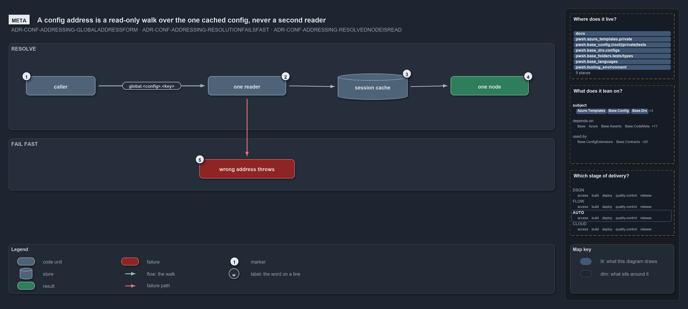

# A config address is a read-only walk over the one cached config, never a second reader

```text
A config address is a read-only walk over the one cached config, never a second reader.

1  caller          code in cats that holds an address as a string
2  one reader      the single way in; it strips the marker and walks the keys
3  session cache   the config the address points into, already loaded once
4  one node        the leaf or subtree the walk ends on: a live reference, to read
5  wrong address   a bad name or a bad key throws at the call, never an empty value

Supports ADR-CONF-ADDRESSING-GLOBALADDRESSFORM, ADR-CONF-ADDRESSING-RESOLUTIONFAILSFAST
and ADR-CONF-ADDRESSING-RESOLVEDNODEISREAD (meta lens).
```

A global config address is a config value with a name that can be written down: `global.<config>.<key>`, the by-reference form of one node
inside a named config. Cats resolves it without adding a second way to read configuration. The address is a walk over a config that the one
reader has already loaded and cached, so the value a caller gets back is the cached config's own node, read-only, and a wrong address throws
at the call that made it.

```yml drawio
description:
  "A global config address is a read-only walk over the one config the reader has already loaded and cached: the caller's string goes
  through the one reader to the cached node, and a wrong address throws at the call."
about:
  rules: [ADR-CONF-ADDRESSING-GLOBALADDRESSFORM, ADR-CONF-ADDRESSING-RESOLUTIONFAILSFAST, ADR-CONF-ADDRESSING-RESOLVEDNODEISREAD]
  lens: meta
content:
  title: A config address is a read-only walk over the one cached config, never a second reader
  kind: explanation
  flow: left-to-right
  theme: dark
  bands:
    - { id: band-resolve, label: RESOLVE }
    - { id: band-fail, label: FAIL FAST }
  glyphs:
    - { id: g-caller, kind: code, label: caller, in: band-resolve }
    - { id: g-reader, kind: code, label: one reader, in: band-resolve }
    - { id: s-cache, kind: store, label: session cache, in: band-resolve }
    - { id: r-node, kind: result, label: one node, in: band-resolve }
    - { id: f-wrong, kind: failure, label: wrong address throws, in: band-fail }
  edges:
    - { from: g-caller, to: g-reader, kind: flow, label: calls }
    - { from: g-reader, to: s-cache, kind: flow, label: "" }
    - { from: s-cache, to: r-node, kind: flow, label: "" }
    - { from: g-reader, to: f-wrong, kind: fail, label: "" }
  markers:
    - { at: g-caller, number: 1 }
    - { at: g-reader, number: 2 }
    - { at: s-cache, number: 3 }
    - { at: r-node, number: 4 }
    - { at: f-wrong, number: 5 }
  legend: auto
  minimaps: [code-locations, module-neighbourhood, axis]
layout:
  band-resolve: { x: 20, y: 84, w: 1260, h: 200 }
  band-fail: { x: 20, y: 304, w: 1260, h: 120 }
  g-caller: { x: 60, y: 160, w: 160, h: 44 }
  g-reader: { x: 480, y: 160, w: 180, h: 44 }
  s-cache: { x: 780, y: 154, w: 160, h: 60 }
  r-node: { x: 1040, y: 160, w: 180, h: 44 }
  f-wrong: { x: 460, y: 352, w: 220, h: 44 }
```



## Walkthrough

1. **Caller.** A caller is code in cats that holds an address as a string: `global.`, then the config's global name, then the keys to walk,
   in order. The key path is optional, so `global.<config>` names the whole config. The address is data; it can sit in a committed config
   file and be dereferenced where a value is wanted.
2. **One reader.** There is one way to resolve an address, and it is built on the one config reader. It strips the `global.` marker, asks
   the reader for the named config, and walks the remaining keys. It opens no file and keeps no cache of its own.
3. **Session cache.** The config the address points into is the one the reader loaded and cached for the session. Resolving an address never
   reads a file again; the walk starts from the cached object, and that object is the same on every call.
4. **One node.** The walk ends on exactly one node: a leaf value or a subtree. It may be a live reference into the cached config, so the
   caller reads it and never changes it; a write through it would change the config every later reader sees.
5. **Wrong address.** A config name no module ships, a name several modules ship, or a key that is neither a dictionary key nor a property
   throws, naming the address and the failing segment. A malformed address is rejected before the walk starts. Nothing returns an empty
   value for a wrong path.

## Why it holds

- An address names exactly one node and is resolved on top of the one config reader, so addressing is a walk over an already-loaded config,
  never a second reader (ADR-CONF-ADDRESSING-GLOBALADDRESSFORM).
- Resolution fails fast: an unknown or ambiguous name throws, a bad segment throws naming the address and the segment, and a malformed
  address is rejected at parameter binding; there is no silent empty value (ADR-CONF-ADDRESSING-RESOLUTIONFAILSFAST).
- A resolved node is a read. It may be a live reference into the config cache and must never be mutated
  (ADR-CONF-ADDRESSING-RESOLVEDNODEISREAD).

## Where the code and the decision record differ

The loading record says only `Get-Config` is public, while the addressing record makes `Get-ConfigValue` public as well, and it is.

## See also

- [Config value addressing](../../drs/configuration/config-value-addressing.md) — the decision this article explains.
- The other lenses on the same walk: [architecture](callers-in-four-modules-share-one-resolver.md),
  [implementation](strip-split-walk-every-wrong-turn-throws.md), [operations](how-a-config-address-becomes-a-value.md) and
  [governance](two-test-files-check-the-address-rules.md).
- [The configuration explanations](index.md) · [How to read the diagrams](../index.md#how-to-read-the-diagrams)
