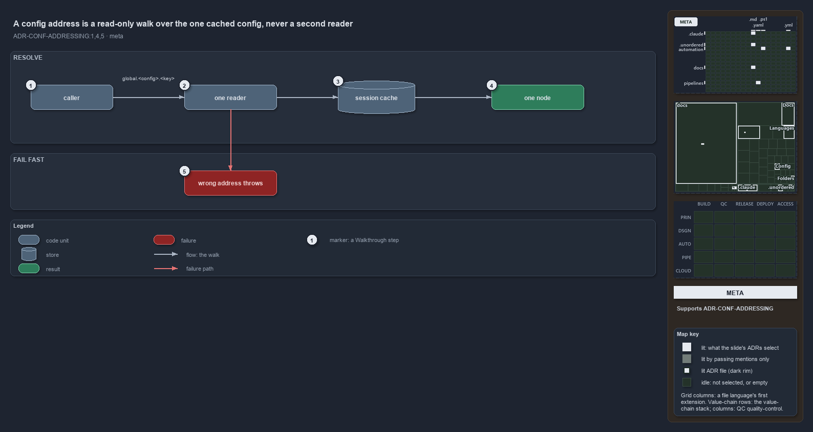

---
catzc:
  derived:
    path: docs/explanation/configuration/an-address-is-a-read-only-walk.md
    folder: docs/explanation/configuration
    name: an-address-is-a-read-only-walk
    filetype: md
    kind: explanation
    language: markdown
    track: docs
    body_sha: "54bd6341713f"
    adrs:
      - ADR-CONF-ADDRESSING#{1,4,5}
    links:
      - docs/.assets/explanation/adr-conf-addressing--an-address-is-a-read-only-walk--meta.drawio.md
      - docs/.assets/explanation/adr-conf-addressing--an-address-is-a-read-only-walk--meta.drawio.png
      - docs/adr/configuration/config-value-addressing.md
      - docs/explanation/configuration/callers-in-four-modules-share-one-resolver.md
      - docs/explanation/configuration/index.md
      - docs/explanation/configuration/strip-split-walk-every-wrong-turn-throws.md
      - docs/explanation/configuration/two-test-files-check-the-address-rules.md
      - docs/explanation/configuration/type-an-address-get-the-value.md
      - docs/explanation/index.md#how-to-read-the-diagrams
---

# A config address is a read-only walk over the one cached config, never a second reader

```text
A config address is a read-only walk over the one cached config, never a second reader.

1  caller          code in cats that holds an address as a string
2  one reader      the single way in; it strips the marker and walks the keys
3  session cache   the config the address points into, already loaded once
4  one node        the leaf or subtree the walk ends on: a live reference, to read
5  wrong address   a bad name or a bad key throws at the call, never an empty value

Supports ADR-CONF-ADDRESSING#1, #4 and #5 (meta lens).
```

A global config address is a config value with a name that can be written down: `global.<config>.<key>`, the by-reference form of one node
inside a named config. Cats resolves it without adding a second way to read configuration. The address is a walk over a config that the one
reader has already loaded and cached, so the value a caller gets back is the cached config's own node, read-only, and a wrong address throws
at the call that made it.



The diagram is described element by element in
[its asset description](../../.assets/explanation/adr-conf-addressing--an-address-is-a-read-only-walk--meta.drawio.md).

## Walkthrough

1. **Caller.** A caller is code in cats that holds an address as a string: `global.`, then the config's global name, then the keys to walk,
   in order. The key path is optional, so `global.<config>` names the whole config. The address is data; it can sit in a committed config
   file and be dereferenced where a value is wanted.
2. **One reader.** There is one way to resolve an address, and it is built on the one config reader. It strips the `global.` marker, asks
   the reader for the named config, and walks the remaining keys. It opens no file and keeps no cache of its own.
3. **Session cache.** The config the address points into is the one the reader loaded and cached for the session. Resolving an address never
   reads a file again; the walk starts from the cached object, and that object is the same on every call.
4. **One node.** The walk ends on exactly one node: a leaf value or a subtree. It may be a live reference into the cached config, so the
   caller reads it and never changes it; a write through it would change the config every later reader sees.
5. **Wrong address.** A config name no module ships, a name several modules ship, or a key that is neither a dictionary key nor a property
   throws, naming the address and the failing segment. A malformed address is rejected before the walk starts. Nothing returns an empty
   value for a wrong path.

## Why it holds

- An address names exactly one node and is resolved on top of the one config reader, so addressing is a walk over an already-loaded config,
  never a second reader (ADR-CONF-ADDRESSING#1).
- Resolution fails fast: an unknown or ambiguous name throws, a bad segment throws naming the address and the segment, and a malformed
  address is rejected at parameter binding; there is no silent empty value (ADR-CONF-ADDRESSING#4).
- A resolved node is a read. It may be a live reference into the config cache and must never be mutated (ADR-CONF-ADDRESSING#5).

## Where the code and the ADR differ

- The loading ADR says only `Get-Config` is public, while the addressing ADR makes `Get-ConfigValue` public as well, and it is.
- The help text of `Get-ConfigValue` cites the addressing ADR by its file name and a stale short code, not by `ADR-CONF-ADDRESSING`.

## See also

- [Config value addressing](../../adr/configuration/config-value-addressing.md) — the decision this article explains.
- The other lenses on the same walk: [architecture](callers-in-four-modules-share-one-resolver.md),
  [implementation](strip-split-walk-every-wrong-turn-throws.md), [operations](type-an-address-get-the-value.md) and
  [governance](two-test-files-check-the-address-rules.md).
- [The configuration explanations](index.md) · [How to read the diagrams](../index.md#how-to-read-the-diagrams)
