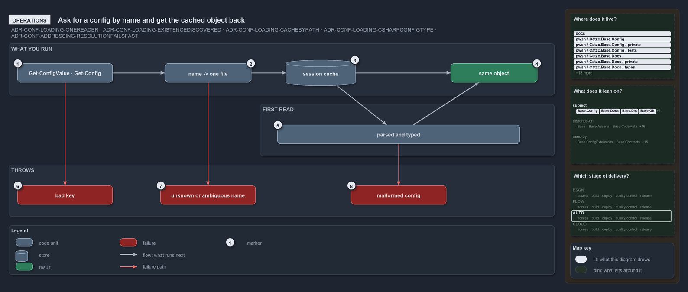

# Ask for a config by name and get the cached object back

```text
Ask for a config by name and get the cached object back; every mistake throws at the call.

1  Get-ConfigValue, Get-Config   the commands you type, by address or by name
2  name -> one file              the name resolves to one file in its owning module
3  session cache                 lasts for the session; a hit prints nothing
4  same object                   the same object on every call, to read, never to change
5  parsed and typed              the first read parses the file and builds its type
6  bad key                       an address segment that resolves to nothing throws
7  unknown or ambiguous name     a name no module ships, or several ship, throws
8  malformed config              a config its type rejects throws every violation

Supports ADR-CONF-LOADING-ONEREADER, ADR-CONF-LOADING-EXISTENCEDISCOVERED, ADR-CONF-LOADING-CACHEBYPATH and ADR-CONF-LOADING-CSHARPCONFIGTYPE, and ADR-CONF-ADDRESSING-RESOLUTIONFAILSFAST (operations lens).
```

The two config commands, `Get-ConfigValue` and `Get-Config`, are how a person or a pipeline step reads cats configuration: by an address
into a config, or by the config's name. The answer is the cached object for the session: nothing prints on a cache hit, the first read
parses and types the file, and every mistake throws at the call that made it, with a message that names the problem.



## Walkthrough

1. **Get-ConfigValue and Get-Config.** These are the commands you type: for example `Get-ConfigValue 'global.tools.cspell.version'` for one
   value, `Get-Config -Config ado` for a whole config, or `Get-Config -Config glossary -ListOwners` to list every module that ships a shared
   name.
2. **name to one file.** The name resolves to one file in its owning module. When several modules ship the name, `-Module` picks one.
3. **session cache.** The cache lasts for the session, and a hit prints nothing. After you change a `configs/*.yml` file, re-run
   `. ./importer.ps1`: only a re-import clears the cache.
4. **same object.** You get the same object on every call. Read it, never change it, because every later reader shares it.
5. **parsed and typed.** The first read of a config parses the file and builds its type. With `-Verbose` it prints
   `Loaded config '<name>' from: <path>`.
6. **bad key.** A key that does not exist throws `Config address '…': key '<k>' does not exist in the config node.`, or names a missing
   property or a null node instead. A malformed address is rejected earlier, when the command binds its parameters.
7. **unknown or ambiguous name.** A name no module ships throws `No config '<name>' found in any module's configs/ folder.`; a name the
   given module does not ship throws `No config '<name>' in module '<module>'.`; and a shared name without `-Module` throws
   `Config '<name>' exists in multiple modules (…) — pass -Module to disambiguate.`
8. **malformed config.** A config its type rejects throws the type's `ArgumentException`, for example `globs config validation failed:`
   followed by every violation. In every test run, `Test-ShippedConfigs` loads every shipped config and writes its report to
   `out/test-shipped-configs/`.

## Why it holds

- All config reads go through `Get-Config` (ADR-CONF-LOADING-ONEREADER).
- The name is global and the owner is discovered; `-Module` only disambiguates, and `-ListOwners` lists the owners
  (ADR-CONF-LOADING-EXISTENCEDISCOVERED).
- The parsed config is cached for the session, and only a re-import clears it (ADR-CONF-LOADING-CACHEBYPATH).
- The C# type validates on the first read and reports every violation in one exception (ADR-CONF-LOADING-CSHARPCONFIGTYPE).
- Resolution fails fast: a wrong name, a wrong key or a malformed address throws, never a silent empty value
  (ADR-CONF-ADDRESSING-RESOLUTIONFAILSFAST).

## Where the code and the decision record differ

The ADR says a config type reports every violation in one exception. `GlobsConfig` throws on a missing `globsets` map before it collects the
other violations.

## See also

- [Module config loading](../../drs/configuration/module-config-loading.md) — the decision this article explains, and
  [config value addressing](../../drs/configuration/config-value-addressing.md) for the address rules.
- The other lenses on the same read path: [meta](one-reader-one-cache-per-session.md),
  [architecture](callers-depend-on-one-config-module.md), [implementation](three-caches-back-one-reader.md) and
  [governance](one-gate-guards-the-read-path.md).
- [The configuration explanations](index.md) · [How to read the diagrams](../index.md#how-to-read-the-diagrams)
