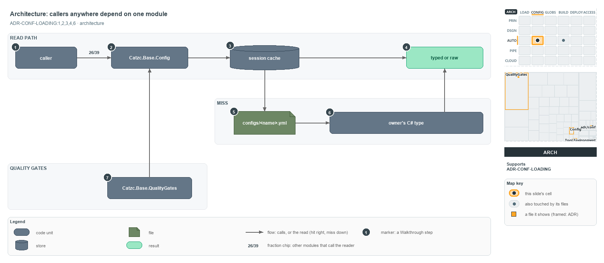

# docs/explanation/configuration/callers-depend-on-one-config-module.md

`Callers in any module read config through one module`

```text
Callers in any module depend on one config module; the owner only ships a file and a type.

1  caller                    any function in any module; 26 of the 39 other modules read config
2  Catzc.Base.Config         the reader module: Get-Config and Get-ConfigValue
3  session cache             looked up by resolved file path; a hit returns at once
4  typed or raw              the typed object, or the raw ordered dictionary when unregistered
5  configs/<name>.yml        the owning module's file, discovered from where it lives
6  owner's C# type           built once on the miss; its constructor maps and validates
7  Catzc.Base.QualityGates   its gate Test-ShippedConfigs calls the same reader

Supports ADR-CONF-LOADING#1, #2, #3, #4 and #6 (architecture lens).
```

A config belongs to the module that ships it, but the code that reads it can live anywhere in cats. The architecture keeps those two apart:
every caller depends on one module, `Catzc.Base.Config`, and the owning module only ships a file and a C# type. The owner is discovered from
where the file lives, never wrapped, and reading a config is global access with no dependency guard.



The diagram is described element by element in
[its asset description](../../.assets/explanation/adr-conf-loading--callers-depend-on-one-config-module--architecture.drawio.md).

## Walkthrough

1. **caller.** A caller is any function in any module. Outside their tests, 26 of the 39 other modules call `Get-Config` or
   `Get-ConfigValue`, among them `Write-EnvironmentSet` and `Test-GeneratedFiles`.
2. **Catzc.Base.Config.** The reader module has two public functions, `Get-Config` and `Get-ConfigValue`. `Get-ConfigValue` walks an address
   into a config that `Get-Config` returns, so only `Get-Config` ever reads a file.
3. **session cache.** The reader looks up the config by its resolved file path. A hit returns the cached object straight away; a miss goes
   down to the file.
4. **typed or raw.** The caller gets the typed object, or the raw ordered dictionary when no type is registered for the name, such as a test
   fixture.
5. **configs/&lt;name&gt;.yml.** The owning module's file. The reader finds it by scanning the modules' `configs/` folders for the name, so
   the owner is discovered, not declared. `-Module` only picks between owners that ship the same name, as the six owners of `glossary` do.
6. **owner's C# type.** The config's C# type lives in the owning module's `types/` and is bound to the name by `configs.yml` in
   `Catzc.Base.Config`, which registers 43 names. The reader builds it once, on the miss, and the constructor maps and validates.
7. **Catzc.Base.QualityGates.** Its gate `Test-ShippedConfigs` calls the same reader for every shipped config, so the gate checks the read
   exactly as callers use it.

## Why it holds

- All config reads go through `Get-Config`; no function re-reads a config file or keeps its own config cache (ADR-CONF-LOADING#1).
- A config's existence is discovered from its folder, and a name is global; `-Module` only disambiguates (ADR-CONF-LOADING#2).
- The parsed config is cached by its resolved file path for the session (ADR-CONF-LOADING#3).
- Every shipped config has a C# config type registered in `configs.yml`, and `Test-ShippedConfigs` is its gate (ADR-CONF-LOADING#4).
- Reading a config is global access, never guarded by dependencies (ADR-CONF-LOADING#6).

## Where the code and the ADR differ

The ADR says discovery scans `automation/*/configs/`. The code scans the loaded code root, `Get-CatzcModulesRoot`, which is the source
`automation/` folder or a built package, and skips dot-folders.

The ADR says only `Get-Config` is public. `Catzc.Base.Config` also exports `Get-ConfigValue`, which the addressing ADR sanctions and which
reads no file itself.

## See also

- [Module config loading](../../adr/configuration/module-config-loading.md) — the decision this article explains.
- The other lenses on the same read path: [meta](one-reader-one-cache-per-session.md), [implementation](three-caches-back-one-reader.md),
  [operations](ask-by-name-get-the-cached-object.md) and [governance](one-gate-guards-the-read-path.md).
- [The configuration explanations](index.md) · [How to read the diagrams](../index.md#how-to-read-the-diagrams)
