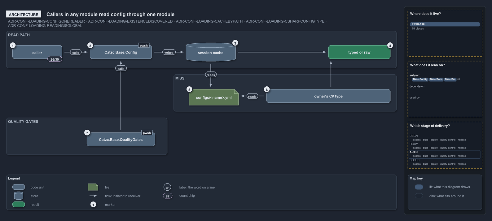

# Callers in any module read config through one module

```text
Callers in any module depend on one config module; the owner only ships a file and a type.

1  caller                    any function in any module; 26 of the 39 other modules read config
2  Catzc.Base.Config         the reader module: Get-Config and Get-ConfigValue
3  session cache             looked up by resolved file path; a hit returns at once
4  typed or raw              the typed object, or the raw ordered dictionary when unregistered
5  configs/<name>.yml        the owning module's file, discovered from where it lives
6  owner's C# type           built once on the miss; its constructor maps and validates
7  Catzc.Base.QualityGates   its gate Test-ShippedConfigs calls the same reader

Supports ADR-CONF-LOADING-CONFIGONEREADER, ADR-CONF-LOADING-EXISTENCEDISCOVERED, ADR-CONF-LOADING-CACHEBYPATH,
ADR-CONF-LOADING-CSHARPCONFIGTYPE and ADR-CONF-LOADING-READINGISGLOBAL (architecture lens).
```

A config belongs to the module that ships it, but the code that reads it can live anywhere in cats. The architecture keeps those two apart:
every caller depends on one module, `Catzc.Base.Config`, and the owning module only ships a file and a C# type. The owner is discovered from
where the file lives, never wrapped, and reading a config is global access with no dependency guard.

```yml drawio
description:
  Every caller in any module reads config through the one reader module, which looks the file up in the session cache and, on a miss, builds
  the owning module's C# type from the file it ships; the quality gate calls the same reader.
about:
  rules:
    - ADR-CONF-LOADING-CONFIGONEREADER
    - ADR-CONF-LOADING-EXISTENCEDISCOVERED
    - ADR-CONF-LOADING-CACHEBYPATH
    - ADR-CONF-LOADING-CSHARPCONFIGTYPE
    - ADR-CONF-LOADING-READINGISGLOBAL
  lens: architecture
content:
  title: Callers in any module read config through one module
  kind: explanation
  flow: left-to-right
  theme: dark
  bands:
    - { id: band-read, label: READ PATH }
    - { id: band-miss, label: MISS }
    - { id: band-gates, label: QUALITY GATES }
  glyphs:
    - { id: g-caller, kind: code, label: caller, in: band-read }
    - { id: g-config, kind: code, label: Catzc.Base.Config, in: band-read }
    - { id: s-cache, kind: store, label: session cache, in: band-read }
    - { id: r-typed, kind: result, label: typed or raw, in: band-read }
    - { id: g-file, kind: file, label: configs/<name>.yml, in: band-miss }
    - { id: g-type, kind: code, label: owner's C# type, in: band-miss }
    - { id: g-gates, kind: code, label: Catzc.Base.QualityGates, in: band-gates }
  edges:
    - { from: g-caller, to: g-config, kind: flow, label: calls }
    - { from: g-config, to: s-cache, kind: flow, label: "" }
    - { from: s-cache, to: r-typed, kind: flow, label: "" }
    - { from: s-cache, to: g-file, kind: flow, label: reads }
    - { from: g-type, to: g-file, kind: flow, label: reads }
    - { from: g-type, to: r-typed, kind: flow, label: "" }
    - { from: g-gates, to: g-config, kind: flow, label: calls }
  markers:
    - { at: g-caller, number: 1 }
    - { at: g-config, number: 2 }
    - { at: s-cache, number: 3 }
    - { at: r-typed, number: 4 }
    - { at: g-file, number: 5 }
    - { at: g-type, number: 6 }
    - { at: g-gates, number: 7 }
  chips:
    - { at: g-caller, kind: count, text: 26/39 }
  legend: auto
  minimaps: [code-locations, module-neighbourhood, axis]
layout:
  band-read: { x: 20, y: 84, w: 1260, h: 120 }
  band-miss: { x: 560, y: 224, w: 720, h: 120 }
  band-gates: { x: 20, y: 364, w: 520, h: 120 }
  g-caller: { x: 40, y: 130, w: 160, h: 44 }
  g-config: { x: 290, y: 130, w: 200, h: 44 }
  s-cache: { x: 600, y: 122, w: 160, h: 60 }
  r-typed: { x: 1060, y: 130, w: 200, h: 44 }
  g-file: { x: 610, y: 272, w: 160, h: 52 }
  g-type: { x: 860, y: 272, w: 400, h: 44 }
  g-gates: { x: 280, y: 412, w: 220, h: 44 }
```



## Walkthrough

1. **caller.** A caller is any function in any module. Outside their tests, 26 of the 39 other modules call `Get-Config` or
   `Get-ConfigValue`, among them `Write-EnvironmentSet` and `Test-GeneratedFiles`.
2. **Catzc.Base.Config.** The reader module has two public functions, `Get-Config` and `Get-ConfigValue`. `Get-ConfigValue` walks an address
   into a config that `Get-Config` returns, so only `Get-Config` ever reads a file.
3. **session cache.** The reader looks up the config by its resolved file path. A hit returns the cached object straight away; a miss goes
   down to the file.
4. **typed or raw.** The caller gets the typed object, or the raw ordered dictionary when no type is registered for the name, such as a test
   fixture.
5. **configs/&lt;name&gt;.yml.** The owning module's file. The reader finds it by scanning the modules' `configs/` folders for the name, so
   the owner is discovered, not declared. `-Module` only picks between owners that ship the same name, as the six owners of `glossary` do.
6. **owner's C# type.** The config's C# type lives in the owning module's `types/` and is bound to the name by `configs.yml` in
   `Catzc.Base.Config`, which registers 43 names. The reader builds it once, on the miss, and the constructor maps and validates.
7. **Catzc.Base.QualityGates.** Its gate `Test-ShippedConfigs` calls the same reader for every shipped config, so the gate checks the read
   exactly as callers use it.

## Why it holds

- All config reads go through `Get-Config`; no function re-reads a config file or keeps its own config cache
  (ADR-CONF-LOADING-CONFIGONEREADER).
- A config's existence is discovered from its folder, and a name is global; `-Module` only disambiguates
  (ADR-CONF-LOADING-EXISTENCEDISCOVERED).
- The parsed config is cached by its resolved file path for the session (ADR-CONF-LOADING-CACHEBYPATH).
- Every shipped config has a C# config type registered in `configs.yml`, and `Test-ShippedConfigs` is its gate
  (ADR-CONF-LOADING-CSHARPCONFIGTYPE).
- Reading a config is global access, never guarded by dependencies (ADR-CONF-LOADING-READINGISGLOBAL).

## Where the code and the decision record differ

The record says discovery scans `pwsh/*/configs/`. The code scans the loaded code root, `Get-CatzcModulesRoot`, which is the source `pwsh/`
folder or a built package, and skips dot-folders.

The record says only `Get-Config` is public. `Catzc.Base.Config` also exports `Get-ConfigValue`, which the addressing record sanctions and
which reads no file itself.

## See also

- [Module config loading](../../drs/configuration/module-config-loading.md) — the decision this article explains.
- The other lenses on the same read path: [meta](one-reader-one-cache-per-session.md), [implementation](three-caches-back-one-reader.md),
  [operations](ask-by-name-get-the-cached-object.md) and [governance](one-gate-guards-the-read-path.md).
- [The configuration explanations](index.md) · [How to read the diagrams](../index.md#how-to-read-the-diagrams)
