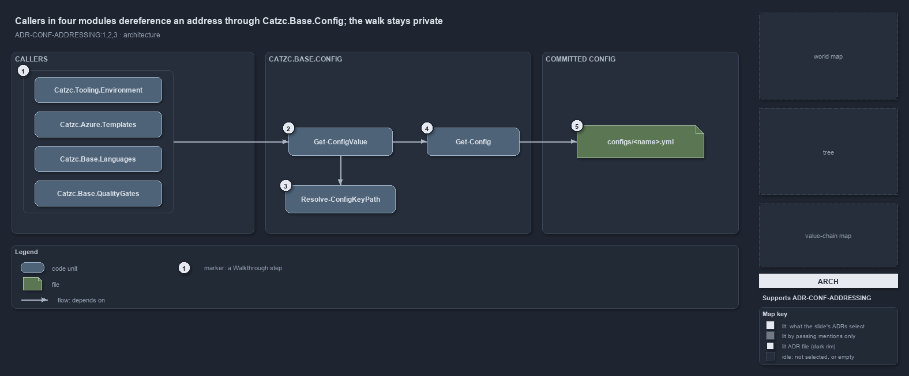

---
catzc:
  derived:
    path: docs/explanation/configuration/callers-in-four-modules-share-one-resolver.md
    kind: explanation
    language: markdown
    filetype: md
    track: docs
    body_sha: "0851cc5cff01"
    adrs:
      - ADR-CONF-ADDRESSING#{1-3}
    links:
      - docs/.assets/explanation/adr-conf-addressing--callers-in-four-modules-share-one-resolver--architecture.drawio.md
      - docs/.assets/explanation/adr-conf-addressing--callers-in-four-modules-share-one-resolver--architecture.drawio.png
      - docs/adr/configuration/config-value-addressing.md
      - docs/explanation/configuration/an-address-is-a-read-only-walk.md
      - docs/explanation/configuration/index.md
      - docs/explanation/configuration/strip-split-walk-every-wrong-turn-throws.md
      - docs/explanation/configuration/two-test-files-check-the-address-rules.md
      - docs/explanation/configuration/type-an-address-get-the-value.md
      - docs/explanation/index.md#how-to-read-the-diagrams
---

# Callers in four modules dereference an address through Catzc.Base.Config; the walk stays private

```text
Callers in four modules dereference an address through Catzc.Base.Config; the walk stays private.

1  callers                  four modules hold addresses and hand them to Catzc.Base.Config
2  Get-ConfigValue          the public resolver: strip the marker, read the config, walk the keys
3  Resolve-ConfigKeyPath    the private walk, one segment at a time
4  Get-Config               the one reader the resolver is built on
5  configs/<name>.yml       the committed file the reader opens; all an address can reach

Supports ADR-CONF-ADDRESSING#1, #2 and #3 (architecture lens).
```

A global config address can be held by code in any module, but only one module knows how to dereference it. `Catzc.Base.Config` exports the
resolver, `Get-ConfigValue`, keeps the key walk private, and builds the resolver on its own reader, `Get-Config`. Four modules hold
addresses today, and every one of them depends on the same module and the same public pair, while the only file an address can reach is a
committed `configs/<name>.yml` in the module that ships it.



The diagram is described element by element in
[its asset description](../../.assets/explanation/adr-conf-addressing--callers-in-four-modules-share-one-resolver--architecture.drawio.md).

## Walkthrough

1. **Callers.** Four modules dereference addresses. `Catzc.Tooling.Environment` resolves the `global.…` entries of `Write-EnvironmentSet`'s
   `-Set` map; `Catzc.Azure.Templates` resolves the `{ address: … }` parameters of a template config in `Resolve-BicepParameterAddresses`,
   which `Build-Bicep` runs for every slot; `Catzc.Base.Languages` reads the Go and Python tool pins in `New-GoWorkspace` and
   `New-PythonProject`; and `Catzc.Base.QualityGates` reads the cspell pin in `Test-GeneratedFiles`. Each holds the address as a string and
   depends on `Catzc.Base.Config` for its value.
2. **Get-ConfigValue.** The public resolver. It takes `-Address` and an optional `-Module`, strips the `global.` marker, splits the rest
   into the config's global name and the key path, reads the named config through `Get-Config`, and hands the node and the keys to the walk.
   It opens no file and caches nothing.
3. **Resolve-ConfigKeyPath.** The walk lives in one private function so the resolver stays a thin strip-split-walk and the walk can be
   tested on its own. For each segment it resolves a dictionary key when the node is a dictionary, otherwise a property, so a typed C#
   config and a raw ordered dictionary traverse the same way.
4. **Get-Config.** The one config reader, the same one every direct config read uses. It discovers the owning module from the name alone, so
   `-Module` is only for the rare name two modules ship, and it returns the same cached object on every call.
5. **configs/&lt;name&gt;.yml.** The only file the reader opens is the owning module's committed config file, discovered by scanning the
   modules' `configs/` folders. Everything an address can name lives in git, so nothing addressable is a secret; a secret reaches
   `Write-EnvironmentSet` as a `[SecureString]` and never as an address.

## Why it holds

- `Get-ConfigValue` is public in `Catzc.Base.Config` and built on `Get-Config`, so addressing adds a grammar and a walk on top of the one
  reader and the one cache, never a second reader (ADR-CONF-ADDRESSING#1).
- The first segment after `global.` is the config's global name and the owning module is discovered, not written into the address; each
  following segment resolves as a dictionary key, otherwise as a property (ADR-CONF-ADDRESSING#2).
- An address references only version-controlled config, so anything addressable is non-secret, and secrets travel out of band as a
  `[SecureString]` through the one sanctioned seam (ADR-CONF-ADDRESSING#3).

## Where the code and the ADR differ

- The loading ADR says only `Get-Config` is public, while the addressing ADR makes `Get-ConfigValue` public as well, and it is.
- The help texts of `Get-ConfigValue`, `Resolve-ConfigKeyPath` and `Write-EnvironmentSet` cite the addressing ADR by its file name, not by
  `ADR-CONF-ADDRESSING`.

## See also

- [Config value addressing](../../adr/configuration/config-value-addressing.md) — the decision this article explains.
- The other lenses on the same walk: [meta](an-address-is-a-read-only-walk.md),
  [implementation](strip-split-walk-every-wrong-turn-throws.md), [operations](type-an-address-get-the-value.md) and
  [governance](two-test-files-check-the-address-rules.md).
- [The configuration explanations](index.md) · [How to read the diagrams](../index.md#how-to-read-the-diagrams)
