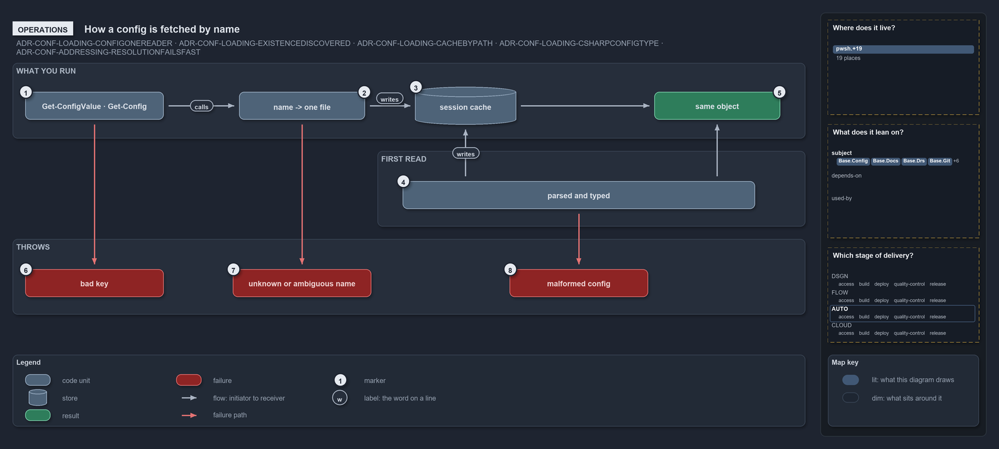

# How a config is fetched by name

```text
How a config is fetched by name.

1  Get-ConfigValue, Get-Config   the commands you type, by address or by name
2  name -> one file              the name resolves to one file in its owning module
3  session cache                 lasts for the session; a hit prints nothing
4  parsed and typed              the first read parses the file and builds its type
5  same object                   the same object on every call, to read, never to change
6  bad key                       an address segment that resolves to nothing throws
7  unknown or ambiguous name     a name no module ships, or several ship, throws
8  malformed config              a config its type rejects throws every violation

Supports ADR-CONF-LOADING-CONFIGONEREADER, ADR-CONF-LOADING-EXISTENCEDISCOVERED, ADR-CONF-LOADING-CACHEBYPATH
and ADR-CONF-LOADING-CSHARPCONFIGTYPE, and ADR-CONF-ADDRESSING-RESOLUTIONFAILSFAST (operations lens).
```

The two config commands, `Get-ConfigValue` and `Get-Config`, are how a person or a pipeline step reads cats configuration: by an address
into a config, or by the config's name. The answer is the cached object for the session: nothing prints on a cache hit, the first read
parses and types the file, and every mistake throws at the call that made it, with a message that names the problem.

```yml drawio
description:
  Get-ConfigValue and Get-Config resolve a name to one file and answer with the session's cached object; the first read parses and types the
  file, and a bad key, an unknown or ambiguous name or a malformed config throws at the call.
about:
  rules:
    - ADR-CONF-LOADING-CONFIGONEREADER
    - ADR-CONF-LOADING-EXISTENCEDISCOVERED
    - ADR-CONF-LOADING-CACHEBYPATH
    - ADR-CONF-LOADING-CSHARPCONFIGTYPE
    - ADR-CONF-ADDRESSING-RESOLUTIONFAILSFAST
  lens: operations
content:
  title: How a config is fetched by name
  kind: explanation
  flow: left-to-right
  theme: dark
  bands:
    - { id: band-run, label: WHAT YOU RUN }
    - { id: band-first, label: FIRST READ }
    - { id: band-throws, label: THROWS }
  glyphs:
    - { id: g-commands, kind: code, label: Get-ConfigValue · Get-Config, in: band-run }
    - { id: g-resolve, kind: code, label: name -> one file, in: band-run }
    - { id: s-cache, kind: store, label: session cache, in: band-run }
    - { id: r-same, kind: result, label: same object, in: band-run }
    - { id: g-parsed, kind: code, label: parsed and typed, in: band-first }
    - { id: f-bad-key, kind: failure, label: bad key, in: band-throws }
    - { id: f-unknown, kind: failure, label: unknown or ambiguous name, in: band-throws }
    - { id: f-malformed, kind: failure, label: malformed config, in: band-throws }
  edges:
    - { from: g-commands, to: g-resolve, kind: flow, label: calls }
    - { from: g-resolve, to: s-cache, kind: flow, label: "" }
    - { from: s-cache, to: r-same, kind: flow, label: "" }
    - { from: g-parsed, to: s-cache, kind: flow, label: writes }
    - { from: g-parsed, to: r-same, kind: flow, label: "" }
    - { from: g-commands, to: f-bad-key, kind: fail, label: "" }
    - { from: g-resolve, to: f-unknown, kind: fail, label: "" }
    - { from: g-parsed, to: f-malformed, kind: fail, label: "" }
  markers:
    - { at: g-commands, number: 1 }
    - { at: g-resolve, number: 2 }
    - { at: s-cache, number: 3 }
    - { at: g-parsed, number: 4 }
    - { at: r-same, number: 5 }
    - { at: f-bad-key, number: 6 }
    - { at: f-unknown, number: 7 }
    - { at: f-malformed, number: 8 }
  legend: auto
  minimaps: [code-locations, module-neighbourhood, axis]
layout:
  band-run: { x: 20, y: 84, w: 1260, h: 120 }
  band-first: { x: 600, y: 224, w: 680, h: 120 }
  band-throws: { x: 20, y: 364, w: 1260, h: 120 }
  g-commands: { x: 40, y: 130, w: 220, h: 44 }
  g-resolve: { x: 380, y: 130, w: 200, h: 44 }
  s-cache: { x: 660, y: 122, w: 160, h: 60 }
  r-same: { x: 1040, y: 130, w: 200, h: 44 }
  g-parsed: { x: 640, y: 272, w: 560, h: 44 }
  f-bad-key: { x: 40, y: 412, w: 220, h: 44 }
  f-unknown: { x: 370, y: 412, w: 220, h: 44 }
  f-malformed: { x: 810, y: 412, w: 220, h: 44 }
```



## Walkthrough

1. **Get-ConfigValue and Get-Config.** These are the commands you type: for example `Get-ConfigValue 'global.tools.cspell.version'` for one
   value, `Get-Config -Config ado` for a whole config, or `Get-Config -Config glossary -ListOwners` to list every module that ships a shared
   name.
2. **name to one file.** The name resolves to one file in its owning module. When several modules ship the name, `-Module` picks one.
3. **session cache.** The cache lasts for the session, and a hit prints nothing. After you change a `configs/*.yml` file, re-run
   `. ./importer.ps1`: only a re-import clears the cache.
4. **parsed and typed.** The first read of a config parses the file and builds its type. With `-Verbose` it prints
   `Loaded config '<name>' from: <path>`.
5. **same object.** You get the same object on every call. Read it, never change it, because every later reader shares it.
6. **bad key.** A key that does not exist throws `Config address '…': key '<k>' does not exist in the config node.`, or names a missing
   property or a null node instead. A malformed address is rejected earlier, when the command binds its parameters.
7. **unknown or ambiguous name.** A name no module ships throws `No config '<name>' found in any module's configs/ folder.`; a name the
   given module does not ship throws `No config '<name>' in module '<module>'.`; and a shared name without `-Module` throws
   `Config '<name>' exists in multiple modules (…) — pass -Module to disambiguate.`
8. **malformed config.** A config its type rejects throws the type's `ArgumentException`, for example `globs config validation failed:`
   followed by every violation. In every test run, `Test-ShippedConfigs` loads every shipped config and writes its report to
   `out/test-shipped-configs/`.

## Why it holds

- All config reads go through `Get-Config` (ADR-CONF-LOADING-CONFIGONEREADER).
- The name is global and the owner is discovered; `-Module` only disambiguates, and `-ListOwners` lists the owners
  (ADR-CONF-LOADING-EXISTENCEDISCOVERED).
- The parsed config is cached for the session, and only a re-import clears it (ADR-CONF-LOADING-CACHEBYPATH).
- The C# type validates on the first read and reports every violation in one exception (ADR-CONF-LOADING-CSHARPCONFIGTYPE).
- Resolution fails fast: a wrong name, a wrong key or a malformed address throws, never a silent empty value
  (ADR-CONF-ADDRESSING-RESOLUTIONFAILSFAST).

## Where the code and the decision record differ

The record says a config type reports every violation in one exception. `GlobsConfig` throws on a missing `globsets` map before it collects
the other violations.

## See also

- [Module config loading](../../drs/configuration/module-config-loading.md) — the decision this article explains, and
  [config value addressing](../../drs/configuration/config-value-addressing.md) for the address rules.
- The other lenses on the same read path: [meta](how-a-config-read-is-cached.md), [architecture](how-callers-in-any-module-read-config.md),
  [implementation](which-caches-back-the-config-reader.md) and [governance](what-guards-the-config-read-path.md).
- [The configuration explanations](index.md) · [How to read the diagrams](../index.md#how-to-read-the-diagrams)
