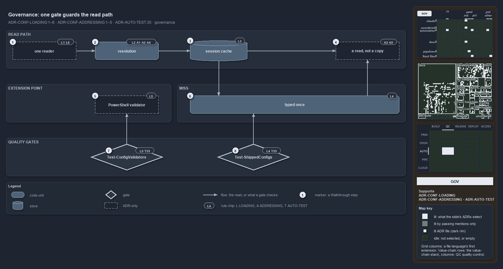

---
catzc:
  immutable:
    with_body_sha: dad908bee111
    repo_status: clean
    path: docs/explanation/configuration/one-gate-guards-the-read-path.md
    folder: docs/explanation/configuration
    name: one-gate-guards-the-read-path
    filetype: md
    kind: explanation
    language: markdown
    track: docs
    tracktype: documentation
  edges:
    cites:
      - ADR-AUTO-TEST#35
      - ADR-CONF-ADDRESSING
      - ADR-CONF-LOADING
    links:
      - docs/adr/automation/test-automation.md
      - docs/adr/configuration/config-value-addressing.md
      - docs/adr/configuration/module-config-loading.md
      - docs/explanation/.assets/adr-conf-loading--one-gate-guards-the-read-path--governance.drawio.png
      - docs/explanation/configuration/ask-by-name-get-the-cached-object.md
      - docs/explanation/configuration/callers-depend-on-one-config-module.md
      - docs/explanation/configuration/index.md
      - docs/explanation/configuration/one-gate-guards-the-read-path.drawio.md
      - docs/explanation/configuration/one-reader-one-cache-per-session.md
      - docs/explanation/configuration/three-caches-back-one-reader.md
      - docs/explanation/index.md#how-to-read-the-diagrams
---

# One quality gate guards the config read path, and it checks only the typed step

```text
One quality gate guards the config read path, and it checks only the typed step.

1  one reader              every read goes through Get-Config (L1, L6); convention only
2  resolution              name discovered, address walked (L2, A1, A2, A4); runtime throws
3  session cache           one cache keyed by file path (L3); held by the code
4  a read, not a copy      a resolved node is never mutated (A3, A5); convention only
5  PowerShell validator    the extension point outside Get-Config (L5); no validator yet
6  typed once              the registered C# type validates the whole config (L4)
7  Test-ConfigValidators   the gate for the extension point (L5, T35)
8  Test-ShippedConfigs     the gate for the typed step (L4, T35)

Supports ADR-CONF-LOADING#1 to #6, ADR-CONF-ADDRESSING#1 to #5 and ADR-AUTO-TEST#35 (governance lens).
```

Three ADRs constrain how cats reads a config: the loading ADR, the addressing ADR, and the test-automation rule that every quality gate runs
in an integrity test. Each stage of the read path carries the rules that govern it, set against what actually checks them. One quality gate,
`Test-ShippedConfigs`, guards the read path, and it looks only at the typed step; the one-reader rule and the read-only rule rest on
convention.



The diagram is described element by element in [its asset description](one-gate-guards-the-read-path.drawio.md). Rule chips name the rules:
`L` is ADR-CONF-LOADING, `A` is ADR-CONF-ADDRESSING and `T` is ADR-AUTO-TEST.

## Walkthrough

1. **one reader.** Every config read goes through `Get-Config`, and only `Get-Config` is public (L1, L6). No analyzer rule or quality gate
   looks for a direct config read, and two functions read config files themselves today: `Get-ConfigRegistry` reads `configs.yml` and keeps
   its own `$script:` cache, and `Test-ConfigIdentityHygiene` parses every module's `configs/*.yml` directly.
2. **resolution.** The name is discovered and the address is walked (L2, A1, A2, A4). Runtime throws check this stage: a `ValidatePattern`
   rejects a malformed address at binding, `Resolve-ConfigEntry` throws on an unknown or ambiguous name, and the key walk throws on a
   segment that is neither a key nor a property.
3. **session cache.** One cache keyed by file path, invalidated only by re-import (L3). The code holds this rule, and an L0 logic test pins
   the same reference on repeat calls.
4. **a read, not a copy.** A resolved node may be a live reference into the cache, and it must never be mutated (A3, A5). Nothing stops a
   caller from changing it; committed config is the only thing an address can reach, so secrets have no address by construction.
5. **PowerShell validator.** The extension point for owners that cannot ship a C# type: `Invoke-ConfigValidator` runs an
   `Assert-<Name>Config` in its owning module's scope (L5). No such validator exists outside test fixtures, and nothing outside its own
   tests calls `Invoke-ConfigValidator`.
6. **typed once.** On the miss, the registered C# type is constructed once and validates the whole config (L4). This is where the read
   path's gate looks.
7. **Test-ConfigValidators.** The gate for the extension point (L5, T35): every `Assert-*Config` must map to a shipped config of its module.
   An L0 integrity test runs it, so it is wired into every test run, but today it has no validator to check.
8. **Test-ShippedConfigs.** The gate for the typed step (L4, T35), run by an L0 integrity test in every test run. It reports a shipped
   config without a type, a registry entry without a shipped config, a type that does not resolve, and a config that does not load, and
   writes its report to `out/test-shipped-configs/`.

## Why it holds

- All config reads go through `Get-Config`, and only `Get-Config` is public (ADR-CONF-LOADING#1, ADR-CONF-LOADING#6).
- A config is discovered from its folder; an unknown or ambiguous name throws (ADR-CONF-LOADING#2).
- The cache is keyed by resolved path and cleared only by re-import (ADR-CONF-LOADING#3).
- Every shipped config has a registered C# type, and `Test-ShippedConfigs` is its gate (ADR-CONF-LOADING#4).
- A PowerShell validator is the extension point outside `Get-Config`, and `Test-ConfigValidators` is its gate (ADR-CONF-LOADING#5).
- An address names one node, its first segment is the config's global name, and resolution fails fast (ADR-CONF-ADDRESSING#1,
  ADR-CONF-ADDRESSING#2, ADR-CONF-ADDRESSING#4).
- Only committed config is addressable, and a resolved node is a read, never mutated (ADR-CONF-ADDRESSING#3, ADR-CONF-ADDRESSING#5).
- Every quality gate runs in an integrity test at its tier (ADR-AUTO-TEST#35).

## Where the code and the ADR differ

- The one-reader rule has two exceptions the ADR does not state: `Get-ConfigRegistry` reads `configs.yml` and caches it itself, and
  `Test-ConfigIdentityHygiene` parses module configs directly.
- The ADR says only `Get-Config` is public; `Catzc.Base.Config` also exports `Get-ConfigValue`, which the addressing ADR sanctions.
- An address key cannot contain a dot, because `Get-ConfigValue` splits the address on every dot; the addressing ADR does not say so.

## See also

- [Module config loading](../../adr/configuration/module-config-loading.md) — the decision this article explains.
- [Config value addressing](../../adr/configuration/config-value-addressing.md) and
  [test automation](../../adr/automation/test-automation.md) — the other rules on the diagram.
- The other lenses on the same read path: [meta](one-reader-one-cache-per-session.md),
  [architecture](callers-depend-on-one-config-module.md), [implementation](three-caches-back-one-reader.md) and
  [operations](ask-by-name-get-the-cached-object.md).
- [The configuration explanations](index.md) · [How to read the diagrams](../index.md#how-to-read-the-diagrams)
