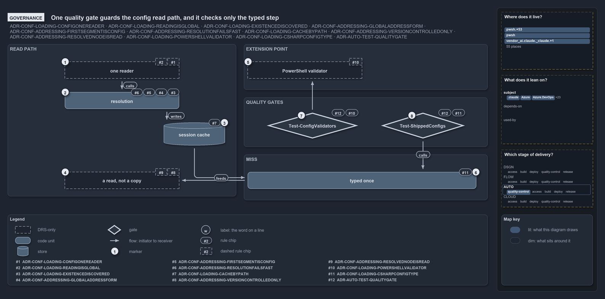

---
catzc:
  edges:
    cites:
      - ADR-AUTO-TEST-QUALITYGATE
      - ADR-CONF-ADDRESSING
      - ADR-CONF-LOADING
---

# One quality gate guards the config read path, and it checks only the typed step

```text
One quality gate guards the config read path, and it checks only the typed step.

1  one reader              every read goes through Get-Config (L1, L6); convention only
2  resolution              name discovered, address walked (L2, A1, A2, A4); runtime throws
3  session cache           one cache keyed by file path (L3); held by the code
4  a read, not a copy      a resolved node is never mutated (A3, A5); convention only
5  PowerShell validator    the extension point outside Get-Config (L5); no validator yet
6  typed once              the registered C# type validates the whole config (L4)
7  Test-ConfigValidators   the gate for the extension point (L5, T35)
8  Test-ShippedConfigs     the gate for the typed step (L4, T35)

Supports ADR-CONF-LOADING-ONEREADER, ADR-CONF-LOADING-READINGISGLOBAL, ADR-CONF-LOADING-EXISTENCEDISCOVERED, ADR-CONF-ADDRESSING-GLOBALADDRESSFORM, ADR-CONF-ADDRESSING-FIRSTSEGMENTISCONFIG, ADR-CONF-ADDRESSING-RESOLUTIONFAILSFAST, ADR-CONF-LOADING-CACHEBYPATH, ADR-CONF-ADDRESSING-VERSIONCONTROLLEDONLY, ADR-CONF-ADDRESSING-RESOLVEDNODEISREAD, ADR-CONF-LOADING-POWERSHELLVALIDATOR, ADR-CONF-LOADING-CSHARPCONFIGTYPE and ADR-AUTO-TEST-QUALITYGATE (governance lens).
```

Three ADRs constrain how cats reads a config: the loading ADR, the addressing ADR, and the test-automation rule that every quality gate runs
in an integrity test. Each stage of the read path carries the rules that govern it, set against what actually checks them. One quality gate,
`Test-ShippedConfigs`, guards the read path, and it looks only at the typed step; the one-reader rule and the read-only rule rest on
convention.

```yml drawio
description:
  "Each stage of the config read path with the rules that govern it and what actually checks them: one quality gate guards the typed step
  and one the validator extension point, while the one-reader and read-only rules rest on convention."
about:
  adrs:
    - ADR-CONF-LOADING-ONEREADER
    - ADR-CONF-LOADING-READINGISGLOBAL
    - ADR-CONF-LOADING-EXISTENCEDISCOVERED
    - ADR-CONF-ADDRESSING-GLOBALADDRESSFORM
    - ADR-CONF-ADDRESSING-FIRSTSEGMENTISCONFIG
    - ADR-CONF-ADDRESSING-RESOLUTIONFAILSFAST
    - ADR-CONF-LOADING-CACHEBYPATH
    - ADR-CONF-ADDRESSING-VERSIONCONTROLLEDONLY
    - ADR-CONF-ADDRESSING-RESOLVEDNODEISREAD
    - ADR-CONF-LOADING-POWERSHELLVALIDATOR
    - ADR-CONF-LOADING-CSHARPCONFIGTYPE
    - ADR-AUTO-TEST-QUALITYGATE
  lens: governance
content:
  title: One quality gate guards the config read path, and it checks only the typed step
  kind: explanation
  flow: left-to-right
  relation: the read, or what a gate checks
  theme: dark
  bands:
    - { id: band-read, label: READ PATH }
    - { id: band-miss, label: MISS }
    - { id: band-extension, label: EXTENSION POINT }
    - { id: band-gates, label: QUALITY GATES }
  glyphs:
    - { id: a-reader, kind: drsonly, label: one reader, in: band-read }
    - { id: g-resolution, kind: code, label: resolution, in: band-read }
    - { id: s-cache, kind: store, label: session cache, in: band-read }
    - { id: a-copy, kind: drsonly, label: "a read, not a copy", in: band-read }
    - { id: g-typed, kind: code, label: typed once, in: band-miss }
    - { id: a-validator, kind: drsonly, label: PowerShell validator, in: band-extension }
    - { id: g-validators, kind: gate, label: Test-ConfigValidators, in: band-gates }
    - { id: g-shipped, kind: gate, label: Test-ShippedConfigs, in: band-gates }
  edges:
    - { from: a-reader, to: g-resolution, kind: flow, label: "" }
    - { from: g-resolution, to: s-cache, kind: flow, label: "" }
    - { from: s-cache, to: g-typed, kind: flow, label: "" }
    - { from: g-typed, to: a-copy, kind: flow, label: "" }
    - { from: g-validators, to: a-validator, kind: flow, label: "" }
    - { from: g-shipped, to: g-typed, kind: flow, label: "" }
  markers:
    - { at: a-reader, number: 1 }
    - { at: g-resolution, number: 2 }
    - { at: s-cache, number: 3 }
    - { at: a-copy, number: 4 }
    - { at: a-validator, number: 5 }
    - { at: g-typed, number: 6 }
    - { at: g-validators, number: 7 }
    - { at: g-shipped, number: 8 }
  chips:
    - { at: a-reader, kind: rule, rule: ADR-CONF-LOADING-ONEREADER, gated: false }
    - { at: a-reader, kind: rule, rule: ADR-CONF-LOADING-READINGISGLOBAL, gated: false }
    - { at: g-resolution, kind: rule, rule: ADR-CONF-LOADING-EXISTENCEDISCOVERED }
    - { at: g-resolution, kind: rule, rule: ADR-CONF-ADDRESSING-GLOBALADDRESSFORM }
    - { at: g-resolution, kind: rule, rule: ADR-CONF-ADDRESSING-FIRSTSEGMENTISCONFIG }
    - { at: g-resolution, kind: rule, rule: ADR-CONF-ADDRESSING-RESOLUTIONFAILSFAST }
    - { at: s-cache, kind: rule, rule: ADR-CONF-LOADING-CACHEBYPATH }
    - { at: a-copy, kind: rule, rule: ADR-CONF-ADDRESSING-VERSIONCONTROLLEDONLY, gated: false }
    - { at: a-copy, kind: rule, rule: ADR-CONF-ADDRESSING-RESOLVEDNODEISREAD, gated: false }
    - { at: a-validator, kind: rule, rule: ADR-CONF-LOADING-POWERSHELLVALIDATOR, gated: false }
    - { at: g-typed, kind: rule, rule: ADR-CONF-LOADING-CSHARPCONFIGTYPE }
    - { at: g-validators, kind: rule, rule: ADR-CONF-LOADING-POWERSHELLVALIDATOR }
    - { at: g-validators, kind: rule, rule: ADR-AUTO-TEST-QUALITYGATE }
    - { at: g-shipped, kind: rule, rule: ADR-CONF-LOADING-CSHARPCONFIGTYPE }
    - { at: g-shipped, kind: rule, rule: ADR-AUTO-TEST-QUALITYGATE }
  legend: auto
  minimaps:
    code-locations:
      - cell: .claude/.claude/.
        by: [.claude/CLAUDE.md, ADR-AUTO-TEST-QUALITYGATE]
      - cell: .claude/.claude/agents
        by: [.claude/agents/test-optimization.md, ADR-AUTO-TEST-QUALITYGATE]
      - cell: .claude/.claude/skills/test-speed
        by: [.claude/skills/test-speed/SKILL.md, ADR-AUTO-TEST-QUALITYGATE]
      - cell: docs/-/.
        by:
          - docs/drs/automation/dora-explains.md
          - docs/drs/automation/test-automation.md
          - docs/drs/configuration/config-value-addressing.md
          - docs/drs/configuration/dora-explains.md
          - docs/drs/configuration/module-config-loading.md
          - docs/drs/glossary.md
          - docs/drs/index.md
          - docs/how-to/getting-started/pwsh/add-a-module.md
          - docs/how-to/pwsh/manual-test-plan/configs.md
          - docs/references/pwsh/catzc-azure-dev-ops/Test-Pipelines.ps1.md
          - docs/references/pwsh/catzc-azure-templates/private/Resolve-BicepParameterAddresses.ps1.md
          - docs/references/pwsh/catzc-azure/Test-AzureNetworkPlan.ps1.md
          - docs/references/pwsh/catzc-base-config-extensions/Test-ConfigValidators.ps1.md
          - docs/references/pwsh/catzc-base-config/Get-Config.ps1.md
          - docs/references/pwsh/catzc-base-config/Get-ConfigValue.ps1.md
          - docs/references/pwsh/catzc-base-config/private/Resolve-ConfigKeyPath.ps1.md
          - docs/references/pwsh/catzc-base-config/tests/Config-Conventions.Tests.ps1.md
          - docs/references/pwsh/catzc-base-config/tests/Get-ConfigValue.Tests.ps1.md
          - docs/references/pwsh/catzc-base-contracts/Test-Contracts.ps1.md
          - docs/references/pwsh/catzc-base-contracts/tests/Test-Contracts.Tests.ps1.md
          - docs/references/pwsh/catzc-base-docs.md
          - docs/references/pwsh/catzc-base-docs/Build-Readme.ps1.md
          - docs/references/pwsh/catzc-base-docs/Test-AgentDefinitions.ps1.md
          - docs/references/pwsh/catzc-base-docs/Test-GeneratedReadmes.ps1.md
          - docs/references/pwsh/catzc-base-docs/Test-Glossary.ps1.md
          - docs/references/pwsh/catzc-base-docs/private/Get-CatsRuleEnforcers.ps1.md
          - docs/references/pwsh/catzc-base-docs/private/Get-GlossarySources.ps1.md
          - docs/references/pwsh/catzc-base-docs/types/AgentsConfig.cs.md
          - docs/references/pwsh/catzc-base-docs/types/DocsConfig.cs.md
          - docs/references/pwsh/catzc-base-drs/Test-DrsEngineNeutrality.ps1.md
          - docs/references/pwsh/catzc-base-drs/Test-DrsRegistry.ps1.md
          - docs/references/pwsh/catzc-base-drs/configs/drs-checks.yml.md
          - docs/references/pwsh/catzc-base-drs/tests/Get-DrsRuleSet.Tests.ps1.md
          - docs/references/pwsh/catzc-base-drs/tests/Test-DrsRegistry.Tests.ps1.md
          - docs/references/pwsh/catzc-base-drs/types/DrsChecksConfig.cs.md
          - docs/references/pwsh/catzc-base-drs/types/DrsConfig.cs.md
          - docs/references/pwsh/catzc-base-execution/Invoke-Executable.ps1.md
          - docs/references/pwsh/catzc-base-execution/Resolve-ToolExecutable.ps1.md
          - docs/references/pwsh/catzc-base-git/private/Get-AutoControlledGlobs.ps1.md
          - docs/references/pwsh/catzc-base-git/types/GitIgnoreConfig.cs.md
          - docs/references/pwsh/catzc-base-globs.md
          - docs/references/pwsh/catzc-base-globs/Test-AdoPipelineTriggerGlob.ps1.md
          - docs/references/pwsh/catzc-base-globs/Test-GitHubWorkflowTriggerGlob.ps1.md
          - docs/references/pwsh/catzc-base-globs/Test-GlobSetIndependence.ps1.md
          - docs/references/pwsh/catzc-base-globs/Test-GlobSetTriggerCoverage.ps1.md
          - docs/references/pwsh/catzc-base-globs/tests/GlobSetTrigger-Coverage.Tests.ps1.md
          - docs/references/pwsh/catzc-base-globs/tests/Test-AdoPipelineTriggerGlob.Tests.ps1.md
          - docs/references/pwsh/catzc-base-globs/tests/Test-GitHubWorkflowTriggerGlob.Tests.ps1.md
          - docs/references/pwsh/catzc-base-globs/tests/Test-GlobSetIndependence.Tests.ps1.md
          - docs/references/pwsh/catzc-base-languages/New-GoWorkspace.ps1.md
          - docs/references/pwsh/catzc-base-languages/New-PythonProject.ps1.md
          - docs/references/pwsh/catzc-base-maps/Get-ValueChainHighlight.ps1.md
          - docs/references/pwsh/catzc-base-maps/Test-ValueChainMap.ps1.md
          - docs/references/pwsh/catzc-base-maps/Test-WorldMap.ps1.md
          - docs/references/pwsh/catzc-base-maps/tests/Test-ValueChainMap.Tests.ps1.md
          - docs/references/pwsh/catzc-base-maps/tests/Test-WorldMap.Tests.ps1.md
          - docs/references/pwsh/catzc-base-module-system.md
          - docs/references/pwsh/catzc-base-module-system/Copy-CatzcModule.ps1.md
          - docs/references/pwsh/catzc-base-module-system/Test-CheckedInBinaries.ps1.md
          - docs/references/pwsh/catzc-base-module-system/Test-FolderConventions.ps1.md
          - docs/references/pwsh/catzc-base-module-system/Test-FunctionDependency.ps1.md
          - docs/references/pwsh/catzc-base-module-system/Test-InternalAssetDependency.ps1.md
          - docs/references/pwsh/catzc-base-module-system/Test-ModuleCycles.ps1.md
          - docs/references/pwsh/catzc-base-module-system/Test-ModuleDependency.ps1.md
          - docs/references/pwsh/catzc-base-module-system/configs/artifacts.yml.md
          - docs/references/pwsh/catzc-base-module-system/tests/Get-InternalAssetDependency.Integrity.Tests.ps1.md
          - docs/references/pwsh/catzc-base-module-system/tests/Test-CheckedInBinaries.Tests.ps1.md
          - docs/references/pwsh/catzc-base-module-system/tests/Test-FunctionDependency.Tests.ps1.md
          - docs/references/pwsh/catzc-base-module-system/tests/Test-ModuleDependency.Tests.ps1.md
          - docs/references/pwsh/catzc-base-quality-gates/Test-AnalyzerDrsMap.ps1.md
          - docs/references/pwsh/catzc-base-quality-gates/Test-BuildArtifact.ps1.md
          - docs/references/pwsh/catzc-base-quality-gates/Test-Change.ps1.md
          - docs/references/pwsh/catzc-base-quality-gates/Test-Comments.ps1.md
          - docs/references/pwsh/catzc-base-quality-gates/Test-ConfigIdentityHygiene.ps1.md
          - docs/references/pwsh/catzc-base-quality-gates/Test-FileMeta.ps1.md
          - docs/references/pwsh/catzc-base-quality-gates/Test-FileMetaProcessors.ps1.md
          - docs/references/pwsh/catzc-base-quality-gates/Test-Formatting.ps1.md
          - docs/references/pwsh/catzc-base-quality-gates/Test-GeneratedFiles.ps1.md
          - docs/references/pwsh/catzc-base-quality-gates/Test-Links.ps1.md
          - docs/references/pwsh/catzc-base-quality-gates/Test-LogicTestIdentity.ps1.md
          - docs/references/pwsh/catzc-base-quality-gates/Test-ManagedGuids.ps1.md
          - docs/references/pwsh/catzc-base-quality-gates/Test-ManualTestPlan.ps1.md
          - docs/references/pwsh/catzc-base-quality-gates/Test-MarkdownTitle.ps1.md
          - docs/references/pwsh/catzc-base-quality-gates/Test-Markdownlint.ps1.md
          - docs/references/pwsh/catzc-base-quality-gates/Test-ParameterConsistency.ps1.md
          - docs/references/pwsh/catzc-base-quality-gates/Test-Plans.ps1.md
          - docs/references/pwsh/catzc-base-quality-gates/Test-ScriptAnalyzer.ps1.md
          - docs/references/pwsh/catzc-base-quality-gates/Test-ShippedConfigs.ps1.md
          - docs/references/pwsh/catzc-base-quality-gates/Test-SourceConventions.ps1.md
          - docs/references/pwsh/catzc-base-quality-gates/Test-Spelling.ps1.md
          - docs/references/pwsh/catzc-base-quality-gates/Test-Terminology.ps1.md
          - docs/references/pwsh/catzc-base-quality-gates/Test-TestTitles.ps1.md
          - docs/references/pwsh/catzc-base-quality-gates/configs/generated-files.yml.md
          - docs/references/pwsh/catzc-base-quality-gates/configs/terminology.yml.md
          - docs/references/pwsh/catzc-base-quality-gates/private/Get-GeneratedFileGenerator.ps1.md
          - docs/references/pwsh/catzc-base-quality-gates/private/Get-LiveIdentityTokens.ps1.md
          - docs/references/pwsh/catzc-base-quality-gates/tests/Format-Types.Tests.ps1.md
          - docs/references/pwsh/catzc-base-quality-gates/tests/Get-AnalyzerDrsCoverage.Tests.ps1.md
          - docs/references/pwsh/catzc-base-quality-gates/tests/Get-RepositoryGuids.Tests.ps1.md
          - docs/references/pwsh/catzc-base-quality-gates/tests/Get-TestTagViolations.Tests.ps1.md
          - docs/references/pwsh/catzc-base-quality-gates/tests/ManualTestPlan-Coverage.Tests.ps1.md
          - docs/references/pwsh/catzc-base-quality-gates/tests/Test-Automation.Tests.ps1.md
          - docs/references/pwsh/catzc-base-quality-gates/tests/Test-BuildArtifact.Tests.ps1.md
          - docs/references/pwsh/catzc-base-quality-gates/tests/Test-ConfigIdentityHygiene.Tests.ps1.md
          - docs/references/pwsh/catzc-base-quality-gates/tests/Test-Formatting.Tests.ps1.md
          - docs/references/pwsh/catzc-base-quality-gates/tests/Test-GeneratedFiles.Tests.ps1.md
          - docs/references/pwsh/catzc-base-quality-gates/tests/Test-Links.Tests.ps1.md
          - docs/references/pwsh/catzc-base-quality-gates/tests/Test-LogicTestIdentity.Tests.ps1.md
          - docs/references/pwsh/catzc-base-quality-gates/tests/Test-ParameterConsistency.Tests.ps1.md
          - docs/references/pwsh/catzc-base-quality-gates/tests/Test-PythonLint.Tests.ps1.md
          - docs/references/pwsh/catzc-base-quality-gates/tests/Test-ShellScripts.Tests.ps1.md
          - docs/references/pwsh/catzc-base-quality-gates/tests/TestTitle-TemplateTokens.Tests.ps1.md
          - docs/references/pwsh/catzc-base-quality-gates/types/FileMetaConfig.cs.md
          - docs/references/pwsh/catzc-base-reports/Write-QualityGateReport.ps1.md
          - docs/references/pwsh/catzc-base-reports/configs/reports.yml.md
          - docs/references/pwsh/catzc-base-reports/tests/Write-QualityGateReport.Tests.ps1.md
          - docs/references/pwsh/catzc-base-reports/types/CheckMode.cs.md
          - docs/references/pwsh/catzc-base-reports/types/ReportsConfig.cs.md
          - docs/references/pwsh/catzc-base-root-config.md
          - docs/references/pwsh/catzc-base-root-config/Test-RootAnalyzerSettings.ps1.md
          - docs/references/pwsh/catzc-base-root-config/Test-RootConfigFiles.ps1.md
          - docs/references/pwsh/catzc-base-root-config/tests/Test-RootConfigIntegrity.Tests.ps1.md
          - docs/references/pwsh/catzc-base-root-config/types/RootConfigFiles.cs.md
          - docs/references/pwsh/catzc-base-types-system/Test-ShippedTypes.ps1.md
          - docs/references/pwsh/catzc-tooling-environment/Write-EnvironmentSet.ps1.md
          - docs/references/pwsh/catzc-tooling-key-handler/private/Select-SupportedKeyHandler.ps1.md
          - docs/references/pwsh/internal/tests/Test-FolderConventions.Tests.ps1.md
          - ADR-AUTO-TEST-QUALITYGATE
          - ADR-CONF-ADDRESSING-FIRSTSEGMENTISCONFIG
          - ADR-CONF-ADDRESSING-GLOBALADDRESSFORM
          - ADR-CONF-ADDRESSING-RESOLUTIONFAILSFAST
          - ADR-CONF-ADDRESSING-RESOLVEDNODEISREAD
          - ADR-CONF-ADDRESSING-VERSIONCONTROLLEDONLY
          - ADR-CONF-LOADING-CACHEBYPATH
          - ADR-CONF-LOADING-CSHARPCONFIGTYPE
          - ADR-CONF-LOADING-EXISTENCEDISCOVERED
          - ADR-CONF-LOADING-ONEREADER
          - ADR-CONF-LOADING-POWERSHELLVALIDATOR
          - ADR-CONF-LOADING-READINGISGLOBAL
      - cell: pwsh/Catzc.Azure/.
        by: [pwsh/Catzc.Azure/Test-AzureNetworkPlan.ps1, ADR-AUTO-TEST-QUALITYGATE]
      - cell: pwsh/Catzc.Azure.DevOps/.
        by: [pwsh/Catzc.Azure.DevOps/Test-Pipelines.ps1, ADR-AUTO-TEST-QUALITYGATE]
      - cell: pwsh/Catzc.Azure.DevOps/tests
        by: [pwsh/Catzc.Azure.DevOps/tests/Test-Pipelines.Tests.ps1, ADR-AUTO-TEST-QUALITYGATE]
      - cell: pwsh/Catzc.Azure.Templates/private
        by:
          - pwsh/Catzc.Azure.Templates/private/Resolve-BicepParameterAddresses.ps1
          - ADR-CONF-ADDRESSING-GLOBALADDRESSFORM
          - ADR-CONF-ADDRESSING-VERSIONCONTROLLEDONLY
      - cell: pwsh/Catzc.Base.Config/.
        by:
          - pwsh/Catzc.Base.Config/Get-Config.ps1
          - pwsh/Catzc.Base.Config/Get-ConfigValue.ps1
          - ADR-CONF-ADDRESSING-FIRSTSEGMENTISCONFIG
          - ADR-CONF-ADDRESSING-GLOBALADDRESSFORM
          - ADR-CONF-ADDRESSING-RESOLUTIONFAILSFAST
          - ADR-CONF-ADDRESSING-RESOLVEDNODEISREAD
          - ADR-CONF-ADDRESSING-VERSIONCONTROLLEDONLY
          - ADR-CONF-LOADING-CACHEBYPATH
          - ADR-CONF-LOADING-CSHARPCONFIGTYPE
          - ADR-CONF-LOADING-EXISTENCEDISCOVERED
          - ADR-CONF-LOADING-ONEREADER
      - cell: pwsh/Catzc.Base.Config/private
        by:
          - pwsh/Catzc.Base.Config/private/Resolve-ConfigKeyPath.ps1
          - ADR-CONF-ADDRESSING-FIRSTSEGMENTISCONFIG
          - ADR-CONF-ADDRESSING-GLOBALADDRESSFORM
          - ADR-CONF-ADDRESSING-RESOLUTIONFAILSFAST
          - ADR-CONF-ADDRESSING-RESOLVEDNODEISREAD
          - ADR-CONF-ADDRESSING-VERSIONCONTROLLEDONLY
      - cell: pwsh/Catzc.Base.Config/tests
        by:
          - pwsh/Catzc.Base.Config/tests/Config-Conventions.Tests.ps1
          - pwsh/Catzc.Base.Config/tests/Get-ConfigValue.Tests.ps1
          - ADR-AUTO-TEST-QUALITYGATE
          - ADR-CONF-ADDRESSING-RESOLUTIONFAILSFAST
          - ADR-CONF-ADDRESSING-RESOLVEDNODEISREAD
          - ADR-CONF-LOADING-ONEREADER
      - cell: pwsh/Catzc.Base.ConfigExtensions/.
        by: [pwsh/Catzc.Base.ConfigExtensions/Test-ConfigValidators.ps1, ADR-AUTO-TEST-QUALITYGATE]
      - cell: pwsh/Catzc.Base.Contracts/.
        by: [pwsh/Catzc.Base.Contracts/Test-Contracts.ps1, ADR-AUTO-TEST-QUALITYGATE]
      - cell: pwsh/Catzc.Base.Contracts/tests
        by: [pwsh/Catzc.Base.Contracts/tests/Test-Contracts.Tests.ps1, ADR-AUTO-TEST-QUALITYGATE]
      - cell: pwsh/Catzc.Base.Docs/.
        by:
          - pwsh/Catzc.Base.Docs/Build-Readme.ps1
          - pwsh/Catzc.Base.Docs/Test-AgentDefinitions.ps1
          - pwsh/Catzc.Base.Docs/Test-GeneratedReadmes.ps1
          - pwsh/Catzc.Base.Docs/Test-Glossary.ps1
          - ADR-AUTO-TEST-QUALITYGATE
          - ADR-CONF-LOADING-CACHEBYPATH
          - ADR-CONF-LOADING-CSHARPCONFIGTYPE
          - ADR-CONF-LOADING-EXISTENCEDISCOVERED
          - ADR-CONF-LOADING-ONEREADER
          - ADR-CONF-LOADING-POWERSHELLVALIDATOR
          - ADR-CONF-LOADING-READINGISGLOBAL
      - cell: pwsh/Catzc.Base.Docs/configs
        by: [pwsh/Catzc.Base.Docs/configs/agents.yml, pwsh/Catzc.Base.Docs/configs/capabilities.yml, ADR-AUTO-TEST-QUALITYGATE]
      - cell: pwsh/Catzc.Base.Docs/private
        by:
          - pwsh/Catzc.Base.Docs/private/Get-CatsRuleEnforcers.ps1
          - pwsh/Catzc.Base.Docs/private/Get-GlossarySources.ps1
          - ADR-CONF-LOADING-ONEREADER
          - ADR-CONF-LOADING-READINGISGLOBAL
      - cell: pwsh/Catzc.Base.Docs/tests
        by:
          - pwsh/Catzc.Base.Docs/tests/Test-AgentDefinitions.Tests.ps1
          - pwsh/Catzc.Base.Docs/tests/Test-Glossary.Tests.ps1
          - ADR-AUTO-TEST-QUALITYGATE
      - cell: pwsh/Catzc.Base.Docs/types
        by:
          - pwsh/Catzc.Base.Docs/types/AgentsConfig.cs
          - pwsh/Catzc.Base.Docs/types/CapabilitiesConfig.cs
          - pwsh/Catzc.Base.Docs/types/CapabilityEntry.cs
          - pwsh/Catzc.Base.Docs/types/DocsConfig.cs
          - ADR-CONF-LOADING-CACHEBYPATH
          - ADR-CONF-LOADING-CSHARPCONFIGTYPE
          - ADR-CONF-LOADING-EXISTENCEDISCOVERED
          - ADR-CONF-LOADING-ONEREADER
          - ADR-CONF-LOADING-POWERSHELLVALIDATOR
          - ADR-CONF-LOADING-READINGISGLOBAL
      - cell: pwsh/Catzc.Base.Drs/.
        by: [pwsh/Catzc.Base.Drs/Test-DrsEngineNeutrality.ps1, pwsh/Catzc.Base.Drs/Test-DrsRegistry.ps1, ADR-AUTO-TEST-QUALITYGATE]
      - cell: pwsh/Catzc.Base.Drs/configs
        by:
          - pwsh/Catzc.Base.Drs/configs/drs-checks.yml
          - pwsh/Catzc.Base.Drs/configs/drs.yml
          - ADR-AUTO-TEST-QUALITYGATE
          - ADR-CONF-ADDRESSING-FIRSTSEGMENTISCONFIG
          - ADR-CONF-ADDRESSING-GLOBALADDRESSFORM
          - ADR-CONF-ADDRESSING-RESOLUTIONFAILSFAST
          - ADR-CONF-ADDRESSING-RESOLVEDNODEISREAD
          - ADR-CONF-ADDRESSING-VERSIONCONTROLLEDONLY
          - ADR-CONF-LOADING-CACHEBYPATH
          - ADR-CONF-LOADING-CSHARPCONFIGTYPE
          - ADR-CONF-LOADING-EXISTENCEDISCOVERED
          - ADR-CONF-LOADING-ONEREADER
          - ADR-CONF-LOADING-POWERSHELLVALIDATOR
          - ADR-CONF-LOADING-READINGISGLOBAL
      - cell: pwsh/Catzc.Base.Drs/tests
        by:
          - pwsh/Catzc.Base.Drs/tests/Get-DrsCitationGraphViolations.Tests.ps1
          - pwsh/Catzc.Base.Drs/tests/Get-DrsDoraCoverageViolations.Tests.ps1
          - pwsh/Catzc.Base.Drs/tests/Get-DrsRuleSet.Tests.ps1
          - pwsh/Catzc.Base.Drs/tests/Test-DrsEngineNeutrality.Tests.ps1
          - pwsh/Catzc.Base.Drs/tests/Test-DrsRegistry.Tests.ps1
          - ADR-AUTO-TEST-QUALITYGATE
          - ADR-CONF-LOADING-CSHARPCONFIGTYPE
      - cell: pwsh/Catzc.Base.Drs/types
        by:
          - pwsh/Catzc.Base.Drs/types/DrsChecksConfig.cs
          - pwsh/Catzc.Base.Drs/types/DrsConfig.cs
          - ADR-AUTO-TEST-QUALITYGATE
          - ADR-CONF-LOADING-CSHARPCONFIGTYPE
      - cell: pwsh/Catzc.Base.Execution/.
        by:
          - pwsh/Catzc.Base.Execution/Invoke-Executable.ps1
          - pwsh/Catzc.Base.Execution/Resolve-ToolExecutable.ps1
          - ADR-AUTO-TEST-QUALITYGATE
          - ADR-CONF-LOADING-READINGISGLOBAL
      - cell: pwsh/Catzc.Base.Folders/tests/types
        by: [pwsh/Catzc.Base.Folders/tests/types/FolderWalkConfig.Tests.ps1, ADR-CONF-ADDRESSING-GLOBALADDRESSFORM]
      - cell: pwsh/Catzc.Base.Git/private
        by: [pwsh/Catzc.Base.Git/private/Get-AutoControlledGlobs.ps1, ADR-CONF-LOADING-READINGISGLOBAL]
      - cell: pwsh/Catzc.Base.Git/types
        by:
          - pwsh/Catzc.Base.Git/types/GitIgnoreConfig.cs
          - ADR-CONF-LOADING-CACHEBYPATH
          - ADR-CONF-LOADING-CSHARPCONFIGTYPE
          - ADR-CONF-LOADING-EXISTENCEDISCOVERED
          - ADR-CONF-LOADING-ONEREADER
          - ADR-CONF-LOADING-POWERSHELLVALIDATOR
          - ADR-CONF-LOADING-READINGISGLOBAL
      - cell: pwsh/Catzc.Base.Globs/.
        by:
          - pwsh/Catzc.Base.Globs/Test-AdoPipelineTriggerGlob.ps1
          - pwsh/Catzc.Base.Globs/Test-GitHubWorkflowTriggerGlob.ps1
          - pwsh/Catzc.Base.Globs/Test-GlobSetIndependence.ps1
          - pwsh/Catzc.Base.Globs/Test-GlobSetTriggerCoverage.ps1
          - ADR-AUTO-TEST-QUALITYGATE
      - cell: pwsh/Catzc.Base.Globs/tests
        by:
          - pwsh/Catzc.Base.Globs/tests/GlobSetTrigger-Coverage.Tests.ps1
          - pwsh/Catzc.Base.Globs/tests/Test-AdoPipelineTriggerGlob.Tests.ps1
          - pwsh/Catzc.Base.Globs/tests/Test-GitHubWorkflowTriggerGlob.Tests.ps1
          - pwsh/Catzc.Base.Globs/tests/Test-GlobSetIndependence.Tests.ps1
          - ADR-AUTO-TEST-QUALITYGATE
      - cell: pwsh/Catzc.Base.Globs/types
        by: [pwsh/Catzc.Base.Globs/types/FileKindsConfig.cs, ADR-CONF-LOADING-CSHARPCONFIGTYPE]
      - cell: pwsh/Catzc.Base.Languages/.
        by:
          - pwsh/Catzc.Base.Languages/New-GoWorkspace.ps1
          - pwsh/Catzc.Base.Languages/New-PythonProject.ps1
          - ADR-CONF-ADDRESSING-FIRSTSEGMENTISCONFIG
          - ADR-CONF-ADDRESSING-GLOBALADDRESSFORM
          - ADR-CONF-ADDRESSING-RESOLUTIONFAILSFAST
          - ADR-CONF-ADDRESSING-RESOLVEDNODEISREAD
          - ADR-CONF-ADDRESSING-VERSIONCONTROLLEDONLY
      - cell: pwsh/Catzc.Base.Maps/.
        by:
          - pwsh/Catzc.Base.Maps/Get-ValueChainHighlight.ps1
          - pwsh/Catzc.Base.Maps/Test-ValueChainMap.ps1
          - pwsh/Catzc.Base.Maps/Test-WorldMap.ps1
          - ADR-AUTO-TEST-QUALITYGATE
      - cell: pwsh/Catzc.Base.Maps/tests
        by:
          - pwsh/Catzc.Base.Maps/tests/Test-ValueChainMap.Tests.ps1
          - pwsh/Catzc.Base.Maps/tests/Test-WorldMap.Tests.ps1
          - ADR-AUTO-TEST-QUALITYGATE
      - cell: pwsh/Catzc.Base.Modules/tests
        by: [pwsh/Catzc.Base.Modules/tests/Get-CatzcModule.Tests.ps1, ADR-AUTO-TEST-QUALITYGATE]
      - cell: pwsh/Catzc.Base.ModuleSystem/.
        by:
          - pwsh/Catzc.Base.ModuleSystem/Copy-CatzcModule.ps1
          - pwsh/Catzc.Base.ModuleSystem/Test-CheckedInBinaries.ps1
          - pwsh/Catzc.Base.ModuleSystem/Test-FolderConventions.ps1
          - pwsh/Catzc.Base.ModuleSystem/Test-FunctionDependency.ps1
          - pwsh/Catzc.Base.ModuleSystem/Test-InternalAssetDependency.ps1
          - pwsh/Catzc.Base.ModuleSystem/Test-ModuleCycles.ps1
          - pwsh/Catzc.Base.ModuleSystem/Test-ModuleDependency.ps1
          - ADR-AUTO-TEST-QUALITYGATE
          - ADR-CONF-LOADING-CACHEBYPATH
          - ADR-CONF-LOADING-CSHARPCONFIGTYPE
          - ADR-CONF-LOADING-EXISTENCEDISCOVERED
          - ADR-CONF-LOADING-ONEREADER
          - ADR-CONF-LOADING-POWERSHELLVALIDATOR
          - ADR-CONF-LOADING-READINGISGLOBAL
      - cell: pwsh/Catzc.Base.ModuleSystem/configs
        by: [pwsh/Catzc.Base.ModuleSystem/configs/artifacts.yml, ADR-AUTO-TEST-QUALITYGATE]
      - cell: pwsh/Catzc.Base.ModuleSystem/tests
        by:
          - pwsh/Catzc.Base.ModuleSystem/tests/Get-InternalAssetDependency.Integrity.Tests.ps1
          - pwsh/Catzc.Base.ModuleSystem/tests/Test-CheckedInBinaries.Tests.ps1
          - pwsh/Catzc.Base.ModuleSystem/tests/Test-FunctionDependency.Tests.ps1
          - pwsh/Catzc.Base.ModuleSystem/tests/Test-ModuleDependency.Tests.ps1
          - ADR-AUTO-TEST-QUALITYGATE
      - cell: pwsh/Catzc.Base.QualityGates/.
        by:
          - pwsh/Catzc.Base.QualityGates/Test-AnalyzerDrsMap.ps1
          - pwsh/Catzc.Base.QualityGates/Test-BuildArtifact.ps1
          - pwsh/Catzc.Base.QualityGates/Test-Change.ps1
          - pwsh/Catzc.Base.QualityGates/Test-Comments.ps1
          - pwsh/Catzc.Base.QualityGates/Test-ConfigIdentityHygiene.ps1
          - pwsh/Catzc.Base.QualityGates/Test-FileMeta.ps1
          - pwsh/Catzc.Base.QualityGates/Test-FileMetaProcessors.ps1
          - pwsh/Catzc.Base.QualityGates/Test-Formatting.ps1
          - pwsh/Catzc.Base.QualityGates/Test-GeneratedFiles.ps1
          - pwsh/Catzc.Base.QualityGates/Test-Links.ps1
          - pwsh/Catzc.Base.QualityGates/Test-LogicTestIdentity.ps1
          - pwsh/Catzc.Base.QualityGates/Test-ManagedGuids.ps1
          - pwsh/Catzc.Base.QualityGates/Test-ManualTestPlan.ps1
          - pwsh/Catzc.Base.QualityGates/Test-MarkdownTitle.ps1
          - pwsh/Catzc.Base.QualityGates/Test-Markdownlint.ps1
          - pwsh/Catzc.Base.QualityGates/Test-ParameterConsistency.ps1
          - pwsh/Catzc.Base.QualityGates/Test-Plans.ps1
          - pwsh/Catzc.Base.QualityGates/Test-ScriptAnalyzer.ps1
          - pwsh/Catzc.Base.QualityGates/Test-ShippedConfigs.ps1
          - pwsh/Catzc.Base.QualityGates/Test-SourceConventions.ps1
          - pwsh/Catzc.Base.QualityGates/Test-Spelling.ps1
          - pwsh/Catzc.Base.QualityGates/Test-Terminology.ps1
          - pwsh/Catzc.Base.QualityGates/Test-TestTitles.ps1
          - ADR-AUTO-TEST-QUALITYGATE
          - ADR-CONF-LOADING-CSHARPCONFIGTYPE
      - cell: pwsh/Catzc.Base.QualityGates/configs
        by:
          - pwsh/Catzc.Base.QualityGates/configs/generated-files.yml
          - pwsh/Catzc.Base.QualityGates/configs/glossary.yml
          - pwsh/Catzc.Base.QualityGates/configs/terminology.yml
          - ADR-AUTO-TEST-QUALITYGATE
      - cell: pwsh/Catzc.Base.QualityGates/private
        by:
          - pwsh/Catzc.Base.QualityGates/private/Get-GeneratedFileGenerator.ps1
          - pwsh/Catzc.Base.QualityGates/private/Get-LiveIdentityTokens.ps1
          - ADR-AUTO-TEST-QUALITYGATE
          - ADR-CONF-LOADING-CACHEBYPATH
          - ADR-CONF-LOADING-CSHARPCONFIGTYPE
          - ADR-CONF-LOADING-EXISTENCEDISCOVERED
          - ADR-CONF-LOADING-ONEREADER
          - ADR-CONF-LOADING-POWERSHELLVALIDATOR
          - ADR-CONF-LOADING-READINGISGLOBAL
      - cell: pwsh/Catzc.Base.QualityGates/tests
        by:
          - pwsh/Catzc.Base.QualityGates/tests/Format-FileMeta.Tests.ps1
          - pwsh/Catzc.Base.QualityGates/tests/Format-MarkdownTitle.Tests.ps1
          - pwsh/Catzc.Base.QualityGates/tests/Format-Types.Tests.ps1
          - pwsh/Catzc.Base.QualityGates/tests/Get-AnalyzerDrsCoverage.Tests.ps1
          - pwsh/Catzc.Base.QualityGates/tests/Get-RepositoryGuids.Tests.ps1
          - pwsh/Catzc.Base.QualityGates/tests/Get-TestTagViolations.Tests.ps1
          - pwsh/Catzc.Base.QualityGates/tests/ManualTestPlan-Coverage.Tests.ps1
          - pwsh/Catzc.Base.QualityGates/tests/Test-Automation.Tests.ps1
          - pwsh/Catzc.Base.QualityGates/tests/Test-BuildArtifact.Tests.ps1
          - pwsh/Catzc.Base.QualityGates/tests/Test-ConfigIdentityHygiene.Tests.ps1
          - pwsh/Catzc.Base.QualityGates/tests/Test-Formatting.Tests.ps1
          - pwsh/Catzc.Base.QualityGates/tests/Test-GeneratedFiles.Tests.ps1
          - pwsh/Catzc.Base.QualityGates/tests/Test-Links.Tests.ps1
          - pwsh/Catzc.Base.QualityGates/tests/Test-LogicTestIdentity.Tests.ps1
          - pwsh/Catzc.Base.QualityGates/tests/Test-Markdownlint.Tests.ps1
          - pwsh/Catzc.Base.QualityGates/tests/Test-ParameterConsistency.Tests.ps1
          - pwsh/Catzc.Base.QualityGates/tests/Test-Plans.Tests.ps1
          - pwsh/Catzc.Base.QualityGates/tests/Test-PythonLint.Tests.ps1
          - pwsh/Catzc.Base.QualityGates/tests/Test-PythonTypes.Tests.ps1
          - pwsh/Catzc.Base.QualityGates/tests/Test-ScriptAnalyzer.Tests.ps1
          - pwsh/Catzc.Base.QualityGates/tests/Test-ShellScripts.Tests.ps1
          - pwsh/Catzc.Base.QualityGates/tests/Test-Spelling.Tests.ps1
          - pwsh/Catzc.Base.QualityGates/tests/TestTitle-TemplateTokens.Tests.ps1
          - ADR-AUTO-TEST-QUALITYGATE
      - cell: pwsh/Catzc.Base.QualityGates/tests/types
        by: [pwsh/Catzc.Base.QualityGates/tests/types/CommentsConfig.Tests.ps1, ADR-CONF-LOADING-CSHARPCONFIGTYPE]
      - cell: pwsh/Catzc.Base.QualityGates/types
        by: [pwsh/Catzc.Base.QualityGates/types/FileMetaConfig.cs, ADR-CONF-LOADING-CSHARPCONFIGTYPE]
      - cell: pwsh/Catzc.Base.Reports/.
        by: [pwsh/Catzc.Base.Reports/Write-QualityGateReport.ps1, ADR-AUTO-TEST-QUALITYGATE]
      - cell: pwsh/Catzc.Base.Reports/configs
        by: [pwsh/Catzc.Base.Reports/configs/reports.yml, ADR-AUTO-TEST-QUALITYGATE]
      - cell: pwsh/Catzc.Base.Reports/tests
        by: [pwsh/Catzc.Base.Reports/tests/Write-QualityGateReport.Tests.ps1, ADR-AUTO-TEST-QUALITYGATE]
      - cell: pwsh/Catzc.Base.Reports/tests/types
        by: [pwsh/Catzc.Base.Reports/tests/types/ReportsConfig.Tests.ps1, ADR-AUTO-TEST-QUALITYGATE]
      - cell: pwsh/Catzc.Base.Reports/types
        by: [pwsh/Catzc.Base.Reports/types/CheckMode.cs, pwsh/Catzc.Base.Reports/types/ReportsConfig.cs, ADR-AUTO-TEST-QUALITYGATE]
      - cell: pwsh/Catzc.Base.RootConfig/.
        by:
          - pwsh/Catzc.Base.RootConfig/Test-RootAnalyzerSettings.ps1
          - pwsh/Catzc.Base.RootConfig/Test-RootConfigFiles.ps1
          - ADR-AUTO-TEST-QUALITYGATE
      - cell: pwsh/Catzc.Base.RootConfig/tests
        by: [pwsh/Catzc.Base.RootConfig/tests/Test-RootConfigIntegrity.Tests.ps1, ADR-AUTO-TEST-QUALITYGATE]
      - cell: pwsh/Catzc.Base.RootConfig/types
        by:
          - pwsh/Catzc.Base.RootConfig/types/RootConfigFiles.cs
          - ADR-CONF-LOADING-CACHEBYPATH
          - ADR-CONF-LOADING-CSHARPCONFIGTYPE
          - ADR-CONF-LOADING-EXISTENCEDISCOVERED
          - ADR-CONF-LOADING-ONEREADER
          - ADR-CONF-LOADING-POWERSHELLVALIDATOR
          - ADR-CONF-LOADING-READINGISGLOBAL
      - cell: pwsh/Catzc.Base.TypesSystem/.
        by: [pwsh/Catzc.Base.TypesSystem/Test-ShippedTypes.ps1, ADR-AUTO-TEST-QUALITYGATE]
      - cell: pwsh/Catzc.Internal.Tests/.
        by: [pwsh/.internal/tests/Test-FolderConventions.Tests.ps1, ADR-AUTO-TEST-QUALITYGATE]
      - cell: pwsh/Catzc.Tooling.Environment/.
        by:
          - pwsh/Catzc.Tooling.Environment/Write-EnvironmentSet.ps1
          - ADR-CONF-ADDRESSING-FIRSTSEGMENTISCONFIG
          - ADR-CONF-ADDRESSING-GLOBALADDRESSFORM
          - ADR-CONF-ADDRESSING-RESOLUTIONFAILSFAST
          - ADR-CONF-ADDRESSING-RESOLVEDNODEISREAD
          - ADR-CONF-ADDRESSING-VERSIONCONTROLLEDONLY
      - cell: pwsh/Catzc.Tooling.KeyHandler/private
        by: [pwsh/Catzc.Tooling.KeyHandler/private/Select-SupportedKeyHandler.ps1, ADR-AUTO-TEST-QUALITYGATE]
    module-neighbourhood:
      - cell: subject/.claude
        by: [.claude/CLAUDE.md, .claude/agents/test-optimization.md, .claude/skills/test-speed/SKILL.md, ADR-AUTO-TEST-QUALITYGATE]
      - cell: subject/Catzc.Azure
        by: [pwsh/Catzc.Azure/Test-AzureNetworkPlan.ps1, ADR-AUTO-TEST-QUALITYGATE]
      - cell: subject/Catzc.Azure.DevOps
        by: [pwsh/Catzc.Azure.DevOps/Test-Pipelines.ps1, pwsh/Catzc.Azure.DevOps/tests/Test-Pipelines.Tests.ps1, ADR-AUTO-TEST-QUALITYGATE]
      - cell: subject/Catzc.Azure.Templates
        by:
          - pwsh/Catzc.Azure.Templates/private/Resolve-BicepParameterAddresses.ps1
          - ADR-CONF-ADDRESSING-GLOBALADDRESSFORM
          - ADR-CONF-ADDRESSING-VERSIONCONTROLLEDONLY
      - cell: subject/Catzc.Base.Config
        by:
          - pwsh/Catzc.Base.Config/Get-Config.ps1
          - pwsh/Catzc.Base.Config/Get-ConfigValue.ps1
          - pwsh/Catzc.Base.Config/private/Resolve-ConfigKeyPath.ps1
          - pwsh/Catzc.Base.Config/tests/Config-Conventions.Tests.ps1
          - pwsh/Catzc.Base.Config/tests/Get-ConfigValue.Tests.ps1
          - ADR-AUTO-TEST-QUALITYGATE
          - ADR-CONF-ADDRESSING-FIRSTSEGMENTISCONFIG
          - ADR-CONF-ADDRESSING-GLOBALADDRESSFORM
          - ADR-CONF-ADDRESSING-RESOLUTIONFAILSFAST
          - ADR-CONF-ADDRESSING-RESOLVEDNODEISREAD
          - ADR-CONF-ADDRESSING-VERSIONCONTROLLEDONLY
          - ADR-CONF-LOADING-CACHEBYPATH
          - ADR-CONF-LOADING-CSHARPCONFIGTYPE
          - ADR-CONF-LOADING-EXISTENCEDISCOVERED
          - ADR-CONF-LOADING-ONEREADER
      - cell: subject/Catzc.Base.ConfigExtensions
        by: [pwsh/Catzc.Base.ConfigExtensions/Test-ConfigValidators.ps1, ADR-AUTO-TEST-QUALITYGATE]
      - cell: subject/Catzc.Base.Contracts
        by:
          - pwsh/Catzc.Base.Contracts/Test-Contracts.ps1
          - pwsh/Catzc.Base.Contracts/tests/Test-Contracts.Tests.ps1
          - ADR-AUTO-TEST-QUALITYGATE
      - cell: subject/Catzc.Base.Docs
        by:
          - pwsh/Catzc.Base.Docs/Build-Readme.ps1
          - pwsh/Catzc.Base.Docs/Test-AgentDefinitions.ps1
          - pwsh/Catzc.Base.Docs/Test-GeneratedReadmes.ps1
          - pwsh/Catzc.Base.Docs/Test-Glossary.ps1
          - pwsh/Catzc.Base.Docs/configs/agents.yml
          - pwsh/Catzc.Base.Docs/configs/capabilities.yml
          - pwsh/Catzc.Base.Docs/private/Get-CatsRuleEnforcers.ps1
          - pwsh/Catzc.Base.Docs/private/Get-GlossarySources.ps1
          - pwsh/Catzc.Base.Docs/tests/Test-AgentDefinitions.Tests.ps1
          - pwsh/Catzc.Base.Docs/tests/Test-Glossary.Tests.ps1
          - pwsh/Catzc.Base.Docs/types/AgentsConfig.cs
          - pwsh/Catzc.Base.Docs/types/CapabilitiesConfig.cs
          - pwsh/Catzc.Base.Docs/types/CapabilityEntry.cs
          - pwsh/Catzc.Base.Docs/types/DocsConfig.cs
          - ADR-AUTO-TEST-QUALITYGATE
          - ADR-CONF-LOADING-CACHEBYPATH
          - ADR-CONF-LOADING-CSHARPCONFIGTYPE
          - ADR-CONF-LOADING-EXISTENCEDISCOVERED
          - ADR-CONF-LOADING-ONEREADER
          - ADR-CONF-LOADING-POWERSHELLVALIDATOR
          - ADR-CONF-LOADING-READINGISGLOBAL
      - cell: subject/Catzc.Base.Drs
        by:
          - pwsh/Catzc.Base.Drs/Test-DrsEngineNeutrality.ps1
          - pwsh/Catzc.Base.Drs/Test-DrsRegistry.ps1
          - pwsh/Catzc.Base.Drs/configs/drs-checks.yml
          - pwsh/Catzc.Base.Drs/configs/drs.yml
          - pwsh/Catzc.Base.Drs/tests/Get-DrsCitationGraphViolations.Tests.ps1
          - pwsh/Catzc.Base.Drs/tests/Get-DrsDoraCoverageViolations.Tests.ps1
          - pwsh/Catzc.Base.Drs/tests/Get-DrsRuleSet.Tests.ps1
          - pwsh/Catzc.Base.Drs/tests/Test-DrsEngineNeutrality.Tests.ps1
          - pwsh/Catzc.Base.Drs/tests/Test-DrsRegistry.Tests.ps1
          - pwsh/Catzc.Base.Drs/types/DrsChecksConfig.cs
          - pwsh/Catzc.Base.Drs/types/DrsConfig.cs
          - ADR-AUTO-TEST-QUALITYGATE
          - ADR-CONF-ADDRESSING-FIRSTSEGMENTISCONFIG
          - ADR-CONF-ADDRESSING-GLOBALADDRESSFORM
          - ADR-CONF-ADDRESSING-RESOLUTIONFAILSFAST
          - ADR-CONF-ADDRESSING-RESOLVEDNODEISREAD
          - ADR-CONF-ADDRESSING-VERSIONCONTROLLEDONLY
          - ADR-CONF-LOADING-CACHEBYPATH
          - ADR-CONF-LOADING-CSHARPCONFIGTYPE
          - ADR-CONF-LOADING-EXISTENCEDISCOVERED
          - ADR-CONF-LOADING-ONEREADER
          - ADR-CONF-LOADING-POWERSHELLVALIDATOR
          - ADR-CONF-LOADING-READINGISGLOBAL
      - cell: subject/Catzc.Base.Execution
        by:
          - pwsh/Catzc.Base.Execution/Invoke-Executable.ps1
          - pwsh/Catzc.Base.Execution/Resolve-ToolExecutable.ps1
          - ADR-AUTO-TEST-QUALITYGATE
          - ADR-CONF-LOADING-READINGISGLOBAL
      - cell: subject/Catzc.Base.Folders
        by: [pwsh/Catzc.Base.Folders/tests/types/FolderWalkConfig.Tests.ps1, ADR-CONF-ADDRESSING-GLOBALADDRESSFORM]
      - cell: subject/Catzc.Base.Git
        by:
          - pwsh/Catzc.Base.Git/private/Get-AutoControlledGlobs.ps1
          - pwsh/Catzc.Base.Git/types/GitIgnoreConfig.cs
          - ADR-CONF-LOADING-CACHEBYPATH
          - ADR-CONF-LOADING-CSHARPCONFIGTYPE
          - ADR-CONF-LOADING-EXISTENCEDISCOVERED
          - ADR-CONF-LOADING-ONEREADER
          - ADR-CONF-LOADING-POWERSHELLVALIDATOR
          - ADR-CONF-LOADING-READINGISGLOBAL
      - cell: subject/Catzc.Base.Globs
        by:
          - pwsh/Catzc.Base.Globs/Test-AdoPipelineTriggerGlob.ps1
          - pwsh/Catzc.Base.Globs/Test-GitHubWorkflowTriggerGlob.ps1
          - pwsh/Catzc.Base.Globs/Test-GlobSetIndependence.ps1
          - pwsh/Catzc.Base.Globs/Test-GlobSetTriggerCoverage.ps1
          - pwsh/Catzc.Base.Globs/tests/GlobSetTrigger-Coverage.Tests.ps1
          - pwsh/Catzc.Base.Globs/tests/Test-AdoPipelineTriggerGlob.Tests.ps1
          - pwsh/Catzc.Base.Globs/tests/Test-GitHubWorkflowTriggerGlob.Tests.ps1
          - pwsh/Catzc.Base.Globs/tests/Test-GlobSetIndependence.Tests.ps1
          - pwsh/Catzc.Base.Globs/types/FileKindsConfig.cs
          - ADR-AUTO-TEST-QUALITYGATE
          - ADR-CONF-LOADING-CSHARPCONFIGTYPE
      - cell: subject/Catzc.Base.Languages
        by:
          - pwsh/Catzc.Base.Languages/New-GoWorkspace.ps1
          - pwsh/Catzc.Base.Languages/New-PythonProject.ps1
          - ADR-CONF-ADDRESSING-FIRSTSEGMENTISCONFIG
          - ADR-CONF-ADDRESSING-GLOBALADDRESSFORM
          - ADR-CONF-ADDRESSING-RESOLUTIONFAILSFAST
          - ADR-CONF-ADDRESSING-RESOLVEDNODEISREAD
          - ADR-CONF-ADDRESSING-VERSIONCONTROLLEDONLY
      - cell: subject/Catzc.Base.Maps
        by:
          - pwsh/Catzc.Base.Maps/Get-ValueChainHighlight.ps1
          - pwsh/Catzc.Base.Maps/Test-ValueChainMap.ps1
          - pwsh/Catzc.Base.Maps/Test-WorldMap.ps1
          - pwsh/Catzc.Base.Maps/tests/Test-ValueChainMap.Tests.ps1
          - pwsh/Catzc.Base.Maps/tests/Test-WorldMap.Tests.ps1
          - ADR-AUTO-TEST-QUALITYGATE
      - cell: subject/Catzc.Base.ModuleSystem
        by:
          - pwsh/Catzc.Base.ModuleSystem/Copy-CatzcModule.ps1
          - pwsh/Catzc.Base.ModuleSystem/Test-CheckedInBinaries.ps1
          - pwsh/Catzc.Base.ModuleSystem/Test-FolderConventions.ps1
          - pwsh/Catzc.Base.ModuleSystem/Test-FunctionDependency.ps1
          - pwsh/Catzc.Base.ModuleSystem/Test-InternalAssetDependency.ps1
          - pwsh/Catzc.Base.ModuleSystem/Test-ModuleCycles.ps1
          - pwsh/Catzc.Base.ModuleSystem/Test-ModuleDependency.ps1
          - pwsh/Catzc.Base.ModuleSystem/configs/artifacts.yml
          - pwsh/Catzc.Base.ModuleSystem/tests/Get-InternalAssetDependency.Integrity.Tests.ps1
          - pwsh/Catzc.Base.ModuleSystem/tests/Test-CheckedInBinaries.Tests.ps1
          - pwsh/Catzc.Base.ModuleSystem/tests/Test-FunctionDependency.Tests.ps1
          - pwsh/Catzc.Base.ModuleSystem/tests/Test-ModuleDependency.Tests.ps1
          - ADR-AUTO-TEST-QUALITYGATE
          - ADR-CONF-LOADING-CACHEBYPATH
          - ADR-CONF-LOADING-CSHARPCONFIGTYPE
          - ADR-CONF-LOADING-EXISTENCEDISCOVERED
          - ADR-CONF-LOADING-ONEREADER
          - ADR-CONF-LOADING-POWERSHELLVALIDATOR
          - ADR-CONF-LOADING-READINGISGLOBAL
      - cell: subject/Catzc.Base.Modules
        by: [pwsh/Catzc.Base.Modules/tests/Get-CatzcModule.Tests.ps1, ADR-AUTO-TEST-QUALITYGATE]
      - cell: subject/Catzc.Base.QualityGates
        by:
          - pwsh/Catzc.Base.QualityGates/Test-AnalyzerDrsMap.ps1
          - pwsh/Catzc.Base.QualityGates/Test-BuildArtifact.ps1
          - pwsh/Catzc.Base.QualityGates/Test-Change.ps1
          - pwsh/Catzc.Base.QualityGates/Test-Comments.ps1
          - pwsh/Catzc.Base.QualityGates/Test-ConfigIdentityHygiene.ps1
          - pwsh/Catzc.Base.QualityGates/Test-FileMeta.ps1
          - pwsh/Catzc.Base.QualityGates/Test-FileMetaProcessors.ps1
          - pwsh/Catzc.Base.QualityGates/Test-Formatting.ps1
          - pwsh/Catzc.Base.QualityGates/Test-GeneratedFiles.ps1
          - pwsh/Catzc.Base.QualityGates/Test-Links.ps1
          - pwsh/Catzc.Base.QualityGates/Test-LogicTestIdentity.ps1
          - pwsh/Catzc.Base.QualityGates/Test-ManagedGuids.ps1
          - pwsh/Catzc.Base.QualityGates/Test-ManualTestPlan.ps1
          - pwsh/Catzc.Base.QualityGates/Test-MarkdownTitle.ps1
          - pwsh/Catzc.Base.QualityGates/Test-Markdownlint.ps1
          - pwsh/Catzc.Base.QualityGates/Test-ParameterConsistency.ps1
          - pwsh/Catzc.Base.QualityGates/Test-Plans.ps1
          - pwsh/Catzc.Base.QualityGates/Test-ScriptAnalyzer.ps1
          - pwsh/Catzc.Base.QualityGates/Test-ShippedConfigs.ps1
          - pwsh/Catzc.Base.QualityGates/Test-SourceConventions.ps1
          - pwsh/Catzc.Base.QualityGates/Test-Spelling.ps1
          - pwsh/Catzc.Base.QualityGates/Test-Terminology.ps1
          - pwsh/Catzc.Base.QualityGates/Test-TestTitles.ps1
          - pwsh/Catzc.Base.QualityGates/configs/generated-files.yml
          - pwsh/Catzc.Base.QualityGates/configs/glossary.yml
          - pwsh/Catzc.Base.QualityGates/configs/terminology.yml
          - pwsh/Catzc.Base.QualityGates/private/Get-GeneratedFileGenerator.ps1
          - pwsh/Catzc.Base.QualityGates/private/Get-LiveIdentityTokens.ps1
          - pwsh/Catzc.Base.QualityGates/tests/Format-FileMeta.Tests.ps1
          - pwsh/Catzc.Base.QualityGates/tests/Format-MarkdownTitle.Tests.ps1
          - pwsh/Catzc.Base.QualityGates/tests/Format-Types.Tests.ps1
          - pwsh/Catzc.Base.QualityGates/tests/Get-AnalyzerDrsCoverage.Tests.ps1
          - pwsh/Catzc.Base.QualityGates/tests/Get-RepositoryGuids.Tests.ps1
          - pwsh/Catzc.Base.QualityGates/tests/Get-TestTagViolations.Tests.ps1
          - pwsh/Catzc.Base.QualityGates/tests/ManualTestPlan-Coverage.Tests.ps1
          - pwsh/Catzc.Base.QualityGates/tests/Test-Automation.Tests.ps1
          - pwsh/Catzc.Base.QualityGates/tests/Test-BuildArtifact.Tests.ps1
          - pwsh/Catzc.Base.QualityGates/tests/Test-ConfigIdentityHygiene.Tests.ps1
          - pwsh/Catzc.Base.QualityGates/tests/Test-Formatting.Tests.ps1
          - pwsh/Catzc.Base.QualityGates/tests/Test-GeneratedFiles.Tests.ps1
          - pwsh/Catzc.Base.QualityGates/tests/Test-Links.Tests.ps1
          - pwsh/Catzc.Base.QualityGates/tests/Test-LogicTestIdentity.Tests.ps1
          - pwsh/Catzc.Base.QualityGates/tests/Test-Markdownlint.Tests.ps1
          - pwsh/Catzc.Base.QualityGates/tests/Test-ParameterConsistency.Tests.ps1
          - pwsh/Catzc.Base.QualityGates/tests/Test-Plans.Tests.ps1
          - pwsh/Catzc.Base.QualityGates/tests/Test-PythonLint.Tests.ps1
          - pwsh/Catzc.Base.QualityGates/tests/Test-PythonTypes.Tests.ps1
          - pwsh/Catzc.Base.QualityGates/tests/Test-ScriptAnalyzer.Tests.ps1
          - pwsh/Catzc.Base.QualityGates/tests/Test-ShellScripts.Tests.ps1
          - pwsh/Catzc.Base.QualityGates/tests/Test-Spelling.Tests.ps1
          - pwsh/Catzc.Base.QualityGates/tests/TestTitle-TemplateTokens.Tests.ps1
          - pwsh/Catzc.Base.QualityGates/tests/types/CommentsConfig.Tests.ps1
          - pwsh/Catzc.Base.QualityGates/types/FileMetaConfig.cs
          - ADR-AUTO-TEST-QUALITYGATE
          - ADR-CONF-LOADING-CACHEBYPATH
          - ADR-CONF-LOADING-CSHARPCONFIGTYPE
          - ADR-CONF-LOADING-EXISTENCEDISCOVERED
          - ADR-CONF-LOADING-ONEREADER
          - ADR-CONF-LOADING-POWERSHELLVALIDATOR
          - ADR-CONF-LOADING-READINGISGLOBAL
      - cell: subject/Catzc.Base.Reports
        by:
          - pwsh/Catzc.Base.Reports/Write-QualityGateReport.ps1
          - pwsh/Catzc.Base.Reports/configs/reports.yml
          - pwsh/Catzc.Base.Reports/tests/Write-QualityGateReport.Tests.ps1
          - pwsh/Catzc.Base.Reports/tests/types/ReportsConfig.Tests.ps1
          - pwsh/Catzc.Base.Reports/types/CheckMode.cs
          - pwsh/Catzc.Base.Reports/types/ReportsConfig.cs
          - ADR-AUTO-TEST-QUALITYGATE
      - cell: subject/Catzc.Base.RootConfig
        by:
          - pwsh/Catzc.Base.RootConfig/Test-RootAnalyzerSettings.ps1
          - pwsh/Catzc.Base.RootConfig/Test-RootConfigFiles.ps1
          - pwsh/Catzc.Base.RootConfig/tests/Test-RootConfigIntegrity.Tests.ps1
          - pwsh/Catzc.Base.RootConfig/types/RootConfigFiles.cs
          - ADR-AUTO-TEST-QUALITYGATE
          - ADR-CONF-LOADING-CACHEBYPATH
          - ADR-CONF-LOADING-CSHARPCONFIGTYPE
          - ADR-CONF-LOADING-EXISTENCEDISCOVERED
          - ADR-CONF-LOADING-ONEREADER
          - ADR-CONF-LOADING-POWERSHELLVALIDATOR
          - ADR-CONF-LOADING-READINGISGLOBAL
      - cell: subject/Catzc.Base.TypesSystem
        by: [pwsh/Catzc.Base.TypesSystem/Test-ShippedTypes.ps1, ADR-AUTO-TEST-QUALITYGATE]
      - cell: subject/Catzc.Internal.Tests
        by: [pwsh/.internal/tests/Test-FolderConventions.Tests.ps1, ADR-AUTO-TEST-QUALITYGATE]
      - cell: subject/Catzc.Tooling.Environment
        by:
          - pwsh/Catzc.Tooling.Environment/Write-EnvironmentSet.ps1
          - ADR-CONF-ADDRESSING-FIRSTSEGMENTISCONFIG
          - ADR-CONF-ADDRESSING-GLOBALADDRESSFORM
          - ADR-CONF-ADDRESSING-RESOLUTIONFAILSFAST
          - ADR-CONF-ADDRESSING-RESOLVEDNODEISREAD
          - ADR-CONF-ADDRESSING-VERSIONCONTROLLEDONLY
      - cell: subject/Catzc.Tooling.KeyHandler
        by: [pwsh/Catzc.Tooling.KeyHandler/private/Select-SupportedKeyHandler.ps1, ADR-AUTO-TEST-QUALITYGATE]
    axis:
      - cell: AUTO/quality-control
        by: [ADR-AUTO-TEST-QUALITYGATE]
      - cell: AUTO/*
        by:
          - ADR-CONF-ADDRESSING-FIRSTSEGMENTISCONFIG
          - ADR-CONF-ADDRESSING-GLOBALADDRESSFORM
          - ADR-CONF-ADDRESSING-RESOLUTIONFAILSFAST
          - ADR-CONF-ADDRESSING-RESOLVEDNODEISREAD
          - ADR-CONF-ADDRESSING-VERSIONCONTROLLEDONLY
          - ADR-CONF-LOADING-CACHEBYPATH
          - ADR-CONF-LOADING-CSHARPCONFIGTYPE
          - ADR-CONF-LOADING-EXISTENCEDISCOVERED
          - ADR-CONF-LOADING-ONEREADER
          - ADR-CONF-LOADING-POWERSHELLVALIDATOR
          - ADR-CONF-LOADING-READINGISGLOBAL
layout:
  band-read: { x: 20, y: 100, w: 600, h: 400 }
  band-extension: { x: 640, y: 100, w: 640, h: 120 }
  band-gates: { x: 640, y: 240, w: 640, h: 130 }
  band-miss: { x: 640, y: 390, w: 640, h: 120 }
  a-reader: { x: 170, y: 146, w: 300, h: 44 }
  g-resolution: { x: 170, y: 226, w: 300, h: 44 }
  s-cache: { x: 240, y: 306, w: 160, h: 60 }
  a-copy: { x: 170, y: 436, w: 300, h: 44 }
  a-validator: { x: 650, y: 146, w: 300, h: 44 }
  g-validators: { x: 700, y: 280, w: 240, h: 68 }
  g-shipped: { x: 1000, y: 280, w: 220, h: 68 }
  g-typed: { x: 650, y: 436, w: 600, h: 44 }
```



In the walkthrough, `L` is ADR-CONF-LOADING, `A` is ADR-CONF-ADDRESSING and `T` is ADR-AUTO-TEST; the diagram's rule chips are keyed in its
legend.

## Walkthrough

1. **one reader.** Every config read goes through `Get-Config`, and only `Get-Config` is public (L1, L6). No analyzer rule or quality gate
   looks for a direct config read, and two functions read config files themselves today: `Get-ConfigRegistry` reads `configs.yml` and keeps
   its own `$script:` cache, and `Test-ConfigIdentityHygiene` parses every module's `configs/*.yml` directly.
2. **resolution.** The name is discovered and the address is walked (L2, A1, A2, A4). Runtime throws check this stage: a `ValidatePattern`
   rejects a malformed address at binding, `Resolve-ConfigEntry` throws on an unknown or ambiguous name, and the key walk throws on a
   segment that is neither a key nor a property.
3. **session cache.** One cache keyed by file path, invalidated only by re-import (L3). The code holds this rule, and an L0 logic test pins
   the same reference on repeat calls.
4. **a read, not a copy.** A resolved node may be a live reference into the cache, and it must never be mutated (A3, A5). Nothing stops a
   caller from changing it; committed config is the only thing an address can reach, so secrets have no address by construction.
5. **PowerShell validator.** The extension point for owners that cannot ship a C# type: `Invoke-ConfigValidator` runs an
   `Assert-<Name>Config` in its owning module's scope (L5). No such validator exists outside test fixtures, and nothing outside its own
   tests calls `Invoke-ConfigValidator`.
6. **typed once.** On the miss, the registered C# type is constructed once and validates the whole config (L4). This is where the read
   path's gate looks.
7. **Test-ConfigValidators.** The gate for the extension point (L5, T35): every `Assert-*Config` must map to a shipped config of its module.
   An L0 integrity test runs it, so it is wired into every test run, but today it has no validator to check.
8. **Test-ShippedConfigs.** The gate for the typed step (L4, T35), run by an L0 integrity test in every test run. It reports a shipped
   config without a type, a registry entry without a shipped config, a type that does not resolve, and a config that does not load, and
   writes its report to `out/test-shipped-configs/`.

## Why it holds

- All config reads go through `Get-Config`, and only `Get-Config` is public (ADR-CONF-LOADING-ONEREADER, ADR-CONF-LOADING-READINGISGLOBAL).
- A config is discovered from its folder; an unknown or ambiguous name throws (ADR-CONF-LOADING-EXISTENCEDISCOVERED).
- The cache is keyed by resolved path and cleared only by re-import (ADR-CONF-LOADING-CACHEBYPATH).
- Every shipped config has a registered C# type, and `Test-ShippedConfigs` is its gate (ADR-CONF-LOADING-CSHARPCONFIGTYPE).
- A PowerShell validator is the extension point outside `Get-Config`, and `Test-ConfigValidators` is its gate
  (ADR-CONF-LOADING-POWERSHELLVALIDATOR).
- An address names one node, its first segment is the config's global name, and resolution fails fast
  (ADR-CONF-ADDRESSING-GLOBALADDRESSFORM, ADR-CONF-ADDRESSING-FIRSTSEGMENTISCONFIG, ADR-CONF-ADDRESSING-RESOLUTIONFAILSFAST).
- Only committed config is addressable, and a resolved node is a read, never mutated (ADR-CONF-ADDRESSING-VERSIONCONTROLLEDONLY,
  ADR-CONF-ADDRESSING-RESOLVEDNODEISREAD).
- Every quality gate runs in an integrity test at its tier (ADR-AUTO-TEST-QUALITYGATE).

## Where the code and the decision record differ

- The one-reader rule has two exceptions the ADR does not state: `Get-ConfigRegistry` reads `configs.yml` and caches it itself, and
  `Test-ConfigIdentityHygiene` parses module configs directly.
- The ADR says only `Get-Config` is public; `Catzc.Base.Config` also exports `Get-ConfigValue`, which the addressing ADR sanctions.
- An address key cannot contain a dot, because `Get-ConfigValue` splits the address on every dot; the addressing ADR does not say so.

## See also

- [Module config loading](../../drs/configuration/module-config-loading.md) — the decision this article explains.
- [Config value addressing](../../drs/configuration/config-value-addressing.md) and
  [test automation](../../drs/automation/test-automation.md) — the other rules on the diagram.
- The other lenses on the same read path: [meta](one-reader-one-cache-per-session.md),
  [architecture](callers-depend-on-one-config-module.md), [implementation](three-caches-back-one-reader.md) and
  [operations](ask-by-name-get-the-cached-object.md).
- [The configuration explanations](index.md) · [How to read the diagrams](../index.md#how-to-read-the-diagrams)
