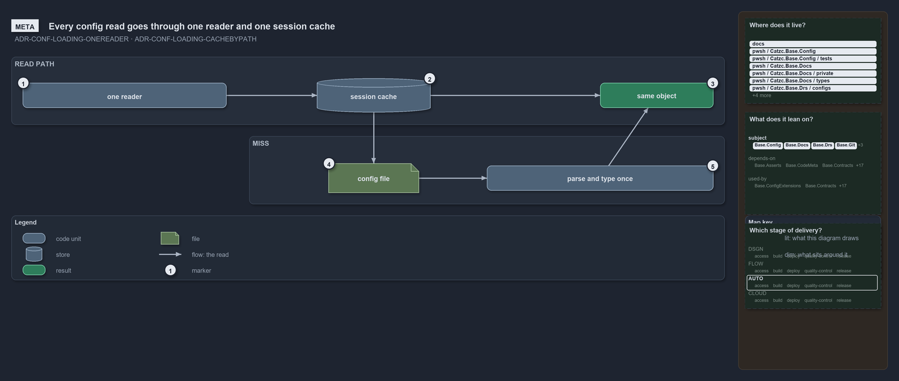

---
catzc:
  warning: "Header is generated by Format-FileMeta via Format-Code; do not change it"
  edges:
    cites:
      - ADR-CONF-LOADING-ONEREADER
      - ADR-CONF-LOADING-CACHEBYPATH
    drs_total: 2
---

# Every config read goes through one reader and one session cache

```text
Every config read goes through one reader and one cache for the session.

1  one reader            the single way in, by a config's name or by an address into it
2  session cache         looked up first; a config read before is already there
3  same object           what every read returns, shared by every later reader
4  config file           opened on a miss, and only then
5  parse and type once   the file becomes its typed object once per session

Supports ADR-CONF-LOADING-ONEREADER and ADR-CONF-LOADING-CACHEBYPATH (meta lens).
```

Config reading in cats has exactly one reader and one cache for the whole session. Cats keeps its settings in config files, and any function
in any module may need one of them, so instead of letting each function open the file it wants, every read goes the same way. The first read
of a config parses and types the file; every later read gets the same object back from the cache, and only a re-import clears it.

```yml drawio
description:
  "Every config read goes through one reader and one session cache: a hit returns the same object, and only a miss opens the file and parses
  and types it once."
about:
  adrs: [ADR-CONF-LOADING-ONEREADER, ADR-CONF-LOADING-CACHEBYPATH]
  lens: meta
content:
  title: Every config read goes through one reader and one session cache
  kind: explanation
  flow: left-to-right
  relation: the read
  theme: dark
  bands:
    - { id: band-read, label: READ PATH }
    - { id: band-miss, label: MISS }
  glyphs:
    - { id: g-reader, kind: code, label: one reader, in: band-read }
    - { id: s-cache, kind: store, label: session cache, in: band-read }
    - { id: r-same, kind: result, label: same object, in: band-read }
    - { id: g-file, kind: file, label: config file, in: band-miss }
    - { id: g-parse, kind: code, label: parse and type once, in: band-miss }
  edges:
    - { from: g-reader, to: s-cache, kind: flow, label: "" }
    - { from: s-cache, to: r-same, kind: flow, label: "" }
    - { from: s-cache, to: g-file, kind: flow, label: "" }
    - { from: g-file, to: g-parse, kind: flow, label: "" }
    - { from: g-parse, to: r-same, kind: flow, label: "" }
  markers:
    - { at: g-reader, number: 1 }
    - { at: s-cache, number: 2 }
    - { at: r-same, number: 3 }
    - { at: g-file, number: 4 }
    - { at: g-parse, number: 5 }
  legend: auto
  minimaps:
    code-locations:
      - cell: docs/-/.
        by:
          - docs/drs/configuration/dora-explains.md
          - docs/drs/configuration/module-config-loading.md
          - docs/drs/index.md
          - docs/references/pwsh/catzc-base-config/Get-Config.ps1.md
          - docs/references/pwsh/catzc-base-config/Get-ConfigValue.ps1.md
          - docs/references/pwsh/catzc-base-config/tests/Get-ConfigValue.Tests.ps1.md
          - docs/references/pwsh/catzc-base-docs/Build-Readme.ps1.md
          - docs/references/pwsh/catzc-base-docs/private/Get-GlossarySources.ps1.md
          - docs/references/pwsh/catzc-base-docs/types/DocsConfig.cs.md
          - docs/references/pwsh/catzc-base-git/types/GitIgnoreConfig.cs.md
          - docs/references/pwsh/catzc-base-module-system/Copy-CatzcModule.ps1.md
          - docs/references/pwsh/catzc-base-quality-gates/private/Get-LiveIdentityTokens.ps1.md
          - docs/references/pwsh/catzc-base-root-config/types/RootConfigFiles.cs.md
          - ADR-CONF-LOADING-CACHEBYPATH
          - ADR-CONF-LOADING-ONEREADER
      - cell: pwsh/Catzc.Base.Config/.
        by:
          - pwsh/Catzc.Base.Config/Get-Config.ps1
          - pwsh/Catzc.Base.Config/Get-ConfigValue.ps1
          - ADR-CONF-LOADING-CACHEBYPATH
          - ADR-CONF-LOADING-ONEREADER
      - cell: pwsh/Catzc.Base.Config/tests
        by: [pwsh/Catzc.Base.Config/tests/Get-ConfigValue.Tests.ps1, ADR-CONF-LOADING-ONEREADER]
      - cell: pwsh/Catzc.Base.Docs/.
        by: [pwsh/Catzc.Base.Docs/Build-Readme.ps1, ADR-CONF-LOADING-CACHEBYPATH, ADR-CONF-LOADING-ONEREADER]
      - cell: pwsh/Catzc.Base.Docs/private
        by: [pwsh/Catzc.Base.Docs/private/Get-GlossarySources.ps1, ADR-CONF-LOADING-ONEREADER]
      - cell: pwsh/Catzc.Base.Docs/types
        by: [pwsh/Catzc.Base.Docs/types/DocsConfig.cs, ADR-CONF-LOADING-CACHEBYPATH, ADR-CONF-LOADING-ONEREADER]
      - cell: pwsh/Catzc.Base.Drs/configs
        by: [pwsh/Catzc.Base.Drs/configs/drs.yml, ADR-CONF-LOADING-CACHEBYPATH, ADR-CONF-LOADING-ONEREADER]
      - cell: pwsh/Catzc.Base.Git/types
        by: [pwsh/Catzc.Base.Git/types/GitIgnoreConfig.cs, ADR-CONF-LOADING-CACHEBYPATH, ADR-CONF-LOADING-ONEREADER]
      - cell: pwsh/Catzc.Base.ModuleSystem/.
        by: [pwsh/Catzc.Base.ModuleSystem/Copy-CatzcModule.ps1, ADR-CONF-LOADING-CACHEBYPATH, ADR-CONF-LOADING-ONEREADER]
      - cell: pwsh/Catzc.Base.QualityGates/private
        by: [pwsh/Catzc.Base.QualityGates/private/Get-LiveIdentityTokens.ps1, ADR-CONF-LOADING-CACHEBYPATH, ADR-CONF-LOADING-ONEREADER]
      - cell: pwsh/Catzc.Base.RootConfig/types
        by: [pwsh/Catzc.Base.RootConfig/types/RootConfigFiles.cs, ADR-CONF-LOADING-CACHEBYPATH, ADR-CONF-LOADING-ONEREADER]
    module-neighbourhood:
      - cell: subject/Catzc.Base.Config
        by:
          - pwsh/Catzc.Base.Config/Get-Config.ps1
          - pwsh/Catzc.Base.Config/Get-ConfigValue.ps1
          - pwsh/Catzc.Base.Config/tests/Get-ConfigValue.Tests.ps1
          - ADR-CONF-LOADING-CACHEBYPATH
          - ADR-CONF-LOADING-ONEREADER
      - cell: subject/Catzc.Base.Docs
        by:
          - pwsh/Catzc.Base.Docs/Build-Readme.ps1
          - pwsh/Catzc.Base.Docs/private/Get-GlossarySources.ps1
          - pwsh/Catzc.Base.Docs/types/DocsConfig.cs
          - ADR-CONF-LOADING-CACHEBYPATH
          - ADR-CONF-LOADING-ONEREADER
      - cell: subject/Catzc.Base.Drs
        by: [pwsh/Catzc.Base.Drs/configs/drs.yml, ADR-CONF-LOADING-CACHEBYPATH, ADR-CONF-LOADING-ONEREADER]
      - cell: subject/Catzc.Base.Git
        by: [pwsh/Catzc.Base.Git/types/GitIgnoreConfig.cs, ADR-CONF-LOADING-CACHEBYPATH, ADR-CONF-LOADING-ONEREADER]
      - cell: subject/Catzc.Base.ModuleSystem
        by: [pwsh/Catzc.Base.ModuleSystem/Copy-CatzcModule.ps1, ADR-CONF-LOADING-CACHEBYPATH, ADR-CONF-LOADING-ONEREADER]
      - cell: subject/Catzc.Base.QualityGates
        by: [pwsh/Catzc.Base.QualityGates/private/Get-LiveIdentityTokens.ps1, ADR-CONF-LOADING-CACHEBYPATH, ADR-CONF-LOADING-ONEREADER]
      - cell: subject/Catzc.Base.RootConfig
        by: [pwsh/Catzc.Base.RootConfig/types/RootConfigFiles.cs, ADR-CONF-LOADING-CACHEBYPATH, ADR-CONF-LOADING-ONEREADER]
    axis:
      - cell: AUTO/*
        by: [ADR-CONF-LOADING-CACHEBYPATH, ADR-CONF-LOADING-ONEREADER]
layout:
  band-read: { x: 20, y: 84, w: 1260, h: 120 }
  band-miss: { x: 440, y: 224, w: 840, h: 120 }
  g-reader: { x: 40, y: 130, w: 360, h: 44 }
  s-cache: { x: 560, y: 122, w: 200, h: 60 }
  r-same: { x: 1060, y: 130, w: 200, h: 44 }
  g-file: { x: 580, y: 272, w: 160, h: 52 }
  g-parse: { x: 860, y: 276, w: 400, h: 44 }
```



## Walkthrough

1. **One reader.** Every config read goes through one reader, whether it asks for a whole config by name or for one node by its address. The
   reader finds the file from the config's name alone; the caller never names the owning module.
2. **Session cache.** The reader looks in the session cache first. A config read before in this session is already there, and the read goes
   straight on to the result.
3. **Same object.** A read returns the same object on every call. It is a view to read, never to change, because every later reader shares
   it.
4. **Config file.** On a miss, and only then, the reader opens the config file.
5. **Parse and type once.** The file is parsed and turned into its typed object once per session, and that object goes into the cache. A
   malformed file never yields a value: the read throws instead. A wrong name or a wrong address throws too, never an empty value.

## Why it holds

- Every config read goes through the one reader; no function re-reads a config file or keeps its own config cache
  (ADR-CONF-LOADING-ONEREADER).
- The parsed config is cached by its file path, and only a re-import invalidates it (ADR-CONF-LOADING-CACHEBYPATH).

## See also

- [Module config loading](../../drs/configuration/module-config-loading.md) — the decision this article explains.
- The other lenses on the same read path: [architecture](callers-depend-on-one-config-module.md),
  [implementation](three-caches-back-one-reader.md), [operations](ask-by-name-get-the-cached-object.md) and
  [governance](one-gate-guards-the-read-path.md).
- [The configuration explanations](index.md) · [How to read the diagrams](../index.md#how-to-read-the-diagrams)
