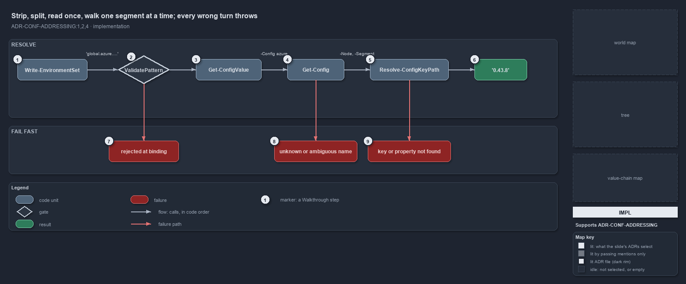

---
catzc:
  derived:
    path: docs/explanation/configuration/strip-split-walk-every-wrong-turn-throws.md
    kind: explanation
    body_sha: d0b1eb6f0b40
    adrs:
      - ADR-CONF-ADDRESSING#{1,2,4}
    links:
      - docs/.assets/explanation/adr-conf-addressing--strip-split-walk-every-wrong-turn-throws--implementation.drawio.md
      - docs/.assets/explanation/adr-conf-addressing--strip-split-walk-every-wrong-turn-throws--implementation.drawio.png
      - docs/adr/configuration/config-value-addressing.md
      - docs/explanation/configuration/an-address-is-a-read-only-walk.md
      - docs/explanation/configuration/callers-in-four-modules-share-one-resolver.md
      - docs/explanation/configuration/index.md
      - docs/explanation/configuration/two-test-files-check-the-address-rules.md
      - docs/explanation/configuration/type-an-address-get-the-value.md
      - docs/explanation/index.md#how-to-read-the-diagrams
---

# Strip, split, read once, walk one segment at a time; every wrong turn throws

```text
Strip, split, read once, walk one segment at a time; every wrong turn throws.

1  Write-EnvironmentSet         a caller: hands a 'global.…' entry of -Set to Get-ConfigValue
2  ValidatePattern              the grammar, checked when -Address binds
3  Get-ConfigValue              strips global., splits on '.', config name first, keys after
4  Get-Config                   the one reader: resolves the name, serves the cache, reads once
5  Resolve-ConfigKeyPath        walks the keys: dictionary key when the node is one, else property
6  '0.43.8'                     the node global.azure.bicep_min_version resolves to
7  rejected at binding          a malformed address never reaches the body
8  unknown or ambiguous name    no module ships the config, or more than one does
9  key or property not found    a segment resolves at neither, named with its address

Supports ADR-CONF-ADDRESSING#1, #2 and #4 (implementation lens).
```

Resolving a global config address is three small functions in `Catzc.Base.Config` in a fixed order. `Get-ConfigValue` strips the marker and
splits the address, `Get-Config` reads the named config once and serves its cache after that, and `Resolve-ConfigKeyPath` walks the keys one
segment at a time. Every wrong turn throws where it happens: at parameter binding, in the reader, or in the walk. The real example
`global.azure.bicep_min_version` resolves to `'0.43.8'` on the typed `AzureConfig` object.



The diagram is described element by element in
[its asset description](../../.assets/explanation/adr-conf-addressing--strip-split-walk-every-wrong-turn-throws--implementation.drawio.md).

## Walkthrough

1. **Write-EnvironmentSet.** A caller. For every entry of its `-Set` map whose value is a string starting with `global.`, it calls
   `Get-ConfigValue -Address` with that string; the value comes back non-secret and is logged with its address.
2. **ValidatePattern.** The `-Address` parameter carries a `ValidatePattern`: a lowercase kebab-case config name after `global.`, then any
   number of `.`-separated segments, none empty. A malformed address, such as an uppercase config name, is rejected when the parameter
   binds, before any code runs.
3. **Get-ConfigValue.** It splits the address on every `.`; element 1 is the config's global name and elements 2 onward are the key path,
   which may be empty. It then calls `Get-Config -Config <name> -Module <module>` and hands the result to the walk. It has no file read and
   no cache of its own.
4. **Get-Config.** The one reader resolves the name to its owning module's file through `Resolve-ConfigEntry`, returns the cached object
   when it has one, and otherwise reads the file once, builds the registered C# type, and caches the result. For `azure` the type is
   `Catzc.Azure.AzureConfig`, so the node the walk starts from is a typed object.
5. **Resolve-ConfigKeyPath.** Given `-Node`, `-Segment` and `-Address`, it walks one segment at a time: when the current node is an
   `IDictionary` it checks the key through the interface and steps in; otherwise it looks the segment up as a property. A C# dictionary
   inside a typed config, such as `environments`, traverses the same way, so the ADR's own example
   `global.azure.environments.prod.region_code` resolves to `weu`.
6. **'0.43.8'.** The walk ends on the node and returns it as it is: `bicep_min_version` is a string property of `AzureConfig`, and the
   caller gets the value `0.43.8` from `azure.yml`. A subtree comes back as the live cached object.
7. **rejected at binding.** `global.Azure.x` fails with `Cannot validate argument on parameter 'Address'`: the grammar is checked at the
   call site, not deep in the walk.
8. **unknown or ambiguous name.** `Resolve-ConfigEntry`, called by `Get-Config`, throws
   `No config '<name>' found in any module's configs/ folder.` for a name no module ships, and
   `Config '<name>' exists in multiple modules (…) — pass -Module to disambiguate.` for a name several ship.
9. **key or property not found.** The walk throws `Config address '<address>': key '<key>' does not exist in the config node.` on a
   dictionary, `… '<key>' is neither a dictionary key nor a property on the config node.` on any other node, and names the next segment when
   the node before it is null. Nothing returns an empty value.

## Why it holds

- `Get-ConfigValue` is built on `Get-Config` and walks with the private `Resolve-ConfigKeyPath`, so there is one reader and one cache and
  the address is a walk over a config already loaded (ADR-CONF-ADDRESSING#1).
- The first segment after `global.` is the config's global name; each later segment resolves as a dictionary key on a dictionary node,
  otherwise as a property, uniformly over raw and typed configs (ADR-CONF-ADDRESSING#2).
- An unknown or ambiguous name throws from the reader, a bad segment throws naming the address and the segment, and a malformed address is
  rejected at parameter binding; there is no silent empty value (ADR-CONF-ADDRESSING#4).

## Where the code and the ADR differ

- A key cannot contain a dot, because `Get-ConfigValue` splits the whole address on every dot; the ADR's grammar does not say so.
- The help text of `Get-ConfigValue` cites the addressing ADR by its file name and a stale short code, not by `ADR-CONF-ADDRESSING`; the
  help texts of `Resolve-ConfigKeyPath` and `Write-EnvironmentSet` cite the file name as well.

## See also

- [Config value addressing](../../adr/configuration/config-value-addressing.md) — the decision this article explains.
- The other lenses on the same walk: [meta](an-address-is-a-read-only-walk.md),
  [architecture](callers-in-four-modules-share-one-resolver.md), [operations](type-an-address-get-the-value.md) and
  [governance](two-test-files-check-the-address-rules.md).
- [The configuration explanations](index.md) · [How to read the diagrams](../index.md#how-to-read-the-diagrams)
