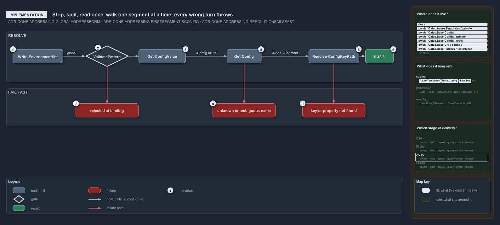

---
catzc:
  warning: "Header is generated by Format-FileMeta via Format-Code; do not change it"
  edges:
    cites:
      - ADR-CONF-ADDRESSING-GLOBALADDRESSFORM
      - ADR-CONF-ADDRESSING-FIRSTSEGMENTISCONFIG
      - ADR-CONF-ADDRESSING-RESOLUTIONFAILSFAST
    drs_total: 3
---

# Strip, split, read once, walk one segment at a time; every wrong turn throws

```text
Strip, split, read once, walk one segment at a time; every wrong turn throws.

1  Write-EnvironmentSet         a caller: hands a 'global.…' entry of -Set to Get-ConfigValue
2  ValidatePattern              the grammar, checked when -Address binds
3  Get-ConfigValue              strips global., splits on '.', config name first, keys after
4  Get-Config                   the one reader: resolves the name, serves the cache, reads once
5  Resolve-ConfigKeyPath        walks the keys: dictionary key when the node is one, else property
6  '0.43.8'                     the node global.azure.bicep_min_version resolves to
7  rejected at binding          a malformed address never reaches the body
8  unknown or ambiguous name    no module ships the config, or more than one does
9  key or property not found    a segment resolves at neither, named with its address

Supports ADR-CONF-ADDRESSING-GLOBALADDRESSFORM, ADR-CONF-ADDRESSING-FIRSTSEGMENTISCONFIG and ADR-CONF-ADDRESSING-RESOLUTIONFAILSFAST (implementation lens).
```

Resolving a global config address is three small functions in `Catzc.Base.Config` in a fixed order. `Get-ConfigValue` strips the marker and
splits the address, `Get-Config` reads the named config once and serves its cache after that, and `Resolve-ConfigKeyPath` walks the keys one
segment at a time. Every wrong turn throws where it happens: at parameter binding, in the reader, or in the walk. The real example
`global.azure.bicep_min_version` resolves to `'0.43.8'` on the typed `AzureConfig` object.

```yml drawio
description:
  "Resolving a global config address is three small functions in a fixed order: the address is validated at binding, stripped and split, the
  named config is read once, and the keys are walked one segment at a time; every wrong turn throws where it happens."
about:
  adrs: [ADR-CONF-ADDRESSING-GLOBALADDRESSFORM, ADR-CONF-ADDRESSING-FIRSTSEGMENTISCONFIG, ADR-CONF-ADDRESSING-RESOLUTIONFAILSFAST]
  lens: implementation
content:
  title: Strip, split, read once, walk one segment at a time; every wrong turn throws
  kind: explanation
  flow: left-to-right
  relation: calls, in code order
  theme: dark
  bands:
    - { id: band-resolve, label: RESOLVE }
    - { id: band-fail, label: FAIL FAST }
  glyphs:
    - { id: g-caller, kind: code, label: Write-EnvironmentSet, in: band-resolve }
    - { id: g-pattern, kind: gate, label: ValidatePattern, in: band-resolve }
    - { id: g-value, kind: code, label: Get-ConfigValue, in: band-resolve }
    - { id: g-config, kind: code, label: Get-Config, in: band-resolve }
    - { id: g-walk, kind: code, label: Resolve-ConfigKeyPath, in: band-resolve }
    - { id: r-node, kind: result, label: "'0.43.8'", in: band-resolve }
    - { id: f-binding, kind: failure, label: rejected at binding, in: band-fail }
    - { id: f-name, kind: failure, label: unknown or ambiguous name, in: band-fail }
    - { id: f-key, kind: failure, label: key or property not found, in: band-fail }
  edges:
    - { from: g-caller, to: g-pattern, kind: flow, label: "'global.…'" }
    - { from: g-pattern, to: g-value, kind: flow, label: "" }
    - { from: g-value, to: g-config, kind: flow, label: -Config azure }
    - { from: g-config, to: g-walk, kind: flow, label: "-Node, -Segment" }
    - { from: g-walk, to: r-node, kind: flow, label: "" }
    - { from: g-pattern, to: f-binding, kind: fail, label: "" }
    - { from: g-config, to: f-name, kind: fail, label: "" }
    - { from: g-walk, to: f-key, kind: fail, label: "" }
  markers:
    - { at: g-caller, number: 1 }
    - { at: g-pattern, number: 2 }
    - { at: g-value, number: 3 }
    - { at: g-config, number: 4 }
    - { at: g-walk, number: 5 }
    - { at: r-node, number: 6 }
    - { at: f-binding, number: 7 }
    - { at: f-name, number: 8 }
    - { at: f-key, number: 9 }
  legend: auto
  minimaps:
    code-locations:
      - cell: docs/-/.
        by:
          - docs/drs/configuration/config-value-addressing.md
          - docs/drs/configuration/dora-explains.md
          - docs/drs/index.md
          - docs/references/pwsh/catzc-azure-templates/private/Resolve-BicepParameterAddresses.ps1.md
          - docs/references/pwsh/catzc-base-config/Get-Config.ps1.md
          - docs/references/pwsh/catzc-base-config/Get-ConfigValue.ps1.md
          - docs/references/pwsh/catzc-base-config/private/Resolve-ConfigKeyPath.ps1.md
          - docs/references/pwsh/catzc-base-languages/New-GoWorkspace.ps1.md
          - docs/references/pwsh/catzc-base-languages/New-PythonProject.ps1.md
          - docs/references/pwsh/catzc-tooling-environment/Write-EnvironmentSet.ps1.md
          - ADR-CONF-ADDRESSING-FIRSTSEGMENTISCONFIG
          - ADR-CONF-ADDRESSING-GLOBALADDRESSFORM
          - ADR-CONF-ADDRESSING-RESOLUTIONFAILSFAST
      - cell: pwsh/Catzc.Azure.Templates/private
        by: [pwsh/Catzc.Azure.Templates/private/Resolve-BicepParameterAddresses.ps1, ADR-CONF-ADDRESSING-GLOBALADDRESSFORM]
      - cell: pwsh/Catzc.Base.Config/.
        by:
          - pwsh/Catzc.Base.Config/Get-Config.ps1
          - pwsh/Catzc.Base.Config/Get-ConfigValue.ps1
          - ADR-CONF-ADDRESSING-FIRSTSEGMENTISCONFIG
          - ADR-CONF-ADDRESSING-GLOBALADDRESSFORM
          - ADR-CONF-ADDRESSING-RESOLUTIONFAILSFAST
      - cell: pwsh/Catzc.Base.Config/private
        by:
          - pwsh/Catzc.Base.Config/private/Resolve-ConfigKeyPath.ps1
          - ADR-CONF-ADDRESSING-FIRSTSEGMENTISCONFIG
          - ADR-CONF-ADDRESSING-GLOBALADDRESSFORM
          - ADR-CONF-ADDRESSING-RESOLUTIONFAILSFAST
      - cell: pwsh/Catzc.Base.Config/tests
        by: [pwsh/Catzc.Base.Config/tests/Get-ConfigValue.Tests.ps1, ADR-CONF-ADDRESSING-RESOLUTIONFAILSFAST]
      - cell: pwsh/Catzc.Base.Drs/configs
        by:
          - pwsh/Catzc.Base.Drs/configs/drs.yml
          - ADR-CONF-ADDRESSING-FIRSTSEGMENTISCONFIG
          - ADR-CONF-ADDRESSING-GLOBALADDRESSFORM
          - ADR-CONF-ADDRESSING-RESOLUTIONFAILSFAST
      - cell: pwsh/Catzc.Base.Folders/tests/types
        by: [pwsh/Catzc.Base.Folders/tests/types/FolderWalkConfig.Tests.ps1, ADR-CONF-ADDRESSING-GLOBALADDRESSFORM]
      - cell: pwsh/Catzc.Base.Languages/.
        by:
          - pwsh/Catzc.Base.Languages/New-GoWorkspace.ps1
          - pwsh/Catzc.Base.Languages/New-PythonProject.ps1
          - ADR-CONF-ADDRESSING-FIRSTSEGMENTISCONFIG
          - ADR-CONF-ADDRESSING-GLOBALADDRESSFORM
          - ADR-CONF-ADDRESSING-RESOLUTIONFAILSFAST
      - cell: pwsh/Catzc.Tooling.Environment/.
        by:
          - pwsh/Catzc.Tooling.Environment/Write-EnvironmentSet.ps1
          - ADR-CONF-ADDRESSING-FIRSTSEGMENTISCONFIG
          - ADR-CONF-ADDRESSING-GLOBALADDRESSFORM
          - ADR-CONF-ADDRESSING-RESOLUTIONFAILSFAST
    module-neighbourhood:
      - cell: subject/Catzc.Azure.Templates
        by: [pwsh/Catzc.Azure.Templates/private/Resolve-BicepParameterAddresses.ps1, ADR-CONF-ADDRESSING-GLOBALADDRESSFORM]
      - cell: subject/Catzc.Base.Config
        by:
          - pwsh/Catzc.Base.Config/Get-Config.ps1
          - pwsh/Catzc.Base.Config/Get-ConfigValue.ps1
          - pwsh/Catzc.Base.Config/private/Resolve-ConfigKeyPath.ps1
          - pwsh/Catzc.Base.Config/tests/Get-ConfigValue.Tests.ps1
          - ADR-CONF-ADDRESSING-FIRSTSEGMENTISCONFIG
          - ADR-CONF-ADDRESSING-GLOBALADDRESSFORM
          - ADR-CONF-ADDRESSING-RESOLUTIONFAILSFAST
      - cell: subject/Catzc.Base.Drs
        by:
          - pwsh/Catzc.Base.Drs/configs/drs.yml
          - ADR-CONF-ADDRESSING-FIRSTSEGMENTISCONFIG
          - ADR-CONF-ADDRESSING-GLOBALADDRESSFORM
          - ADR-CONF-ADDRESSING-RESOLUTIONFAILSFAST
      - cell: subject/Catzc.Base.Folders
        by: [pwsh/Catzc.Base.Folders/tests/types/FolderWalkConfig.Tests.ps1, ADR-CONF-ADDRESSING-GLOBALADDRESSFORM]
      - cell: subject/Catzc.Base.Languages
        by:
          - pwsh/Catzc.Base.Languages/New-GoWorkspace.ps1
          - pwsh/Catzc.Base.Languages/New-PythonProject.ps1
          - ADR-CONF-ADDRESSING-FIRSTSEGMENTISCONFIG
          - ADR-CONF-ADDRESSING-GLOBALADDRESSFORM
          - ADR-CONF-ADDRESSING-RESOLUTIONFAILSFAST
      - cell: subject/Catzc.Tooling.Environment
        by:
          - pwsh/Catzc.Tooling.Environment/Write-EnvironmentSet.ps1
          - ADR-CONF-ADDRESSING-FIRSTSEGMENTISCONFIG
          - ADR-CONF-ADDRESSING-GLOBALADDRESSFORM
          - ADR-CONF-ADDRESSING-RESOLUTIONFAILSFAST
    axis:
      - cell: AUTO/*
        by: [ADR-CONF-ADDRESSING-FIRSTSEGMENTISCONFIG, ADR-CONF-ADDRESSING-GLOBALADDRESSFORM, ADR-CONF-ADDRESSING-RESOLUTIONFAILSFAST]
layout:
  band-resolve: { x: 20, y: 84, w: 1260, h: 160 }
  band-fail: { x: 20, y: 264, w: 1260, h: 120 }
  g-caller: { x: 40, y: 140, w: 160, h: 44 }
  g-pattern: { x: 270, y: 128, w: 140, h: 68 }
  g-value: { x: 440, y: 140, w: 150, h: 44 }
  g-config: { x: 720, y: 140, w: 110, h: 44 }
  g-walk: { x: 980, y: 140, w: 160, h: 44 }
  r-node: { x: 1160, y: 140, w: 90, h: 44 }
  f-binding: { x: 240, y: 312, w: 200, h: 44 }
  f-name: { x: 675, y: 312, w: 200, h: 44 }
  f-key: { x: 960, y: 312, w: 200, h: 44 }
```



## Walkthrough

1. **Write-EnvironmentSet.** A caller. For every entry of its `-Set` map whose value is a string starting with `global.`, it calls
   `Get-ConfigValue -Address` with that string; the value comes back non-secret and is logged with its address.
2. **ValidatePattern.** The `-Address` parameter carries a `ValidatePattern`: a lowercase kebab-case config name after `global.`, then any
   number of `.`-separated segments, none empty. A malformed address, such as an uppercase config name, is rejected when the parameter
   binds, before any code runs.
3. **Get-ConfigValue.** It splits the address on every `.`; element 1 is the config's global name and elements 2 onward are the key path,
   which may be empty. It then calls `Get-Config -Config <name> -Module <module>` and hands the result to the walk. It has no file read and
   no cache of its own.
4. **Get-Config.** The one reader resolves the name to its owning module's file through `Resolve-ConfigEntry`, returns the cached object
   when it has one, and otherwise reads the file once, builds the registered C# type, and caches the result. For `azure` the type is
   `Catzc.Azure.AzureConfig`, so the node the walk starts from is a typed object.
5. **Resolve-ConfigKeyPath.** Given `-Node`, `-Segment` and `-Address`, it walks one segment at a time: when the current node is an
   `IDictionary` it checks the key through the interface and steps in; otherwise it looks the segment up as a property. A C# dictionary
   inside a typed config, such as `environments`, traverses the same way, so the ADR's own example
   `global.azure.environments.prod.region_code` resolves to `weu`.
6. **'0.43.8'.** The walk ends on the node and returns it as it is: `bicep_min_version` is a string property of `AzureConfig`, and the
   caller gets the value `0.43.8` from `azure.yml`. A subtree comes back as the live cached object.
7. **rejected at binding.** `global.Azure.x` fails with `Cannot validate argument on parameter 'Address'`: the grammar is checked at the
   call site, not deep in the walk.
8. **unknown or ambiguous name.** `Resolve-ConfigEntry`, called by `Get-Config`, throws
   `No config '<name>' found in any module's configs/ folder.` for a name no module ships, and
   `Config '<name>' exists in multiple modules (…) — pass -Module to disambiguate.` for a name several ship.
9. **key or property not found.** The walk throws `Config address '<address>': key '<key>' does not exist in the config node.` on a
   dictionary, `… '<key>' is neither a dictionary key nor a property on the config node.` on any other node, and names the next segment when
   the node before it is null. Nothing returns an empty value.

## Why it holds

- `Get-ConfigValue` is built on `Get-Config` and walks with the private `Resolve-ConfigKeyPath`, so there is one reader and one cache and
  the address is a walk over a config already loaded (ADR-CONF-ADDRESSING-GLOBALADDRESSFORM).
- The first segment after `global.` is the config's global name; each later segment resolves as a dictionary key on a dictionary node,
  otherwise as a property, uniformly over raw and typed configs (ADR-CONF-ADDRESSING-FIRSTSEGMENTISCONFIG).
- An unknown or ambiguous name throws from the reader, a bad segment throws naming the address and the segment, and a malformed address is
  rejected at parameter binding; there is no silent empty value (ADR-CONF-ADDRESSING-RESOLUTIONFAILSFAST).

## Where the code and the decision record differ

A key cannot contain a dot, because `Get-ConfigValue` splits the whole address on every dot; the ADR's grammar does not say so.

## See also

- [Config value addressing](../../drs/configuration/config-value-addressing.md) — the decision this article explains.
- The other lenses on the same walk: [meta](an-address-is-a-read-only-walk.md),
  [architecture](callers-in-four-modules-share-one-resolver.md), [operations](type-an-address-get-the-value.md) and
  [governance](two-test-files-check-the-address-rules.md).
- [The configuration explanations](index.md) · [How to read the diagrams](../index.md#how-to-read-the-diagrams)
