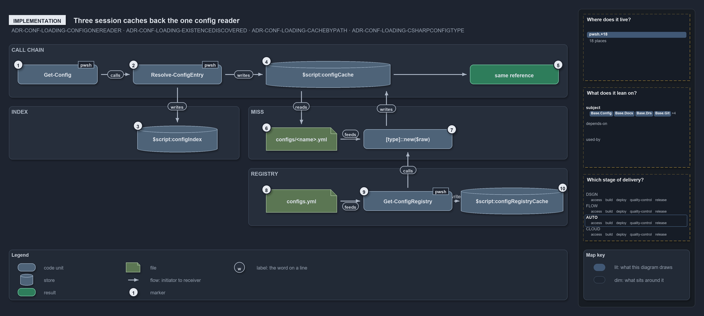

---
catzc:
  warning: "Header is generated by Format-FileMeta via Format-Code; do not change it"
  edges:
    cites:
      - ADR-CONF-LOADING-ONEREADER
      - ADR-CONF-LOADING-EXISTENCEDISCOVERED
      - ADR-CONF-LOADING-CACHEBYPATH
      - ADR-CONF-LOADING-CSHARPCONFIGTYPE
    drs_total: 4
---

# Three session caches back the one config reader

```text
Three session caches back the one config reader, each filled once and kept until re-import.

1   Get-Config                    the one reader: -Config <name>, optional -Module
2   Resolve-ConfigEntry           the private discovery seam: name -> one entry, or a throw
3   $script:configIndex           the name-to-entries index, built on the first call
4   $script:configCache           the parsed configs, keyed by resolved path
5   same reference                what a hit returns, the same object every call
6   configs/<name>.yml            asserted, then parsed as an ordered dictionary on a miss
7   [type]::new($raw)             the registered type built from the dictionary, then cached
8   configs.yml                   the registry: 43 config names, one type each
9   Get-ConfigRegistry            the private registry reader, validated by ConfigsConfig
10  $script:configRegistryCache   the registry's configs: map, read once per session

Supports ADR-CONF-LOADING-ONEREADER, ADR-CONF-LOADING-EXISTENCEDISCOVERED, ADR-CONF-LOADING-CACHEBYPATH and ADR-CONF-LOADING-CSHARPCONFIGTYPE (implementation lens).
```

`Get-Config` is the one config reader in cats, and it stays fast because three `$script:` caches stand behind it: `configIndex` maps config
names to files, `configCache` holds the parsed configs, and `configRegistryCache` holds the type registry. Each is built lazily, on first
use, and lives until the next import. Read in call order, the code shows where each cache is filled and where it is read.

```yml drawio
description:
  "Get-Config stays fast because three script-scope caches stand behind it, each filled once and kept until re-import: the name index, the
  parsed configs keyed by path, and the type registry."
about:
  adrs: [ADR-CONF-LOADING-ONEREADER, ADR-CONF-LOADING-EXISTENCEDISCOVERED, ADR-CONF-LOADING-CACHEBYPATH, ADR-CONF-LOADING-CSHARPCONFIGTYPE]
  lens: implementation
content:
  title: Three session caches back the one config reader
  kind: explanation
  flow: left-to-right
  relation: call order
  theme: dark
  bands:
    - { id: band-chain, label: CALL CHAIN }
    - { id: band-index, label: INDEX }
    - { id: band-miss, label: MISS }
    - { id: band-registry, label: REGISTRY }
  glyphs:
    - { id: g-reader, kind: code, label: Get-Config, in: band-chain }
    - { id: g-entry, kind: code, label: Resolve-ConfigEntry, in: band-chain }
    - { id: s-cache, kind: store, label: "$script:configCache", in: band-chain }
    - { id: r-same, kind: result, label: same reference, in: band-chain }
    - { id: s-index, kind: store, label: "$script:configIndex", in: band-index }
    - { id: g-file, kind: file, label: configs/<name>.yml, in: band-miss }
    - { id: g-type, kind: code, label: "[type]::new($raw)", in: band-miss }
    - { id: g-registry-file, kind: file, label: configs.yml, in: band-registry }
    - { id: g-registry, kind: code, label: Get-ConfigRegistry, in: band-registry }
    - { id: s-registry, kind: store, label: "$script:configRegistryCache", in: band-registry }
  edges:
    - { from: g-reader, to: g-entry, kind: flow, label: "" }
    - { from: g-entry, to: s-cache, kind: flow, label: "" }
    - { from: s-cache, to: r-same, kind: flow, label: "" }
    - { from: g-entry, to: s-index, kind: flow, label: "" }
    - { from: s-cache, to: g-file, kind: flow, label: "" }
    - { from: g-file, to: g-type, kind: flow, label: "" }
    - { from: g-type, to: s-cache, kind: flow, label: "" }
    - { from: g-registry-file, to: g-registry, kind: flow, label: "" }
    - { from: g-registry, to: s-registry, kind: flow, label: "" }
    - { from: g-registry, to: g-type, kind: flow, label: "" }
  markers:
    - { at: g-reader, number: 1 }
    - { at: g-entry, number: 2 }
    - { at: s-index, number: 3 }
    - { at: s-cache, number: 4 }
    - { at: r-same, number: 5 }
    - { at: g-file, number: 6 }
    - { at: g-type, number: 7 }
    - { at: g-registry-file, number: 8 }
    - { at: g-registry, number: 9 }
    - { at: s-registry, number: 10 }
  legend: auto
  minimaps:
    code-locations:
      - cell: docs/-/.
        by:
          - docs/drs/configuration/dora-explains.md
          - docs/drs/configuration/module-config-loading.md
          - docs/drs/index.md
          - docs/how-to/getting-started/pwsh/add-a-module.md
          - docs/how-to/pwsh/manual-test-plan/configs.md
          - docs/references/pwsh/catzc-base-config/Get-Config.ps1.md
          - docs/references/pwsh/catzc-base-config/Get-ConfigValue.ps1.md
          - docs/references/pwsh/catzc-base-config/tests/Get-ConfigValue.Tests.ps1.md
          - docs/references/pwsh/catzc-base-docs/Build-Readme.ps1.md
          - docs/references/pwsh/catzc-base-docs/private/Get-GlossarySources.ps1.md
          - docs/references/pwsh/catzc-base-docs/types/AgentsConfig.cs.md
          - docs/references/pwsh/catzc-base-docs/types/DocsConfig.cs.md
          - docs/references/pwsh/catzc-base-drs/types/DrsChecksConfig.cs.md
          - docs/references/pwsh/catzc-base-drs/types/DrsConfig.cs.md
          - docs/references/pwsh/catzc-base-git/types/GitIgnoreConfig.cs.md
          - docs/references/pwsh/catzc-base-module-system/Copy-CatzcModule.ps1.md
          - docs/references/pwsh/catzc-base-quality-gates/Test-ShippedConfigs.ps1.md
          - docs/references/pwsh/catzc-base-quality-gates/private/Get-LiveIdentityTokens.ps1.md
          - docs/references/pwsh/catzc-base-quality-gates/types/FileMetaConfig.cs.md
          - docs/references/pwsh/catzc-base-root-config/types/RootConfigFiles.cs.md
          - ADR-CONF-LOADING-CACHEBYPATH
          - ADR-CONF-LOADING-CSHARPCONFIGTYPE
          - ADR-CONF-LOADING-EXISTENCEDISCOVERED
          - ADR-CONF-LOADING-ONEREADER
      - cell: pwsh/Catzc.Base.Config/.
        by:
          - pwsh/Catzc.Base.Config/Get-Config.ps1
          - pwsh/Catzc.Base.Config/Get-ConfigValue.ps1
          - ADR-CONF-LOADING-CACHEBYPATH
          - ADR-CONF-LOADING-CSHARPCONFIGTYPE
          - ADR-CONF-LOADING-EXISTENCEDISCOVERED
          - ADR-CONF-LOADING-ONEREADER
      - cell: pwsh/Catzc.Base.Config/tests
        by: [pwsh/Catzc.Base.Config/tests/Get-ConfigValue.Tests.ps1, ADR-CONF-LOADING-ONEREADER]
      - cell: pwsh/Catzc.Base.Docs/.
        by:
          - pwsh/Catzc.Base.Docs/Build-Readme.ps1
          - ADR-CONF-LOADING-CACHEBYPATH
          - ADR-CONF-LOADING-CSHARPCONFIGTYPE
          - ADR-CONF-LOADING-EXISTENCEDISCOVERED
          - ADR-CONF-LOADING-ONEREADER
      - cell: pwsh/Catzc.Base.Docs/private
        by: [pwsh/Catzc.Base.Docs/private/Get-GlossarySources.ps1, ADR-CONF-LOADING-ONEREADER]
      - cell: pwsh/Catzc.Base.Docs/types
        by:
          - pwsh/Catzc.Base.Docs/types/AgentsConfig.cs
          - pwsh/Catzc.Base.Docs/types/CapabilitiesConfig.cs
          - pwsh/Catzc.Base.Docs/types/CapabilityEntry.cs
          - pwsh/Catzc.Base.Docs/types/DocsConfig.cs
          - ADR-CONF-LOADING-CACHEBYPATH
          - ADR-CONF-LOADING-CSHARPCONFIGTYPE
          - ADR-CONF-LOADING-EXISTENCEDISCOVERED
          - ADR-CONF-LOADING-ONEREADER
      - cell: pwsh/Catzc.Base.Drs/configs
        by:
          - pwsh/Catzc.Base.Drs/configs/drs.yml
          - ADR-CONF-LOADING-CACHEBYPATH
          - ADR-CONF-LOADING-CSHARPCONFIGTYPE
          - ADR-CONF-LOADING-EXISTENCEDISCOVERED
          - ADR-CONF-LOADING-ONEREADER
      - cell: pwsh/Catzc.Base.Drs/tests
        by: [pwsh/Catzc.Base.Drs/tests/Get-DrsRuleSet.Tests.ps1, ADR-CONF-LOADING-CSHARPCONFIGTYPE]
      - cell: pwsh/Catzc.Base.Drs/types
        by: [pwsh/Catzc.Base.Drs/types/DrsChecksConfig.cs, pwsh/Catzc.Base.Drs/types/DrsConfig.cs, ADR-CONF-LOADING-CSHARPCONFIGTYPE]
      - cell: pwsh/Catzc.Base.Git/types
        by:
          - pwsh/Catzc.Base.Git/types/GitIgnoreConfig.cs
          - ADR-CONF-LOADING-CACHEBYPATH
          - ADR-CONF-LOADING-CSHARPCONFIGTYPE
          - ADR-CONF-LOADING-EXISTENCEDISCOVERED
          - ADR-CONF-LOADING-ONEREADER
      - cell: pwsh/Catzc.Base.Globs/types
        by: [pwsh/Catzc.Base.Globs/types/FileKindsConfig.cs, ADR-CONF-LOADING-CSHARPCONFIGTYPE]
      - cell: pwsh/Catzc.Base.ModuleSystem/.
        by:
          - pwsh/Catzc.Base.ModuleSystem/Copy-CatzcModule.ps1
          - ADR-CONF-LOADING-CACHEBYPATH
          - ADR-CONF-LOADING-CSHARPCONFIGTYPE
          - ADR-CONF-LOADING-EXISTENCEDISCOVERED
          - ADR-CONF-LOADING-ONEREADER
      - cell: pwsh/Catzc.Base.QualityGates/.
        by: [pwsh/Catzc.Base.QualityGates/Test-ShippedConfigs.ps1, ADR-CONF-LOADING-CSHARPCONFIGTYPE]
      - cell: pwsh/Catzc.Base.QualityGates/private
        by:
          - pwsh/Catzc.Base.QualityGates/private/Get-LiveIdentityTokens.ps1
          - ADR-CONF-LOADING-CACHEBYPATH
          - ADR-CONF-LOADING-CSHARPCONFIGTYPE
          - ADR-CONF-LOADING-EXISTENCEDISCOVERED
          - ADR-CONF-LOADING-ONEREADER
      - cell: pwsh/Catzc.Base.QualityGates/tests/types
        by: [pwsh/Catzc.Base.QualityGates/tests/types/CommentsConfig.Tests.ps1, ADR-CONF-LOADING-CSHARPCONFIGTYPE]
      - cell: pwsh/Catzc.Base.QualityGates/types
        by: [pwsh/Catzc.Base.QualityGates/types/FileMetaConfig.cs, ADR-CONF-LOADING-CSHARPCONFIGTYPE]
      - cell: pwsh/Catzc.Base.RootConfig/types
        by:
          - pwsh/Catzc.Base.RootConfig/types/RootConfigFiles.cs
          - ADR-CONF-LOADING-CACHEBYPATH
          - ADR-CONF-LOADING-CSHARPCONFIGTYPE
          - ADR-CONF-LOADING-EXISTENCEDISCOVERED
          - ADR-CONF-LOADING-ONEREADER
    module-neighbourhood:
      - cell: subject/Catzc.Base.Config
        by:
          - pwsh/Catzc.Base.Config/Get-Config.ps1
          - pwsh/Catzc.Base.Config/Get-ConfigValue.ps1
          - pwsh/Catzc.Base.Config/tests/Get-ConfigValue.Tests.ps1
          - ADR-CONF-LOADING-CACHEBYPATH
          - ADR-CONF-LOADING-CSHARPCONFIGTYPE
          - ADR-CONF-LOADING-EXISTENCEDISCOVERED
          - ADR-CONF-LOADING-ONEREADER
      - cell: subject/Catzc.Base.Docs
        by:
          - pwsh/Catzc.Base.Docs/Build-Readme.ps1
          - pwsh/Catzc.Base.Docs/private/Get-GlossarySources.ps1
          - pwsh/Catzc.Base.Docs/types/AgentsConfig.cs
          - pwsh/Catzc.Base.Docs/types/CapabilitiesConfig.cs
          - pwsh/Catzc.Base.Docs/types/CapabilityEntry.cs
          - pwsh/Catzc.Base.Docs/types/DocsConfig.cs
          - ADR-CONF-LOADING-CACHEBYPATH
          - ADR-CONF-LOADING-CSHARPCONFIGTYPE
          - ADR-CONF-LOADING-EXISTENCEDISCOVERED
          - ADR-CONF-LOADING-ONEREADER
      - cell: subject/Catzc.Base.Drs
        by:
          - pwsh/Catzc.Base.Drs/configs/drs.yml
          - pwsh/Catzc.Base.Drs/tests/Get-DrsRuleSet.Tests.ps1
          - pwsh/Catzc.Base.Drs/types/DrsChecksConfig.cs
          - pwsh/Catzc.Base.Drs/types/DrsConfig.cs
          - ADR-CONF-LOADING-CACHEBYPATH
          - ADR-CONF-LOADING-CSHARPCONFIGTYPE
          - ADR-CONF-LOADING-EXISTENCEDISCOVERED
          - ADR-CONF-LOADING-ONEREADER
      - cell: subject/Catzc.Base.Git
        by:
          - pwsh/Catzc.Base.Git/types/GitIgnoreConfig.cs
          - ADR-CONF-LOADING-CACHEBYPATH
          - ADR-CONF-LOADING-CSHARPCONFIGTYPE
          - ADR-CONF-LOADING-EXISTENCEDISCOVERED
          - ADR-CONF-LOADING-ONEREADER
      - cell: subject/Catzc.Base.Globs
        by: [pwsh/Catzc.Base.Globs/types/FileKindsConfig.cs, ADR-CONF-LOADING-CSHARPCONFIGTYPE]
      - cell: subject/Catzc.Base.ModuleSystem
        by:
          - pwsh/Catzc.Base.ModuleSystem/Copy-CatzcModule.ps1
          - ADR-CONF-LOADING-CACHEBYPATH
          - ADR-CONF-LOADING-CSHARPCONFIGTYPE
          - ADR-CONF-LOADING-EXISTENCEDISCOVERED
          - ADR-CONF-LOADING-ONEREADER
      - cell: subject/Catzc.Base.QualityGates
        by:
          - pwsh/Catzc.Base.QualityGates/Test-ShippedConfigs.ps1
          - pwsh/Catzc.Base.QualityGates/private/Get-LiveIdentityTokens.ps1
          - pwsh/Catzc.Base.QualityGates/tests/types/CommentsConfig.Tests.ps1
          - pwsh/Catzc.Base.QualityGates/types/FileMetaConfig.cs
          - ADR-CONF-LOADING-CACHEBYPATH
          - ADR-CONF-LOADING-CSHARPCONFIGTYPE
          - ADR-CONF-LOADING-EXISTENCEDISCOVERED
          - ADR-CONF-LOADING-ONEREADER
      - cell: subject/Catzc.Base.RootConfig
        by:
          - pwsh/Catzc.Base.RootConfig/types/RootConfigFiles.cs
          - ADR-CONF-LOADING-CACHEBYPATH
          - ADR-CONF-LOADING-CSHARPCONFIGTYPE
          - ADR-CONF-LOADING-EXISTENCEDISCOVERED
          - ADR-CONF-LOADING-ONEREADER
    axis:
      - cell: AUTO/*
        by:
          - ADR-CONF-LOADING-CACHEBYPATH
          - ADR-CONF-LOADING-CSHARPCONFIGTYPE
          - ADR-CONF-LOADING-EXISTENCEDISCOVERED
          - ADR-CONF-LOADING-ONEREADER
layout:
  band-chain: { x: 20, y: 84, w: 1260, h: 120 }
  band-index: { x: 20, y: 224, w: 520, h: 120 }
  band-miss: { x: 560, y: 224, w: 720, h: 120 }
  band-registry: { x: 560, y: 364, w: 720, h: 130 }
  g-reader: { x: 40, y: 130, w: 180, h: 44 }
  g-entry: { x: 300, y: 130, w: 200, h: 44 }
  s-cache: { x: 600, y: 122, w: 280, h: 60 }
  r-same: { x: 1060, y: 130, w: 200, h: 44 }
  s-index: { x: 310, y: 268, w: 180, h: 60 }
  g-file: { x: 600, y: 272, w: 160, h: 52 }
  g-type: { x: 820, y: 276, w: 200, h: 44 }
  g-registry-file: { x: 600, y: 412, w: 160, h: 52 }
  g-registry: { x: 820, y: 416, w: 200, h: 44 }
  s-registry: { x: 1040, y: 408, w: 230, h: 60 }
```



## Walkthrough

1. **Get-Config.** The reader takes `-Config <name>` and an optional `-Module`; a `ValidatePattern` holds the name to kebab case. Callers
   such as `Get-ConfigValue` build on it.
2. **Resolve-ConfigEntry.** The private discovery seam resolves the name to one `@{ Name; Module; Path }`. It throws on an unknown name, on
   a name the given `-Module` does not ship, and on a name several modules ship.
3. **$script:configIndex.** On its first call the seam scans `<module>/configs/*.yml` under `Get-CatzcModulesRoot`, skipping dot-folders,
   into a name-to-entries index. Every later call reads the index.
4. **$script:configCache.** `Get-Config` checks `configCache.ContainsKey` with the resolved path. A hit returns at once; a miss goes down.
5. **same reference.** The caller gets the cached object, the same reference on every call for that file.
6. **configs/&lt;name&gt;.yml.** On a miss, `Assert-PathExist` checks the file, and `ConvertFrom-Yaml -Ordered` parses it into an ordered
   dictionary.
7. **[type]::new($raw).** When the registry names a type for the config, `Get-Config` constructs it from the dictionary; an unregistered
   config stays raw. After the `-Verbose` line, the result goes into `configCache` under its path and is returned.
8. **configs.yml.** The registry file of `Catzc.Base.Config` lists 43 configs under a top-level `configs:` key, each with one `type:`, for
   example `globs` to `Catzc.Base.Globs.GlobsConfig`.
9. **Get-ConfigRegistry.** The private registry reader reads `configs.yml` itself, not through `Get-Config`, to avoid a circular read, and
   validates it with `Catzc.Base.Config.ConfigsConfig`. A missing `configs.yml` yields an empty registry.
10. **$script:configRegistryCache.** The registry reader keeps the `configs:` map here, so the registry file is read once per session.

## Why it holds

- `Get-Config` is the one reader of module configs; no other function keeps its own config cache (ADR-CONF-LOADING-ONEREADER).
- Discovery is a private seam that scans the modules' `configs/` folders and resolves a name to its owning module
  (ADR-CONF-LOADING-EXISTENCEDISCOVERED).
- The parsed config is cached by its resolved file path, and only a re-import invalidates it (ADR-CONF-LOADING-CACHEBYPATH).
- The registered C# type is constructed once, on the cache miss, and its constructor maps and validates (ADR-CONF-LOADING-CSHARPCONFIGTYPE).

## Where the code and the decision record differ

- The ADR says no function re-reads a config file or keeps its own `$script:` config cache. `Get-ConfigRegistry` does both for
  `configs.yml`, an exception the ADR does not state.
- The ADR writes a registry entry as `<name>: { type: <C# FQN> }`. In `configs.yml` the entries sit under a top-level `configs:` key, which
  `ConfigsConfig` enforces.
- The ADR says discovery scans `pwsh/*/configs/`. The code scans `Get-CatzcModulesRoot`, the source `pwsh/` folder or a built package, and
  skips dot-folders.

## See also

- [Module config loading](../../drs/configuration/module-config-loading.md) — the decision this article explains.
- The other lenses on the same read path: [meta](one-reader-one-cache-per-session.md),
  [architecture](callers-depend-on-one-config-module.md), [operations](ask-by-name-get-the-cached-object.md) and
  [governance](one-gate-guards-the-read-path.md).
- [The configuration explanations](index.md) · [How to read the diagrams](../index.md#how-to-read-the-diagrams)
