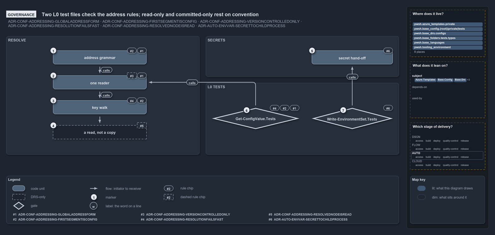

---
catzc:
  warning: "Header is generated by Format-FileMeta via Format-Code; do not change it"
  edges:
    cites:
      - ADR-AUTO-ENVVAR-SECRETTOCHILDPROCESS
      - ADR-CONF-ADDRESSING
    drs_total: 6
---

# Two L0 test files check the address rules; read-only and committed-only rest on convention

```text
Two L0 test files check the address rules; read-only and committed-only rest on convention.

1  address grammar               global.<config>.<key>… names one node (A1, A2); the grammar is checked at binding
2  one reader                    resolved on Get-Config (A1), over committed config only (A3); A3 has no check
3  key walk                      dictionary key, else property (A2); every wrong turn throws (A4)
4  a read, not a copy            the node is never mutated (A5); nothing enforces it
5  secret hand-off               a secret crosses only through Write-EnvironmentSet (E7)
6  Get-ConfigValue.Tests         the L0 file that checks A1, A2 and A4
7  Write-EnvironmentSet.Tests    the L0 file that checks E7

Supports ADR-CONF-ADDRESSING-GLOBALADDRESSFORM, ADR-CONF-ADDRESSING-FIRSTSEGMENTISCONFIG, ADR-CONF-ADDRESSING-VERSIONCONTROLLEDONLY, ADR-CONF-ADDRESSING-RESOLUTIONFAILSFAST and ADR-CONF-ADDRESSING-RESOLVEDNODEISREAD, and ADR-AUTO-ENVVAR-SECRETTOCHILDPROCESS (governance lens).
```

Five addressing rules and one environment-variable rule constrain how cats dereferences a global config address. Each stage of the walk
carries the rules that govern it, set against what checks them. No quality gate looks at addresses; two L0 test files do, one for the
grammar, the reader and the walk, and one for the secret hand-off. Two rules rest on convention: that a resolved node is never written
through, and that nothing an address can reach is a secret.

```yml drawio
description:
  "Each stage of resolving a global config address with the rules that govern it and what checks them: two L0 test files check the grammar,
  the reader, the walk and the secret hand-off, while read-only and committed-only rest on convention."
about:
  adrs:
    - ADR-CONF-ADDRESSING-GLOBALADDRESSFORM
    - ADR-CONF-ADDRESSING-FIRSTSEGMENTISCONFIG
    - ADR-CONF-ADDRESSING-VERSIONCONTROLLEDONLY
    - ADR-CONF-ADDRESSING-RESOLUTIONFAILSFAST
    - ADR-CONF-ADDRESSING-RESOLVEDNODEISREAD
    - ADR-AUTO-ENVVAR-SECRETTOCHILDPROCESS
  lens: governance
content:
  title: Two L0 test files check the address rules; read-only and committed-only rest on convention
  kind: explanation
  flow: left-to-right
  relation: the walk, or what a test checks
  theme: dark
  bands:
    - { id: band-resolve, label: RESOLVE }
    - { id: band-secrets, label: SECRETS }
    - { id: band-tests, label: L0 TESTS }
  glyphs:
    - { id: g-grammar, kind: code, label: address grammar, in: band-resolve }
    - { id: g-reader, kind: code, label: one reader, in: band-resolve }
    - { id: g-walk, kind: code, label: key walk, in: band-resolve }
    - { id: a-copy, kind: drsonly, label: "a read, not a copy", in: band-resolve }
    - { id: g-secret, kind: code, label: secret hand-off, in: band-secrets }
    - { id: g-value-tests, kind: gate, label: Get-ConfigValue.Tests, in: band-tests }
    - { id: g-env-tests, kind: gate, label: Write-EnvironmentSet.Tests, in: band-tests }
  edges:
    - { from: g-grammar, to: g-reader, kind: flow, label: "" }
    - { from: g-reader, to: g-walk, kind: flow, label: "" }
    - { from: g-walk, to: a-copy, kind: flow, label: "" }
    - { from: g-value-tests, to: g-reader, kind: flow, label: "" }
    - { from: g-env-tests, to: g-secret, kind: flow, label: "" }
  markers:
    - { at: g-grammar, number: 1 }
    - { at: g-reader, number: 2 }
    - { at: g-walk, number: 3 }
    - { at: a-copy, number: 4 }
    - { at: g-secret, number: 5 }
    - { at: g-value-tests, number: 6 }
    - { at: g-env-tests, number: 7 }
  chips:
    - { at: g-grammar, kind: rule, rule: ADR-CONF-ADDRESSING-GLOBALADDRESSFORM }
    - { at: g-grammar, kind: rule, rule: ADR-CONF-ADDRESSING-FIRSTSEGMENTISCONFIG }
    - { at: g-reader, kind: rule, rule: ADR-CONF-ADDRESSING-GLOBALADDRESSFORM }
    - { at: g-reader, kind: rule, rule: ADR-CONF-ADDRESSING-VERSIONCONTROLLEDONLY, gated: false }
    - { at: g-walk, kind: rule, rule: ADR-CONF-ADDRESSING-FIRSTSEGMENTISCONFIG }
    - { at: g-walk, kind: rule, rule: ADR-CONF-ADDRESSING-RESOLUTIONFAILSFAST }
    - { at: a-copy, kind: rule, rule: ADR-CONF-ADDRESSING-RESOLVEDNODEISREAD, gated: false }
    - { at: g-secret, kind: rule, rule: ADR-AUTO-ENVVAR-SECRETTOCHILDPROCESS }
    - { at: g-value-tests, kind: rule, rule: ADR-CONF-ADDRESSING-GLOBALADDRESSFORM }
    - { at: g-value-tests, kind: rule, rule: ADR-CONF-ADDRESSING-FIRSTSEGMENTISCONFIG }
    - { at: g-value-tests, kind: rule, rule: ADR-CONF-ADDRESSING-RESOLUTIONFAILSFAST }
    - { at: g-env-tests, kind: rule, rule: ADR-AUTO-ENVVAR-SECRETTOCHILDPROCESS }
  legend: auto
  minimaps:
    code-locations:
      - cell: docs/-/.
        by:
          - docs/drs/automation/dora-explains.md
          - docs/drs/automation/environment-variables.md
          - docs/drs/configuration/config-value-addressing.md
          - docs/drs/configuration/dora-explains.md
          - docs/drs/index.md
          - docs/references/pwsh/catzc-azure-templates/private/Resolve-BicepParameterAddresses.ps1.md
          - docs/references/pwsh/catzc-base-config/Get-Config.ps1.md
          - docs/references/pwsh/catzc-base-config/Get-ConfigValue.ps1.md
          - docs/references/pwsh/catzc-base-config/private/Resolve-ConfigKeyPath.ps1.md
          - docs/references/pwsh/catzc-base-languages/New-GoWorkspace.ps1.md
          - docs/references/pwsh/catzc-base-languages/New-PythonProject.ps1.md
          - docs/references/pwsh/catzc-tooling-environment.md
          - docs/references/pwsh/catzc-tooling-environment/Write-EnvironmentSet.ps1.md
          - ADR-AUTO-ENVVAR-SECRETTOCHILDPROCESS
          - ADR-CONF-ADDRESSING-FIRSTSEGMENTISCONFIG
          - ADR-CONF-ADDRESSING-GLOBALADDRESSFORM
          - ADR-CONF-ADDRESSING-RESOLUTIONFAILSFAST
          - ADR-CONF-ADDRESSING-RESOLVEDNODEISREAD
          - ADR-CONF-ADDRESSING-VERSIONCONTROLLEDONLY
      - cell: pwsh/Catzc.Azure.Templates/private
        by:
          - pwsh/Catzc.Azure.Templates/private/Resolve-BicepParameterAddresses.ps1
          - ADR-CONF-ADDRESSING-GLOBALADDRESSFORM
          - ADR-CONF-ADDRESSING-VERSIONCONTROLLEDONLY
      - cell: pwsh/Catzc.Base.Config/.
        by:
          - pwsh/Catzc.Base.Config/Get-Config.ps1
          - pwsh/Catzc.Base.Config/Get-ConfigValue.ps1
          - ADR-AUTO-ENVVAR-SECRETTOCHILDPROCESS
          - ADR-CONF-ADDRESSING-FIRSTSEGMENTISCONFIG
          - ADR-CONF-ADDRESSING-GLOBALADDRESSFORM
          - ADR-CONF-ADDRESSING-RESOLUTIONFAILSFAST
          - ADR-CONF-ADDRESSING-RESOLVEDNODEISREAD
          - ADR-CONF-ADDRESSING-VERSIONCONTROLLEDONLY
      - cell: pwsh/Catzc.Base.Config/private
        by:
          - pwsh/Catzc.Base.Config/private/Resolve-ConfigKeyPath.ps1
          - ADR-CONF-ADDRESSING-FIRSTSEGMENTISCONFIG
          - ADR-CONF-ADDRESSING-GLOBALADDRESSFORM
          - ADR-CONF-ADDRESSING-RESOLUTIONFAILSFAST
          - ADR-CONF-ADDRESSING-RESOLVEDNODEISREAD
          - ADR-CONF-ADDRESSING-VERSIONCONTROLLEDONLY
      - cell: pwsh/Catzc.Base.Config/tests
        by:
          - pwsh/Catzc.Base.Config/tests/Get-ConfigValue.Tests.ps1
          - ADR-CONF-ADDRESSING-RESOLUTIONFAILSFAST
          - ADR-CONF-ADDRESSING-RESOLVEDNODEISREAD
      - cell: pwsh/Catzc.Base.Drs/configs
        by:
          - pwsh/Catzc.Base.Drs/configs/drs.yml
          - ADR-AUTO-ENVVAR-SECRETTOCHILDPROCESS
          - ADR-CONF-ADDRESSING-FIRSTSEGMENTISCONFIG
          - ADR-CONF-ADDRESSING-GLOBALADDRESSFORM
          - ADR-CONF-ADDRESSING-RESOLUTIONFAILSFAST
          - ADR-CONF-ADDRESSING-RESOLVEDNODEISREAD
          - ADR-CONF-ADDRESSING-VERSIONCONTROLLEDONLY
      - cell: pwsh/Catzc.Base.Folders/tests/types
        by: [pwsh/Catzc.Base.Folders/tests/types/FolderWalkConfig.Tests.ps1, ADR-CONF-ADDRESSING-GLOBALADDRESSFORM]
      - cell: pwsh/Catzc.Base.Languages/.
        by:
          - pwsh/Catzc.Base.Languages/New-GoWorkspace.ps1
          - pwsh/Catzc.Base.Languages/New-PythonProject.ps1
          - ADR-CONF-ADDRESSING-FIRSTSEGMENTISCONFIG
          - ADR-CONF-ADDRESSING-GLOBALADDRESSFORM
          - ADR-CONF-ADDRESSING-RESOLUTIONFAILSFAST
          - ADR-CONF-ADDRESSING-RESOLVEDNODEISREAD
          - ADR-CONF-ADDRESSING-VERSIONCONTROLLEDONLY
      - cell: pwsh/Catzc.Tooling.Environment/.
        by:
          - pwsh/Catzc.Tooling.Environment/Write-EnvironmentSet.ps1
          - ADR-AUTO-ENVVAR-SECRETTOCHILDPROCESS
          - ADR-CONF-ADDRESSING-FIRSTSEGMENTISCONFIG
          - ADR-CONF-ADDRESSING-GLOBALADDRESSFORM
          - ADR-CONF-ADDRESSING-RESOLUTIONFAILSFAST
          - ADR-CONF-ADDRESSING-RESOLVEDNODEISREAD
          - ADR-CONF-ADDRESSING-VERSIONCONTROLLEDONLY
    module-neighbourhood:
      - cell: subject/Catzc.Azure.Templates
        by:
          - pwsh/Catzc.Azure.Templates/private/Resolve-BicepParameterAddresses.ps1
          - ADR-CONF-ADDRESSING-GLOBALADDRESSFORM
          - ADR-CONF-ADDRESSING-VERSIONCONTROLLEDONLY
      - cell: subject/Catzc.Base.Config
        by:
          - pwsh/Catzc.Base.Config/Get-Config.ps1
          - pwsh/Catzc.Base.Config/Get-ConfigValue.ps1
          - pwsh/Catzc.Base.Config/private/Resolve-ConfigKeyPath.ps1
          - pwsh/Catzc.Base.Config/tests/Get-ConfigValue.Tests.ps1
          - ADR-AUTO-ENVVAR-SECRETTOCHILDPROCESS
          - ADR-CONF-ADDRESSING-FIRSTSEGMENTISCONFIG
          - ADR-CONF-ADDRESSING-GLOBALADDRESSFORM
          - ADR-CONF-ADDRESSING-RESOLUTIONFAILSFAST
          - ADR-CONF-ADDRESSING-RESOLVEDNODEISREAD
          - ADR-CONF-ADDRESSING-VERSIONCONTROLLEDONLY
      - cell: subject/Catzc.Base.Drs
        by:
          - pwsh/Catzc.Base.Drs/configs/drs.yml
          - ADR-AUTO-ENVVAR-SECRETTOCHILDPROCESS
          - ADR-CONF-ADDRESSING-FIRSTSEGMENTISCONFIG
          - ADR-CONF-ADDRESSING-GLOBALADDRESSFORM
          - ADR-CONF-ADDRESSING-RESOLUTIONFAILSFAST
          - ADR-CONF-ADDRESSING-RESOLVEDNODEISREAD
          - ADR-CONF-ADDRESSING-VERSIONCONTROLLEDONLY
      - cell: subject/Catzc.Base.Folders
        by: [pwsh/Catzc.Base.Folders/tests/types/FolderWalkConfig.Tests.ps1, ADR-CONF-ADDRESSING-GLOBALADDRESSFORM]
      - cell: subject/Catzc.Base.Languages
        by:
          - pwsh/Catzc.Base.Languages/New-GoWorkspace.ps1
          - pwsh/Catzc.Base.Languages/New-PythonProject.ps1
          - ADR-CONF-ADDRESSING-FIRSTSEGMENTISCONFIG
          - ADR-CONF-ADDRESSING-GLOBALADDRESSFORM
          - ADR-CONF-ADDRESSING-RESOLUTIONFAILSFAST
          - ADR-CONF-ADDRESSING-RESOLVEDNODEISREAD
          - ADR-CONF-ADDRESSING-VERSIONCONTROLLEDONLY
      - cell: subject/Catzc.Tooling.Environment
        by:
          - pwsh/Catzc.Tooling.Environment/Write-EnvironmentSet.ps1
          - ADR-AUTO-ENVVAR-SECRETTOCHILDPROCESS
          - ADR-CONF-ADDRESSING-FIRSTSEGMENTISCONFIG
          - ADR-CONF-ADDRESSING-GLOBALADDRESSFORM
          - ADR-CONF-ADDRESSING-RESOLUTIONFAILSFAST
          - ADR-CONF-ADDRESSING-RESOLVEDNODEISREAD
          - ADR-CONF-ADDRESSING-VERSIONCONTROLLEDONLY
    axis:
      - cell: AUTO/*
        by:
          - ADR-AUTO-ENVVAR-SECRETTOCHILDPROCESS
          - ADR-CONF-ADDRESSING-FIRSTSEGMENTISCONFIG
          - ADR-CONF-ADDRESSING-GLOBALADDRESSFORM
          - ADR-CONF-ADDRESSING-RESOLUTIONFAILSFAST
          - ADR-CONF-ADDRESSING-RESOLVEDNODEISREAD
          - ADR-CONF-ADDRESSING-VERSIONCONTROLLEDONLY
layout:
  band-resolve: { x: 20, y: 100, w: 620, h: 380 }
  band-secrets: { x: 660, y: 100, w: 620, h: 130 }
  band-tests: { x: 660, y: 250, w: 620, h: 230 }
  g-grammar: { x: 170, y: 146, w: 300, h: 44 }
  g-reader: { x: 170, y: 226, w: 300, h: 44 }
  g-walk: { x: 170, y: 306, w: 300, h: 44 }
  a-copy: { x: 170, y: 386, w: 300, h: 44 }
  g-secret: { x: 1000, y: 146, w: 260, h: 44 }
  g-value-tests: { x: 680, y: 330, w: 280, h: 68 }
  g-env-tests: { x: 1000, y: 330, w: 260, h: 68 }
```



In the walkthrough, `A` is ADR-CONF-ADDRESSING and `E` is ADR-AUTO-ENVVAR; the diagram's rule chips are keyed in its legend.

## Walkthrough

1. **address grammar.** An address is `global.<config>.<key>[.<key>…]` and names exactly one node; the first segment after `global.` is the
   config's global name and the key path is optional (A1, A2). A `ValidatePattern` on `-Address` rejects a malformed address when the
   parameter binds, and the test file pins four malformed forms.
2. **one reader.** `Get-ConfigValue` is built on `Get-Config`, so addressing is a walk over a config already loaded, never a second reader
   (A1). The reader opens only a committed `configs/<name>.yml`, so nothing addressable is a secret (A3); that holds by construction, and no
   test or gate checks it.
3. **key walk.** Each segment resolves as a dictionary key when the node is a dictionary, otherwise as a property, uniformly over raw and
   typed configs (A2), and a segment that resolves at neither throws, naming the address and the segment; an unknown or ambiguous name
   throws from the reader (A4).
4. **a read, not a copy.** A resolved node may be a live reference into the config cache and must never be mutated (A5). The test file pins
   that the node is the same reference; nothing in the code or the tests stops a caller from writing through it.
5. **secret hand-off.** A secret reaches a child process only through `Write-EnvironmentSet`, as a `[SecureString]`, masked in every
   message, decrypted only at the assignment, and restored when the scoped block ends (E7).
6. **Get-ConfigValue.Tests.** The L0 logic tests mock `Get-Config` and check the grammar over a raw dictionary and a typed object, the
   `-Module` passthrough, the four malformed forms, and the two throws of the walk (A1, A2, A4). One integrity test resolves `global.tools`
   through the live reader.
7. **Write-EnvironmentSet.Tests.** The L0 logic tests mock the environment write and check that a secret is decrypted for the assignment,
   that the plaintext never reaches a message and `***` does, that a bare literal in `-Set` is rejected, and that a scoped call restores
   every variable (E7).

## Why it holds

- An address names one node and is resolved by `Get-ConfigValue` on top of the one reader (ADR-CONF-ADDRESSING-GLOBALADDRESSFORM).
- The first segment is the config's global name; each following segment is a key on a dictionary node, otherwise a property
  (ADR-CONF-ADDRESSING-FIRSTSEGMENTISCONFIG).
- An address references only version-controlled config, so secrets never have addresses (ADR-CONF-ADDRESSING-VERSIONCONTROLLEDONLY).
- Resolution fails fast: unknown name, bad segment and malformed address all throw (ADR-CONF-ADDRESSING-RESOLUTIONFAILSFAST).
- A resolved node is a read, never mutated (ADR-CONF-ADDRESSING-RESOLVEDNODEISREAD).
- A secret crosses to a child or external process only through `Write-EnvironmentSet` (ADR-AUTO-ENVVAR-SECRETTOCHILDPROCESS).

## Where the code and the decision record differ

- The read-only rule is stated by the ADR and repeated in the help texts, and no code or test prevents a write through a resolved node.
- The loading ADR says only `Get-Config` is public, while the addressing ADR makes `Get-ConfigValue` public as well, and it is.

## See also

- [Config value addressing](../../drs/configuration/config-value-addressing.md) — the decision this article explains, and
  [environment variables](../../drs/automation/environment-variables.md) for the secret hand-off.
- The other lenses on the same walk: [meta](an-address-is-a-read-only-walk.md),
  [architecture](callers-in-four-modules-share-one-resolver.md), [implementation](strip-split-walk-every-wrong-turn-throws.md) and
  [operations](type-an-address-get-the-value.md).
- [The configuration explanations](index.md) · [How to read the diagrams](../index.md#how-to-read-the-diagrams)
