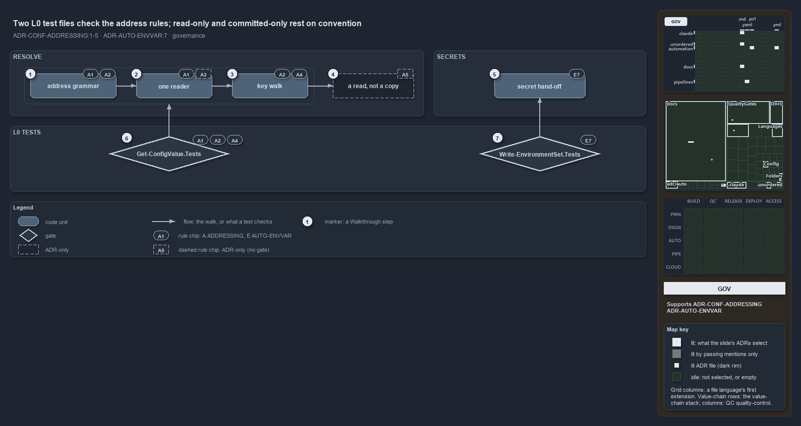

---
catzc:
  immutable:
    with_body_sha: "7e375ce38235"
    repo_status: clean
    path: docs/explanation/configuration/two-test-files-check-the-address-rules.md
    folder: docs/explanation/configuration
    name: two-test-files-check-the-address-rules
    filetype: md
    kind: explanation
    language: markdown
    track: docs
    tracktype: documentation
  edges:
    cites:
      - ADR-AUTO-ENVVAR#7
      - ADR-CONF-ADDRESSING
    links:
      - docs/adr/automation/environment-variables.md
      - docs/adr/configuration/config-value-addressing.md
      - docs/explanation/.assets/adr-conf-addressing--two-test-files-check-the-address-rules--governance.drawio.png
      - docs/explanation/configuration/an-address-is-a-read-only-walk.md
      - docs/explanation/configuration/callers-in-four-modules-share-one-resolver.md
      - docs/explanation/configuration/index.md
      - docs/explanation/configuration/strip-split-walk-every-wrong-turn-throws.md
      - docs/explanation/configuration/two-test-files-check-the-address-rules.drawio.md
      - docs/explanation/configuration/type-an-address-get-the-value.md
      - docs/explanation/index.md#how-to-read-the-diagrams
---

# Two L0 test files check the address rules; read-only and committed-only rest on convention

```text
Two L0 test files check the address rules; read-only and committed-only rest on convention.

1  address grammar               global.<config>.<key>… names one node (A1, A2); the grammar is checked at binding
2  one reader                    resolved on Get-Config (A1), over committed config only (A3); A3 has no check
3  key walk                      dictionary key, else property (A2); every wrong turn throws (A4)
4  a read, not a copy            the node is never mutated (A5); nothing enforces it
5  secret hand-off               a secret crosses only through Write-EnvironmentSet (E7)
6  Get-ConfigValue.Tests         the L0 file that checks A1, A2 and A4
7  Write-EnvironmentSet.Tests    the L0 file that checks E7

Supports ADR-CONF-ADDRESSING#1, #2, #3, #4 and #5, and ADR-AUTO-ENVVAR#7 (governance lens).
```

Five addressing rules and one environment-variable rule constrain how cats dereferences a global config address. Each stage of the walk
carries the rules that govern it, set against what checks them. No quality gate looks at addresses; two L0 test files do, one for the
grammar, the reader and the walk, and one for the secret hand-off. Two rules rest on convention: that a resolved node is never written
through, and that nothing an address can reach is a secret.



The diagram is described element by element in [its asset description](two-test-files-check-the-address-rules.drawio.md). Rule chips name
the rules: `A` is ADR-CONF-ADDRESSING and `E` is ADR-AUTO-ENVVAR.

## Walkthrough

1. **address grammar.** An address is `global.<config>.<key>[.<key>…]` and names exactly one node; the first segment after `global.` is the
   config's global name and the key path is optional (A1, A2). A `ValidatePattern` on `-Address` rejects a malformed address when the
   parameter binds, and the test file pins four malformed forms.
2. **one reader.** `Get-ConfigValue` is built on `Get-Config`, so addressing is a walk over a config already loaded, never a second reader
   (A1). The reader opens only a committed `configs/<name>.yml`, so nothing addressable is a secret (A3); that holds by construction, and no
   test or gate checks it.
3. **key walk.** Each segment resolves as a dictionary key when the node is a dictionary, otherwise as a property, uniformly over raw and
   typed configs (A2), and a segment that resolves at neither throws, naming the address and the segment; an unknown or ambiguous name
   throws from the reader (A4).
4. **a read, not a copy.** A resolved node may be a live reference into the config cache and must never be mutated (A5). The test file pins
   that the node is the same reference; nothing in the code or the tests stops a caller from writing through it.
5. **secret hand-off.** A secret reaches a child process only through `Write-EnvironmentSet`, as a `[SecureString]`, masked in every
   message, decrypted only at the assignment, and restored when the scoped block ends (E7).
6. **Get-ConfigValue.Tests.** The L0 logic tests mock `Get-Config` and check the grammar over a raw dictionary and a typed object, the
   `-Module` passthrough, the four malformed forms, and the two throws of the walk (A1, A2, A4). One integrity test resolves `global.tools`
   through the live reader.
7. **Write-EnvironmentSet.Tests.** The L0 logic tests mock the environment write and check that a secret is decrypted for the assignment,
   that the plaintext never reaches a message and `***` does, that a bare literal in `-Set` is rejected, and that a scoped call restores
   every variable (E7).

## Why it holds

- An address names one node and is resolved by `Get-ConfigValue` on top of the one reader (ADR-CONF-ADDRESSING#1).
- The first segment is the config's global name; each following segment is a key on a dictionary node, otherwise a property
  (ADR-CONF-ADDRESSING#2).
- An address references only version-controlled config, so secrets never have addresses (ADR-CONF-ADDRESSING#3).
- Resolution fails fast: unknown name, bad segment and malformed address all throw (ADR-CONF-ADDRESSING#4).
- A resolved node is a read, never mutated (ADR-CONF-ADDRESSING#5).
- A secret crosses to a child or external process only through `Write-EnvironmentSet` (ADR-AUTO-ENVVAR#7).

## Where the code and the ADR differ

- The read-only rule is stated by the ADR and repeated in the help texts, and no code or test prevents a write through a resolved node.
- The loading ADR says only `Get-Config` is public, while the addressing ADR makes `Get-ConfigValue` public as well, and it is.
- The help texts of `Get-ConfigValue`, `Resolve-ConfigKeyPath` and `Write-EnvironmentSet` cite the addressing ADR by its file name, not by
  `ADR-CONF-ADDRESSING`.

## See also

- [Config value addressing](../../adr/configuration/config-value-addressing.md) — the decision this article explains, and
  [environment variables](../../adr/automation/environment-variables.md) for the secret hand-off.
- The other lenses on the same walk: [meta](an-address-is-a-read-only-walk.md),
  [architecture](callers-in-four-modules-share-one-resolver.md), [implementation](strip-split-walk-every-wrong-turn-throws.md) and
  [operations](type-an-address-get-the-value.md).
- [The configuration explanations](index.md) · [How to read the diagrams](../index.md#how-to-read-the-diagrams)
