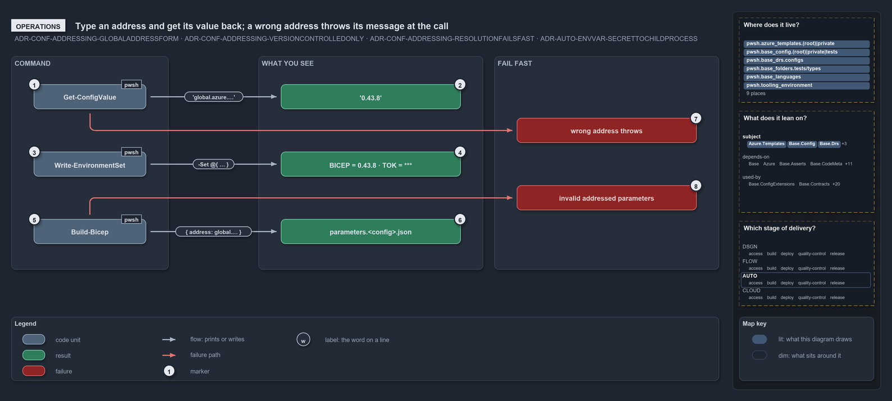

---
catzc:
  warning: "Header is generated by Format-FileMeta via Format-Code; do not change it"
  edges:
    cites:
      - ADR-AUTO-ENVVAR-SECRETTOCHILDPROCESS
      - ADR-CONF-ADDRESSING-GLOBALADDRESSFORM
      - ADR-CONF-ADDRESSING-VERSIONCONTROLLEDONLY
      - ADR-CONF-ADDRESSING-RESOLUTIONFAILSFAST
    drs_total: 4
---

# Type an address and get its value back; a wrong address throws its message at the call

```text
Type an address and get its value back; a wrong address throws its message at the call.

1  Get-ConfigValue               the command: one address in, its value out
2  '0.43.8'                      what global.azure.bicep_min_version returns
3  Write-EnvironmentSet          addresses and secrets into a child's environment
4  BICEP = 0.43.8 · TOK = ***    the lines it prints: the value with its address, the secret masked
5  Build-Bicep                   resolves the { address: … } parameters of every template config
6  parameters.<config>.json      the rendered parameters file, addresses replaced by values
7  wrong address throws          a malformed address, an unknown config or a bad key, at the call
8  invalid addressed parameters  one throw naming the config file and every bad parameter

Supports ADR-CONF-ADDRESSING-GLOBALADDRESSFORM, ADR-CONF-ADDRESSING-VERSIONCONTROLLEDONLY and ADR-CONF-ADDRESSING-RESOLUTIONFAILSFAST, and ADR-AUTO-ENVVAR-SECRETTOCHILDPROCESS (operations lens).
```

Three commands dereference a global config address in cats, and each shows the person or the pipeline step that runs it the same two things:
the value the address names, and a message at the call when the address is wrong. `Get-ConfigValue` returns the value,
`Write-EnvironmentSet` puts it into a child process's environment next to secrets it masks, and `Build-Bicep` writes it into a template's
parameters file.

```yml drawio
description:
  "Three commands dereference a global config address and show the same two things: Get-ConfigValue returns the value, Write-EnvironmentSet
  prints it with secrets masked, and Build-Bicep renders it into a parameters file; a wrong address throws a message at the call."
about:
  adrs:
    - ADR-CONF-ADDRESSING-GLOBALADDRESSFORM
    - ADR-CONF-ADDRESSING-VERSIONCONTROLLEDONLY
    - ADR-CONF-ADDRESSING-RESOLUTIONFAILSFAST
    - ADR-AUTO-ENVVAR-SECRETTOCHILDPROCESS
  lens: operations
content:
  title: Type an address and get its value back; a wrong address throws its message at the call
  kind: explanation
  flow: left-to-right
  relation: prints or writes
  theme: dark
  bands:
    - { id: band-command, label: COMMAND }
    - { id: band-see, label: WHAT YOU SEE }
    - { id: band-fail, label: FAIL FAST }
  glyphs:
    - { id: g-value, kind: code, label: Get-ConfigValue, in: band-command }
    - { id: g-env, kind: code, label: Write-EnvironmentSet, in: band-command }
    - { id: g-build, kind: code, label: Build-Bicep, in: band-command }
    - { id: r-value, kind: result, label: "'0.43.8'", in: band-see }
    - { id: r-lines, kind: result, label: BICEP = 0.43.8 · TOK = ***, in: band-see }
    - { id: r-params, kind: result, label: parameters.<config>.json, in: band-see }
    - { id: f-wrong, kind: failure, label: wrong address throws, in: band-fail }
    - { id: f-invalid, kind: failure, label: invalid addressed parameters, in: band-fail }
  edges:
    - { from: g-value, to: r-value, kind: flow, label: "'global.azure.…'" }
    - { from: g-env, to: r-lines, kind: flow, label: "-Set @{ … }" }
    - { from: g-build, to: r-params, kind: flow, label: "{ address: global.… }" }
    - { from: g-value, to: f-wrong, kind: fail, label: "" }
    - { from: g-build, to: f-invalid, kind: fail, label: "" }
  markers:
    - { at: g-value, number: 1 }
    - { at: r-value, number: 2 }
    - { at: g-env, number: 3 }
    - { at: r-lines, number: 4 }
    - { at: g-build, number: 5 }
    - { at: r-params, number: 6 }
    - { at: f-wrong, number: 7 }
    - { at: f-invalid, number: 8 }
  legend: auto
  minimaps: [code-locations, module-neighbourhood, axis]
layout:
  band-command: { x: 20, y: 84, w: 280, h: 380 }
  band-see: { x: 460, y: 84, w: 400, h: 380 }
  band-fail: { x: 880, y: 84, w: 400, h: 380 }
  g-value: { x: 60, y: 134, w: 200, h: 44 }
  g-env: { x: 60, y: 254, w: 200, h: 44 }
  g-build: { x: 60, y: 374, w: 200, h: 44 }
  r-value: { x: 500, y: 134, w: 320, h: 44 }
  r-lines: { x: 500, y: 254, w: 320, h: 44 }
  r-params: { x: 500, y: 374, w: 320, h: 44 }
  f-wrong: { x: 920, y: 194, w: 320, h: 44 }
  f-invalid: { x: 920, y: 314, w: 320, h: 44 }
```



## Walkthrough

1. **Get-ConfigValue.** The command you type: `Get-ConfigValue -Address 'global.azure.bicep_min_version'`. Add `-Module` only for a config
   name that two modules ship.
2. **'0.43.8'.** The value comes straight back: the string `0.43.8` from `azure.yml`. An address with no keys, such as `global.azure`,
   returns the whole typed config, and a subtree address returns that subtree.
3. **Write-EnvironmentSet.** `Write-EnvironmentSet -Set @{ BICEP = 'global.azure.bicep_min_version'; TOK = $secure } -ScriptBlock { … }`
   takes two kinds of entry: a `global.…` address, resolved through `Get-ConfigValue`, and a `[SecureString]` secret. A bare literal string
   in `-Set` throws and points you to `-Value`, so a literal is never mistaken for a secret or an address.
4. **BICEP = 0.43.8 · TOK = \*\*\*.** It prints one line per variable:
   `Setting environment variable: BICEP = 0.43.8 (from global.azure.bicep_min_version)` for the address, and
   `Setting environment variable: TOK = ***` for the secret, whose plaintext is never logged or returned. A subtree address fans out under
   its prefix, uppercased with `.` as `_`. When the script block ends, every variable is restored, and one that was unset before is removed.
5. **Build-Bicep.** `Build-Bicep -Template discovery` loads each slot's config and resolves every parameter written as
   `{ address: global.<config>.<key>… }` into `{ value: … }`; the shipped `discovery` configs address `global.azure.subscriptions` and
   `global.azure.policy_enforcement.production`, for example. A secure parameter takes a Key Vault `reference`, never an address.
6. **parameters.&lt;config&gt;.json.** The rendered file lands under `out/template/<name>/`, named `parameters.<config>.json` for a root
   slot or `parameters.<customer>.<config>.json` for a customer slot, with the addressed entries replaced by their values.
7. **wrong address throws.** `Get-ConfigValue` throws at the call, and the message names the problem:
   `Cannot validate argument on parameter 'Address'` for a malformed address such as `global.Azure.x`;
   `No config '<name>' found in any module's configs/ folder.` for a config no module ships;
   `Config address '<address>': '<key>' is neither a dictionary key nor a property on the config node.` for a bad key. Nothing returns an
   empty value.
8. **invalid addressed parameters.** `Build-Bicep` collects every bad parameter of a config and throws once:
   `Template config '<file>' has invalid config-addressed parameters:` followed by one line per parameter, whether its address does not
   resolve, is not a string, or is set together with `value` or `reference`.

## Why it holds

- An address names exactly one node and is resolved by `Get-ConfigValue`, built on the one reader; it is data a command can take and a
  config file can carry (ADR-CONF-ADDRESSING-GLOBALADDRESSFORM).
- An address reaches only version-controlled config, so an address-sourced value is non-secret and can be logged with its address, while a
  secret travels as a `[SecureString]` (ADR-CONF-ADDRESSING-VERSIONCONTROLLEDONLY).
- Resolution fails fast: a wrong name, a wrong key or a malformed address throws at the call, never a silent empty value
  (ADR-CONF-ADDRESSING-RESOLUTIONFAILSFAST).
- A secret crosses to a child process only through `Write-EnvironmentSet`, taken as a protected value, masked as `***`, decrypted only at
  the assignment, and restored when the scoped block ends (ADR-AUTO-ENVVAR-SECRETTOCHILDPROCESS).

## See also

- [Config value addressing](../../drs/configuration/config-value-addressing.md) — the decision this article explains, and
  [environment variables](../../drs/automation/environment-variables.md) for the secret hand-off.
- The other lenses on the same walk: [meta](an-address-is-a-read-only-walk.md),
  [architecture](callers-in-four-modules-share-one-resolver.md), [implementation](strip-split-walk-every-wrong-turn-throws.md) and
  [governance](two-test-files-check-the-address-rules.md).
- [The configuration explanations](index.md) · [How to read the diagrams](../index.md#how-to-read-the-diagrams)
