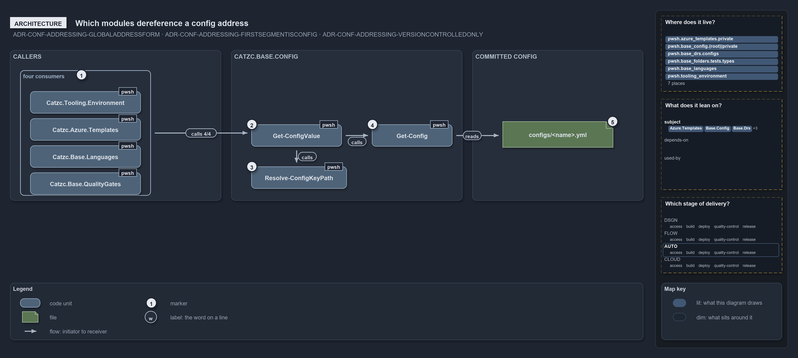

# Which modules dereference a config address

```text
Which modules dereference a config address.

1  callers                  four modules hold addresses and hand them to Catzc.Base.Config
2  Get-ConfigValue          the public resolver: strip the marker, read the config, walk the keys
3  Resolve-ConfigKeyPath    the private walk, one segment at a time
4  Get-Config               the one reader the resolver is built on
5  configs/<name>.yml       the committed file the reader opens; all an address can reach

Supports ADR-CONF-ADDRESSING-GLOBALADDRESSFORM, ADR-CONF-ADDRESSING-FIRSTSEGMENTISCONFIG
and ADR-CONF-ADDRESSING-VERSIONCONTROLLEDONLY (architecture lens).
```

A global config address can be held by code in any module, but only one module knows how to dereference it. `Catzc.Base.Config` exports the
resolver, `Get-ConfigValue`, keeps the key walk private, and builds the resolver on its own reader, `Get-Config`. Four modules hold
addresses today, and every one of them depends on the same module and the same public pair, while the only file an address can reach is a
committed `configs/<name>.yml` in the module that ships it.

```yml drawio
description:
  Four modules hold config addresses and hand them to the one public resolver in Catzc.Base.Config, which keeps the key walk private and
  builds on its own reader; the only file an address can reach is a committed config file.
about:
  rules: [ADR-CONF-ADDRESSING-GLOBALADDRESSFORM, ADR-CONF-ADDRESSING-FIRSTSEGMENTISCONFIG, ADR-CONF-ADDRESSING-VERSIONCONTROLLEDONLY]
  lens: architecture
content:
  title: Which modules dereference a config address
  kind: explanation
  flow: left-to-right
  theme: dark
  bands:
    - { id: band-callers, label: CALLERS }
    - { id: band-config, label: CATZC.BASE.CONFIG }
    - { id: band-committed, label: COMMITTED CONFIG }
  groups:
    - { id: grp-consumers, label: four consumers, in: band-callers }
  glyphs:
    - { id: g-environment, kind: code, label: Catzc.Tooling.Environment, in: grp-consumers }
    - { id: g-templates, kind: code, label: Catzc.Azure.Templates, in: grp-consumers }
    - { id: g-languages, kind: code, label: Catzc.Base.Languages, in: grp-consumers }
    - { id: g-gates, kind: code, label: Catzc.Base.QualityGates, in: grp-consumers }
    - { id: g-value, kind: code, label: Get-ConfigValue, in: band-config }
    - { id: g-walk, kind: code, label: Resolve-ConfigKeyPath, in: band-config }
    - { id: g-reader, kind: code, label: Get-Config, in: band-config }
    - { id: g-file, kind: file, label: configs/<name>.yml, in: band-committed }
  edges:
    - { from: grp-consumers, to: g-value, kind: flow, label: calls, count: 4/4 }
    - { from: g-value, to: g-walk, kind: flow, label: calls }
    - { from: g-value, to: g-reader, kind: flow, label: calls }
    - { from: g-reader, to: g-file, kind: flow, label: "" }
  markers:
    - { at: grp-consumers, number: 1 }
    - { at: g-value, number: 2 }
    - { at: g-walk, number: 3 }
    - { at: g-reader, number: 4 }
    - { at: g-file, number: 5 }
  legend: auto
  minimaps: [code-locations, module-neighbourhood, axis]
layout:
  band-callers: { x: 20, y: 84, w: 420, h: 300 }
  band-config: { x: 460, y: 84, w: 460, h: 300 }
  band-committed: { x: 940, y: 84, w: 340, h: 300 }
  grp-consumers: { x: 40, y: 124, w: 260, h: 250 }
  g-environment: { x: 60, y: 166, w: 220, h: 44 }
  g-templates: { x: 60, y: 220, w: 220, h: 44 }
  g-languages: { x: 60, y: 274, w: 220, h: 44 }
  g-gates: { x: 60, y: 328, w: 220, h: 44 }
  g-value: { x: 500, y: 232, w: 180, h: 44 }
  g-walk: { x: 500, y: 316, w: 190, h: 44 }
  g-reader: { x: 740, y: 232, w: 160, h: 44 }
  g-file: { x: 1000, y: 226, w: 220, h: 52 }
```



## Walkthrough

1. **Callers.** Four modules dereference addresses. `Catzc.Tooling.Environment` resolves the `global.…` entries of `Write-EnvironmentSet`'s
   `-Set` map; `Catzc.Azure.Templates` resolves the `{ address: … }` parameters of a template config in `Resolve-BicepParameterAddresses`,
   which `Build-Bicep` runs for every slot; `Catzc.Base.Languages` reads the Go and Python tool pins in `New-GoWorkspace` and
   `New-PythonProject`; and `Catzc.Base.QualityGates` reads the cspell pin in `Test-GeneratedFiles`. Each holds the address as a string and
   depends on `Catzc.Base.Config` for its value.
2. **Get-ConfigValue.** The public resolver. It takes `-Address` and an optional `-Module`, strips the `global.` marker, splits the rest
   into the config's global name and the key path, reads the named config through `Get-Config`, and hands the node and the keys to the walk.
   It opens no file and caches nothing.
3. **Resolve-ConfigKeyPath.** The walk lives in one private function so the resolver stays a thin strip-split-walk and the walk can be
   tested on its own. For each segment it resolves a dictionary key when the node is a dictionary, otherwise a property, so a typed C#
   config and a raw ordered dictionary traverse the same way.
4. **Get-Config.** The one config reader, the same one every direct config read uses. It discovers the owning module from the name alone, so
   `-Module` is only for the rare name two modules ship, and it returns the same cached object on every call.
5. **configs/&lt;name&gt;.yml.** The only file the reader opens is the owning module's committed config file, discovered by scanning the
   modules' `configs/` folders. Everything an address can name lives in git, so nothing addressable is a secret; a secret reaches
   `Write-EnvironmentSet` as a `[SecureString]` and never as an address.

## Why it holds

- `Get-ConfigValue` is public in `Catzc.Base.Config` and built on `Get-Config`, so addressing adds a grammar and a walk on top of the one
  reader and the one cache, never a second reader (ADR-CONF-ADDRESSING-GLOBALADDRESSFORM).
- The first segment after `global.` is the config's global name and the owning module is discovered, not written into the address; each
  following segment resolves as a dictionary key, otherwise as a property (ADR-CONF-ADDRESSING-FIRSTSEGMENTISCONFIG).
- An address references only version-controlled config, so anything addressable is non-secret, and secrets travel out of band as a
  `[SecureString]` through the one sanctioned seam (ADR-CONF-ADDRESSING-VERSIONCONTROLLEDONLY).

## Where the code and the decision record differ

The loading record says only `Get-Config` is public, while the addressing record makes `Get-ConfigValue` public as well, and it is.

## See also

- [Config value addressing](../../drs/configuration/config-value-addressing.md) — the decision this article explains.
- The other lenses on the same walk: [meta](how-a-config-address-is-read.md), [implementation](how-a-config-address-is-walked.md),
  [operations](how-a-config-address-becomes-a-value.md) and [governance](what-tests-the-config-address-rules.md).
- [The configuration explanations](index.md) · [How to read the diagrams](../index.md#how-to-read-the-diagrams)
