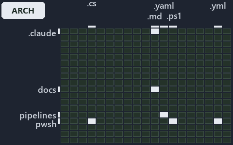

---
catzc:
  immutable:
    with_body_sha: cef5f5489db6
    repo_status: locked
    path: docs/explanation/design/.assets/10-commits-story/grid.md
    source: docs/explanation/design/.assets/10-commits-story/diagram.drawio.png
    role: asset-description
    language: markdown
    filetype: md
    track: docs
    tracktype: documentation
---

# Ten numbered commits trace the whole lifecycle across pipeline, environments and git: the world-map minimap

```text
Where the files that cite ADR-DSGN-LIFE, ADR-DSGN-VISUAL and ADR-FLOW-CD sit in the repository: tracks down, file languages across.
6 of 342 cells lit, holding 118 files.
```



This is the world-map minimap in the sidebar of the architecture diagram of [Ten numbered commits trace the whole lifecycle across pipeline,
environments and git][120], which explains [ADR-DSGN-LIFE][1], [ADR-DSGN-VISUAL][2] and [ADR-FLOW-CD][3]. It lights every cell of the world
map that holds a file citing those codes, so it shows where the decision lives in the repository. Each lit cell has its reason below, naming
the code that selects it.

## What the minimap shows

The grid crosses the 18 tracks (rows) with the 19 file languages (columns) of the world map and lights 6 cells, filled in ink. A cell lit
only by passing mentions (citations in body comments, not in a file's header or text) is touched: a lighter ink. Every other cell is idle, a
grey box: it holds files the slide's ADR codes do not select, or no file at all (288 of the 342 cells hold none). The minimap shows where
the slide sits, not how many files a cell holds; the world-map PDFs show the counts.

- .claude × markdown: 6 lit of 64 files
- docs × markdown: 92 lit of 2781 files
- pipelines × pipeline-yaml: 3 lit of 14 files
- pwsh × csharp: 3 lit of 295 files
- pwsh × powershell: 6 lit of 1653 files
- pwsh × yaml: 8 lit of 115 files

## Key

A lit row prints its track's name; a lit column prints a short code, the first extension of its file language:

- `.cs`: csharp
- `.md`: markdown
- `.yaml`: pipeline-yaml
- `.ps1`: powershell
- `.yml`: yaml

## Why each cell is lit

### .claude × markdown (6 lit files)

Placed: the root folder `.claude/` names the track .claude ([ADR-DSGN-TRACK-TRACKISPLACEDCLUSTER][4]); the extension `.md` names the file
language markdown ([ADR-DSGN-TRACK-FILELANGUAGE][4]). Lit ([ADR-DSGN-TRACK-LITCELL][4]) by:

- [.claude/CLAUDE.md][5]: selected by [ADR-FLOW-CD][3]: the file cites it at line 55 (text) and line 56 (text).
- [.claude/plans/plan-diagram-folders-rest.md][6]: selected by [ADR-DSGN-VISUAL][2]: the file cites it at line 66 (text).
- [.claude/plans/plan-explanation-drift-gaps.md][7]: selected by [ADR-FLOW-CD][3]: the file cites it at line 17 (text) and line 18 (text).
- [.claude/plans/plan-fast-push-followups.md][8]: selected by [ADR-DSGN-LIFE][1]: the file cites it at line 13 (text) and line 18 (text).
- [.claude/plans/plan-promotion-ladder.md][9]: selected by [ADR-DSGN-LIFE][1]: the file cites it at line 11 (text) and line 38 (text);
  selected by [ADR-FLOW-CD][3]: the file cites it at line 11 (text), line 13 (text) and line 38 (text).
- [.claude/plans/value-of-plan.md][10]: selected by [ADR-DSGN-LIFE][1]: the file cites it at line 33 (text); selected by [ADR-FLOW-CD][3]:
  the file cites it at line 33 (text).

### docs × markdown (92 lit files)

Placed: the root folder `docs/` names the track docs ([ADR-DSGN-TRACK-TRACKISPLACEDCLUSTER][4]); the extension `.md` names the file language
markdown ([ADR-DSGN-TRACK-FILELANGUAGE][4]). Lit ([ADR-DSGN-TRACK-LITCELL][4]) by:

- [docs/adr/design/.assets/commit-lifecycle-states/chain.md][11]: selected by [ADR-DSGN-LIFE][1]: the file cites it at line 18 (text), line
  25 (text), line 61 (text), line 61 (text), line 69 (text), line 69 (text), line 77 (text) and line 77 (text).
- [docs/adr/design/.assets/commit-lifecycle-states/grid.md][12]: selected by [ADR-DSGN-LIFE][1]: the file cites it at line 18 (text), line
  25 (text), line 55 (text), line 56 (text), line 57 (text), line 64 (text), line 66 (text), line 70 (text), line 74 (text), line 76 (text),
  line 80 (text), line 84 (text), line 85 (text), line 86 (text), line 87 (text), line 88 (text), line 95 (text), line 104 (text), line 105
  (text) and line 106 (text).
- [docs/adr/design/.assets/commit-lifecycle-states/tree.md][13]: selected by [ADR-DSGN-LIFE][1]: the file cites it at line 18 (text), line
  25 (text), line 48 (text), line 50 (text), line 54 (text), line 58 (text), line 60 (text), line 64 (text), line 68 (text), line 69 (text),
  line 75 (text), line 77 (text), line 79 (text), line 85 (text), line 87 (text), line 93 (text), line 94 (text), line 101 (text), line 108
  (text) and line 116 (text).
- [docs/adr/design/.assets/sync-point/chain.md][14]: selected by [ADR-DSGN-LIFE][1]: the file cites it at line 18 (text), line 25 (text),
  line 61 (text), line 61 (text), line 69 (text), line 69 (text), line 77 (text) and line 77 (text).
- [docs/adr/design/.assets/sync-point/grid.md][15]: selected by [ADR-DSGN-LIFE][1]: the file cites it at line 18 (text), line 25 (text),
  line 55 (text), line 56 (text), line 57 (text), line 64 (text), line 66 (text), line 70 (text), line 74 (text), line 76 (text), line 80
  (text), line 84 (text), line 85 (text), line 86 (text), line 87 (text), line 88 (text), line 95 (text), line 104 (text), line 105 (text)
  and line 106 (text).
- [docs/adr/design/.assets/sync-point/tree.md][16]: selected by [ADR-DSGN-LIFE][1]: the file cites it at line 18 (text), line 25 (text),
  line 48 (text), line 50 (text), line 54 (text), line 58 (text), line 60 (text), line 64 (text), line 68 (text), line 69 (text), line 75
  (text), line 77 (text), line 79 (text), line 85 (text), line 87 (text), line 93 (text), line 94 (text), line 101 (text), line 108 (text)
  and line 116 (text).
- [docs/adr/design/commit-lifecycle.md][1]: selected by [ADR-DSGN-LIFE][1]: the ADR's own file.
- [docs/adr/design/dora-explains.md][17]: selected by [ADR-DSGN-LIFE][1]: the file cites it at line 82 (text); selected by
  [ADR-DSGN-VISUAL][2]: the file cites it at line 63 (text).
- [docs/adr/design/visual-design.md][2]: selected by [ADR-DSGN-VISUAL][2]: the ADR's own file.
- [docs/adr/flow/cd-discipline-and-promotion-flow.md][3]: selected by [ADR-FLOW-CD][3]: the ADR's own file.
- [docs/adr/flow/dora-explains.md][18]: selected by [ADR-FLOW-CD][3]: the file cites it at line 11 (text), line 31 (text), line 49 (text),
  line 67 (text) and line 92 (text).
- [docs/adr/glossary.md][19]: selected by [ADR-DSGN-LIFE][1]: the file cites it at line 272 (text) and line 346 (text); selected by
  [ADR-FLOW-CD][3]: the file cites it at line 506 (text) and line 519 (text).
- [docs/adr/index.md][20]: selected by [ADR-DSGN-LIFE][1]: the file cites it at line 112 (text); selected by [ADR-DSGN-VISUAL][2]: the file
  cites it at line 111 (text); selected by [ADR-FLOW-CD][3]: the file cites it at line 129 (text), line 130 (text), line 131 (text), line
  132 (text) and line 133 (text).
- [docs/how-to/automation/apply-environment-approvals.md][21]: selected by [ADR-FLOW-CD][3]: the file cites it at line 4 (text).
- [docs/how-to/pwsh/manual-test-plan/pipelines-and-globs.md][22]: selected by [ADR-FLOW-CD][3]: the file cites it at line 16 (text).
- [docs/references/pipelines/cd-apex.yaml.md][23]: selected by [ADR-FLOW-CD][3]: the file cites it at line 31 (text).
- [docs/references/pipelines/cd-flux.yaml.md][24]: selected by [ADR-FLOW-CD][3]: the file cites it at line 30 (text).
- [docs/references/pipelines/cd-nova.yaml.md][25]: selected by [ADR-FLOW-CD][3]: the file cites it at line 30 (text).
- [docs/references/pipelines/cd-shared.yaml.md][26]: selected by [ADR-FLOW-CD][3]: the file cites it at line 12 (text) and line 22 (text).
- [docs/references/pipelines/ci-automation.yaml.md][27]: selected by [ADR-FLOW-CD][3]: the file cites it at line 12 (text).
- [docs/references/pipelines/ci-infrastructure.yaml.md][28]: selected by [ADR-FLOW-CD][3]: the file cites it at line 12 (text) and line 13
  (text).
- [docs/references/pipelines/deploy-apex.yaml.md][29]: selected by [ADR-FLOW-CD][3]: the file cites it at line 12 (text) and line 21 (text).
- [docs/references/pipelines/deploy-nova.yaml.md][30]: selected by [ADR-FLOW-CD][3]: the file cites it at line 12 (text).
- [docs/references/pipelines/deploy-shared.yaml.md][31]: selected by [ADR-FLOW-CD][3]: the file cites it at line 12 (text).
- [docs/references/pipelines/github-workflows/ci-automation.yml.md][32]: selected by [ADR-FLOW-CD][3]: the file cites it at line 12 (text).
- [docs/references/pipelines/stages/deploy-unit.yaml.md][33]: selected by [ADR-FLOW-CD][3]: the file cites it at line 11 (text).
- [docs/references/pipelines/steps/download-artifact.yaml.md][34]: selected by [ADR-FLOW-CD][3]: the file cites it at line 12 (text).
- [docs/references/pipelines/steps/invoke-automation.yaml.md][35]: selected by [ADR-FLOW-CD][3]: the file cites it at line 28 (text).
- [docs/references/pwsh/.assets/protected-module-skip-by-hash/diagram.drawio.md][36]: selected by [ADR-FLOW-CD][3]: the file cites it at
  line 26 (text), line 33 (text), line 108 (text), line 108 (text) and line 109 (text).
- [docs/references/pwsh/.assets/protected-module-skip-by-hash/diagram.drawio.verify.md][37]: selected by [ADR-FLOW-CD][3]: the file cites it
  at line 55 (text), line 55 (text) and line 55 (text).
- [docs/references/pwsh/catzc-azure-devops-buildvalidation/Get-AdoBuildValidations.ps1.md][38]: selected by [ADR-FLOW-CD][3]: the file cites
  it at line 15 (text) and line 17 (text).
- [docs/references/pwsh/catzc-azure-devops-buildvalidation/Register-AdoBuildValidation.ps1.md][39]: selected by [ADR-FLOW-CD][3]: the file
  cites it at line 14 (text), line 16 (text) and line 74 (text).
- [docs/references/pwsh/catzc-azure-devops-buildvalidation/Unregister-AdoBuildValidation.ps1.md][40]: selected by [ADR-FLOW-CD][3]: the file
  cites it at line 15 (text).
- [docs/references/pwsh/catzc-azure-devops-buildvalidation/configs/build-validation.yml.md][41]: selected by [ADR-FLOW-CD][3]: the file
  cites it at line 12 (text) and line 15 (text).
- [docs/references/pwsh/catzc-azure-devops-buildvalidation/private/Get-BuildValidationPathFilter.ps1.md][42]: selected by [ADR-FLOW-CD][3]:
  the file cites it at line 16 (text) and line 19 (text).
- [docs/references/pwsh/catzc-azure-devops-buildvalidation/types/BuildValidationConfig.cs.md][43]: selected by [ADR-FLOW-CD][3]: the file
  cites it at line 13 (text).
- [docs/references/pwsh/catzc-azure-devops-buildvalidation/types/BuildValidationEntry.cs.md][44]: selected by [ADR-FLOW-CD][3]: the file
  cites it at line 12 (text).
- [docs/references/pwsh/catzc-azure-devops/New-AdoPullRequest.ps1.md][45]: selected by [ADR-FLOW-CD][3]: the file cites it at line 14
  (text).
- [docs/references/pwsh/catzc-azure-devops/Sync-AdoEnvironmentApprovals.ps1.md][46]: selected by [ADR-FLOW-CD][3]: the file cites it at line
  15 (text).
- [docs/references/pwsh/catzc-azure-templates/Get-BicepDeploymentName.ps1.md][47]: selected by [ADR-FLOW-CD][3]: the file cites it at line
  58 (text).
- [docs/references/pwsh/catzc-azure-templates/Set-BicepTemplateConfiguration.ps1.md][48]: selected by [ADR-FLOW-CD][3]: the file cites it at
  line 26 (text).
- [docs/references/pwsh/catzc-base-docs/types/AdrsConfig.cs.md][49]: selected by [ADR-FLOW-CD][3]: the file cites it at line 28 (text), line
  29 (text), line 57 (text) and line 58 (text).
- [docs/references/pwsh/catzc-base-docs/types/GlossaryConcept.cs.md][50]: selected by [ADR-FLOW-CD][3]: the file cites it at line 34 (text).
- [docs/references/pwsh/catzc-base-exporter/Get-CatzcContentHash.ps1.md][51]: selected by [ADR-FLOW-CD][3]: the file cites it at line 14
  (text).
- [docs/references/pwsh/catzc-base-git/Push-Dirty.ps1.md][52]: selected by [ADR-DSGN-LIFE][1]: the file cites it at line 14 (text).
- [docs/references/pwsh/catzc-base-globs.md][53]: selected by [ADR-FLOW-CD][3]: the file cites it at line 27 (text).
- [docs/references/pwsh/catzc-base-globs/Get-ChangedGlobSet.ps1.md][54]: selected by [ADR-FLOW-CD][3]: the file cites it at line 15 (text)
  and line 27 (text).
- [docs/references/pwsh/catzc-base-globs/Get-GlobSet.ps1.md][55]: selected by [ADR-FLOW-CD][3]: the file cites it at line 14 (text).
- [docs/references/pwsh/catzc-base-globs/Get-GlobSetChangeRange.ps1.md][56]: selected by [ADR-FLOW-CD][3]: the file cites it at line 15
  (text) and line 26 (text).
- [docs/references/pwsh/catzc-base-globs/Get-GlobSetFile.ps1.md][57]: selected by [ADR-FLOW-CD][3]: the file cites it at line 14 (text) and
  line 16 (text).
- [docs/references/pwsh/catzc-base-globs/Get-GlobSetHash.ps1.md][58]: selected by [ADR-FLOW-CD][3]: the file cites it at line 20 (text).
- [docs/references/pwsh/catzc-base-globs/Get-GlobSetTrigger.ps1.md][59]: selected by [ADR-FLOW-CD][3]: the file cites it at line 15 (text),
  line 29 (text) and line 30 (text).
- [docs/references/pwsh/catzc-base-globs/Get-MarkerBlastRadius.ps1.md][60]: selected by [ADR-FLOW-CD][3]: the file cites it at line 14
  (text).
- [docs/references/pwsh/catzc-base-globs/Get-ModuleGlobSet.ps1.md][61]: selected by [ADR-FLOW-CD][3]: the file cites it at line 58 (text),
  line 61 (text) and line 109 (text).
- [docs/references/pwsh/catzc-base-globs/Get-TrackedFile.ps1.md][62]: selected by [ADR-FLOW-CD][3]: the file cites it at line 15 (text).
- [docs/references/pwsh/catzc-base-globs/Test-AdoPipelineTriggerGlob.ps1.md][63]: selected by [ADR-FLOW-CD][3]: the file cites it at line 24
  (text) and line 25 (text).
- [docs/references/pwsh/catzc-base-globs/Test-GitHubWorkflowTriggerGlob.ps1.md][64]: selected by [ADR-FLOW-CD][3]: the file cites it at line
  24 (text) and line 25 (text).
- [docs/references/pwsh/catzc-base-globs/Test-GlobSetAffected.ps1.md][65]: selected by [ADR-FLOW-CD][3]: the file cites it at line 17 (text)
  and line 20 (text).
- [docs/references/pwsh/catzc-base-globs/Test-GlobSetIndependence.ps1.md][66]: selected by [ADR-FLOW-CD][3]: the file cites it at line 18
  (text), line 56 (text) and line 66 (text).
- [docs/references/pwsh/catzc-base-globs/Test-GlobSetTriggerCoverage.ps1.md][67]: selected by [ADR-FLOW-CD][3]: the file cites it at line 15
  (text).
- [docs/references/pwsh/catzc-base-globs/configs/globs.yml.md][68]: selected by [ADR-FLOW-CD][3]: the file cites it at line 12 (text), line
  17 (text), line 25 (text), line 27 (text), line 41 (text), line 71 (text) and line 85 (text).
- [docs/references/pwsh/catzc-base-globs/private/Get-ChangedFile.ps1.md][69]: selected by [ADR-FLOW-CD][3]: the file cites it at line 14
  (text).
- [docs/references/pwsh/catzc-base-globs/private/Get-GlobSetMember.ps1.md][70]: selected by [ADR-FLOW-CD][3]: the file cites it at line 14
  (text).
- [docs/references/pwsh/catzc-base-globs/private/Get-PipelineTrigger.ps1.md][71]: selected by [ADR-FLOW-CD][3]: the file cites it at line 16
  (text).
- [docs/references/pwsh/catzc-base-globs/private/Test-GlobListEqual.ps1.md][72]: selected by [ADR-FLOW-CD][3]: the file cites it at line 18
  (text).
- [docs/references/pwsh/catzc-base-globs/tests/Get-ChangedFile.Tests.ps1.md][73]: selected by [ADR-FLOW-CD][3]: the file cites it at line 13
  (text).
- [docs/references/pwsh/catzc-base-globs/tests/Get-ChangedGlobSet.Tests.ps1.md][74]: selected by [ADR-FLOW-CD][3]: the file cites it at line
  12 (text).
- [docs/references/pwsh/catzc-base-globs/tests/Get-GlobSetChangeRange.Tests.ps1.md][75]: selected by [ADR-FLOW-CD][3]: the file cites it at
  line 11 (text).
- [docs/references/pwsh/catzc-base-globs/tests/Get-GlobSetFile.Tests.ps1.md][76]: selected by [ADR-FLOW-CD][3]: the file cites it at line 12
  (text) and line 13 (text).
- [docs/references/pwsh/catzc-base-globs/tests/Get-GlobSetHash.Tests.ps1.md][77]: selected by [ADR-FLOW-CD][3]: the file cites it at line 13
  (text).
- [docs/references/pwsh/catzc-base-globs/tests/Get-GlobSetMember.Tests.ps1.md][78]: selected by [ADR-FLOW-CD][3]: the file cites it at line
  12 (text).
- [docs/references/pwsh/catzc-base-globs/tests/Get-GlobSetTrigger.Tests.ps1.md][79]: selected by [ADR-FLOW-CD][3]: the file cites it at line
  12 (text).
- [docs/references/pwsh/catzc-base-globs/tests/Get-PipelineTrigger.Tests.ps1.md][80]: selected by [ADR-FLOW-CD][3]: the file cites it at
  line 12 (text).
- [docs/references/pwsh/catzc-base-globs/tests/Get-TrackedFile.Tests.ps1.md][81]: selected by [ADR-FLOW-CD][3]: the file cites it at line 11
  (text).
- [docs/references/pwsh/catzc-base-globs/tests/GlobSet-Independence.Tests.ps1.md][82]: selected by [ADR-FLOW-CD][3]: the file cites it at
  line 12 (text).
- [docs/references/pwsh/catzc-base-globs/tests/GlobSetTrigger-Coverage.Tests.ps1.md][83]: selected by [ADR-FLOW-CD][3]: the file cites it at
  line 12 (text).
- [docs/references/pwsh/catzc-base-globs/tests/PipelineTrigger-Integrity.Tests.ps1.md][84]: selected by [ADR-FLOW-CD][3]: the file cites it
  at line 13 (text).
- [docs/references/pwsh/catzc-base-globs/tests/Test-GlobSetIndependence.Tests.ps1.md][85]: selected by [ADR-FLOW-CD][3]: the file cites it
  at line 13 (text).
- [docs/references/pwsh/catzc-base-globs/tests/types/GlobPattern.Tests.ps1.md][86]: selected by [ADR-FLOW-CD][3]: the file cites it at line
  11 (text) and line 13 (text).
- [docs/references/pwsh/catzc-base-globs/tests/types/GlobSet.Tests.ps1.md][87]: selected by [ADR-FLOW-CD][3]: the file cites it at line 12
  (text) and line 14 (text).
- [docs/references/pwsh/catzc-base-globs/tests/types/GlobsConfig.Tests.ps1.md][88]: selected by [ADR-FLOW-CD][3]: the file cites it at line
  14 (text), line 16 (text) and line 25 (text).
- [docs/references/pwsh/catzc-base-globs/types/Aspect.cs.md][89]: selected by [ADR-FLOW-CD][3]: the file cites it at line 19 (text).
- [docs/references/pwsh/catzc-base-globs/types/DurableHash.cs.md][90]: selected by [ADR-FLOW-CD][3]: the file cites it at line 11 (text) and
  line 17 (text).
- [docs/references/pwsh/catzc-base-globs/types/GlobPattern.cs.md][91]: selected by [ADR-FLOW-CD][3]: the file cites it at line 17 (text),
  line 18 (text) and line 19 (text).
- [docs/references/pwsh/catzc-base-globs/types/GlobSet.cs.md][92]: selected by [ADR-FLOW-CD][3]: the file cites it at line 13 (text), line
  15 (text), line 16 (text), line 22 (text), line 25 (text), line 27 (text), line 30 (text), line 38 (text), line 47 (text), line 65 (text),
  line 82 (text), line 92 (text), line 116 (text) and line 124 (text).
- [docs/references/pwsh/catzc-base-globs/types/GlobsConfig.cs.md][93]: selected by [ADR-FLOW-CD][3]: the file cites it at line 13 (text),
  line 17 (text), line 20 (text) and line 39 (text).
- [docs/references/pwsh/catzc-base-maps/Get-ValueChainHighlight.ps1.md][94]: selected by [ADR-FLOW-CD][3]: the file cites it at line 37
  (text).
- [docs/references/pwsh/catzc-base-maps/Get-WorldMapHighlight.ps1.md][95]: selected by [ADR-FLOW-CD][3]: the file cites it at line 54
  (text).
- [docs/references/pwsh/catzc-base-qualitygates/Test-Automation.ps1.md][96]: selected by [ADR-FLOW-CD][3]: the file cites it at line 97
  (text).
- [docs/references/pwsh/catzc-base-qualitygates/private/Get-GuidScanFiles.ps1.md][97]: selected by [ADR-FLOW-CD][3]: the file cites it at
  line 15 (text).
- [docs/references/pwsh/catzc-base-qualitygates/private/Get-ModuleProtectionIdentity.ps1.md][98]: selected by [ADR-FLOW-CD][3]: the file
  cites it at line 80 (text).
- [docs/references/pwsh/catzc-base-qualitygates/private/Resolve-TestSuite.ps1.md][99]: selected by [ADR-FLOW-CD][3]: the file cites it at
  line 17 (text).

### pipelines × pipeline-yaml (3 lit files)

Placed: the root folder `pipelines/` names the track pipelines ([ADR-DSGN-TRACK-TRACKISPLACEDCLUSTER][4]); the extension `.yaml` names the
file language pipeline-yaml ([ADR-DSGN-TRACK-FILELANGUAGE][4]). Lit ([ADR-DSGN-TRACK-LITCELL][4]) by:

- [pipelines/cd-shared.yaml][100]: selected by [ADR-FLOW-CD][3]: the file cites it at line 45 (body comment) (a passing mention only).
- [pipelines/ci-automation.yaml][101]: selected by [ADR-DSGN-LIFE][1]: a pipeline that cites nothing itself carries its globset's citations,
  which cite it at `pwsh/Catzc.Base.Docs/configs/adrs.yml` line 78 (text), `pwsh/Catzc.Base.Docs/configs/glossary.yml` line 484 (text) and
  `pwsh/Catzc.Base.ModuleSystem/configs/glossary.yml` line 49 (text); selected by [ADR-DSGN-VISUAL][2]: a pipeline that cites nothing itself
  carries its globset's citations, which cite it at `pwsh/Catzc.Base.Docs/configs/adrs.yml` line 77 (text),
  `pwsh/Catzc.Base.Docs/configs/agents.yml` line 28 (text), `pwsh/Catzc.Base.Docs/configs/agents.yml` line 28 (text),
  `pwsh/Catzc.Base.Docs/configs/agents.yml` line 34 (text), `pwsh/Catzc.Base.Docs/configs/agents.yml` line 39 (text),
  `pwsh/Catzc.Base.Docs/configs/capabilities.yml` line 74 (text), `pwsh/Catzc.Base.Docs/configs/capabilities.yml` line 79 (text),
  `pwsh/Catzc.Base.Docs/configs/capabilities.yml` line 84 (text), `pwsh/Catzc.Base.Docs/configs/capabilities.yml` line 84 (text) and
  `pwsh/Catzc.Base.Docs/configs/capabilities.yml` line 89 (text); selected by [ADR-FLOW-CD][3]: a pipeline that cites nothing itself carries
  its globset's citations, which cite it at `pwsh/Catzc.Base.Docs/configs/adrs.yml` line 97 (text), `pwsh/Catzc.Base.Docs/configs/adrs.yml`
  line 98 (text), `pwsh/Catzc.Base.Docs/configs/adrs.yml` line 99 (text), `pwsh/Catzc.Base.Docs/configs/adrs.yml` line 100 (text),
  `pwsh/Catzc.Base.Docs/configs/adrs.yml` line 101 (text), `pwsh/Catzc.Base.Globs/Test-GlobSetIndependence.ps1` line 42 (text),
  `pwsh/Catzc.Base.Globs/tests/GlobSet-Independence.Tests.ps1` line 2 (text), `pwsh/Catzc.Base.Globs/tests/GlobSet-Independence.Tests.ps1`
  line 4 (text), `pwsh/Catzc.Base.Globs/tests/types/GlobPattern.Tests.ps1` line 58 (text),
  `pwsh/Catzc.Base.Globs/tests/types/GlobSet.Tests.ps1` line 9 (text), `pwsh/Catzc.Base.Globs/tests/types/GlobsConfig.Tests.ps1` line 53
  (text), `pwsh/Catzc.Base.Globs/tests/types/GlobsConfig.Tests.ps1` line 66 (text),
  `pwsh/Catzc.Base.Globs/tests/types/GlobsConfig.Tests.ps1` line 77 (text), `pwsh/Catzc.Base.Globs/tests/types/GlobsConfig.Tests.ps1` line
  89 (text), `pwsh/Catzc.Base.Globs/types/GlobPattern.cs` line 23 (text), `pwsh/Catzc.Base.Globs/types/GlobPattern.cs` line 27 (text),
  `pwsh/Catzc.Base.Globs/types/GlobPattern.cs` line 31 (text), `pwsh/Catzc.Base.Globs/types/GlobPattern.cs` line 43 (text),
  `pwsh/Catzc.Base.Globs/types/GlobPattern.cs` line 47 (text), `pwsh/Catzc.Base.Globs/types/GlobPattern.cs` line 56 (text),
  `pwsh/Catzc.Base.Globs/types/GlobSet.cs` line 54 (text), `pwsh/Catzc.Base.Globs/types/GlobsConfig.cs` line 73 (text),
  `pwsh/Catzc.Base.Globs/types/GlobsConfig.cs` line 136 (text), `pwsh/Catzc.Base.Globs/types/GlobsConfig.cs` line 140 (text),
  `pwsh/Catzc.Base.Globs/types/GlobsConfig.cs` line 154 (text), `pwsh/Catzc.Base.Maps/tests/Get-WorldMapHighlight.Tests.ps1` line 70 (text),
  `pwsh/Catzc.Base.Maps/tests/Get-WorldMapHighlight.Tests.ps1` line 71 (text), `pwsh/Catzc.Base.ModuleSystem/configs/glossary.yml` line 18
  (text), `pwsh/Catzc.Base.QualityGates/configs/analyzer-adr-map.yml` line 11 (text), `pwsh/Catzc.Base.QualityGates/configs/glossary.yml`
  line 58 (text) and `pwsh/Catzc.Base.QualityGates/configs/terminology.yml` line 1078 (text).
- [pipelines/extends/cd-customer.yaml][102]: selected by [ADR-FLOW-CD][3]: the file cites it at line 21 (body comment) (a passing mention
  only).

### pwsh × csharp (3 lit files)

Placed: the root folder `pwsh/` names the track pwsh ([ADR-DSGN-TRACK-TRACKISPLACEDCLUSTER][4]); the extension `.cs` names the file language
csharp ([ADR-DSGN-TRACK-FILELANGUAGE][4]). Lit ([ADR-DSGN-TRACK-LITCELL][4]) by:

- [pwsh/Catzc.Base.Globs/types/GlobPattern.cs][103]: selected by [ADR-FLOW-CD][3]: the file cites it at line 23 (text), line 27 (text), line
  31 (text), line 43 (text), line 47 (text) and line 56 (text).
- [pwsh/Catzc.Base.Globs/types/GlobSet.cs][104]: selected by [ADR-FLOW-CD][3]: the file cites it at line 54 (text).
- [pwsh/Catzc.Base.Globs/types/GlobsConfig.cs][105]: selected by [ADR-FLOW-CD][3]: the file cites it at line 73 (text), line 136 (text),
  line 140 (text) and line 154 (text).

### pwsh × powershell (6 lit files)

Placed: the root folder `pwsh/` names the track pwsh ([ADR-DSGN-TRACK-TRACKISPLACEDCLUSTER][4]); the extension `.ps1` names the file
language powershell ([ADR-DSGN-TRACK-FILELANGUAGE][4]). Lit ([ADR-DSGN-TRACK-LITCELL][4]) by:

- [pwsh/Catzc.Base.Globs/Test-GlobSetIndependence.ps1][106]: selected by [ADR-FLOW-CD][3]: the file cites it at line 42 (text).
- [pwsh/Catzc.Base.Globs/tests/GlobSet-Independence.Tests.ps1][107]: selected by [ADR-FLOW-CD][3]: the file cites it at line 2 (text) and
  line 4 (text).
- [pwsh/Catzc.Base.Globs/tests/types/GlobPattern.Tests.ps1][108]: selected by [ADR-FLOW-CD][3]: the file cites it at line 58 (text).
- [pwsh/Catzc.Base.Globs/tests/types/GlobSet.Tests.ps1][109]: selected by [ADR-FLOW-CD][3]: the file cites it at line 9 (text).
- [pwsh/Catzc.Base.Globs/tests/types/GlobsConfig.Tests.ps1][110]: selected by [ADR-FLOW-CD][3]: the file cites it at line 53 (text), line 66
  (text), line 77 (text) and line 89 (text).
- [pwsh/Catzc.Base.Maps/tests/Get-WorldMapHighlight.Tests.ps1][111]: selected by [ADR-FLOW-CD][3]: the file cites it at line 70 (text) and
  line 71 (text).

### pwsh × yaml (8 lit files)

Placed: the root folder `pwsh/` names the track pwsh ([ADR-DSGN-TRACK-TRACKISPLACEDCLUSTER][4]); the extension `.yml` names the file
language yaml ([ADR-DSGN-TRACK-FILELANGUAGE][4]). Lit ([ADR-DSGN-TRACK-LITCELL][4]) by:

- [pwsh/Catzc.Base.Docs/configs/adrs.yml][112]: selected by [ADR-DSGN-LIFE][1]: the file cites it at line 78 (text); selected by
  [ADR-DSGN-VISUAL][2]: the file cites it at line 77 (text); selected by [ADR-FLOW-CD][3]: the file cites it at line 97 (text), line 98
  (text), line 99 (text), line 100 (text) and line 101 (text).
- [pwsh/Catzc.Base.Docs/configs/agents.yml][113]: selected by [ADR-DSGN-VISUAL][2]: the file cites it at line 28 (text), line 28 (text),
  line 34 (text) and line 39 (text).
- [pwsh/Catzc.Base.Docs/configs/capabilities.yml][114]: selected by [ADR-DSGN-VISUAL][2]: the file cites it at line 74 (text), line 79
  (text), line 84 (text), line 84 (text) and line 89 (text).
- [pwsh/Catzc.Base.Docs/configs/glossary.yml][115]: selected by [ADR-DSGN-LIFE][1]: the file cites it at line 484 (text).
- [pwsh/Catzc.Base.ModuleSystem/configs/glossary.yml][116]: selected by [ADR-DSGN-LIFE][1]: the file cites it at line 49 (text); selected by
  [ADR-FLOW-CD][3]: the file cites it at line 18 (text).
- [pwsh/Catzc.Base.QualityGates/configs/analyzer-adr-map.yml][117]: selected by [ADR-FLOW-CD][3]: the file cites it at line 11 (text).
- [pwsh/Catzc.Base.QualityGates/configs/glossary.yml][118]: selected by [ADR-FLOW-CD][3]: the file cites it at line 58 (text).
- [pwsh/Catzc.Base.QualityGates/configs/terminology.yml][119]: selected by [ADR-FLOW-CD][3]: the file cites it at line 1078 (text).

## Keywords

- [world map][121]
- [track][122]
- [file language][123]
- [cell][124]
- [lit cell][125]
- [.claude][126]: a track
- [docs][126]: a track
- [pipelines][126]: a track
- [pwsh][126]: a track
- [csharp][127]: a file language
- [markdown][127]: a file language
- [pipeline-yaml][127]: a file language
- [powershell][127]: a file language
- [yaml][127]: a file language

[1]: ../../../../adr/design/commit-lifecycle.md
[2]: ../../../../adr/design/visual-design.md
[3]: ../../../../adr/flow/cd-discipline-and-promotion-flow.md
[4]: ../../../../adr/design/tracks.md
[5]: ../../../../../.claude/CLAUDE.md
[6]: ../../../../../.claude/plans/plan-diagram-folders-rest.md
[7]: ../../../../../.claude/plans/plan-explanation-drift-gaps.md
[8]: ../../../../../.claude/plans/plan-fast-push-followups.md
[9]: ../../../../../.claude/plans/plan-promotion-ladder.md
[10]: ../../../../../.claude/plans/value-of-plan.md
[11]: ../../../../adr/design/.assets/commit-lifecycle-states/chain.md
[12]: ../../../../adr/design/.assets/commit-lifecycle-states/grid.md
[13]: ../../../../adr/design/.assets/commit-lifecycle-states/tree.md
[14]: ../../../../adr/design/.assets/sync-point/chain.md
[15]: ../../../../adr/design/.assets/sync-point/grid.md
[16]: ../../../../adr/design/.assets/sync-point/tree.md
[17]: ../../../../adr/design/dora-explains.md
[18]: ../../../../adr/flow/dora-explains.md
[19]: ../../../../adr/glossary.md
[20]: ../../../../adr/index.md
[21]: ../../../../how-to/automation/apply-environment-approvals.md
[22]: ../../../../how-to/pwsh/manual-test-plan/pipelines-and-globs.md
[23]: ../../../../references/pipelines/cd-apex.yaml.md
[24]: ../../../../references/pipelines/cd-flux.yaml.md
[25]: ../../../../references/pipelines/cd-nova.yaml.md
[26]: ../../../../references/pipelines/cd-shared.yaml.md
[27]: ../../../../references/pipelines/ci-automation.yaml.md
[28]: ../../../../references/pipelines/ci-infrastructure.yaml.md
[29]: ../../../../references/pipelines/deploy-apex.yaml.md
[30]: ../../../../references/pipelines/deploy-nova.yaml.md
[31]: ../../../../references/pipelines/deploy-shared.yaml.md
[32]: ../../../../references/pipelines/github-workflows/ci-automation.yml.md
[33]: ../../../../references/pipelines/stages/deploy-unit.yaml.md
[34]: ../../../../references/pipelines/steps/download-artifact.yaml.md
[35]: ../../../../references/pipelines/steps/invoke-automation.yaml.md
[36]: ../../../../references/pwsh/.assets/protected-module-skip-by-hash/diagram.drawio.md
[37]: ../../../../references/pwsh/.assets/protected-module-skip-by-hash/diagram.drawio.verify.md
[38]: ../../../../references/pwsh/catzc-azure-devops-buildvalidation/Get-AdoBuildValidations.ps1.md
[39]: ../../../../references/pwsh/catzc-azure-devops-buildvalidation/Register-AdoBuildValidation.ps1.md
[40]: ../../../../references/pwsh/catzc-azure-devops-buildvalidation/Unregister-AdoBuildValidation.ps1.md
[41]: ../../../../references/pwsh/catzc-azure-devops-buildvalidation/configs/build-validation.yml.md
[42]: ../../../../references/pwsh/catzc-azure-devops-buildvalidation/private/Get-BuildValidationPathFilter.ps1.md
[43]: ../../../../references/pwsh/catzc-azure-devops-buildvalidation/types/BuildValidationConfig.cs.md
[44]: ../../../../references/pwsh/catzc-azure-devops-buildvalidation/types/BuildValidationEntry.cs.md
[45]: ../../../../references/pwsh/catzc-azure-devops/New-AdoPullRequest.ps1.md
[46]: ../../../../references/pwsh/catzc-azure-devops/Sync-AdoEnvironmentApprovals.ps1.md
[47]: ../../../../references/pwsh/catzc-azure-templates/Get-BicepDeploymentName.ps1.md
[48]: ../../../../references/pwsh/catzc-azure-templates/Set-BicepTemplateConfiguration.ps1.md
[49]: ../../../../references/pwsh/catzc-base-docs/types/AdrsConfig.cs.md
[50]: ../../../../references/pwsh/catzc-base-docs/types/GlossaryConcept.cs.md
[51]: ../../../../references/pwsh/catzc-base-exporter/Get-CatzcContentHash.ps1.md
[52]: ../../../../references/pwsh/catzc-base-git/Push-Dirty.ps1.md
[53]: ../../../../references/pwsh/catzc-base-globs.md
[54]: ../../../../references/pwsh/catzc-base-globs/Get-ChangedGlobSet.ps1.md
[55]: ../../../../references/pwsh/catzc-base-globs/Get-GlobSet.ps1.md
[56]: ../../../../references/pwsh/catzc-base-globs/Get-GlobSetChangeRange.ps1.md
[57]: ../../../../references/pwsh/catzc-base-globs/Get-GlobSetFile.ps1.md
[58]: ../../../../references/pwsh/catzc-base-globs/Get-GlobSetHash.ps1.md
[59]: ../../../../references/pwsh/catzc-base-globs/Get-GlobSetTrigger.ps1.md
[60]: ../../../../references/pwsh/catzc-base-globs/Get-MarkerBlastRadius.ps1.md
[61]: ../../../../references/pwsh/catzc-base-globs/Get-ModuleGlobSet.ps1.md
[62]: ../../../../references/pwsh/catzc-base-globs/Get-TrackedFile.ps1.md
[63]: ../../../../references/pwsh/catzc-base-globs/Test-AdoPipelineTriggerGlob.ps1.md
[64]: ../../../../references/pwsh/catzc-base-globs/Test-GitHubWorkflowTriggerGlob.ps1.md
[65]: ../../../../references/pwsh/catzc-base-globs/Test-GlobSetAffected.ps1.md
[66]: ../../../../references/pwsh/catzc-base-globs/Test-GlobSetIndependence.ps1.md
[67]: ../../../../references/pwsh/catzc-base-globs/Test-GlobSetTriggerCoverage.ps1.md
[68]: ../../../../references/pwsh/catzc-base-globs/configs/globs.yml.md
[69]: ../../../../references/pwsh/catzc-base-globs/private/Get-ChangedFile.ps1.md
[70]: ../../../../references/pwsh/catzc-base-globs/private/Get-GlobSetMember.ps1.md
[71]: ../../../../references/pwsh/catzc-base-globs/private/Get-PipelineTrigger.ps1.md
[72]: ../../../../references/pwsh/catzc-base-globs/private/Test-GlobListEqual.ps1.md
[73]: ../../../../references/pwsh/catzc-base-globs/tests/Get-ChangedFile.Tests.ps1.md
[74]: ../../../../references/pwsh/catzc-base-globs/tests/Get-ChangedGlobSet.Tests.ps1.md
[75]: ../../../../references/pwsh/catzc-base-globs/tests/Get-GlobSetChangeRange.Tests.ps1.md
[76]: ../../../../references/pwsh/catzc-base-globs/tests/Get-GlobSetFile.Tests.ps1.md
[77]: ../../../../references/pwsh/catzc-base-globs/tests/Get-GlobSetHash.Tests.ps1.md
[78]: ../../../../references/pwsh/catzc-base-globs/tests/Get-GlobSetMember.Tests.ps1.md
[79]: ../../../../references/pwsh/catzc-base-globs/tests/Get-GlobSetTrigger.Tests.ps1.md
[80]: ../../../../references/pwsh/catzc-base-globs/tests/Get-PipelineTrigger.Tests.ps1.md
[81]: ../../../../references/pwsh/catzc-base-globs/tests/Get-TrackedFile.Tests.ps1.md
[82]: ../../../../references/pwsh/catzc-base-globs/tests/GlobSet-Independence.Tests.ps1.md
[83]: ../../../../references/pwsh/catzc-base-globs/tests/GlobSetTrigger-Coverage.Tests.ps1.md
[84]: ../../../../references/pwsh/catzc-base-globs/tests/PipelineTrigger-Integrity.Tests.ps1.md
[85]: ../../../../references/pwsh/catzc-base-globs/tests/Test-GlobSetIndependence.Tests.ps1.md
[86]: ../../../../references/pwsh/catzc-base-globs/tests/types/GlobPattern.Tests.ps1.md
[87]: ../../../../references/pwsh/catzc-base-globs/tests/types/GlobSet.Tests.ps1.md
[88]: ../../../../references/pwsh/catzc-base-globs/tests/types/GlobsConfig.Tests.ps1.md
[89]: ../../../../references/pwsh/catzc-base-globs/types/Aspect.cs.md
[90]: ../../../../references/pwsh/catzc-base-globs/types/DurableHash.cs.md
[91]: ../../../../references/pwsh/catzc-base-globs/types/GlobPattern.cs.md
[92]: ../../../../references/pwsh/catzc-base-globs/types/GlobSet.cs.md
[93]: ../../../../references/pwsh/catzc-base-globs/types/GlobsConfig.cs.md
[94]: ../../../../references/pwsh/catzc-base-maps/Get-ValueChainHighlight.ps1.md
[95]: ../../../../references/pwsh/catzc-base-maps/Get-WorldMapHighlight.ps1.md
[96]: ../../../../references/pwsh/catzc-base-qualitygates/Test-Automation.ps1.md
[97]: ../../../../references/pwsh/catzc-base-qualitygates/private/Get-GuidScanFiles.ps1.md
[98]: ../../../../references/pwsh/catzc-base-qualitygates/private/Get-ModuleProtectionIdentity.ps1.md
[99]: ../../../../references/pwsh/catzc-base-qualitygates/private/Resolve-TestSuite.ps1.md
[100]: ../../../../../pipelines/cd-shared.yaml
[101]: ../../../../../pipelines/ci-automation.yaml
[102]: ../../../../../pipelines/extends/cd-customer.yaml
[103]: ../../../../../pwsh/Catzc.Base.Globs/types/GlobPattern.cs
[104]: ../../../../../pwsh/Catzc.Base.Globs/types/GlobSet.cs
[105]: ../../../../../pwsh/Catzc.Base.Globs/types/GlobsConfig.cs
[106]: ../../../../../pwsh/Catzc.Base.Globs/Test-GlobSetIndependence.ps1
[107]: ../../../../../pwsh/Catzc.Base.Globs/tests/GlobSet-Independence.Tests.ps1
[108]: ../../../../../pwsh/Catzc.Base.Globs/tests/types/GlobPattern.Tests.ps1
[109]: ../../../../../pwsh/Catzc.Base.Globs/tests/types/GlobSet.Tests.ps1
[110]: ../../../../../pwsh/Catzc.Base.Globs/tests/types/GlobsConfig.Tests.ps1
[111]: ../../../../../pwsh/Catzc.Base.Maps/tests/Get-WorldMapHighlight.Tests.ps1
[112]: ../../../../../pwsh/Catzc.Base.Docs/configs/adrs.yml
[113]: ../../../../../pwsh/Catzc.Base.Docs/configs/agents.yml
[114]: ../../../../../pwsh/Catzc.Base.Docs/configs/capabilities.yml
[115]: ../../../../../pwsh/Catzc.Base.Docs/configs/glossary.yml
[116]: ../../../../../pwsh/Catzc.Base.ModuleSystem/configs/glossary.yml
[117]: ../../../../../pwsh/Catzc.Base.QualityGates/configs/analyzer-adr-map.yml
[118]: ../../../../../pwsh/Catzc.Base.QualityGates/configs/glossary.yml
[119]: ../../../../../pwsh/Catzc.Base.QualityGates/configs/terminology.yml
[120]: ../../ten-commits-trace-the-whole-lifecycle.md
[121]: ../../../../adr/glossary.md#world-map
[122]: ../../../../adr/glossary.md#track
[123]: ../../../../adr/glossary.md#file-language
[124]: ../../../../adr/glossary.md#cell
[125]: ../../../../adr/glossary.md#lit-cell
[126]: ../../../../../pwsh/Catzc.Base.Variants/configs/variants.yml
[127]: ../../../../../pwsh/Catzc.Base.Languages/configs/languages.yml
