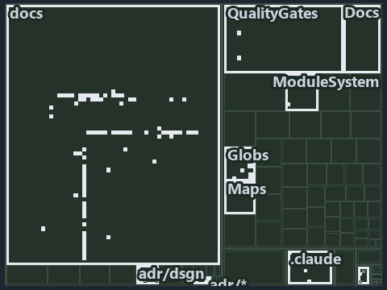

---
catzc:
  immutable:
    with_body_sha: dbd24608a061
    repo_status: locked
    path: docs/explanation/design/.assets/10-commits-story/tree.md
    source: docs/explanation/design/.assets/10-commits-story/diagram.drawio.png
    role: asset-description
    language: markdown
    filetype: md
    track: docs
    tracktype: documentation
---

# Ten numbered commits trace the whole lifecycle across pipeline, environments and git: the tree minimap

```text
Which files cite ADR-DSGN-LIFE, ADR-DSGN-VISUAL and ADR-FLOW-CD: every file of the world map is a tile, grouped by top-level folder.
118 files lit in 11 groups.
```



This is the tree minimap in the sidebar of the architecture diagram of [Ten numbered commits trace the whole lifecycle across pipeline,
environments and git][119], which explains [ADR-DSGN-LIFE][1], [ADR-DSGN-VISUAL][2] and [ADR-FLOW-CD][3]. It lights every file that cites
those codes, grouped by folder, so it shows which files carry the decision. Each lit group has its reason below, naming the code that
selects it.

## What the minimap shows

The tree draws every file of the world map as a tile, grouped by top-level folder (under `pwsh/` by module, under `docs/adr/` by ADR
domain), and lights 118 files in 11 groups, filled in ink. A lit ADR file has a white rim; a file lit only by passing mentions is a lighter
ink. Every other tile is idle, a grey box: a file the slide's ADR codes do not select.

- docs (docs/ outside docs/adr/): 79 lit files
- adr/dsgn (docs/adr/design): 9 lit files
- Globs (pwsh/Catzc.Base.Globs): 8 lit files
- .claude: 6 lit files
- Docs (pwsh/Catzc.Base.Docs): 4 lit files
- pipelines: 3 lit files
- QualityGates (pwsh/Catzc.Base.QualityGates): 3 lit files
- adr/* (the files directly in docs/adr/): 2 lit files
- adr/flow (docs/adr/flow): 2 lit files
- Maps (pwsh/Catzc.Base.Maps): 1 lit file
- ModuleSystem (pwsh/Catzc.Base.ModuleSystem): 1 lit file

## Why each group is lit

### docs (docs/ outside docs/adr/, 79 lit files)

The group holds the files of docs/ outside docs/adr/; each sits in its world-map cell and is lit by:

- [docs/how-to/automation/apply-environment-approvals.md][4], in the cell docs × markdown: selected by [ADR-FLOW-CD][3]: the file cites it
  at line 4 (text).
- [docs/how-to/pwsh/manual-test-plan/pipelines-and-globs.md][5], in the cell docs × markdown: selected by [ADR-FLOW-CD][3]: the file cites
  it at line 16 (text).
- [docs/references/pipelines/cd-apex.yaml.md][6], in the cell docs × markdown: selected by [ADR-FLOW-CD][3]: the file cites it at line 31
  (text).
- [docs/references/pipelines/cd-flux.yaml.md][7], in the cell docs × markdown: selected by [ADR-FLOW-CD][3]: the file cites it at line 30
  (text).
- [docs/references/pipelines/cd-nova.yaml.md][8], in the cell docs × markdown: selected by [ADR-FLOW-CD][3]: the file cites it at line 30
  (text).
- [docs/references/pipelines/cd-shared.yaml.md][9], in the cell docs × markdown: selected by [ADR-FLOW-CD][3]: the file cites it at line 12
  (text) and line 22 (text).
- [docs/references/pipelines/ci-automation.yaml.md][10], in the cell docs × markdown: selected by [ADR-FLOW-CD][3]: the file cites it at
  line 12 (text).
- [docs/references/pipelines/ci-infrastructure.yaml.md][11], in the cell docs × markdown: selected by [ADR-FLOW-CD][3]: the file cites it at
  line 12 (text) and line 13 (text).
- [docs/references/pipelines/deploy-apex.yaml.md][12], in the cell docs × markdown: selected by [ADR-FLOW-CD][3]: the file cites it at line
  12 (text) and line 21 (text).
- [docs/references/pipelines/deploy-nova.yaml.md][13], in the cell docs × markdown: selected by [ADR-FLOW-CD][3]: the file cites it at line
  12 (text).
- [docs/references/pipelines/deploy-shared.yaml.md][14], in the cell docs × markdown: selected by [ADR-FLOW-CD][3]: the file cites it at
  line 12 (text).
- [docs/references/pipelines/github-workflows/ci-automation.yml.md][15], in the cell docs × markdown: selected by [ADR-FLOW-CD][3]: the file
  cites it at line 12 (text).
- [docs/references/pipelines/stages/deploy-unit.yaml.md][16], in the cell docs × markdown: selected by [ADR-FLOW-CD][3]: the file cites it
  at line 11 (text).
- [docs/references/pipelines/steps/download-artifact.yaml.md][17], in the cell docs × markdown: selected by [ADR-FLOW-CD][3]: the file cites
  it at line 12 (text).
- [docs/references/pipelines/steps/invoke-automation.yaml.md][18], in the cell docs × markdown: selected by [ADR-FLOW-CD][3]: the file cites
  it at line 28 (text).
- [docs/references/pwsh/.assets/protected-module-skip-by-hash/diagram.drawio.md][19], in the cell docs × markdown: selected by
  [ADR-FLOW-CD][3]: the file cites it at line 26 (text), line 33 (text), line 108 (text), line 108 (text) and line 109 (text).
- [docs/references/pwsh/.assets/protected-module-skip-by-hash/diagram.drawio.verify.md][20], in the cell docs × markdown: selected by
  [ADR-FLOW-CD][3]: the file cites it at line 55 (text), line 55 (text) and line 55 (text).
- [docs/references/pwsh/catzc-azure-devops-buildvalidation/Get-AdoBuildValidations.ps1.md][21], in the cell docs × markdown: selected by
  [ADR-FLOW-CD][3]: the file cites it at line 15 (text) and line 17 (text).
- [docs/references/pwsh/catzc-azure-devops-buildvalidation/Register-AdoBuildValidation.ps1.md][22], in the cell docs × markdown: selected by
  [ADR-FLOW-CD][3]: the file cites it at line 14 (text), line 16 (text) and line 74 (text).
- [docs/references/pwsh/catzc-azure-devops-buildvalidation/Unregister-AdoBuildValidation.ps1.md][23], in the cell docs × markdown: selected
  by [ADR-FLOW-CD][3]: the file cites it at line 15 (text).
- [docs/references/pwsh/catzc-azure-devops-buildvalidation/configs/build-validation.yml.md][24], in the cell docs × markdown: selected by
  [ADR-FLOW-CD][3]: the file cites it at line 12 (text) and line 15 (text).
- [docs/references/pwsh/catzc-azure-devops-buildvalidation/private/Get-BuildValidationPathFilter.ps1.md][25], in the cell docs × markdown:
  selected by [ADR-FLOW-CD][3]: the file cites it at line 16 (text) and line 19 (text).
- [docs/references/pwsh/catzc-azure-devops-buildvalidation/types/BuildValidationConfig.cs.md][26], in the cell docs × markdown: selected by
  [ADR-FLOW-CD][3]: the file cites it at line 13 (text).
- [docs/references/pwsh/catzc-azure-devops-buildvalidation/types/BuildValidationEntry.cs.md][27], in the cell docs × markdown: selected by
  [ADR-FLOW-CD][3]: the file cites it at line 12 (text).
- [docs/references/pwsh/catzc-azure-devops/New-AdoPullRequest.ps1.md][28], in the cell docs × markdown: selected by [ADR-FLOW-CD][3]: the
  file cites it at line 14 (text).
- [docs/references/pwsh/catzc-azure-devops/Sync-AdoEnvironmentApprovals.ps1.md][29], in the cell docs × markdown: selected by
  [ADR-FLOW-CD][3]: the file cites it at line 15 (text).
- [docs/references/pwsh/catzc-azure-templates/Get-BicepDeploymentName.ps1.md][30], in the cell docs × markdown: selected by
  [ADR-FLOW-CD][3]: the file cites it at line 58 (text).
- [docs/references/pwsh/catzc-azure-templates/Set-BicepTemplateConfiguration.ps1.md][31], in the cell docs × markdown: selected by
  [ADR-FLOW-CD][3]: the file cites it at line 26 (text).
- [docs/references/pwsh/catzc-base-docs/types/AdrsConfig.cs.md][32], in the cell docs × markdown: selected by [ADR-FLOW-CD][3]: the file
  cites it at line 28 (text), line 29 (text), line 57 (text) and line 58 (text).
- [docs/references/pwsh/catzc-base-docs/types/GlossaryConcept.cs.md][33], in the cell docs × markdown: selected by [ADR-FLOW-CD][3]: the
  file cites it at line 34 (text).
- [docs/references/pwsh/catzc-base-exporter/Get-CatzcContentHash.ps1.md][34], in the cell docs × markdown: selected by [ADR-FLOW-CD][3]: the
  file cites it at line 14 (text).
- [docs/references/pwsh/catzc-base-git/Push-Dirty.ps1.md][35], in the cell docs × markdown: selected by [ADR-DSGN-LIFE][1]: the file cites
  it at line 14 (text).
- [docs/references/pwsh/catzc-base-globs.md][36], in the cell docs × markdown: selected by [ADR-FLOW-CD][3]: the file cites it at line 27
  (text).
- [docs/references/pwsh/catzc-base-globs/Get-ChangedGlobSet.ps1.md][37], in the cell docs × markdown: selected by [ADR-FLOW-CD][3]: the file
  cites it at line 15 (text) and line 27 (text).
- [docs/references/pwsh/catzc-base-globs/Get-GlobSet.ps1.md][38], in the cell docs × markdown: selected by [ADR-FLOW-CD][3]: the file cites
  it at line 14 (text).
- [docs/references/pwsh/catzc-base-globs/Get-GlobSetChangeRange.ps1.md][39], in the cell docs × markdown: selected by [ADR-FLOW-CD][3]: the
  file cites it at line 15 (text) and line 26 (text).
- [docs/references/pwsh/catzc-base-globs/Get-GlobSetFile.ps1.md][40], in the cell docs × markdown: selected by [ADR-FLOW-CD][3]: the file
  cites it at line 14 (text) and line 16 (text).
- [docs/references/pwsh/catzc-base-globs/Get-GlobSetHash.ps1.md][41], in the cell docs × markdown: selected by [ADR-FLOW-CD][3]: the file
  cites it at line 20 (text).
- [docs/references/pwsh/catzc-base-globs/Get-GlobSetTrigger.ps1.md][42], in the cell docs × markdown: selected by [ADR-FLOW-CD][3]: the file
  cites it at line 15 (text), line 29 (text) and line 30 (text).
- [docs/references/pwsh/catzc-base-globs/Get-MarkerBlastRadius.ps1.md][43], in the cell docs × markdown: selected by [ADR-FLOW-CD][3]: the
  file cites it at line 14 (text).
- [docs/references/pwsh/catzc-base-globs/Get-ModuleGlobSet.ps1.md][44], in the cell docs × markdown: selected by [ADR-FLOW-CD][3]: the file
  cites it at line 58 (text), line 61 (text) and line 109 (text).
- [docs/references/pwsh/catzc-base-globs/Get-TrackedFile.ps1.md][45], in the cell docs × markdown: selected by [ADR-FLOW-CD][3]: the file
  cites it at line 15 (text).
- [docs/references/pwsh/catzc-base-globs/Test-AdoPipelineTriggerGlob.ps1.md][46], in the cell docs × markdown: selected by [ADR-FLOW-CD][3]:
  the file cites it at line 24 (text) and line 25 (text).
- [docs/references/pwsh/catzc-base-globs/Test-GitHubWorkflowTriggerGlob.ps1.md][47], in the cell docs × markdown: selected by
  [ADR-FLOW-CD][3]: the file cites it at line 24 (text) and line 25 (text).
- [docs/references/pwsh/catzc-base-globs/Test-GlobSetAffected.ps1.md][48], in the cell docs × markdown: selected by [ADR-FLOW-CD][3]: the
  file cites it at line 17 (text) and line 20 (text).
- [docs/references/pwsh/catzc-base-globs/Test-GlobSetIndependence.ps1.md][49], in the cell docs × markdown: selected by [ADR-FLOW-CD][3]:
  the file cites it at line 18 (text), line 56 (text) and line 66 (text).
- [docs/references/pwsh/catzc-base-globs/Test-GlobSetTriggerCoverage.ps1.md][50], in the cell docs × markdown: selected by [ADR-FLOW-CD][3]:
  the file cites it at line 15 (text).
- [docs/references/pwsh/catzc-base-globs/configs/globs.yml.md][51], in the cell docs × markdown: selected by [ADR-FLOW-CD][3]: the file
  cites it at line 12 (text), line 17 (text), line 25 (text), line 27 (text), line 41 (text), line 71 (text) and line 85 (text).
- [docs/references/pwsh/catzc-base-globs/private/Get-ChangedFile.ps1.md][52], in the cell docs × markdown: selected by [ADR-FLOW-CD][3]: the
  file cites it at line 14 (text).
- [docs/references/pwsh/catzc-base-globs/private/Get-GlobSetMember.ps1.md][53], in the cell docs × markdown: selected by [ADR-FLOW-CD][3]:
  the file cites it at line 14 (text).
- [docs/references/pwsh/catzc-base-globs/private/Get-PipelineTrigger.ps1.md][54], in the cell docs × markdown: selected by [ADR-FLOW-CD][3]:
  the file cites it at line 16 (text).
- [docs/references/pwsh/catzc-base-globs/private/Test-GlobListEqual.ps1.md][55], in the cell docs × markdown: selected by [ADR-FLOW-CD][3]:
  the file cites it at line 18 (text).
- [docs/references/pwsh/catzc-base-globs/tests/Get-ChangedFile.Tests.ps1.md][56], in the cell docs × markdown: selected by [ADR-FLOW-CD][3]:
  the file cites it at line 13 (text).
- [docs/references/pwsh/catzc-base-globs/tests/Get-ChangedGlobSet.Tests.ps1.md][57], in the cell docs × markdown: selected by
  [ADR-FLOW-CD][3]: the file cites it at line 12 (text).
- [docs/references/pwsh/catzc-base-globs/tests/Get-GlobSetChangeRange.Tests.ps1.md][58], in the cell docs × markdown: selected by
  [ADR-FLOW-CD][3]: the file cites it at line 11 (text).
- [docs/references/pwsh/catzc-base-globs/tests/Get-GlobSetFile.Tests.ps1.md][59], in the cell docs × markdown: selected by [ADR-FLOW-CD][3]:
  the file cites it at line 12 (text) and line 13 (text).
- [docs/references/pwsh/catzc-base-globs/tests/Get-GlobSetHash.Tests.ps1.md][60], in the cell docs × markdown: selected by [ADR-FLOW-CD][3]:
  the file cites it at line 13 (text).
- [docs/references/pwsh/catzc-base-globs/tests/Get-GlobSetMember.Tests.ps1.md][61], in the cell docs × markdown: selected by
  [ADR-FLOW-CD][3]: the file cites it at line 12 (text).
- [docs/references/pwsh/catzc-base-globs/tests/Get-GlobSetTrigger.Tests.ps1.md][62], in the cell docs × markdown: selected by
  [ADR-FLOW-CD][3]: the file cites it at line 12 (text).
- [docs/references/pwsh/catzc-base-globs/tests/Get-PipelineTrigger.Tests.ps1.md][63], in the cell docs × markdown: selected by
  [ADR-FLOW-CD][3]: the file cites it at line 12 (text).
- [docs/references/pwsh/catzc-base-globs/tests/Get-TrackedFile.Tests.ps1.md][64], in the cell docs × markdown: selected by [ADR-FLOW-CD][3]:
  the file cites it at line 11 (text).
- [docs/references/pwsh/catzc-base-globs/tests/GlobSet-Independence.Tests.ps1.md][65], in the cell docs × markdown: selected by
  [ADR-FLOW-CD][3]: the file cites it at line 12 (text).
- [docs/references/pwsh/catzc-base-globs/tests/GlobSetTrigger-Coverage.Tests.ps1.md][66], in the cell docs × markdown: selected by
  [ADR-FLOW-CD][3]: the file cites it at line 12 (text).
- [docs/references/pwsh/catzc-base-globs/tests/PipelineTrigger-Integrity.Tests.ps1.md][67], in the cell docs × markdown: selected by
  [ADR-FLOW-CD][3]: the file cites it at line 13 (text).
- [docs/references/pwsh/catzc-base-globs/tests/Test-GlobSetIndependence.Tests.ps1.md][68], in the cell docs × markdown: selected by
  [ADR-FLOW-CD][3]: the file cites it at line 13 (text).
- [docs/references/pwsh/catzc-base-globs/tests/types/GlobPattern.Tests.ps1.md][69], in the cell docs × markdown: selected by
  [ADR-FLOW-CD][3]: the file cites it at line 11 (text) and line 13 (text).
- [docs/references/pwsh/catzc-base-globs/tests/types/GlobSet.Tests.ps1.md][70], in the cell docs × markdown: selected by [ADR-FLOW-CD][3]:
  the file cites it at line 12 (text) and line 14 (text).
- [docs/references/pwsh/catzc-base-globs/tests/types/GlobsConfig.Tests.ps1.md][71], in the cell docs × markdown: selected by
  [ADR-FLOW-CD][3]: the file cites it at line 14 (text), line 16 (text) and line 25 (text).
- [docs/references/pwsh/catzc-base-globs/types/Aspect.cs.md][72], in the cell docs × markdown: selected by [ADR-FLOW-CD][3]: the file cites
  it at line 19 (text).
- [docs/references/pwsh/catzc-base-globs/types/DurableHash.cs.md][73], in the cell docs × markdown: selected by [ADR-FLOW-CD][3]: the file
  cites it at line 11 (text) and line 17 (text).
- [docs/references/pwsh/catzc-base-globs/types/GlobPattern.cs.md][74], in the cell docs × markdown: selected by [ADR-FLOW-CD][3]: the file
  cites it at line 17 (text), line 18 (text) and line 19 (text).
- [docs/references/pwsh/catzc-base-globs/types/GlobSet.cs.md][75], in the cell docs × markdown: selected by [ADR-FLOW-CD][3]: the file cites
  it at line 13 (text), line 15 (text), line 16 (text), line 22 (text), line 25 (text), line 27 (text), line 30 (text), line 38 (text), line
  47 (text), line 65 (text), line 82 (text), line 92 (text), line 116 (text) and line 124 (text).
- [docs/references/pwsh/catzc-base-globs/types/GlobsConfig.cs.md][76], in the cell docs × markdown: selected by [ADR-FLOW-CD][3]: the file
  cites it at line 13 (text), line 17 (text), line 20 (text) and line 39 (text).
- [docs/references/pwsh/catzc-base-maps/Get-ValueChainHighlight.ps1.md][77], in the cell docs × markdown: selected by [ADR-FLOW-CD][3]: the
  file cites it at line 37 (text).
- [docs/references/pwsh/catzc-base-maps/Get-WorldMapHighlight.ps1.md][78], in the cell docs × markdown: selected by [ADR-FLOW-CD][3]: the
  file cites it at line 54 (text).
- [docs/references/pwsh/catzc-base-qualitygates/Test-Automation.ps1.md][79], in the cell docs × markdown: selected by [ADR-FLOW-CD][3]: the
  file cites it at line 97 (text).
- [docs/references/pwsh/catzc-base-qualitygates/private/Get-GuidScanFiles.ps1.md][80], in the cell docs × markdown: selected by
  [ADR-FLOW-CD][3]: the file cites it at line 15 (text).
- [docs/references/pwsh/catzc-base-qualitygates/private/Get-ModuleProtectionIdentity.ps1.md][81], in the cell docs × markdown: selected by
  [ADR-FLOW-CD][3]: the file cites it at line 80 (text).
- [docs/references/pwsh/catzc-base-qualitygates/private/Resolve-TestSuite.ps1.md][82], in the cell docs × markdown: selected by
  [ADR-FLOW-CD][3]: the file cites it at line 17 (text).

### adr/dsgn (docs/adr/design, 9 lit files)

The group holds the files of docs/adr/design; each sits in its world-map cell and is lit by:

- [docs/adr/design/.assets/commit-lifecycle-states/chain.md][83], in the cell docs × markdown: selected by [ADR-DSGN-LIFE][1]: the file
  cites it at line 18 (text), line 25 (text), line 61 (text), line 61 (text), line 69 (text), line 69 (text), line 77 (text) and line 77
  (text).
- [docs/adr/design/.assets/commit-lifecycle-states/grid.md][84], in the cell docs × markdown: selected by [ADR-DSGN-LIFE][1]: the file cites
  it at line 18 (text), line 25 (text), line 55 (text), line 56 (text), line 57 (text), line 64 (text), line 66 (text), line 70 (text), line
  74 (text), line 76 (text), line 79 (text), line 82 (text), line 83 (text), line 84 (text), line 85 (text), line 86 (text), line 93 (text),
  line 102 (text), line 103 (text) and line 104 (text).
- [docs/adr/design/.assets/commit-lifecycle-states/tree.md][85], in the cell docs × markdown: selected by [ADR-DSGN-LIFE][1]: the file cites
  it at line 18 (text), line 25 (text), line 48 (text), line 50 (text), line 54 (text), line 58 (text), line 60 (text), line 63 (text), line
  66 (text), line 67 (text), line 73 (text), line 75 (text), line 77 (text), line 83 (text), line 85 (text), line 91 (text), line 92 (text),
  line 99 (text), line 106 (text) and line 114 (text).
- [docs/adr/design/.assets/sync-point/chain.md][86], in the cell docs × markdown: selected by [ADR-DSGN-LIFE][1]: the file cites it at line
  18 (text), line 25 (text), line 61 (text), line 61 (text), line 69 (text), line 69 (text), line 77 (text) and line 77 (text).
- [docs/adr/design/.assets/sync-point/grid.md][87], in the cell docs × markdown: selected by [ADR-DSGN-LIFE][1]: the file cites it at line
  18 (text), line 25 (text), line 55 (text), line 56 (text), line 57 (text), line 64 (text), line 66 (text), line 69 (text), line 72 (text),
  line 73 (text), line 74 (text), line 75 (text), line 76 (text), line 83 (text), line 92 (text), line 93 (text) and line 94 (text).
- [docs/adr/design/.assets/sync-point/tree.md][88], in the cell docs × markdown: selected by [ADR-DSGN-LIFE][1]: the file cites it at line
  18 (text), line 25 (text), line 48 (text), line 50 (text), line 53 (text), line 56 (text), line 57 (text), line 63 (text), line 65 (text),
  line 67 (text), line 73 (text), line 75 (text), line 81 (text), line 82 (text), line 89 (text), line 96 (text) and line 104 (text).
- [docs/adr/design/commit-lifecycle.md][1], in the cell docs × markdown: selected by [ADR-DSGN-LIFE][1]: the ADR's own file.
- [docs/adr/design/dora-explains.md][89], in the cell docs × markdown: selected by [ADR-DSGN-LIFE][1]: the file cites it at line 82 (text);
  selected by [ADR-DSGN-VISUAL][2]: the file cites it at line 63 (text).
- [docs/adr/design/visual-design.md][2], in the cell docs × markdown: selected by [ADR-DSGN-VISUAL][2]: the ADR's own file.

### Globs (pwsh/Catzc.Base.Globs, 8 lit files)

The group holds the files of pwsh/Catzc.Base.Globs; each sits in its world-map cell and is lit by:

- [pwsh/Catzc.Base.Globs/Test-GlobSetIndependence.ps1][90], in the cell pwsh × powershell: selected by [ADR-FLOW-CD][3]: the file cites it
  at line 42 (text).
- [pwsh/Catzc.Base.Globs/tests/GlobSet-Independence.Tests.ps1][91], in the cell pwsh × powershell: selected by [ADR-FLOW-CD][3]: the file
  cites it at line 2 (text) and line 4 (text).
- [pwsh/Catzc.Base.Globs/tests/types/GlobPattern.Tests.ps1][92], in the cell pwsh × powershell: selected by [ADR-FLOW-CD][3]: the file cites
  it at line 58 (text).
- [pwsh/Catzc.Base.Globs/tests/types/GlobSet.Tests.ps1][93], in the cell pwsh × powershell: selected by [ADR-FLOW-CD][3]: the file cites it
  at line 9 (text).
- [pwsh/Catzc.Base.Globs/tests/types/GlobsConfig.Tests.ps1][94], in the cell pwsh × powershell: selected by [ADR-FLOW-CD][3]: the file cites
  it at line 53 (text), line 66 (text), line 77 (text) and line 89 (text).
- [pwsh/Catzc.Base.Globs/types/GlobPattern.cs][95], in the cell pwsh × csharp: selected by [ADR-FLOW-CD][3]: the file cites it at line 23
  (text), line 27 (text), line 31 (text), line 43 (text), line 47 (text) and line 56 (text).
- [pwsh/Catzc.Base.Globs/types/GlobSet.cs][96], in the cell pwsh × csharp: selected by [ADR-FLOW-CD][3]: the file cites it at line 54
  (text).
- [pwsh/Catzc.Base.Globs/types/GlobsConfig.cs][97], in the cell pwsh × csharp: selected by [ADR-FLOW-CD][3]: the file cites it at line 73
  (text), line 136 (text), line 140 (text) and line 154 (text).

### .claude (6 lit files)

The group holds the files of .claude; each sits in its world-map cell and is lit by:

- [.claude/CLAUDE.md][98], in the cell .claude × markdown: selected by [ADR-FLOW-CD][3]: the file cites it at line 55 (text) and line 56
  (text).
- [.claude/plans/plan-diagram-folders-rest.md][99], in the cell .claude × markdown: selected by [ADR-DSGN-VISUAL][2]: the file cites it at
  line 59 (text).
- [.claude/plans/plan-explanation-drift-gaps.md][100], in the cell .claude × markdown: selected by [ADR-FLOW-CD][3]: the file cites it at
  line 17 (text) and line 18 (text).
- [.claude/plans/plan-fast-push-followups.md][101], in the cell .claude × markdown: selected by [ADR-DSGN-LIFE][1]: the file cites it at
  line 13 (text) and line 18 (text).
- [.claude/plans/plan-promotion-ladder.md][102], in the cell .claude × markdown: selected by [ADR-DSGN-LIFE][1]: the file cites it at line
  11 (text) and line 38 (text); selected by [ADR-FLOW-CD][3]: the file cites it at line 11 (text), line 13 (text) and line 38 (text).
- [.claude/plans/value-of-plan.md][103], in the cell .claude × markdown: selected by [ADR-DSGN-LIFE][1]: the file cites it at line 33
  (text); selected by [ADR-FLOW-CD][3]: the file cites it at line 33 (text).

### Docs (pwsh/Catzc.Base.Docs, 4 lit files)

The group holds the files of pwsh/Catzc.Base.Docs; each sits in its world-map cell and is lit by:

- [pwsh/Catzc.Base.Docs/configs/adrs.yml][104], in the cell pwsh × yaml: selected by [ADR-DSGN-LIFE][1]: the file cites it at line 78
  (text); selected by [ADR-DSGN-VISUAL][2]: the file cites it at line 77 (text); selected by [ADR-FLOW-CD][3]: the file cites it at line 97
  (text), line 98 (text), line 99 (text), line 100 (text) and line 101 (text).
- [pwsh/Catzc.Base.Docs/configs/agents.yml][105], in the cell pwsh × yaml: selected by [ADR-DSGN-VISUAL][2]: the file cites it at line 28
  (text), line 28 (text), line 34 (text) and line 39 (text).
- [pwsh/Catzc.Base.Docs/configs/capabilities.yml][106], in the cell pwsh × yaml: selected by [ADR-DSGN-VISUAL][2]: the file cites it at line
  67 (text), line 72 (text), line 77 (text), line 77 (text) and line 82 (text).
- [pwsh/Catzc.Base.Docs/configs/glossary.yml][107], in the cell pwsh × yaml: selected by [ADR-DSGN-LIFE][1]: the file cites it at line 484
  (text).

### pipelines (3 lit files)

The group holds the files of pipelines; each sits in its world-map cell and is lit by:

- [pipelines/cd-shared.yaml][108], in the cell pipelines × pipeline-yaml: selected by [ADR-FLOW-CD][3]: the file cites it at line 45 (body
  comment) (a passing mention only).
- [pipelines/ci-automation.yaml][109], in the cell pipelines × pipeline-yaml: selected by [ADR-DSGN-LIFE][1]: a pipeline that cites nothing
  itself carries its globset's citations, which cite it at `pwsh/Catzc.Base.Docs/configs/adrs.yml` line 78 (text),
  `pwsh/Catzc.Base.Docs/configs/glossary.yml` line 484 (text) and `pwsh/Catzc.Base.ModuleSystem/configs/glossary.yml` line 49 (text);
  selected by [ADR-DSGN-VISUAL][2]: a pipeline that cites nothing itself carries its globset's citations, which cite it at
  `pwsh/Catzc.Base.Docs/configs/adrs.yml` line 77 (text), `pwsh/Catzc.Base.Docs/configs/agents.yml` line 28 (text),
  `pwsh/Catzc.Base.Docs/configs/agents.yml` line 28 (text), `pwsh/Catzc.Base.Docs/configs/agents.yml` line 34 (text),
  `pwsh/Catzc.Base.Docs/configs/agents.yml` line 39 (text), `pwsh/Catzc.Base.Docs/configs/capabilities.yml` line 67 (text),
  `pwsh/Catzc.Base.Docs/configs/capabilities.yml` line 72 (text), `pwsh/Catzc.Base.Docs/configs/capabilities.yml` line 77 (text),
  `pwsh/Catzc.Base.Docs/configs/capabilities.yml` line 77 (text) and `pwsh/Catzc.Base.Docs/configs/capabilities.yml` line 82 (text);
  selected by [ADR-FLOW-CD][3]: a pipeline that cites nothing itself carries its globset's citations, which cite it at
  `pwsh/Catzc.Base.Docs/configs/adrs.yml` line 97 (text), `pwsh/Catzc.Base.Docs/configs/adrs.yml` line 98 (text),
  `pwsh/Catzc.Base.Docs/configs/adrs.yml` line 99 (text), `pwsh/Catzc.Base.Docs/configs/adrs.yml` line 100 (text),
  `pwsh/Catzc.Base.Docs/configs/adrs.yml` line 101 (text), `pwsh/Catzc.Base.Globs/Test-GlobSetIndependence.ps1` line 42 (text),
  `pwsh/Catzc.Base.Globs/tests/GlobSet-Independence.Tests.ps1` line 2 (text), `pwsh/Catzc.Base.Globs/tests/GlobSet-Independence.Tests.ps1`
  line 4 (text), `pwsh/Catzc.Base.Globs/tests/types/GlobPattern.Tests.ps1` line 58 (text),
  `pwsh/Catzc.Base.Globs/tests/types/GlobSet.Tests.ps1` line 9 (text), `pwsh/Catzc.Base.Globs/tests/types/GlobsConfig.Tests.ps1` line 53
  (text), `pwsh/Catzc.Base.Globs/tests/types/GlobsConfig.Tests.ps1` line 66 (text),
  `pwsh/Catzc.Base.Globs/tests/types/GlobsConfig.Tests.ps1` line 77 (text), `pwsh/Catzc.Base.Globs/tests/types/GlobsConfig.Tests.ps1` line
  89 (text), `pwsh/Catzc.Base.Globs/types/GlobPattern.cs` line 23 (text), `pwsh/Catzc.Base.Globs/types/GlobPattern.cs` line 27 (text),
  `pwsh/Catzc.Base.Globs/types/GlobPattern.cs` line 31 (text), `pwsh/Catzc.Base.Globs/types/GlobPattern.cs` line 43 (text),
  `pwsh/Catzc.Base.Globs/types/GlobPattern.cs` line 47 (text), `pwsh/Catzc.Base.Globs/types/GlobPattern.cs` line 56 (text),
  `pwsh/Catzc.Base.Globs/types/GlobSet.cs` line 54 (text), `pwsh/Catzc.Base.Globs/types/GlobsConfig.cs` line 73 (text),
  `pwsh/Catzc.Base.Globs/types/GlobsConfig.cs` line 136 (text), `pwsh/Catzc.Base.Globs/types/GlobsConfig.cs` line 140 (text),
  `pwsh/Catzc.Base.Globs/types/GlobsConfig.cs` line 154 (text), `pwsh/Catzc.Base.Maps/tests/Get-WorldMapHighlight.Tests.ps1` line 70 (text),
  `pwsh/Catzc.Base.Maps/tests/Get-WorldMapHighlight.Tests.ps1` line 71 (text), `pwsh/Catzc.Base.ModuleSystem/configs/glossary.yml` line 18
  (text), `pwsh/Catzc.Base.QualityGates/configs/analyzer-adr-map.yml` line 11 (text), `pwsh/Catzc.Base.QualityGates/configs/glossary.yml`
  line 58 (text) and `pwsh/Catzc.Base.QualityGates/configs/terminology.yml` line 1076 (text).
- [pipelines/extends/cd-customer.yaml][110], in the cell pipelines × pipeline-yaml: selected by [ADR-FLOW-CD][3]: the file cites it at line
  21 (body comment) (a passing mention only).

### QualityGates (pwsh/Catzc.Base.QualityGates, 3 lit files)

The group holds the files of pwsh/Catzc.Base.QualityGates; each sits in its world-map cell and is lit by:

- [pwsh/Catzc.Base.QualityGates/configs/analyzer-adr-map.yml][111], in the cell pwsh × yaml: selected by [ADR-FLOW-CD][3]: the file cites it
  at line 11 (text).
- [pwsh/Catzc.Base.QualityGates/configs/glossary.yml][112], in the cell pwsh × yaml: selected by [ADR-FLOW-CD][3]: the file cites it at line
  58 (text).
- [pwsh/Catzc.Base.QualityGates/configs/terminology.yml][113], in the cell pwsh × yaml: selected by [ADR-FLOW-CD][3]: the file cites it at
  line 1076 (text).

### adr/* (the files directly in docs/adr/, 2 lit files)

The group holds the files of the files directly in docs/adr/; each sits in its world-map cell and is lit by:

- [docs/adr/glossary.md][114], in the cell docs × markdown: selected by [ADR-DSGN-LIFE][1]: the file cites it at line 272 (text) and line
  346 (text); selected by [ADR-FLOW-CD][3]: the file cites it at line 506 (text) and line 519 (text).
- [docs/adr/index.md][115], in the cell docs × markdown: selected by [ADR-DSGN-LIFE][1]: the file cites it at line 112 (text); selected by
  [ADR-DSGN-VISUAL][2]: the file cites it at line 111 (text); selected by [ADR-FLOW-CD][3]: the file cites it at line 129 (text), line 130
  (text), line 131 (text), line 132 (text) and line 133 (text).

### adr/flow (docs/adr/flow, 2 lit files)

The group holds the files of docs/adr/flow; each sits in its world-map cell and is lit by:

- [docs/adr/flow/cd-discipline-and-promotion-flow.md][3], in the cell docs × markdown: selected by [ADR-FLOW-CD][3]: the ADR's own file.
- [docs/adr/flow/dora-explains.md][116], in the cell docs × markdown: selected by [ADR-FLOW-CD][3]: the file cites it at line 11 (text),
  line 31 (text), line 49 (text), line 67 (text) and line 92 (text).

### Maps (pwsh/Catzc.Base.Maps, 1 lit file)

The group holds the files of pwsh/Catzc.Base.Maps; each sits in its world-map cell and is lit by:

- [pwsh/Catzc.Base.Maps/tests/Get-WorldMapHighlight.Tests.ps1][117], in the cell pwsh × powershell: selected by [ADR-FLOW-CD][3]: the file
  cites it at line 70 (text) and line 71 (text).

### ModuleSystem (pwsh/Catzc.Base.ModuleSystem, 1 lit file)

The group holds the files of pwsh/Catzc.Base.ModuleSystem; each sits in its world-map cell and is lit by:

- [pwsh/Catzc.Base.ModuleSystem/configs/glossary.yml][118], in the cell pwsh × yaml: selected by [ADR-DSGN-LIFE][1]: the file cites it at
  line 49 (text); selected by [ADR-FLOW-CD][3]: the file cites it at line 18 (text).

## Keywords

- [world map][120]
- [track][121]
- [file language][122]
- [cell][123]
- [lit cell][124]
- [.claude][125]: a track
- [docs][125]: a track
- [pipelines][125]: a track
- [pwsh][125]: a track
- [csharp][126]: a file language
- [markdown][126]: a file language
- [pipeline-yaml][126]: a file language
- [powershell][126]: a file language
- [yaml][126]: a file language

[1]: ../../../../adr/design/commit-lifecycle.md
[2]: ../../../../adr/design/visual-design.md
[3]: ../../../../adr/flow/cd-discipline-and-promotion-flow.md
[4]: ../../../../how-to/automation/apply-environment-approvals.md
[5]: ../../../../how-to/pwsh/manual-test-plan/pipelines-and-globs.md
[6]: ../../../../references/pipelines/cd-apex.yaml.md
[7]: ../../../../references/pipelines/cd-flux.yaml.md
[8]: ../../../../references/pipelines/cd-nova.yaml.md
[9]: ../../../../references/pipelines/cd-shared.yaml.md
[10]: ../../../../references/pipelines/ci-automation.yaml.md
[11]: ../../../../references/pipelines/ci-infrastructure.yaml.md
[12]: ../../../../references/pipelines/deploy-apex.yaml.md
[13]: ../../../../references/pipelines/deploy-nova.yaml.md
[14]: ../../../../references/pipelines/deploy-shared.yaml.md
[15]: ../../../../references/pipelines/github-workflows/ci-automation.yml.md
[16]: ../../../../references/pipelines/stages/deploy-unit.yaml.md
[17]: ../../../../references/pipelines/steps/download-artifact.yaml.md
[18]: ../../../../references/pipelines/steps/invoke-automation.yaml.md
[19]: ../../../../references/pwsh/.assets/protected-module-skip-by-hash/diagram.drawio.md
[20]: ../../../../references/pwsh/.assets/protected-module-skip-by-hash/diagram.drawio.verify.md
[21]: ../../../../references/pwsh/catzc-azure-devops-buildvalidation/Get-AdoBuildValidations.ps1.md
[22]: ../../../../references/pwsh/catzc-azure-devops-buildvalidation/Register-AdoBuildValidation.ps1.md
[23]: ../../../../references/pwsh/catzc-azure-devops-buildvalidation/Unregister-AdoBuildValidation.ps1.md
[24]: ../../../../references/pwsh/catzc-azure-devops-buildvalidation/configs/build-validation.yml.md
[25]: ../../../../references/pwsh/catzc-azure-devops-buildvalidation/private/Get-BuildValidationPathFilter.ps1.md
[26]: ../../../../references/pwsh/catzc-azure-devops-buildvalidation/types/BuildValidationConfig.cs.md
[27]: ../../../../references/pwsh/catzc-azure-devops-buildvalidation/types/BuildValidationEntry.cs.md
[28]: ../../../../references/pwsh/catzc-azure-devops/New-AdoPullRequest.ps1.md
[29]: ../../../../references/pwsh/catzc-azure-devops/Sync-AdoEnvironmentApprovals.ps1.md
[30]: ../../../../references/pwsh/catzc-azure-templates/Get-BicepDeploymentName.ps1.md
[31]: ../../../../references/pwsh/catzc-azure-templates/Set-BicepTemplateConfiguration.ps1.md
[32]: ../../../../references/pwsh/catzc-base-docs/types/AdrsConfig.cs.md
[33]: ../../../../references/pwsh/catzc-base-docs/types/GlossaryConcept.cs.md
[34]: ../../../../references/pwsh/catzc-base-exporter/Get-CatzcContentHash.ps1.md
[35]: ../../../../references/pwsh/catzc-base-git/Push-Dirty.ps1.md
[36]: ../../../../references/pwsh/catzc-base-globs.md
[37]: ../../../../references/pwsh/catzc-base-globs/Get-ChangedGlobSet.ps1.md
[38]: ../../../../references/pwsh/catzc-base-globs/Get-GlobSet.ps1.md
[39]: ../../../../references/pwsh/catzc-base-globs/Get-GlobSetChangeRange.ps1.md
[40]: ../../../../references/pwsh/catzc-base-globs/Get-GlobSetFile.ps1.md
[41]: ../../../../references/pwsh/catzc-base-globs/Get-GlobSetHash.ps1.md
[42]: ../../../../references/pwsh/catzc-base-globs/Get-GlobSetTrigger.ps1.md
[43]: ../../../../references/pwsh/catzc-base-globs/Get-MarkerBlastRadius.ps1.md
[44]: ../../../../references/pwsh/catzc-base-globs/Get-ModuleGlobSet.ps1.md
[45]: ../../../../references/pwsh/catzc-base-globs/Get-TrackedFile.ps1.md
[46]: ../../../../references/pwsh/catzc-base-globs/Test-AdoPipelineTriggerGlob.ps1.md
[47]: ../../../../references/pwsh/catzc-base-globs/Test-GitHubWorkflowTriggerGlob.ps1.md
[48]: ../../../../references/pwsh/catzc-base-globs/Test-GlobSetAffected.ps1.md
[49]: ../../../../references/pwsh/catzc-base-globs/Test-GlobSetIndependence.ps1.md
[50]: ../../../../references/pwsh/catzc-base-globs/Test-GlobSetTriggerCoverage.ps1.md
[51]: ../../../../references/pwsh/catzc-base-globs/configs/globs.yml.md
[52]: ../../../../references/pwsh/catzc-base-globs/private/Get-ChangedFile.ps1.md
[53]: ../../../../references/pwsh/catzc-base-globs/private/Get-GlobSetMember.ps1.md
[54]: ../../../../references/pwsh/catzc-base-globs/private/Get-PipelineTrigger.ps1.md
[55]: ../../../../references/pwsh/catzc-base-globs/private/Test-GlobListEqual.ps1.md
[56]: ../../../../references/pwsh/catzc-base-globs/tests/Get-ChangedFile.Tests.ps1.md
[57]: ../../../../references/pwsh/catzc-base-globs/tests/Get-ChangedGlobSet.Tests.ps1.md
[58]: ../../../../references/pwsh/catzc-base-globs/tests/Get-GlobSetChangeRange.Tests.ps1.md
[59]: ../../../../references/pwsh/catzc-base-globs/tests/Get-GlobSetFile.Tests.ps1.md
[60]: ../../../../references/pwsh/catzc-base-globs/tests/Get-GlobSetHash.Tests.ps1.md
[61]: ../../../../references/pwsh/catzc-base-globs/tests/Get-GlobSetMember.Tests.ps1.md
[62]: ../../../../references/pwsh/catzc-base-globs/tests/Get-GlobSetTrigger.Tests.ps1.md
[63]: ../../../../references/pwsh/catzc-base-globs/tests/Get-PipelineTrigger.Tests.ps1.md
[64]: ../../../../references/pwsh/catzc-base-globs/tests/Get-TrackedFile.Tests.ps1.md
[65]: ../../../../references/pwsh/catzc-base-globs/tests/GlobSet-Independence.Tests.ps1.md
[66]: ../../../../references/pwsh/catzc-base-globs/tests/GlobSetTrigger-Coverage.Tests.ps1.md
[67]: ../../../../references/pwsh/catzc-base-globs/tests/PipelineTrigger-Integrity.Tests.ps1.md
[68]: ../../../../references/pwsh/catzc-base-globs/tests/Test-GlobSetIndependence.Tests.ps1.md
[69]: ../../../../references/pwsh/catzc-base-globs/tests/types/GlobPattern.Tests.ps1.md
[70]: ../../../../references/pwsh/catzc-base-globs/tests/types/GlobSet.Tests.ps1.md
[71]: ../../../../references/pwsh/catzc-base-globs/tests/types/GlobsConfig.Tests.ps1.md
[72]: ../../../../references/pwsh/catzc-base-globs/types/Aspect.cs.md
[73]: ../../../../references/pwsh/catzc-base-globs/types/DurableHash.cs.md
[74]: ../../../../references/pwsh/catzc-base-globs/types/GlobPattern.cs.md
[75]: ../../../../references/pwsh/catzc-base-globs/types/GlobSet.cs.md
[76]: ../../../../references/pwsh/catzc-base-globs/types/GlobsConfig.cs.md
[77]: ../../../../references/pwsh/catzc-base-maps/Get-ValueChainHighlight.ps1.md
[78]: ../../../../references/pwsh/catzc-base-maps/Get-WorldMapHighlight.ps1.md
[79]: ../../../../references/pwsh/catzc-base-qualitygates/Test-Automation.ps1.md
[80]: ../../../../references/pwsh/catzc-base-qualitygates/private/Get-GuidScanFiles.ps1.md
[81]: ../../../../references/pwsh/catzc-base-qualitygates/private/Get-ModuleProtectionIdentity.ps1.md
[82]: ../../../../references/pwsh/catzc-base-qualitygates/private/Resolve-TestSuite.ps1.md
[83]: ../../../../adr/design/.assets/commit-lifecycle-states/chain.md
[84]: ../../../../adr/design/.assets/commit-lifecycle-states/grid.md
[85]: ../../../../adr/design/.assets/commit-lifecycle-states/tree.md
[86]: ../../../../adr/design/.assets/sync-point/chain.md
[87]: ../../../../adr/design/.assets/sync-point/grid.md
[88]: ../../../../adr/design/.assets/sync-point/tree.md
[89]: ../../../../adr/design/dora-explains.md
[90]: ../../../../../pwsh/Catzc.Base.Globs/Test-GlobSetIndependence.ps1
[91]: ../../../../../pwsh/Catzc.Base.Globs/tests/GlobSet-Independence.Tests.ps1
[92]: ../../../../../pwsh/Catzc.Base.Globs/tests/types/GlobPattern.Tests.ps1
[93]: ../../../../../pwsh/Catzc.Base.Globs/tests/types/GlobSet.Tests.ps1
[94]: ../../../../../pwsh/Catzc.Base.Globs/tests/types/GlobsConfig.Tests.ps1
[95]: ../../../../../pwsh/Catzc.Base.Globs/types/GlobPattern.cs
[96]: ../../../../../pwsh/Catzc.Base.Globs/types/GlobSet.cs
[97]: ../../../../../pwsh/Catzc.Base.Globs/types/GlobsConfig.cs
[98]: ../../../../../.claude/CLAUDE.md
[99]: ../../../../../.claude/plans/plan-diagram-folders-rest.md
[100]: ../../../../../.claude/plans/plan-explanation-drift-gaps.md
[101]: ../../../../../.claude/plans/plan-fast-push-followups.md
[102]: ../../../../../.claude/plans/plan-promotion-ladder.md
[103]: ../../../../../.claude/plans/value-of-plan.md
[104]: ../../../../../pwsh/Catzc.Base.Docs/configs/adrs.yml
[105]: ../../../../../pwsh/Catzc.Base.Docs/configs/agents.yml
[106]: ../../../../../pwsh/Catzc.Base.Docs/configs/capabilities.yml
[107]: ../../../../../pwsh/Catzc.Base.Docs/configs/glossary.yml
[108]: ../../../../../pipelines/cd-shared.yaml
[109]: ../../../../../pipelines/ci-automation.yaml
[110]: ../../../../../pipelines/extends/cd-customer.yaml
[111]: ../../../../../pwsh/Catzc.Base.QualityGates/configs/analyzer-adr-map.yml
[112]: ../../../../../pwsh/Catzc.Base.QualityGates/configs/glossary.yml
[113]: ../../../../../pwsh/Catzc.Base.QualityGates/configs/terminology.yml
[114]: ../../../../adr/glossary.md
[115]: ../../../../adr/index.md
[116]: ../../../../adr/flow/dora-explains.md
[117]: ../../../../../pwsh/Catzc.Base.Maps/tests/Get-WorldMapHighlight.Tests.ps1
[118]: ../../../../../pwsh/Catzc.Base.ModuleSystem/configs/glossary.yml
[119]: ../../ten-commits-trace-the-whole-lifecycle.md
[120]: ../../../../adr/glossary.md#world-map
[121]: ../../../../adr/glossary.md#track
[122]: ../../../../adr/glossary.md#file-language
[123]: ../../../../adr/glossary.md#cell
[124]: ../../../../adr/glossary.md#lit-cell
[125]: ../../../../../pwsh/Catzc.Base.Variants/configs/variants.yml
[126]: ../../../../../pwsh/Catzc.Base.Languages/configs/languages.yml
