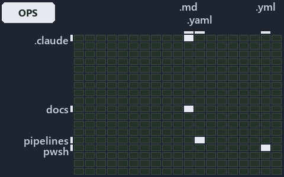

---
catzc:
  immutable:
    with_body_sha: "79dfacae7e91"
    repo_status: locked
    path: docs/explanation/design/.assets/a-push-fires-only-touched-pipelines/grid.md
    source: docs/explanation/design/.assets/a-push-fires-only-touched-pipelines/diagram.drawio.png
    role: asset-description
    language: markdown
    filetype: md
    track: docs
    tracktype: documentation
---

# A push starts only the pipelines whose globset it touches: the world-map minimap

```text
Where the files that cite ADR-DSGN-TRACK sit in the repository: tracks down, file languages across.
4 of 342 cells lit, holding 15 files.
```



This is the world-map minimap in the sidebar of the operations diagram of [A push starts only the pipelines whose globset it touches][16],
which explains [ADR-DSGN-TRACK][1]. It lights every cell of the world map that holds a file citing those codes, so it shows where the
decision lives in the repository. Each lit cell has its reason below, naming the code that selects it.

## What the minimap shows

The grid crosses the 18 tracks (rows) with the 19 file languages (columns) of the world map and lights 4 cells, filled in ink. A cell lit
only by passing mentions (citations in body comments, not in a file's header or text) is touched: a lighter ink. Every other cell is idle, a
grey box: it holds files the slide's ADR codes do not select, or no file at all (288 of the 342 cells hold none). The minimap shows where
the slide sits, not how many files a cell holds; the world-map PDFs show the counts.

- .claude × markdown: 5 lit of 89 files
- docs × markdown: 8 lit of 2763 files
- pipelines × pipeline-yaml: 1 lit of 14 files
- pwsh × yaml: 1 lit of 115 files

## Key

A lit row prints its track's name; a lit column prints a short code, the first extension of its file language:

- `.md`: markdown
- `.yaml`: pipeline-yaml
- `.yml`: yaml

## Why each cell is lit

### .claude × markdown (5 lit files)

Placed: the root folder `.claude/` names the track .claude ([ADR-DSGN-TRACK-TRACKISPLACEDCLUSTER][1]); the extension `.md` names the file
language markdown ([ADR-DSGN-TRACK-FILELANGUAGE][1]). Lit ([ADR-DSGN-TRACK-LITCELL][1]) by:

- [.claude/plans/decisions-2026-10-16.md][2]: selected by [ADR-DSGN-TRACK][1]: the file cites it at line 45 (text), line 53 (text), line 116
  (text), line 117 (text), line 121 (text), line 121 (text) and line 131 (text).
- [.claude/plans/decisions-2026-10-18.md][3]: selected by [ADR-DSGN-TRACK][1]: the file cites it at line 16 (text).
- [.claude/plans/plan-adr-code-language.md][4]: selected by [ADR-DSGN-TRACK][1]: the file cites it at line 36 (text) and line 36 (text).
- [.claude/plans/plan-explanation-drift-gaps.md][5]: selected by [ADR-DSGN-TRACK][1]: the file cites it at line 109 (text).
- [.claude/plans/questionnaire-fundamental-2-2026-10-16.md][6]: selected by [ADR-DSGN-TRACK][1]: the file cites it at line 28 (text).

### docs × markdown (8 lit files)

Placed: the root folder `docs/` names the track docs ([ADR-DSGN-TRACK-TRACKISPLACEDCLUSTER][1]); the extension `.md` names the file language
markdown ([ADR-DSGN-TRACK-FILELANGUAGE][1]). Lit ([ADR-DSGN-TRACK-LITCELL][1]) by:

- [docs/adr/design/dora-explains.md][7]: selected by [ADR-DSGN-TRACK][1]: the file cites it at line 11 (text).
- [docs/adr/design/tracks.md][1]: selected by [ADR-DSGN-TRACK][1]: the ADR's own file.
- [docs/adr/index.md][8]: selected by [ADR-DSGN-TRACK][1]: the file cites it at line 110 (text).
- [docs/references/note-file-kind.md][9]: selected by [ADR-DSGN-TRACK][1]: the file cites it at line 37 (text).
- [docs/references/pwsh/catzc-base-variants/Get-Track.ps1.md][10]: selected by [ADR-DSGN-TRACK][1]: the file cites it at line 14 (text).
- [docs/references/pwsh/catzc-base-variants/configs/variants.yml.md][11]: selected by [ADR-DSGN-TRACK][1]: the file cites it at line 75
  (text).
- [docs/references/pwsh/catzc-base-variants/types/VariantTrack.cs.md][12]: selected by [ADR-DSGN-TRACK][1]: the file cites it at line 11
  (text).
- [docs/references/pwsh/catzc-base-variants/types/VariantsConfig.cs.md][13]: selected by [ADR-DSGN-TRACK][1]: the file cites it at line 32
  (text).

### pipelines × pipeline-yaml (1 lit file)

Placed: the root folder `pipelines/` names the track pipelines ([ADR-DSGN-TRACK-TRACKISPLACEDCLUSTER][1]); the extension `.yaml` names the
file language pipeline-yaml ([ADR-DSGN-TRACK-FILELANGUAGE][1]). Lit ([ADR-DSGN-TRACK-LITCELL][1]) by:

- [pipelines/ci-automation.yaml][14]: selected by [ADR-DSGN-TRACK][1]: a pipeline that cites nothing itself carries its globset's citations,
  which cite it at `pwsh/Catzc.Base.Docs/configs/adrs.yml` line 74 (text).

### pwsh × yaml (1 lit file)

Placed: the root folder `pwsh/` names the track pwsh ([ADR-DSGN-TRACK-TRACKISPLACEDCLUSTER][1]); the extension `.yml` names the file
language yaml ([ADR-DSGN-TRACK-FILELANGUAGE][1]). Lit ([ADR-DSGN-TRACK-LITCELL][1]) by:

- [pwsh/Catzc.Base.Docs/configs/adrs.yml][15]: selected by [ADR-DSGN-TRACK][1]: the file cites it at line 74 (text).

## Keywords

- [world map][17]
- [track][18]
- [file language][19]
- [cell][20]
- [lit cell][21]
- [.claude][22]: a track
- [docs][22]: a track
- [pipelines][22]: a track
- [pwsh][22]: a track
- [markdown][23]: a file language
- [pipeline-yaml][23]: a file language
- [yaml][23]: a file language

[1]: ../../../../adr/design/tracks.md
[2]: ../../../../../.claude/plans/decisions-2026-10-16.md
[3]: ../../../../../.claude/plans/decisions-2026-10-18.md
[4]: ../../../../../.claude/plans/plan-adr-code-language.md
[5]: ../../../../../.claude/plans/plan-explanation-drift-gaps.md
[6]: ../../../../../.claude/plans/questionnaire-fundamental-2-2026-10-16.md
[7]: ../../../../adr/design/dora-explains.md
[8]: ../../../../adr/index.md
[9]: ../../../../references/note-file-kind.md
[10]: ../../../../references/pwsh/catzc-base-variants/Get-Track.ps1.md
[11]: ../../../../references/pwsh/catzc-base-variants/configs/variants.yml.md
[12]: ../../../../references/pwsh/catzc-base-variants/types/VariantTrack.cs.md
[13]: ../../../../references/pwsh/catzc-base-variants/types/VariantsConfig.cs.md
[14]: ../../../../../pipelines/ci-automation.yaml
[15]: ../../../../../pwsh/Catzc.Base.Docs/configs/adrs.yml
[16]: ../../a-push-fires-only-touched-pipelines.md
[17]: ../../../../adr/glossary.md#world-map
[18]: ../../../../adr/glossary.md#track
[19]: ../../../../adr/glossary.md#file-language
[20]: ../../../../adr/glossary.md#cell
[21]: ../../../../adr/glossary.md#lit-cell
[22]: ../../../../../pwsh/Catzc.Base.Variants/configs/variants.yml
[23]: ../../../../../pwsh/Catzc.Base.Languages/configs/languages.yml
