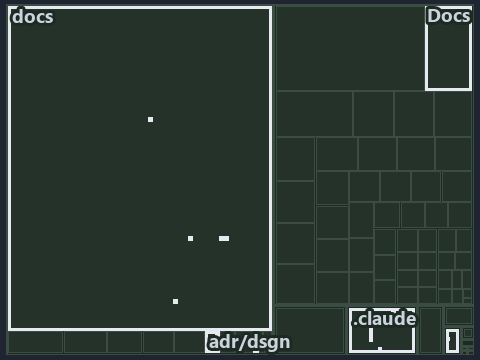

---
catzc:
  immutable:
    with_body_sha: d694a2d1ee1a
    repo_status: locked
    path: docs/explanation/design/.assets/a-push-fires-only-touched-pipelines/tree.md
    source: docs/explanation/design/.assets/a-push-fires-only-touched-pipelines/diagram.drawio.png
    role: asset-description
    language: markdown
    filetype: md
    track: docs
    tracktype: documentation
---

# A push starts only the pipelines whose globset it touches: the tree minimap

```text
Which files cite ADR-DSGN-TRACK: every file of the world map is a tile, grouped by top-level folder.
15 files lit in 6 groups.
```



This is the tree minimap in the sidebar of the operations diagram of [A push starts only the pipelines whose globset it touches][16], which
explains [ADR-DSGN-TRACK][1]. It lights every file that cites those codes, grouped by folder, so it shows which files carry the decision.
Each lit group has its reason below, naming the code that selects it.

## What the minimap shows

The tree draws every file of the world map as a tile, grouped by top-level folder (under `pwsh/` by module, under `docs/adr/` by ADR
domain), and lights 15 files in 6 groups, filled in ink. A lit ADR file has a white rim; a file lit only by passing mentions is a lighter
ink. Every other tile is idle, a grey box: a file the slide's ADR codes do not select.

- .claude: 5 lit files
- docs (docs/ outside docs/adr/): 5 lit files
- adr/dsgn (docs/adr/design): 2 lit files
- adr/* (the files directly in docs/adr/): 1 lit file
- pipelines: 1 lit file
- Docs (pwsh/Catzc.Base.Docs): 1 lit file

## Why each group is lit

### .claude (5 lit files)

The group holds the files of .claude; each sits in its world-map cell and is lit by:

- [.claude/plans/decisions-2026-10-16.md][2], in the cell .claude × markdown: selected by [ADR-DSGN-TRACK][1]: the file cites it at line 45
  (text), line 53 (text), line 116 (text), line 117 (text), line 121 (text), line 121 (text) and line 131 (text).
- [.claude/plans/decisions-2026-10-18.md][3], in the cell .claude × markdown: selected by [ADR-DSGN-TRACK][1]: the file cites it at line 16
  (text).
- [.claude/plans/plan-adr-code-language.md][4], in the cell .claude × markdown: selected by [ADR-DSGN-TRACK][1]: the file cites it at line
  36 (text) and line 36 (text).
- [.claude/plans/plan-explanation-drift-gaps.md][5], in the cell .claude × markdown: selected by [ADR-DSGN-TRACK][1]: the file cites it at
  line 109 (text).
- [.claude/plans/questionnaire-fundamental-2-2026-10-16.md][6], in the cell .claude × markdown: selected by [ADR-DSGN-TRACK][1]: the file
  cites it at line 28 (text).

### docs (docs/ outside docs/adr/, 5 lit files)

The group holds the files of docs/ outside docs/adr/; each sits in its world-map cell and is lit by:

- [docs/references/note-file-kind.md][7], in the cell docs × markdown: selected by [ADR-DSGN-TRACK][1]: the file cites it at line 37 (text).
- [docs/references/pwsh/catzc-base-variants/Get-Track.ps1.md][8], in the cell docs × markdown: selected by [ADR-DSGN-TRACK][1]: the file
  cites it at line 14 (text).
- [docs/references/pwsh/catzc-base-variants/configs/variants.yml.md][9], in the cell docs × markdown: selected by [ADR-DSGN-TRACK][1]: the
  file cites it at line 75 (text).
- [docs/references/pwsh/catzc-base-variants/types/VariantTrack.cs.md][10], in the cell docs × markdown: selected by [ADR-DSGN-TRACK][1]: the
  file cites it at line 11 (text).
- [docs/references/pwsh/catzc-base-variants/types/VariantsConfig.cs.md][11], in the cell docs × markdown: selected by [ADR-DSGN-TRACK][1]:
  the file cites it at line 32 (text).

### adr/dsgn (docs/adr/design, 2 lit files)

The group holds the files of docs/adr/design; each sits in its world-map cell and is lit by:

- [docs/adr/design/dora-explains.md][12], in the cell docs × markdown: selected by [ADR-DSGN-TRACK][1]: the file cites it at line 11 (text).
- [docs/adr/design/tracks.md][1], in the cell docs × markdown: selected by [ADR-DSGN-TRACK][1]: the ADR's own file.

### adr/* (the files directly in docs/adr/, 1 lit file)

The group holds the files of the files directly in docs/adr/; each sits in its world-map cell and is lit by:

- [docs/adr/index.md][13], in the cell docs × markdown: selected by [ADR-DSGN-TRACK][1]: the file cites it at line 110 (text).

### pipelines (1 lit file)

The group holds the files of pipelines; each sits in its world-map cell and is lit by:

- [pipelines/ci-automation.yaml][14], in the cell pipelines × pipeline-yaml: selected by [ADR-DSGN-TRACK][1]: a pipeline that cites nothing
  itself carries its globset's citations, which cite it at `pwsh/Catzc.Base.Docs/configs/adrs.yml` line 74 (text).

### Docs (pwsh/Catzc.Base.Docs, 1 lit file)

The group holds the files of pwsh/Catzc.Base.Docs; each sits in its world-map cell and is lit by:

- [pwsh/Catzc.Base.Docs/configs/adrs.yml][15], in the cell pwsh × yaml: selected by [ADR-DSGN-TRACK][1]: the file cites it at line 74
  (text).

## Keywords

- [world map][17]
- [track][18]
- [file language][19]
- [cell][20]
- [lit cell][21]
- [.claude][22]: a track
- [docs][22]: a track
- [pipelines][22]: a track
- [pwsh][22]: a track
- [markdown][23]: a file language
- [pipeline-yaml][23]: a file language
- [yaml][23]: a file language

[1]: ../../../../adr/design/tracks.md
[2]: ../../../../../.claude/plans/decisions-2026-10-16.md
[3]: ../../../../../.claude/plans/decisions-2026-10-18.md
[4]: ../../../../../.claude/plans/plan-adr-code-language.md
[5]: ../../../../../.claude/plans/plan-explanation-drift-gaps.md
[6]: ../../../../../.claude/plans/questionnaire-fundamental-2-2026-10-16.md
[7]: ../../../../references/note-file-kind.md
[8]: ../../../../references/pwsh/catzc-base-variants/Get-Track.ps1.md
[9]: ../../../../references/pwsh/catzc-base-variants/configs/variants.yml.md
[10]: ../../../../references/pwsh/catzc-base-variants/types/VariantTrack.cs.md
[11]: ../../../../references/pwsh/catzc-base-variants/types/VariantsConfig.cs.md
[12]: ../../../../adr/design/dora-explains.md
[13]: ../../../../adr/index.md
[14]: ../../../../../pipelines/ci-automation.yaml
[15]: ../../../../../pwsh/Catzc.Base.Docs/configs/adrs.yml
[16]: ../../a-push-fires-only-touched-pipelines.md
[17]: ../../../../adr/glossary.md#world-map
[18]: ../../../../adr/glossary.md#track
[19]: ../../../../adr/glossary.md#file-language
[20]: ../../../../adr/glossary.md#cell
[21]: ../../../../adr/glossary.md#lit-cell
[22]: ../../../../../pwsh/Catzc.Base.Variants/configs/variants.yml
[23]: ../../../../../pwsh/Catzc.Base.Languages/configs/languages.yml
