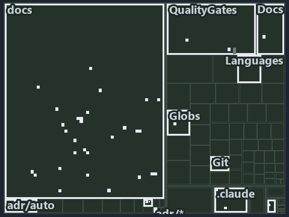

---
catzc:
  immutable:
    with_body_sha: "8fb87e2a2ca5"
    repo_status: locked
    path: docs/explanation/design/.assets/a-sibling-is-an-idea-never-a-reference/tree.md
    source: docs/explanation/design/.assets/a-sibling-is-an-idea-never-a-reference/diagram.drawio.png
    role: asset-description
    language: markdown
    filetype: md
    track: docs
    tracktype: documentation
---

# A sibling is an idea, never a reference: the tree minimap

```text
Which files cite ADR-AUTO-GO and ADR-PRIN-ONELIVE: every file of the world map is a tile, grouped by top-level folder.
50 files lit in 11 groups.
```



This is the tree minimap in the sidebar of the meta diagram of [A sibling is an idea, never a reference][51], which explains
[ADR-AUTO-GO][1] and [ADR-PRIN-ONELIVE][2]. It lights every file that cites those codes, grouped by folder, so it shows which files carry
the decision. Each lit group has its reason below, naming the code that selects it.

## What the minimap shows

The tree draws every file of the world map as a tile, grouped by top-level folder (under `pwsh/` by module, under `docs/adr/` by ADR
domain), and lights 50 files in 11 groups, filled in ink. A lit ADR file has a white rim; a file lit only by passing mentions is a lighter
ink. Every other tile is idle, a grey box: a file the slide's ADR codes do not select.

- docs (docs/ outside docs/adr/): 29 lit files
- Docs (pwsh/Catzc.Base.Docs): 4 lit files
- QualityGates (pwsh/Catzc.Base.QualityGates): 4 lit files
- .claude: 3 lit files
- adr/* (the files directly in docs/adr/): 2 lit files
- adr/auto (docs/adr/automation): 2 lit files
- adr/prin (docs/adr/principles): 2 lit files
- pipelines: 1 lit file
- Git (pwsh/Catzc.Base.Git): 1 lit file
- Globs (pwsh/Catzc.Base.Globs): 1 lit file
- Languages (pwsh/Catzc.Base.Languages): 1 lit file

## Why each group is lit

### docs (docs/ outside docs/adr/, 29 lit files)

The group holds the files of docs/ outside docs/adr/; each sits in its world-map cell and is lit by:

- [docs/how-to/getting-started/automation/go/index.md][3], in the cell docs × markdown: selected by [ADR-AUTO-GO][1]: the file cites it at
  line 4 (text).
- [docs/references/agent-contracts.md][4], in the cell docs × markdown: selected by [ADR-PRIN-ONELIVE][2]: the file cites it at line 28
  (text).
- [docs/references/note-file-kind.md][5], in the cell docs × markdown: selected by [ADR-PRIN-ONELIVE][2]: the file cites it at line 37
  (text).
- [docs/references/pwsh/.assets/tools-yml-install-dispatch/diagram.drawio.verify.md][6], in the cell docs × markdown: selected by
  [ADR-PRIN-ONELIVE][2]: the file cites it at line 72 (text).
- [docs/references/pwsh/catzc-base-docs/tests/types/CheckModes.Tests.ps1.md][7], in the cell docs × markdown: selected by
  [ADR-PRIN-ONELIVE][2]: the file cites it at line 8 (text).
- [docs/references/pwsh/catzc-base-docs/types/CheckModes.cs.md][8], in the cell docs × markdown: selected by [ADR-PRIN-ONELIVE][2]: the file
  cites it at line 13 (text).
- [docs/references/pwsh/catzc-base-files/Get-InputStamp.ps1.md][9], in the cell docs × markdown: selected by [ADR-PRIN-ONELIVE][2]: the file
  cites it at line 23 (text).
- [docs/references/pwsh/catzc-base-files/Write-FileIfChanged.ps1.md][10], in the cell docs × markdown: selected by [ADR-PRIN-ONELIVE][2]:
  the file cites it at line 26 (text).
- [docs/references/pwsh/catzc-base-globs/Get-ModuleGlobSet.ps1.md][11], in the cell docs × markdown: selected by [ADR-AUTO-GO][1]: the file
  cites it at line 20 (text) and line 82 (text).
- [docs/references/pwsh/catzc-base-languages/Invoke-GoTest.ps1.md][12], in the cell docs × markdown: selected by [ADR-AUTO-GO][1]: the file
  cites it at line 100 (text).
- [docs/references/pwsh/catzc-base-languages/Test-GeneratedFileCurrent.ps1.md][13], in the cell docs × markdown: selected by
  [ADR-PRIN-ONELIVE][2]: the file cites it at line 21 (text).
- [docs/references/pwsh/catzc-base-languages/private/Get-EngineContract.ps1.md][14], in the cell docs × markdown: selected by
  [ADR-AUTO-GO][1]: the file cites it at line 16 (text).
- [docs/references/pwsh/catzc-base-qualitygates/Build-CommentView.ps1.md][15], in the cell docs × markdown: selected by
  [ADR-PRIN-ONELIVE][2]: the file cites it at line 15 (text).
- [docs/references/pwsh/catzc-base-qualitygates/Export-Comments.ps1.md][16], in the cell docs × markdown: selected by [ADR-PRIN-ONELIVE][2]:
  the file cites it at line 16 (text).
- [docs/references/pwsh/catzc-base-qualitygates/Test-Comments.ps1.md][17], in the cell docs × markdown: selected by [ADR-PRIN-ONELIVE][2]:
  the file cites it at line 16 (text).
- [docs/references/pwsh/catzc-base-qualitygates/configs/comments.yml.md][18], in the cell docs × markdown: selected by
  [ADR-PRIN-ONELIVE][2]: the file cites it at line 15 (text).
- [docs/references/pwsh/catzc-base-qualitygates/private/Get-LanguageTestExecutable.ps1.md][19], in the cell docs × markdown: selected by
  [ADR-AUTO-GO][1]: the file cites it at line 17 (text).
- [docs/references/pwsh/catzc-base-qualitygates/private/Get-LanguageTestFolders.ps1.md][20], in the cell docs × markdown: selected by
  [ADR-AUTO-GO][1]: the file cites it at line 20 (text).
- [docs/references/pwsh/catzc-base-qualitygates/private/Invoke-Gofmt.ps1.md][21], in the cell docs × markdown: selected by [ADR-AUTO-GO][1]:
  the file cites it at line 15 (text).
- [docs/references/pwsh/catzc-base-qualitygates/tests/Build-CommentView.Tests.ps1.md][22], in the cell docs × markdown: selected by
  [ADR-PRIN-ONELIVE][2]: the file cites it at line 14 (text).
- [docs/references/pwsh/catzc-base-qualitygates/tests/Export-Comments.Tests.ps1.md][23], in the cell docs × markdown: selected by
  [ADR-PRIN-ONELIVE][2]: the file cites it at line 14 (text).
- [docs/references/pwsh/catzc-base-qualitygates/tests/Test-Comments.Tests.ps1.md][24], in the cell docs × markdown: selected by
  [ADR-PRIN-ONELIVE][2]: the file cites it at line 12 (text).
- [docs/references/pwsh/catzc-base-qualitygates/types/CommentPageMap.cs.md][25], in the cell docs × markdown: selected by
  [ADR-PRIN-ONELIVE][2]: the file cites it at line 13 (text).
- [docs/references/pwsh/catzc-base-qualitygates/types/CommentsConfig.cs.md][26], in the cell docs × markdown: selected by
  [ADR-PRIN-ONELIVE][2]: the file cites it at line 15 (text).
- [docs/references/pwsh/catzc-base-rootconfig/private/Invoke-RootConfigGenerator.ps1.md][27], in the cell docs × markdown: selected by
  [ADR-AUTO-GO][1]: the file cites it at line 73 (text).
- [docs/references/pwsh/catzc-base-vscode/configs/vscode-settings.yml.md][28], in the cell docs × markdown: selected by [ADR-AUTO-GO][1]:
  the file cites it at line 182 (text).
- [docs/references/pwsh/internal/Catzc.Internal.Importer.psm1.md][29], in the cell docs × markdown: selected by [ADR-PRIN-ONELIVE][2]: the
  file cites it at line 16 (text).
- [docs/references/pwsh/internal/Catzc.Internal.Loader.psm1.md][30], in the cell docs × markdown: selected by [ADR-PRIN-ONELIVE][2]: the
  file cites it at line 16 (text).
- [docs/references/pwsh/internal/Catzc.Internal.Vendor.psm1.md][31], in the cell docs × markdown: selected by [ADR-PRIN-ONELIVE][2]: the
  file cites it at line 17 (text).

### Docs (pwsh/Catzc.Base.Docs, 4 lit files)

The group holds the files of pwsh/Catzc.Base.Docs; each sits in its world-map cell and is lit by:

- [pwsh/Catzc.Base.Docs/configs/adrs.yml][32], in the cell pwsh × yaml: selected by [ADR-AUTO-GO][1]: the file cites it at line 149 (text);
  selected by [ADR-PRIN-ONELIVE][2]: the file cites it at line 34 (text).
- [pwsh/Catzc.Base.Docs/configs/agents.yml][33], in the cell pwsh × yaml: selected by [ADR-PRIN-ONELIVE][2]: the file cites it at line 60
  (text) and line 66 (text).
- [pwsh/Catzc.Base.Docs/configs/capabilities.yml][34], in the cell pwsh × yaml: selected by [ADR-PRIN-ONELIVE][2]: the file cites it at line
  87 (text) and line 92 (text).
- [pwsh/Catzc.Base.Docs/tests/types/CheckModes.Tests.ps1][35], in the cell pwsh × powershell: selected by [ADR-PRIN-ONELIVE][2]: the file
  cites it at line 1 (text).

### QualityGates (pwsh/Catzc.Base.QualityGates, 4 lit files)

The group holds the files of pwsh/Catzc.Base.QualityGates; each sits in its world-map cell and is lit by:

- [pwsh/Catzc.Base.QualityGates/private/Get-LanguageTestOutcomes.ps1][36], in the cell pwsh × powershell: selected by [ADR-AUTO-GO][1]: the
  file cites it at line 73 (text).
- [pwsh/Catzc.Base.QualityGates/tests/types/CommentEngine.Tests.ps1][37], in the cell pwsh × powershell: selected by [ADR-PRIN-ONELIVE][2]:
  the file cites it at line 1 (header).
- [pwsh/Catzc.Base.QualityGates/types/CommentBlockKind.cs][38], in the cell pwsh × csharp: selected by [ADR-PRIN-ONELIVE][2]: the file cites
  it at line 5 (body comment) (a passing mention only).
- [pwsh/Catzc.Base.QualityGates/types/CommentEngine.cs][39], in the cell pwsh × csharp: selected by [ADR-PRIN-ONELIVE][2]: the file cites it
  at line 12 (body comment) (a passing mention only).

### .claude (3 lit files)

The group holds the files of .claude; each sits in its world-map cell and is lit by:

- [.claude/CLAUDE.md][40], in the cell .claude × markdown: selected by [ADR-AUTO-GO][1]: the file cites it at line 59 (text); selected by
  [ADR-PRIN-ONELIVE][2]: the file cites it at line 61 (text) and line 146 (text).
- [.claude/plans/plan-automation-word-residue.md][41], in the cell .claude × markdown: selected by [ADR-PRIN-ONELIVE][2]: the file cites it
  at line 18 (text) and line 40 (text).
- [.claude/plans/plan-layers-vocabulary-rename-contracts.md][42], in the cell .claude × markdown: selected by [ADR-AUTO-GO][1]: the file
  cites it at line 118 (text).

### adr/* (the files directly in docs/adr/, 2 lit files)

The group holds the files of the files directly in docs/adr/; each sits in its world-map cell and is lit by:

- [docs/adr/glossary.md][43], in the cell docs × markdown: selected by [ADR-AUTO-GO][1]: the file cites it at line 688 (text).
- [docs/adr/index.md][44], in the cell docs × markdown: selected by [ADR-AUTO-GO][1]: the file cites it at line 180 (text); selected by
  [ADR-PRIN-ONELIVE][2]: the file cites it at line 72 (text).

### adr/auto (docs/adr/automation, 2 lit files)

The group holds the files of docs/adr/automation; each sits in its world-map cell and is lit by:

- [docs/adr/automation/dora-explains.md][45], in the cell docs × markdown: selected by [ADR-AUTO-GO][1]: the file cites it at line 563
  (text).
- [docs/adr/automation/go/go-test-artifacts.md][1], in the cell docs × markdown: selected by [ADR-AUTO-GO][1]: the ADR's own file.

### adr/prin (docs/adr/principles, 2 lit files)

The group holds the files of docs/adr/principles; each sits in its world-map cell and is lit by:

- [docs/adr/principles/dora-explains.md][46], in the cell docs × markdown: selected by [ADR-PRIN-ONELIVE][2]: the file cites it at line 84
  (text).
- [docs/adr/principles/one-living-version.md][2], in the cell docs × markdown: selected by [ADR-PRIN-ONELIVE][2]: the ADR's own file.

### pipelines (1 lit file)

The group holds the files of pipelines; each sits in its world-map cell and is lit by:

- [pipelines/ci-automation.yaml][47], in the cell pipelines × pipeline-yaml: selected by [ADR-AUTO-GO][1]: a pipeline that cites nothing
  itself carries its globset's citations, which cite it at `pwsh/Catzc.Base.Docs/configs/adrs.yml` line 149 (text),
  `pwsh/Catzc.Base.Git/configs/gitignore.yml` line 101 (text), `pwsh/Catzc.Base.Globs/tests/Get-ModuleGlobSet.Tests.ps1` line 45 (text),
  `pwsh/Catzc.Base.Languages/configs/glossary.yml` line 16 (text) and `pwsh/Catzc.Base.QualityGates/private/Get-LanguageTestOutcomes.ps1`
  line 73 (text); selected by [ADR-PRIN-ONELIVE][2]: a pipeline that cites nothing itself carries its globset's citations, which cite it at
  `pwsh/Catzc.Base.Docs/configs/adrs.yml` line 34 (text), `pwsh/Catzc.Base.Docs/configs/agents.yml` line 60 (text),
  `pwsh/Catzc.Base.Docs/configs/agents.yml` line 66 (text), `pwsh/Catzc.Base.Docs/configs/capabilities.yml` line 87 (text),
  `pwsh/Catzc.Base.Docs/configs/capabilities.yml` line 92 (text), `pwsh/Catzc.Base.Docs/tests/types/CheckModes.Tests.ps1` line 1 (text),
  `pwsh/Catzc.Base.QualityGates/tests/types/CommentEngine.Tests.ps1` line 1 (header),
  `pwsh/Catzc.Base.QualityGates/types/CommentBlockKind.cs` line 5 (body comment) and `pwsh/Catzc.Base.QualityGates/types/CommentEngine.cs`
  line 12 (body comment).

### Git (pwsh/Catzc.Base.Git, 1 lit file)

The group holds the files of pwsh/Catzc.Base.Git; each sits in its world-map cell and is lit by:

- [pwsh/Catzc.Base.Git/configs/gitignore.yml][48], in the cell pwsh × yaml: selected by [ADR-AUTO-GO][1]: the file cites it at line 101
  (text).

### Globs (pwsh/Catzc.Base.Globs, 1 lit file)

The group holds the files of pwsh/Catzc.Base.Globs; each sits in its world-map cell and is lit by:

- [pwsh/Catzc.Base.Globs/tests/Get-ModuleGlobSet.Tests.ps1][49], in the cell pwsh × powershell: selected by [ADR-AUTO-GO][1]: the file cites
  it at line 45 (text).

### Languages (pwsh/Catzc.Base.Languages, 1 lit file)

The group holds the files of pwsh/Catzc.Base.Languages; each sits in its world-map cell and is lit by:

- [pwsh/Catzc.Base.Languages/configs/glossary.yml][50], in the cell pwsh × yaml: selected by [ADR-AUTO-GO][1]: the file cites it at line 16
  (text).

## Keywords

- [world map][52]
- [track][53]
- [file language][54]
- [cell][55]
- [lit cell][56]
- [.claude][57]: a track
- [docs][57]: a track
- [pipelines][57]: a track
- [pwsh][57]: a track
- [csharp][58]: a file language
- [markdown][58]: a file language
- [pipeline-yaml][58]: a file language
- [powershell][58]: a file language
- [yaml][58]: a file language

[1]: ../../../../adr/automation/go/go-test-artifacts.md
[2]: ../../../../adr/principles/one-living-version.md
[3]: ../../../../how-to/getting-started/automation/go/index.md
[4]: ../../../../references/agent-contracts.md
[5]: ../../../../references/note-file-kind.md
[6]: ../../../../references/pwsh/.assets/tools-yml-install-dispatch/diagram.drawio.verify.md
[7]: ../../../../references/pwsh/catzc-base-docs/tests/types/CheckModes.Tests.ps1.md
[8]: ../../../../references/pwsh/catzc-base-docs/types/CheckModes.cs.md
[9]: ../../../../references/pwsh/catzc-base-files/Get-InputStamp.ps1.md
[10]: ../../../../references/pwsh/catzc-base-files/Write-FileIfChanged.ps1.md
[11]: ../../../../references/pwsh/catzc-base-globs/Get-ModuleGlobSet.ps1.md
[12]: ../../../../references/pwsh/catzc-base-languages/Invoke-GoTest.ps1.md
[13]: ../../../../references/pwsh/catzc-base-languages/Test-GeneratedFileCurrent.ps1.md
[14]: ../../../../references/pwsh/catzc-base-languages/private/Get-EngineContract.ps1.md
[15]: ../../../../references/pwsh/catzc-base-qualitygates/Build-CommentView.ps1.md
[16]: ../../../../references/pwsh/catzc-base-qualitygates/Export-Comments.ps1.md
[17]: ../../../../references/pwsh/catzc-base-qualitygates/Test-Comments.ps1.md
[18]: ../../../../references/pwsh/catzc-base-qualitygates/configs/comments.yml.md
[19]: ../../../../references/pwsh/catzc-base-qualitygates/private/Get-LanguageTestExecutable.ps1.md
[20]: ../../../../references/pwsh/catzc-base-qualitygates/private/Get-LanguageTestFolders.ps1.md
[21]: ../../../../references/pwsh/catzc-base-qualitygates/private/Invoke-Gofmt.ps1.md
[22]: ../../../../references/pwsh/catzc-base-qualitygates/tests/Build-CommentView.Tests.ps1.md
[23]: ../../../../references/pwsh/catzc-base-qualitygates/tests/Export-Comments.Tests.ps1.md
[24]: ../../../../references/pwsh/catzc-base-qualitygates/tests/Test-Comments.Tests.ps1.md
[25]: ../../../../references/pwsh/catzc-base-qualitygates/types/CommentPageMap.cs.md
[26]: ../../../../references/pwsh/catzc-base-qualitygates/types/CommentsConfig.cs.md
[27]: ../../../../references/pwsh/catzc-base-rootconfig/private/Invoke-RootConfigGenerator.ps1.md
[28]: ../../../../references/pwsh/catzc-base-vscode/configs/vscode-settings.yml.md
[29]: ../../../../references/pwsh/internal/Catzc.Internal.Importer.psm1.md
[30]: ../../../../references/pwsh/internal/Catzc.Internal.Loader.psm1.md
[31]: ../../../../references/pwsh/internal/Catzc.Internal.Vendor.psm1.md
[32]: ../../../../../pwsh/Catzc.Base.Docs/configs/adrs.yml
[33]: ../../../../../pwsh/Catzc.Base.Docs/configs/agents.yml
[34]: ../../../../../pwsh/Catzc.Base.Docs/configs/capabilities.yml
[35]: ../../../../../pwsh/Catzc.Base.Docs/tests/types/CheckModes.Tests.ps1
[36]: ../../../../../pwsh/Catzc.Base.QualityGates/private/Get-LanguageTestOutcomes.ps1
[37]: ../../../../../pwsh/Catzc.Base.QualityGates/tests/types/CommentEngine.Tests.ps1
[38]: ../../../../../pwsh/Catzc.Base.QualityGates/types/CommentBlockKind.cs
[39]: ../../../../../pwsh/Catzc.Base.QualityGates/types/CommentEngine.cs
[40]: ../../../../../.claude/CLAUDE.md
[41]: ../../../../../.claude/plans/plan-automation-word-residue.md
[42]: ../../../../../.claude/plans/plan-layers-vocabulary-rename-contracts.md
[43]: ../../../../adr/glossary.md
[44]: ../../../../adr/index.md
[45]: ../../../../adr/automation/dora-explains.md
[46]: ../../../../adr/principles/dora-explains.md
[47]: ../../../../../pipelines/ci-automation.yaml
[48]: ../../../../../pwsh/Catzc.Base.Git/configs/gitignore.yml
[49]: ../../../../../pwsh/Catzc.Base.Globs/tests/Get-ModuleGlobSet.Tests.ps1
[50]: ../../../../../pwsh/Catzc.Base.Languages/configs/glossary.yml
[51]: ../../a-sibling-is-an-idea-never-a-reference.md
[52]: ../../../../adr/glossary.md#world-map
[53]: ../../../../adr/glossary.md#track
[54]: ../../../../adr/glossary.md#file-language
[55]: ../../../../adr/glossary.md#cell
[56]: ../../../../adr/glossary.md#lit-cell
[57]: ../../../../../pwsh/Catzc.Base.Variants/configs/variants.yml
[58]: ../../../../../pwsh/Catzc.Base.Languages/configs/languages.yml
