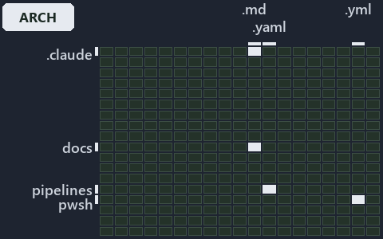

---
catzc:
  immutable:
    with_body_sha: "519b21d9e0ed"
    repo_status: locked
    path: docs/explanation/design/.assets/every-vendor-call-leaves-through-az/grid.md
    source: docs/explanation/design/.assets/every-vendor-call-leaves-through-az/diagram.drawio.png
    role: asset-description
    language: markdown
    filetype: md
    track: docs
    tracktype: documentation
---

# Every vendor call leaves cats through the az CLI: the world-map minimap

```text
Where the files that cite ADR-AZ-CLI and ADR-DSGN-THINPLAT sit in the repository: tracks down, file languages across.
4 of 342 cells lit, holding 20 files.
```



This is the world-map minimap in the sidebar of the architecture diagram of [Every vendor call leaves cats through the az CLI][24], which
explains [ADR-AZ-CLI][1] and [ADR-DSGN-THINPLAT][2]. It lights every cell of the world map that holds a file citing those codes, so it shows
where the decision lives in the repository. Each lit cell has its reason below, naming the code that selects it.

## What the minimap shows

The grid crosses the 18 tracks (rows) with the 19 file languages (columns) of the world map and lights 4 cells, filled in ink. A cell lit
only by passing mentions (citations in body comments, not in a file's header or text) is touched: a lighter ink. Every other cell is idle, a
grey box: it holds files the slide's ADR codes do not select, or no file at all (288 of the 342 cells hold none). The minimap shows where
the slide sits, not how many files a cell holds; the world-map PDFs show the counts.

- .claude × markdown: 1 lit of 89 files
- docs × markdown: 15 lit of 2761 files
- pipelines × pipeline-yaml: 1 lit of 13 files
- pwsh × yaml: 3 lit of 115 files

## Key

A lit row prints its track's name; a lit column prints a short code, the first extension of its file language:

- `.md`: markdown
- `.yaml`: pipeline-yaml
- `.yml`: yaml

## Why each cell is lit

### .claude × markdown (1 lit file)

Placed: the root folder `.claude/` names the track .claude ([ADR-DSGN-TRACK#1][3]); the extension `.md` names the file language markdown
([ADR-DSGN-TRACK#6][4]). Lit ([ADR-DSGN-TRACK#12][5]) by:

- [.claude/plans/plan-explanation-drift-gaps.md][6]: selected by [ADR-AZ-CLI][1]: the file cites it at line 46 (text), line 54 (text) and
  line 114 (text).

### docs × markdown (15 lit files)

Placed: the root folder `docs/` names the track docs ([ADR-DSGN-TRACK#1][3]); the extension `.md` names the file language markdown
([ADR-DSGN-TRACK#6][4]). Lit ([ADR-DSGN-TRACK#12][5]) by:

- [docs/adr/azure/dora-explains.md][7]: selected by [ADR-AZ-CLI][1]: the file cites it at line 94 (text).
- [docs/adr/azure/prefer-az-cli.md][1]: selected by [ADR-AZ-CLI][1]: the ADR's own file.
- [docs/adr/design/dora-explains.md][8]: selected by [ADR-DSGN-THINPLAT][2]: the file cites it at line 27 (text).
- [docs/adr/design/thin-platforms.md][2]: selected by [ADR-DSGN-THINPLAT][2]: the ADR's own file.
- [docs/adr/index.md][9]: selected by [ADR-AZ-CLI][1]: the file cites it at line 283 (text); selected by [ADR-DSGN-THINPLAT][2]: the file
  cites it at line 109 (text).
- [docs/references/.assets/automation/catzc-azure-cli/az-cli-test-assert-share-one-state.drawio.verify.md][10]: selected by [ADR-AZ-CLI][1]:
  the file cites it at line 60 (text).
- [docs/references/pwsh/catzc-azure-cli/Assert-AzCliBicep.ps1.md][11]: selected by [ADR-AZ-CLI][1]: the file cites it at line 18 (text).
- [docs/references/pwsh/catzc-azure-cli/Assert-AzCliCanAccess.ps1.md][12]: selected by [ADR-AZ-CLI][1]: the file cites it at line 22 (text).
- [docs/references/pwsh/catzc-azure-cli/Assert-AzCliSubscriptionAccessible.ps1.md][13]: selected by [ADR-AZ-CLI][1]: the file cites it at
  line 21 (text).
- [docs/references/pwsh/catzc-azure-cli/Get-AzCliSubscriptionAccessState.ps1.md][14]: selected by [ADR-AZ-CLI][1]: the file cites it at line
  26 (text).
- [docs/references/pwsh/catzc-azure-cli/Install-AzCliBicep.ps1.md][15]: selected by [ADR-AZ-CLI][1]: the file cites it at line 18 (text).
- [docs/references/pwsh/catzc-azure-cli/Test-AzCliBicep.ps1.md][16]: selected by [ADR-AZ-CLI][1]: the file cites it at line 23 (text).
- [docs/references/pwsh/catzc-azure-cli/Test-AzCliCanAccess.ps1.md][17]: selected by [ADR-AZ-CLI][1]: the file cites it at line 22 (text).
- [docs/references/pwsh/catzc-azure-cli/Test-AzCliSubscriptionAccessible.ps1.md][18]: selected by [ADR-AZ-CLI][1]: the file cites it at line
  21 (text).
- [docs/references/pwsh/catzc-azure-cli/az-cli-test-assert-share-one-state.drawio.md][19]: selected by [ADR-AZ-CLI][1]: the file cites it at
  line 101 (text).

### pipelines × pipeline-yaml (1 lit file)

Placed: the root folder `pipelines/` names the track pipelines ([ADR-DSGN-TRACK#1][3]); the extension `.yaml` names the file language
pipeline-yaml ([ADR-DSGN-TRACK#6][4]). Lit ([ADR-DSGN-TRACK#12][5]) by:

- [pipelines/ci-automation.yaml][20]: selected by [ADR-AZ-CLI][1]: a pipeline that cites nothing itself carries its globset's citations,
  which cite it at `pwsh/Catzc.Base.Docs/configs/adrs.yml` line 258 (text), `pwsh/Catzc.Base.QualityGates/configs/analyzer-adr-map.yml` line
  7 (text) and `pwsh/Catzc.Base.QualityGates/configs/terminology.yml` line 567 (text); selected by [ADR-DSGN-THINPLAT][2]: a pipeline that
  cites nothing itself carries its globset's citations, which cite it at `pwsh/Catzc.Base.Docs/configs/adrs.yml` line 75 (text) and
  `pwsh/Catzc.Base.QualityGates/configs/terminology.yml` line 661 (text).

### pwsh × yaml (3 lit files)

Placed: the root folder `pwsh/` names the track pwsh ([ADR-DSGN-TRACK#1][3]); the extension `.yml` names the file language yaml
([ADR-DSGN-TRACK#6][4]). Lit ([ADR-DSGN-TRACK#12][5]) by:

- [pwsh/Catzc.Base.Docs/configs/adrs.yml][21]: selected by [ADR-AZ-CLI][1]: the file cites it at line 258 (text); selected by
  [ADR-DSGN-THINPLAT][2]: the file cites it at line 75 (text).
- [pwsh/Catzc.Base.QualityGates/configs/analyzer-adr-map.yml][22]: selected by [ADR-AZ-CLI][1]: the file cites it at line 7 (text).
- [pwsh/Catzc.Base.QualityGates/configs/terminology.yml][23]: selected by [ADR-AZ-CLI][1]: the file cites it at line 567 (text); selected by
  [ADR-DSGN-THINPLAT][2]: the file cites it at line 661 (text).

## Keywords

- [world map][25]
- [track][26]
- [file language][27]
- [cell][28]
- [lit cell][29]
- [.claude][30]: a track
- [docs][30]: a track
- [pipelines][30]: a track
- [pwsh][30]: a track
- [markdown][31]: a file language
- [pipeline-yaml][31]: a file language
- [yaml][31]: a file language

[1]: ../../../../adr/azure/prefer-az-cli.md
[2]: ../../../../adr/design/thin-platforms.md
[3]: ../../../../adr/design/tracks.md#rule-adr-dsgn-track1
[4]: ../../../../adr/design/tracks.md#rule-adr-dsgn-track6
[5]: ../../../../adr/design/tracks.md#rule-adr-dsgn-track12
[6]: ../../../../../.claude/plans/plan-explanation-drift-gaps.md
[7]: ../../../../adr/azure/dora-explains.md
[8]: ../../../../adr/design/dora-explains.md
[9]: ../../../../adr/index.md
[10]: ../../../../references/.assets/automation/catzc-azure-cli/az-cli-test-assert-share-one-state.drawio.verify.md
[11]: ../../../../references/pwsh/catzc-azure-cli/Assert-AzCliBicep.ps1.md
[12]: ../../../../references/pwsh/catzc-azure-cli/Assert-AzCliCanAccess.ps1.md
[13]: ../../../../references/pwsh/catzc-azure-cli/Assert-AzCliSubscriptionAccessible.ps1.md
[14]: ../../../../references/pwsh/catzc-azure-cli/Get-AzCliSubscriptionAccessState.ps1.md
[15]: ../../../../references/pwsh/catzc-azure-cli/Install-AzCliBicep.ps1.md
[16]: ../../../../references/pwsh/catzc-azure-cli/Test-AzCliBicep.ps1.md
[17]: ../../../../references/pwsh/catzc-azure-cli/Test-AzCliCanAccess.ps1.md
[18]: ../../../../references/pwsh/catzc-azure-cli/Test-AzCliSubscriptionAccessible.ps1.md
[19]: ../../../../references/pwsh/catzc-azure-cli/az-cli-test-assert-share-one-state.drawio.md
[20]: ../../../../../pipelines/ci-automation.yaml
[21]: ../../../../../pwsh/Catzc.Base.Docs/configs/adrs.yml
[22]: ../../../../../pwsh/Catzc.Base.QualityGates/configs/analyzer-adr-map.yml
[23]: ../../../../../pwsh/Catzc.Base.QualityGates/configs/terminology.yml
[24]: ../../every-vendor-call-leaves-through-az.md
[25]: ../../../../adr/glossary.md#world-map
[26]: ../../../../adr/glossary.md#track
[27]: ../../../../adr/glossary.md#file-language
[28]: ../../../../adr/glossary.md#cell
[29]: ../../../../adr/glossary.md#lit-cell
[30]: ../../../../../pwsh/Catzc.Base.Variants/configs/variants.yml
[31]: ../../../../../pwsh/Catzc.Base.Languages/configs/languages.yml
