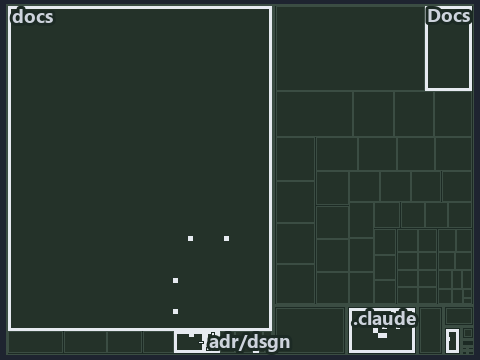

---
catzc:
  immutable:
    with_body_sha: b2e87775dfd8
    repo_status: locked
    path: docs/explanation/design/.assets/ingress-gated-the-rest-by-review/tree.md
    source: docs/explanation/design/.assets/ingress-gated-the-rest-by-review/diagram.drawio.png
    role: asset-description
    language: markdown
    filetype: md
    track: docs
    tracktype: documentation
---

# Only ingress is checked by gates; the source-of-truth and integration rules rest on code review: the tree minimap

```text
Which files cite ADR-DSGN-LIFE, ADR-DSGN-REMOTE and ADR-REPO-VARIANT: every file of the world map is a tile, grouped by top-level folder.
19 files lit in 7 groups.
```



This is the tree minimap in the sidebar of the governance diagram of [Only ingress is checked by gates; the source-of-truth and integration
rules rest on code review][20], which explains [ADR-DSGN-LIFE][1], [ADR-DSGN-REMOTE][2] and [ADR-REPO-VARIANT][3]. It lights every file that
cites those codes, grouped by folder, so it shows which files carry the decision. Each lit group has its reason below, naming the code that
selects it.

## What the minimap shows

The tree draws every file of the world map as a tile, grouped by top-level folder (under `pwsh/` by module, under `docs/adr/` by ADR
domain), and lights 19 files in 7 groups, filled in ink. A lit ADR file has a white rim; a file lit only by passing mentions is a lighter
ink. Every other tile is idle, a grey box: a file the slide's ADR codes do not select.

- .claude: 7 lit files
- docs (docs/ outside docs/adr/): 4 lit files
- adr/dsgn (docs/adr/design): 3 lit files
- adr/repo (docs/adr/repository): 2 lit files
- adr/* (the files directly in docs/adr/): 1 lit file
- pipelines: 1 lit file
- Docs (pwsh/Catzc.Base.Docs): 1 lit file

## Why each group is lit

### .claude (7 lit files)

The group holds the files of .claude; each sits in its world-map cell and is lit by:

- [.claude/plans/plan-explanation-drift-gaps.md][4], in the cell .claude × markdown: selected by [ADR-REPO-VARIANT][3]: the file cites it at
  line 125 (text).
- [.claude/plans/plan-promotion-ladder.md][5], in the cell .claude × markdown: selected by [ADR-DSGN-LIFE][1]: the file cites it at line 12
  (text), line 34 (text) and line 94 (text).
- [.claude/plans/prompt-drift-gaps-1-aspect-move.md][6], in the cell .claude × markdown: selected by [ADR-REPO-VARIANT][3]: the file cites
  it at line 13 (text).
- [.claude/plans/prompt-promotion-ladder-1-build.md][7], in the cell .claude × markdown: selected by [ADR-DSGN-LIFE][1]: the file cites it
  at line 20 (text).
- [.claude/plans/task-explanation-drift-gaps.md][8], in the cell .claude × markdown: selected by [ADR-REPO-VARIANT][3]: the file cites it at
  line 35 (text).
- [.claude/plans/task-loose-ends.md][9], in the cell .claude × markdown: selected by [ADR-DSGN-LIFE][1]: the file cites it at line 55
  (text).
- [.claude/plans/value-of-plan.md][10], in the cell .claude × markdown: selected by [ADR-DSGN-LIFE][1]: the file cites it at line 35 (text).

### docs (docs/ outside docs/adr/, 4 lit files)

The group holds the files of docs/ outside docs/adr/; each sits in its world-map cell and is lit by:

- [docs/references/pwsh/catzc-base-variants/Get-AspectDeclaration.ps1.md][11], in the cell docs × markdown: selected by
  [ADR-REPO-VARIANT][3]: the file cites it at line 16 (text).
- [docs/references/pwsh/catzc-base-variants/Test-AspectDeclaration.ps1.md][12], in the cell docs × markdown: selected by
  [ADR-REPO-VARIANT][3]: the file cites it at line 17 (text).
- [docs/references/pwsh/catzc-base-variants/configs/variants.yml.md][13], in the cell docs × markdown: selected by [ADR-REPO-VARIANT][3]:
  the file cites it at line 11 (text).
- [docs/references/pwsh/catzc-base-variants/types/VariantsConfig.cs.md][14], in the cell docs × markdown: selected by [ADR-REPO-VARIANT][3]:
  the file cites it at line 11 (text).

### adr/dsgn (docs/adr/design, 3 lit files)

The group holds the files of docs/adr/design; each sits in its world-map cell and is lit by:

- [docs/adr/design/commit-lifecycle.md][1], in the cell docs × markdown: selected by [ADR-DSGN-LIFE][1]: the ADR's own file.
- [docs/adr/design/dora-explains.md][15], in the cell docs × markdown: selected by [ADR-DSGN-LIFE][1]: the file cites it at line 82 (text);
  selected by [ADR-DSGN-REMOTE][2]: the file cites it at line 103 (text).
- [docs/adr/design/server-remote-integration.md][2], in the cell docs × markdown: selected by [ADR-DSGN-REMOTE][2]: the ADR's own file.

### adr/repo (docs/adr/repository, 2 lit files)

The group holds the files of docs/adr/repository; each sits in its world-map cell and is lit by:

- [docs/adr/repository/dora-explains.md][16], in the cell docs × markdown: selected by [ADR-REPO-VARIANT][3]: the file cites it at line 165
  (text).
- [docs/adr/repository/repo-variants.md][3], in the cell docs × markdown: selected by [ADR-REPO-VARIANT][3]: the ADR's own file.

### adr/* (the files directly in docs/adr/, 1 lit file)

The group holds the files of the files directly in docs/adr/; each sits in its world-map cell and is lit by:

- [docs/adr/index.md][17], in the cell docs × markdown: selected by [ADR-DSGN-LIFE][1]: the file cites it at line 114 (text); selected by
  [ADR-DSGN-REMOTE][2]: the file cites it at line 115 (text); selected by [ADR-REPO-VARIANT][3]: the file cites it at line 329 (text).

### pipelines (1 lit file)

The group holds the files of pipelines; each sits in its world-map cell and is lit by:

- [pipelines/ci-automation.yaml][18], in the cell pipelines × pipeline-yaml: selected by [ADR-DSGN-LIFE][1]: a pipeline that cites nothing
  itself carries its globset's citations, which cite it at `pwsh/Catzc.Base.Docs/configs/adrs.yml` line 78 (text); selected by
  [ADR-DSGN-REMOTE][2]: a pipeline that cites nothing itself carries its globset's citations, which cite it at
  `pwsh/Catzc.Base.Docs/configs/adrs.yml` line 79 (text); selected by [ADR-REPO-VARIANT][3]: a pipeline that cites nothing itself carries
  its globset's citations, which cite it at `pwsh/Catzc.Base.Docs/configs/adrs.yml` line 303 (text).

### Docs (pwsh/Catzc.Base.Docs, 1 lit file)

The group holds the files of pwsh/Catzc.Base.Docs; each sits in its world-map cell and is lit by:

- [pwsh/Catzc.Base.Docs/configs/adrs.yml][19], in the cell pwsh × yaml: selected by [ADR-DSGN-LIFE][1]: the file cites it at line 78 (text);
  selected by [ADR-DSGN-REMOTE][2]: the file cites it at line 79 (text); selected by [ADR-REPO-VARIANT][3]: the file cites it at line 303
  (text).

## Keywords

- [world map][21]
- [track][22]
- [file language][23]
- [cell][24]
- [lit cell][25]
- [.claude][26]: a track
- [docs][26]: a track
- [pipelines][26]: a track
- [pwsh][26]: a track
- [markdown][27]: a file language
- [pipeline-yaml][27]: a file language
- [yaml][27]: a file language

[1]: ../../../../adr/design/commit-lifecycle.md
[2]: ../../../../adr/design/server-remote-integration.md
[3]: ../../../../adr/repository/repo-variants.md
[4]: ../../../../../.claude/plans/plan-explanation-drift-gaps.md
[5]: ../../../../../.claude/plans/plan-promotion-ladder.md
[6]: ../../../../../.claude/plans/prompt-drift-gaps-1-aspect-move.md
[7]: ../../../../../.claude/plans/prompt-promotion-ladder-1-build.md
[8]: ../../../../../.claude/plans/task-explanation-drift-gaps.md
[9]: ../../../../../.claude/plans/task-loose-ends.md
[10]: ../../../../../.claude/plans/value-of-plan.md
[11]: ../../../../references/pwsh/catzc-base-variants/Get-AspectDeclaration.ps1.md
[12]: ../../../../references/pwsh/catzc-base-variants/Test-AspectDeclaration.ps1.md
[13]: ../../../../references/pwsh/catzc-base-variants/configs/variants.yml.md
[14]: ../../../../references/pwsh/catzc-base-variants/types/VariantsConfig.cs.md
[15]: ../../../../adr/design/dora-explains.md
[16]: ../../../../adr/repository/dora-explains.md
[17]: ../../../../adr/index.md
[18]: ../../../../../pipelines/ci-automation.yaml
[19]: ../../../../../pwsh/Catzc.Base.Docs/configs/adrs.yml
[20]: ../../ingress-gated-the-rest-by-review.md
[21]: ../../../../adr/glossary.md#world-map
[22]: ../../../../adr/glossary.md#track
[23]: ../../../../adr/glossary.md#file-language
[24]: ../../../../adr/glossary.md#cell
[25]: ../../../../adr/glossary.md#lit-cell
[26]: ../../../../../pwsh/Catzc.Base.Variants/configs/variants.yml
[27]: ../../../../../pwsh/Catzc.Base.Languages/configs/languages.yml
