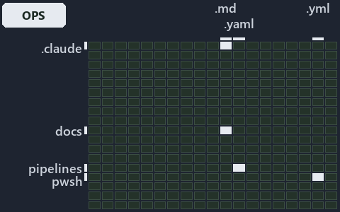

---
catzc:
  immutable:
    with_body_sha: "648ed7e7da43"
    repo_status: locked
    path: docs/explanation/design/.assets/merging-to-main-is-what-deploys/grid.md
    source: docs/explanation/design/.assets/merging-to-main-is-what-deploys/diagram.drawio.png
    role: asset-description
    language: markdown
    filetype: md
    track: docs
    tracktype: documentation
---

# Merging to main is what deploys; there is no run that deploys a topic: the world-map minimap

```text
Where the files that cite ADR-DSGN-LIFE sit in the repository: tracks down, file languages across.
4 of 342 cells lit, holding 14 files.
```



This is the world-map minimap in the sidebar of the operations diagram of [Merging to main is what deploys; there is no run that deploys a
topic][18], which explains [ADR-DSGN-LIFE][1]. It lights every cell of the world map that holds a file citing those codes, so it shows where
the decision lives in the repository. Each lit cell has its reason below, naming the code that selects it.

## What the minimap shows

The grid crosses the 18 tracks (rows) with the 19 file languages (columns) of the world map and lights 4 cells, filled in ink. A cell lit
only by passing mentions (citations in body comments, not in a file's header or text) is touched: a lighter ink. Every other cell is idle, a
grey box: it holds files the slide's ADR codes do not select, or no file at all (288 of the 342 cells hold none). The minimap shows where
the slide sits, not how many files a cell holds; the world-map PDFs show the counts.

- .claude × markdown: 5 lit of 89 files
- docs × markdown: 5 lit of 2761 files
- pipelines × pipeline-yaml: 1 lit of 13 files
- pwsh × yaml: 3 lit of 115 files

## Key

A lit row prints its track's name; a lit column prints a short code, the first extension of its file language:

- `.md`: markdown
- `.yaml`: pipeline-yaml
- `.yml`: yaml

## Why each cell is lit

### .claude × markdown (5 lit files)

Placed: the root folder `.claude/` names the track .claude ([ADR-DSGN-TRACK#1][2]); the extension `.md` names the file language markdown
([ADR-DSGN-TRACK#6][3]). Lit ([ADR-DSGN-TRACK#12][4]) by:

- [.claude/plans/plan-fast-push-followups.md][5]: selected by [ADR-DSGN-LIFE][1]: the file cites it at line 12 (text) and line 37 (text).
- [.claude/plans/plan-promotion-ladder.md][6]: selected by [ADR-DSGN-LIFE][1]: the file cites it at line 12 (text), line 34 (text) and line
  82 (text).
- [.claude/plans/prompt-promotion-ladder-1-build.md][7]: selected by [ADR-DSGN-LIFE][1]: the file cites it at line 20 (text).
- [.claude/plans/task-loose-ends.md][8]: selected by [ADR-DSGN-LIFE][1]: the file cites it at line 55 (text).
- [.claude/plans/value-of-plan.md][9]: selected by [ADR-DSGN-LIFE][1]: the file cites it at line 36 (text) and line 43 (text).

### docs × markdown (5 lit files)

Placed: the root folder `docs/` names the track docs ([ADR-DSGN-TRACK#1][2]); the extension `.md` names the file language markdown
([ADR-DSGN-TRACK#6][3]). Lit ([ADR-DSGN-TRACK#12][4]) by:

- [docs/adr/design/commit-lifecycle.md][1]: selected by [ADR-DSGN-LIFE][1]: the ADR's own file.
- [docs/adr/design/dora-explains.md][10]: selected by [ADR-DSGN-LIFE][1]: the file cites it at line 82 (text).
- [docs/adr/glossary.md][11]: selected by [ADR-DSGN-LIFE][1]: the file cites it at line 272 (text) and line 345 (text).
- [docs/adr/index.md][12]: selected by [ADR-DSGN-LIFE][1]: the file cites it at line 112 (text).
- [docs/references/pwsh/catzc-base-git/Push-Dirty.ps1.md][13]: selected by [ADR-DSGN-LIFE][1]: the file cites it at line 14 (text).

### pipelines × pipeline-yaml (1 lit file)

Placed: the root folder `pipelines/` names the track pipelines ([ADR-DSGN-TRACK#1][2]); the extension `.yaml` names the file language
pipeline-yaml ([ADR-DSGN-TRACK#6][3]). Lit ([ADR-DSGN-TRACK#12][4]) by:

- [pipelines/ci-automation.yaml][14]: selected by [ADR-DSGN-LIFE][1]: a pipeline that cites nothing itself carries its globset's citations,
  which cite it at `pwsh/Catzc.Base.Docs/configs/adrs.yml` line 78 (text), `pwsh/Catzc.Base.Docs/configs/glossary.yml` line 484 (text) and
  `pwsh/Catzc.Base.ModuleSystem/configs/glossary.yml` line 49 (text).

### pwsh × yaml (3 lit files)

Placed: the root folder `pwsh/` names the track pwsh ([ADR-DSGN-TRACK#1][2]); the extension `.yml` names the file language yaml
([ADR-DSGN-TRACK#6][3]). Lit ([ADR-DSGN-TRACK#12][4]) by:

- [pwsh/Catzc.Base.Docs/configs/adrs.yml][15]: selected by [ADR-DSGN-LIFE][1]: the file cites it at line 78 (text).
- [pwsh/Catzc.Base.Docs/configs/glossary.yml][16]: selected by [ADR-DSGN-LIFE][1]: the file cites it at line 484 (text).
- [pwsh/Catzc.Base.ModuleSystem/configs/glossary.yml][17]: selected by [ADR-DSGN-LIFE][1]: the file cites it at line 49 (text).

## Keywords

- [world map][19]
- [track][20]
- [file language][21]
- [cell][22]
- [lit cell][23]
- [.claude][24]: a track
- [docs][24]: a track
- [pipelines][24]: a track
- [pwsh][24]: a track
- [markdown][25]: a file language
- [pipeline-yaml][25]: a file language
- [yaml][25]: a file language

Terms the cited ADRs define:

- [occupant][26], defined by [ADR-DSGN-LIFE#5][27]
- [staging slot][28], defined by [ADR-DSGN-LIFE#5][27]

[1]: ../../../../adr/design/commit-lifecycle.md
[2]: ../../../../adr/design/tracks.md#rule-adr-dsgn-track1
[3]: ../../../../adr/design/tracks.md#rule-adr-dsgn-track6
[4]: ../../../../adr/design/tracks.md#rule-adr-dsgn-track12
[5]: ../../../../../.claude/plans/plan-fast-push-followups.md
[6]: ../../../../../.claude/plans/plan-promotion-ladder.md
[7]: ../../../../../.claude/plans/prompt-promotion-ladder-1-build.md
[8]: ../../../../../.claude/plans/task-loose-ends.md
[9]: ../../../../../.claude/plans/value-of-plan.md
[10]: ../../../../adr/design/dora-explains.md
[11]: ../../../../adr/glossary.md
[12]: ../../../../adr/index.md
[13]: ../../../../references/pwsh/catzc-base-git/Push-Dirty.ps1.md
[14]: ../../../../../pipelines/ci-automation.yaml
[15]: ../../../../../pwsh/Catzc.Base.Docs/configs/adrs.yml
[16]: ../../../../../pwsh/Catzc.Base.Docs/configs/glossary.yml
[17]: ../../../../../pwsh/Catzc.Base.ModuleSystem/configs/glossary.yml
[18]: ../../merging-to-main-is-what-deploys.md
[19]: ../../../../adr/glossary.md#world-map
[20]: ../../../../adr/glossary.md#track
[21]: ../../../../adr/glossary.md#file-language
[22]: ../../../../adr/glossary.md#cell
[23]: ../../../../adr/glossary.md#lit-cell
[24]: ../../../../../pwsh/Catzc.Base.Variants/configs/variants.yml
[25]: ../../../../../pwsh/Catzc.Base.Languages/configs/languages.yml
[26]: ../../../../adr/glossary.md#occupant
[27]: ../../../../adr/design/commit-lifecycle.md#rule-adr-dsgn-life5
[28]: ../../../../adr/glossary.md#staging-slot
