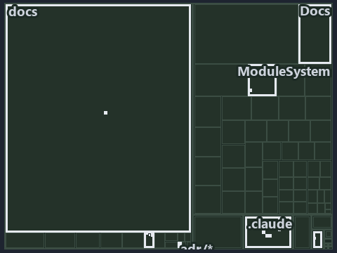

---
catzc:
  immutable:
    with_body_sha: "2c832fdbb579"
    repo_status: locked
    path: docs/explanation/design/.assets/merging-to-main-is-what-deploys/tree.md
    source: docs/explanation/design/.assets/merging-to-main-is-what-deploys/diagram.drawio.png
    role: asset-description
    language: markdown
    filetype: md
    track: docs
    tracktype: documentation
---

# Merging to main is what deploys; there is no run that deploys a topic: the tree minimap

```text
Which files cite ADR-DSGN-LIFE: every file of the world map is a tile, grouped by top-level folder.
14 files lit in 7 groups.
```



This is the tree minimap in the sidebar of the operations diagram of [Merging to main is what deploys; there is no run that deploys a
topic][15], which explains [ADR-DSGN-LIFE][1]. It lights every file that cites those codes, grouped by folder, so it shows which files carry
the decision. Each lit group has its reason below, naming the code that selects it.

## What the minimap shows

The tree draws every file of the world map as a tile, grouped by top-level folder (under `pwsh/` by module, under `docs/adr/` by ADR
domain), and lights 14 files in 7 groups, filled in ink. A lit ADR file has a white rim; a file lit only by passing mentions is a lighter
ink. Every other tile is idle, a grey box: a file the slide's ADR codes do not select.

- .claude: 5 lit files
- adr/* (the files directly in docs/adr/): 2 lit files
- adr/dsgn (docs/adr/design): 2 lit files
- Docs (pwsh/Catzc.Base.Docs): 2 lit files
- docs (docs/ outside docs/adr/): 1 lit file
- pipelines: 1 lit file
- ModuleSystem (pwsh/Catzc.Base.ModuleSystem): 1 lit file

## Why each group is lit

### .claude (5 lit files)

The group holds the files of .claude; each sits in its world-map cell and is lit by:

- [.claude/plans/plan-fast-push-followups.md][2], in the cell .claude × markdown: selected by [ADR-DSGN-LIFE][1]: the file cites it at line
  12 (text) and line 37 (text).
- [.claude/plans/plan-promotion-ladder.md][3], in the cell .claude × markdown: selected by [ADR-DSGN-LIFE][1]: the file cites it at line 12
  (text), line 34 (text) and line 94 (text).
- [.claude/plans/prompt-promotion-ladder-1-build.md][4], in the cell .claude × markdown: selected by [ADR-DSGN-LIFE][1]: the file cites it
  at line 20 (text).
- [.claude/plans/task-loose-ends.md][5], in the cell .claude × markdown: selected by [ADR-DSGN-LIFE][1]: the file cites it at line 57
  (text).
- [.claude/plans/value-of-plan.md][6], in the cell .claude × markdown: selected by [ADR-DSGN-LIFE][1]: the file cites it at line 35 (text),
  line 42 (text) and line 42 (text).

### adr/* (the files directly in docs/adr/, 2 lit files)

The group holds the files of the files directly in docs/adr/; each sits in its world-map cell and is lit by:

- [docs/adr/glossary.md][7], in the cell docs × markdown: selected by [ADR-DSGN-LIFE][1]: the file cites it at line 272 (text) and line 346
  (text).
- [docs/adr/index.md][8], in the cell docs × markdown: selected by [ADR-DSGN-LIFE][1]: the file cites it at line 112 (text).

### adr/dsgn (docs/adr/design, 2 lit files)

The group holds the files of docs/adr/design; each sits in its world-map cell and is lit by:

- [docs/adr/design/commit-lifecycle.md][1], in the cell docs × markdown: selected by [ADR-DSGN-LIFE][1]: the ADR's own file.
- [docs/adr/design/dora-explains.md][9], in the cell docs × markdown: selected by [ADR-DSGN-LIFE][1]: the file cites it at line 82 (text).

### Docs (pwsh/Catzc.Base.Docs, 2 lit files)

The group holds the files of pwsh/Catzc.Base.Docs; each sits in its world-map cell and is lit by:

- [pwsh/Catzc.Base.Docs/configs/adrs.yml][10], in the cell pwsh × yaml: selected by [ADR-DSGN-LIFE][1]: the file cites it at line 78 (text).
- [pwsh/Catzc.Base.Docs/configs/glossary.yml][11], in the cell pwsh × yaml: selected by [ADR-DSGN-LIFE][1]: the file cites it at line 484
  (text).

### docs (docs/ outside docs/adr/, 1 lit file)

The group holds the files of docs/ outside docs/adr/; each sits in its world-map cell and is lit by:

- [docs/references/pwsh/catzc-base-git/Push-Dirty.ps1.md][12], in the cell docs × markdown: selected by [ADR-DSGN-LIFE][1]: the file cites
  it at line 14 (text).

### pipelines (1 lit file)

The group holds the files of pipelines; each sits in its world-map cell and is lit by:

- [pipelines/ci-automation.yaml][13], in the cell pipelines × pipeline-yaml: selected by [ADR-DSGN-LIFE][1]: a pipeline that cites nothing
  itself carries its globset's citations, which cite it at `pwsh/Catzc.Base.Docs/configs/adrs.yml` line 78 (text),
  `pwsh/Catzc.Base.Docs/configs/glossary.yml` line 484 (text) and `pwsh/Catzc.Base.ModuleSystem/configs/glossary.yml` line 49 (text).

### ModuleSystem (pwsh/Catzc.Base.ModuleSystem, 1 lit file)

The group holds the files of pwsh/Catzc.Base.ModuleSystem; each sits in its world-map cell and is lit by:

- [pwsh/Catzc.Base.ModuleSystem/configs/glossary.yml][14], in the cell pwsh × yaml: selected by [ADR-DSGN-LIFE][1]: the file cites it at
  line 49 (text).

## Keywords

- [world map][16]
- [track][17]
- [file language][18]
- [cell][19]
- [lit cell][20]
- [.claude][21]: a track
- [docs][21]: a track
- [pipelines][21]: a track
- [pwsh][21]: a track
- [markdown][22]: a file language
- [pipeline-yaml][22]: a file language
- [yaml][22]: a file language

[1]: ../../../../adr/design/commit-lifecycle.md
[2]: ../../../../../.claude/plans/plan-fast-push-followups.md
[3]: ../../../../../.claude/plans/plan-promotion-ladder.md
[4]: ../../../../../.claude/plans/prompt-promotion-ladder-1-build.md
[5]: ../../../../../.claude/plans/task-loose-ends.md
[6]: ../../../../../.claude/plans/value-of-plan.md
[7]: ../../../../adr/glossary.md
[8]: ../../../../adr/index.md
[9]: ../../../../adr/design/dora-explains.md
[10]: ../../../../../pwsh/Catzc.Base.Docs/configs/adrs.yml
[11]: ../../../../../pwsh/Catzc.Base.Docs/configs/glossary.yml
[12]: ../../../../references/pwsh/catzc-base-git/Push-Dirty.ps1.md
[13]: ../../../../../pipelines/ci-automation.yaml
[14]: ../../../../../pwsh/Catzc.Base.ModuleSystem/configs/glossary.yml
[15]: ../../merging-to-main-is-what-deploys.md
[16]: ../../../../adr/glossary.md#world-map
[17]: ../../../../adr/glossary.md#track
[18]: ../../../../adr/glossary.md#file-language
[19]: ../../../../adr/glossary.md#cell
[20]: ../../../../adr/glossary.md#lit-cell
[21]: ../../../../../pwsh/Catzc.Base.Variants/configs/variants.yml
[22]: ../../../../../pwsh/Catzc.Base.Languages/configs/languages.yml
