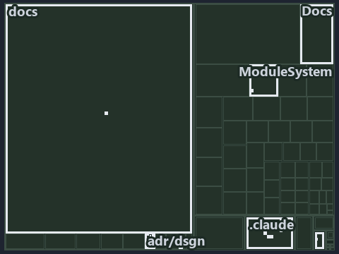

---
catzc:
  immutable:
    with_body_sha: "3c9381c578b0"
    repo_status: locked
    path: docs/explanation/design/.assets/out-of-band-deploy-is-adr-only/tree.md
    source: docs/explanation/design/.assets/out-of-band-deploy-is-adr-only/diagram.drawio.png
    role: asset-description
    language: markdown
    filetype: md
    track: docs
    tracktype: documentation
---

# No gate checks the out-of-band deploy rule, and the only gate on deploys in code is main-only: the tree minimap

```text
Which files cite ADR-DSGN-LIFE and ADR-DSGN-VISUAL: every file of the world map is a tile, grouped by top-level folder.
17 files lit in 7 groups.
```



This is the tree minimap in the sidebar of the governance diagram of [No gate checks the out-of-band deploy rule, and the only gate on
deploys in code is main-only][18], which explains [ADR-DSGN-LIFE][1] and [ADR-DSGN-VISUAL][2]. It lights every file that cites those codes,
grouped by folder, so it shows which files carry the decision. Each lit group has its reason below, naming the code that selects it.

## What the minimap shows

The tree draws every file of the world map as a tile, grouped by top-level folder (under `pwsh/` by module, under `docs/adr/` by ADR
domain), and lights 17 files in 7 groups, filled in ink. A lit ADR file has a white rim; a file lit only by passing mentions is a lighter
ink. Every other tile is idle, a grey box: a file the slide's ADR codes do not select.

- .claude: 5 lit files
- Docs (pwsh/Catzc.Base.Docs): 4 lit files
- adr/dsgn (docs/adr/design): 3 lit files
- adr/* (the files directly in docs/adr/): 2 lit files
- docs (docs/ outside docs/adr/): 1 lit file
- pipelines: 1 lit file
- ModuleSystem (pwsh/Catzc.Base.ModuleSystem): 1 lit file

## Why each group is lit

### .claude (5 lit files)

The group holds the files of .claude; each sits in its world-map cell and is lit by:

- [.claude/plans/plan-fast-push-followups.md][3], in the cell .claude × markdown: selected by [ADR-DSGN-LIFE][1]: the file cites it at line
  12 (text) and line 37 (text).
- [.claude/plans/plan-promotion-ladder.md][4], in the cell .claude × markdown: selected by [ADR-DSGN-LIFE][1]: the file cites it at line 12
  (text), line 34 (text) and line 94 (text).
- [.claude/plans/prompt-promotion-ladder-1-build.md][5], in the cell .claude × markdown: selected by [ADR-DSGN-LIFE][1]: the file cites it
  at line 20 (text).
- [.claude/plans/task-loose-ends.md][6], in the cell .claude × markdown: selected by [ADR-DSGN-LIFE][1]: the file cites it at line 57
  (text).
- [.claude/plans/value-of-plan.md][7], in the cell .claude × markdown: selected by [ADR-DSGN-LIFE][1]: the file cites it at line 35 (text),
  line 42 (text) and line 42 (text).

### Docs (pwsh/Catzc.Base.Docs, 4 lit files)

The group holds the files of pwsh/Catzc.Base.Docs; each sits in its world-map cell and is lit by:

- [pwsh/Catzc.Base.Docs/configs/adrs.yml][8], in the cell pwsh × yaml: selected by [ADR-DSGN-LIFE][1]: the file cites it at line 78 (text);
  selected by [ADR-DSGN-VISUAL][2]: the file cites it at line 77 (text).
- [pwsh/Catzc.Base.Docs/configs/agents.yml][9], in the cell pwsh × yaml: selected by [ADR-DSGN-VISUAL][2]: the file cites it at line 28
  (text), line 28 (text), line 34 (text) and line 39 (text).
- [pwsh/Catzc.Base.Docs/configs/capabilities.yml][10], in the cell pwsh × yaml: selected by [ADR-DSGN-VISUAL][2]: the file cites it at line
  67 (text), line 72 (text), line 77 (text), line 77 (text) and line 82 (text).
- [pwsh/Catzc.Base.Docs/configs/glossary.yml][11], in the cell pwsh × yaml: selected by [ADR-DSGN-LIFE][1]: the file cites it at line 484
  (text).

### adr/dsgn (docs/adr/design, 3 lit files)

The group holds the files of docs/adr/design; each sits in its world-map cell and is lit by:

- [docs/adr/design/commit-lifecycle.md][1], in the cell docs × markdown: selected by [ADR-DSGN-LIFE][1]: the ADR's own file.
- [docs/adr/design/dora-explains.md][12], in the cell docs × markdown: selected by [ADR-DSGN-LIFE][1]: the file cites it at line 82 (text);
  selected by [ADR-DSGN-VISUAL][2]: the file cites it at line 63 (text).
- [docs/adr/design/visual-design.md][2], in the cell docs × markdown: selected by [ADR-DSGN-VISUAL][2]: the ADR's own file.

### adr/* (the files directly in docs/adr/, 2 lit files)

The group holds the files of the files directly in docs/adr/; each sits in its world-map cell and is lit by:

- [docs/adr/glossary.md][13], in the cell docs × markdown: selected by [ADR-DSGN-LIFE][1]: the file cites it at line 272 (text) and line 346
  (text).
- [docs/adr/index.md][14], in the cell docs × markdown: selected by [ADR-DSGN-LIFE][1]: the file cites it at line 112 (text); selected by
  [ADR-DSGN-VISUAL][2]: the file cites it at line 111 (text).

### docs (docs/ outside docs/adr/, 1 lit file)

The group holds the files of docs/ outside docs/adr/; each sits in its world-map cell and is lit by:

- [docs/references/pwsh/catzc-base-git/Push-Dirty.ps1.md][15], in the cell docs × markdown: selected by [ADR-DSGN-LIFE][1]: the file cites
  it at line 14 (text).

### pipelines (1 lit file)

The group holds the files of pipelines; each sits in its world-map cell and is lit by:

- [pipelines/ci-automation.yaml][16], in the cell pipelines × pipeline-yaml: selected by [ADR-DSGN-LIFE][1]: a pipeline that cites nothing
  itself carries its globset's citations, which cite it at `pwsh/Catzc.Base.Docs/configs/adrs.yml` line 78 (text),
  `pwsh/Catzc.Base.Docs/configs/glossary.yml` line 484 (text) and `pwsh/Catzc.Base.ModuleSystem/configs/glossary.yml` line 49 (text);
  selected by [ADR-DSGN-VISUAL][2]: a pipeline that cites nothing itself carries its globset's citations, which cite it at
  `pwsh/Catzc.Base.Docs/configs/adrs.yml` line 77 (text), `pwsh/Catzc.Base.Docs/configs/agents.yml` line 28 (text),
  `pwsh/Catzc.Base.Docs/configs/agents.yml` line 28 (text), `pwsh/Catzc.Base.Docs/configs/agents.yml` line 34 (text),
  `pwsh/Catzc.Base.Docs/configs/agents.yml` line 39 (text), `pwsh/Catzc.Base.Docs/configs/capabilities.yml` line 67 (text),
  `pwsh/Catzc.Base.Docs/configs/capabilities.yml` line 72 (text), `pwsh/Catzc.Base.Docs/configs/capabilities.yml` line 77 (text),
  `pwsh/Catzc.Base.Docs/configs/capabilities.yml` line 77 (text) and `pwsh/Catzc.Base.Docs/configs/capabilities.yml` line 82 (text).

### ModuleSystem (pwsh/Catzc.Base.ModuleSystem, 1 lit file)

The group holds the files of pwsh/Catzc.Base.ModuleSystem; each sits in its world-map cell and is lit by:

- [pwsh/Catzc.Base.ModuleSystem/configs/glossary.yml][17], in the cell pwsh × yaml: selected by [ADR-DSGN-LIFE][1]: the file cites it at
  line 49 (text).

## Keywords

- [world map][19]
- [track][20]
- [file language][21]
- [cell][22]
- [lit cell][23]
- [.claude][24]: a track
- [docs][24]: a track
- [pipelines][24]: a track
- [pwsh][24]: a track
- [markdown][25]: a file language
- [pipeline-yaml][25]: a file language
- [yaml][25]: a file language

[1]: ../../../../adr/design/commit-lifecycle.md
[2]: ../../../../adr/design/visual-design.md
[3]: ../../../../../.claude/plans/plan-fast-push-followups.md
[4]: ../../../../../.claude/plans/plan-promotion-ladder.md
[5]: ../../../../../.claude/plans/prompt-promotion-ladder-1-build.md
[6]: ../../../../../.claude/plans/task-loose-ends.md
[7]: ../../../../../.claude/plans/value-of-plan.md
[8]: ../../../../../pwsh/Catzc.Base.Docs/configs/adrs.yml
[9]: ../../../../../pwsh/Catzc.Base.Docs/configs/agents.yml
[10]: ../../../../../pwsh/Catzc.Base.Docs/configs/capabilities.yml
[11]: ../../../../../pwsh/Catzc.Base.Docs/configs/glossary.yml
[12]: ../../../../adr/design/dora-explains.md
[13]: ../../../../adr/glossary.md
[14]: ../../../../adr/index.md
[15]: ../../../../references/pwsh/catzc-base-git/Push-Dirty.ps1.md
[16]: ../../../../../pipelines/ci-automation.yaml
[17]: ../../../../../pwsh/Catzc.Base.ModuleSystem/configs/glossary.yml
[18]: ../../out-of-band-deploy-is-adr-only.md
[19]: ../../../../adr/glossary.md#world-map
[20]: ../../../../adr/glossary.md#track
[21]: ../../../../adr/glossary.md#file-language
[22]: ../../../../adr/glossary.md#cell
[23]: ../../../../adr/glossary.md#lit-cell
[24]: ../../../../../pwsh/Catzc.Base.Variants/configs/variants.yml
[25]: ../../../../../pwsh/Catzc.Base.Languages/configs/languages.yml
