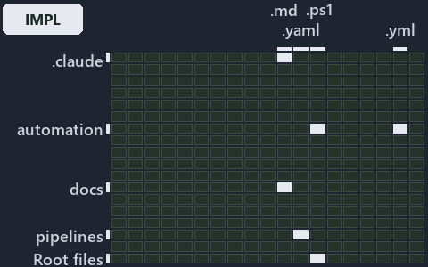

---
catzc:
  immutable:
    with_body_sha: "55592ccc4656"
    repo_status: locked
    path: docs/explanation/design/.assets/shims-set-roots-mode-read-back/grid.md
    source: docs/explanation/design/.assets/shims-set-roots-mode-read-back/diagram.drawio.png
    role: asset-description
    language: markdown
    filetype: md
    track: docs
    tracktype: documentation
---

# Each entry script sets the code root, and Get-CatzcRunMode reads the mode back from it: the world-map minimap

```text
Where the files that cite ADR-DSGN-RUNMODE sit in the repository: tracks down, file languages across.
6 of 342 cells lit, holding 44 files.
```



This is the world-map minimap in the sidebar of the implementation diagram of [Each entry script sets the code root, and Get-CatzcRunMode
reads the mode back from it][46], which explains [ADR-DSGN-RUNMODE][1]. It lights every cell of the world map that holds a file citing those
codes, so it shows where the decision lives in the repository. Each lit cell has its reason below, naming the code that selects it.

## What the minimap shows

The grid crosses the 18 tracks (rows) with the 19 file languages (columns) of the world map and lights 6 cells, filled in ink. A cell lit
only by passing mentions (citations in body comments, not in a file's header or text) is touched: a lighter ink. Every other cell is idle, a
grey box: it holds files the slide's ADR codes do not select, or no file at all (288 of the 342 cells hold none). The minimap shows where
the slide sits, not how many files a cell holds; the world-map PDFs show the counts.

- .claude × markdown: 3 lit of 89 files
- docs × markdown: 34 lit of 2767 files
- pipelines × pipeline-yaml: 1 lit of 14 files
- pwsh × powershell: 3 lit of 1651 files
- pwsh × yaml: 2 lit of 115 files
- Root files × powershell: 1 lit of 1 file

## Key

A lit row prints its track's name; a lit column prints a short code, the first extension of its file language:

- `.md`: markdown
- `.yaml`: pipeline-yaml
- `.ps1`: powershell
- `.yml`: yaml

## Why each cell is lit

### .claude × markdown (3 lit files)

Placed: the root folder `.claude/` names the track .claude ([ADR-DSGN-TRACK-TRACKISPLACEDCLUSTER][2]); the extension `.md` names the file
language markdown ([ADR-DSGN-TRACK-FILELANGUAGE][2]). Lit ([ADR-DSGN-TRACK-LITCELL][2]) by:

- [.claude/plans/plan-explanation-drift-gaps.md][3]: selected by [ADR-DSGN-RUNMODE][1]: the file cites it at line 56 (text) and line 102
  (text).
- [.claude/plans/plan-layers-vocabulary-rename-contracts.md][4]: selected by [ADR-DSGN-RUNMODE][1]: the file cites it at line 133 (text).
- [.claude/plans/task-layers-classification-flip.md][5]: selected by [ADR-DSGN-RUNMODE][1]: the file cites it at line 22 (text), line 31
  (text), line 31 (text) and line 31 (text).

### docs × markdown (34 lit files)

Placed: the root folder `docs/` names the track docs ([ADR-DSGN-TRACK-TRACKISPLACEDCLUSTER][2]); the extension `.md` names the file language
markdown ([ADR-DSGN-TRACK-FILELANGUAGE][2]). Lit ([ADR-DSGN-TRACK-LITCELL][2]) by:

- [docs/adr/design/dora-explains.md][6]: selected by [ADR-DSGN-RUNMODE][1]: the file cites it at line 123 (text).
- [docs/adr/design/run-modes.md][1]: selected by [ADR-DSGN-RUNMODE][1]: the ADR's own file.
- [docs/adr/glossary.md][7]: selected by [ADR-DSGN-RUNMODE][1]: the file cites it at line 312 (text).
- [docs/adr/index.md][8]: selected by [ADR-DSGN-RUNMODE][1]: the file cites it at line 114 (text).
- [docs/references/.assets/automation/catzc-base-modulesystem/module-graph-declared-vs-observed.drawio.verify.md][9]: selected by
  [ADR-DSGN-RUNMODE][1]: the file cites it at line 53 (text).
- [docs/references/pwsh/catzc-base-configextensions/Test-ConfigValidators.ps1.md][10]: selected by [ADR-DSGN-RUNMODE][1]: the file cites it
  at line 19 (text).
- [docs/references/pwsh/catzc-base-docs/private/Get-CatsModules.ps1.md][11]: selected by [ADR-DSGN-RUNMODE][1]: the file cites it at line 18
  (text).
- [docs/references/pwsh/catzc-base-globs/Get-ModuleGlobSet.ps1.md][12]: selected by [ADR-DSGN-RUNMODE][1]: the file cites it at line 31
  (text).
- [docs/references/pwsh/catzc-base-modulesystem/Copy-CatzcModule.ps1.md][13]: selected by [ADR-DSGN-RUNMODE][1]: the file cites it at line
  38 (text).
- [docs/references/pwsh/catzc-base-modulesystem/Get-FunctionDependency.ps1.md][14]: selected by [ADR-DSGN-RUNMODE][1]: the file cites it at
  line 18 (text).
- [docs/references/pwsh/catzc-base-modulesystem/Get-InternalAssetDependency.ps1.md][15]: selected by [ADR-DSGN-RUNMODE][1]: the file cites
  it at line 36 (text).
- [docs/references/pwsh/catzc-base-modulesystem/Get-ModuleFunction.ps1.md][16]: selected by [ADR-DSGN-RUNMODE][1]: the file cites it at line
  19 (text).
- [docs/references/pwsh/catzc-base-modulesystem/New-Importer.ps1.md][17]: selected by [ADR-DSGN-RUNMODE][1]: the file cites it at line 23
  (text).
- [docs/references/pwsh/catzc-base-modulesystem/Sync-GeneratedFile.ps1.md][18]: selected by [ADR-DSGN-RUNMODE][1]: the file cites it at line
  26 (text).
- [docs/references/pwsh/catzc-base-modulesystem/Test-FunctionDependency.ps1.md][19]: selected by [ADR-DSGN-RUNMODE][1]: the file cites it at
  line 26 (text).
- [docs/references/pwsh/catzc-base-modulesystem/module-graph-declared-vs-observed.drawio.md][20]: selected by [ADR-DSGN-RUNMODE][1]: the
  file cites it at line 105 (text).
- [docs/references/pwsh/catzc-base-qualitygates/Test-BuildArtifact.ps1.md][21]: selected by [ADR-DSGN-RUNMODE][1]: the file cites it at line
  34 (text).
- [docs/references/pwsh/catzc-base-qualitygates/Test-CatzcBuild.ps1.md][22]: selected by [ADR-DSGN-RUNMODE][1]: the file cites it at line 15
  (text).
- [docs/references/pwsh/catzc-base-qualitygates/tests/Test-CatzcBuild.Parity.Tests.ps1.md][23]: selected by [ADR-DSGN-RUNMODE][1]: the file
  cites it at line 11 (text).
- [docs/references/pwsh/catzc-base-qualitygates/tests/Test-CatzcBuild.ScopeIsolation.Tests.ps1.md][24]: selected by [ADR-DSGN-RUNMODE][1]:
  the file cites it at line 11 (text).
- [docs/references/pwsh/catzc-base-repository/Assert-SourceTree.ps1.md][25]: selected by [ADR-DSGN-RUNMODE][1]: the file cites it at line 16
  (text).
- [docs/references/pwsh/catzc-base-repository/Get-CatzcModuleRoot.ps1.md][26]: selected by [ADR-DSGN-RUNMODE][1]: the file cites it at line
  16 (text).
- [docs/references/pwsh/catzc-base-repository/Get-CatzcRunMode.ps1.md][27]: selected by [ADR-DSGN-RUNMODE][1]: the file cites it at line 14
  (text).
- [docs/references/pwsh/catzc-base-rootconfig/Build-RootConfig.ps1.md][28]: selected by [ADR-DSGN-RUNMODE][1]: the file cites it at line 28
  (text).
- [docs/references/pwsh/catzc-base-typessystem/Build-BashTimeoutHook.ps1.md][29]: selected by [ADR-DSGN-RUNMODE][1]: the file cites it at
  line 22 (text).
- [docs/references/pwsh/catzc-base-typessystem/Clear-ModuleTypeCache.ps1.md][30]: selected by [ADR-DSGN-RUNMODE][1]: the file cites it at
  line 34 (text).
- [docs/references/pwsh/catzc-base-typessystem/Get-CSharpTypeDependency.ps1.md][31]: selected by [ADR-DSGN-RUNMODE][1]: the file cites it at
  line 31 (text).
- [docs/references/pwsh/catzc-base-typessystem/Invoke-BuildForVSCode.ps1.md][32]: selected by [ADR-DSGN-RUNMODE][1]: the file cites it at
  line 27 (text).
- [docs/references/pwsh/catzc-base-vendor/Install-VendorModule.ps1.md][33]: selected by [ADR-DSGN-RUNMODE][1]: the file cites it at line 19
  (text).
- [docs/references/pwsh/catzc-base-vendor/Remove-VendorModules.ps1.md][34]: selected by [ADR-DSGN-RUNMODE][1]: the file cites it at line 25
  (text).
- [docs/references/pwsh/internal/Catzc.Internal.Builder.psm1.md][35]: selected by [ADR-DSGN-RUNMODE][1]: the file cites it at line 15
  (text).
- [docs/references/pwsh/internal/Catzc.Internal.Importer.psm1.md][36]: selected by [ADR-DSGN-RUNMODE][1]: the file cites it at line 193
  (text).
- [docs/references/pwsh/internal/Catzc.Internal.TestKit.psm1.md][37]: selected by [ADR-DSGN-RUNMODE][1]: the file cites it at line 58
  (text).
- [docs/references/pwsh/internal/assets/Import-Catzc.ps1.md][38]: selected by [ADR-DSGN-RUNMODE][1]: the file cites it at line 14 (text).

### pipelines × pipeline-yaml (1 lit file)

Placed: the root folder `pipelines/` names the track pipelines ([ADR-DSGN-TRACK-TRACKISPLACEDCLUSTER][2]); the extension `.yaml` names the
file language pipeline-yaml ([ADR-DSGN-TRACK-FILELANGUAGE][2]). Lit ([ADR-DSGN-TRACK-LITCELL][2]) by:

- [pipelines/ci-automation.yaml][39]: selected by [ADR-DSGN-RUNMODE][1]: a pipeline that cites nothing itself carries its globset's
  citations, which cite it at `pwsh/.internal/tests/New-FakeRepositoryRoot.Tests.ps1` line 1 (text), `pwsh/Catzc.Base.Docs/configs/adrs.yml`
  line 80 (text), `pwsh/Catzc.Base.Docs/configs/glossary.yml` line 622 (text),
  `pwsh/Catzc.Base.QualityGates/tests/Test-CatzcBuild.Parity.Tests.ps1` line 1 (text) and
  `pwsh/Catzc.Base.QualityGates/tests/Test-CatzcBuild.ScopeIsolation.Tests.ps1` line 1 (text).

### pwsh × powershell (3 lit files)

Placed: the root folder `pwsh/` names the track pwsh ([ADR-DSGN-TRACK-TRACKISPLACEDCLUSTER][2]); the extension `.ps1` names the file
language powershell ([ADR-DSGN-TRACK-FILELANGUAGE][2]). Lit ([ADR-DSGN-TRACK-LITCELL][2]) by:

- [pwsh/.internal/tests/New-FakeRepositoryRoot.Tests.ps1][40]: selected by [ADR-DSGN-RUNMODE][1]: the file cites it at line 1 (text).
- [pwsh/Catzc.Base.QualityGates/tests/Test-CatzcBuild.Parity.Tests.ps1][41]: selected by [ADR-DSGN-RUNMODE][1]: the file cites it at line 1
  (text).
- [pwsh/Catzc.Base.QualityGates/tests/Test-CatzcBuild.ScopeIsolation.Tests.ps1][42]: selected by [ADR-DSGN-RUNMODE][1]: the file cites it at
  line 1 (text).

### pwsh × yaml (2 lit files)

Placed: the root folder `pwsh/` names the track pwsh ([ADR-DSGN-TRACK-TRACKISPLACEDCLUSTER][2]); the extension `.yml` names the file
language yaml ([ADR-DSGN-TRACK-FILELANGUAGE][2]). Lit ([ADR-DSGN-TRACK-LITCELL][2]) by:

- [pwsh/Catzc.Base.Docs/configs/adrs.yml][43]: selected by [ADR-DSGN-RUNMODE][1]: the file cites it at line 80 (text).
- [pwsh/Catzc.Base.Docs/configs/glossary.yml][44]: selected by [ADR-DSGN-RUNMODE][1]: the file cites it at line 622 (text).

### Root files × powershell (1 lit file)

Placed: each file sits directly in the repository root, so it is a root file ([ADR-DSGN-TRACK-ROOTFILE][2]); the extension `.ps1` names the
file language powershell ([ADR-DSGN-TRACK-FILELANGUAGE][2]). Lit ([ADR-DSGN-TRACK-LITCELL][2]) by:

- [importer.ps1][45]: selected by [ADR-DSGN-RUNMODE][1]: a root file carries the citations of its owner module's files (files.yml), which
  cite it at `pwsh/.internal/tests/New-FakeRepositoryRoot.Tests.ps1` line 1 (text).

## Keywords

- [world map][47]
- [track][48]
- [file language][49]
- [cell][50]
- [lit cell][51]
- [root file][52]
- [.claude][53]: a track
- [docs][53]: a track
- [pipelines][53]: a track
- [pwsh][53]: a track
- [markdown][54]: a file language
- [pipeline-yaml][54]: a file language
- [powershell][54]: a file language
- [yaml][54]: a file language

[1]: ../../../../adr/design/run-modes.md
[2]: ../../../../adr/design/tracks.md
[3]: ../../../../../.claude/plans/plan-explanation-drift-gaps.md
[4]: ../../../../../.claude/plans/plan-layers-vocabulary-rename-contracts.md
[5]: ../../../../../.claude/plans/task-layers-classification-flip.md
[6]: ../../../../adr/design/dora-explains.md
[7]: ../../../../adr/glossary.md
[8]: ../../../../adr/index.md
[9]: ../../../../references/.assets/automation/catzc-base-modulesystem/module-graph-declared-vs-observed.drawio.verify.md
[10]: ../../../../references/pwsh/catzc-base-configextensions/Test-ConfigValidators.ps1.md
[11]: ../../../../references/pwsh/catzc-base-docs/private/Get-CatsModules.ps1.md
[12]: ../../../../references/pwsh/catzc-base-globs/Get-ModuleGlobSet.ps1.md
[13]: ../../../../references/pwsh/catzc-base-modulesystem/Copy-CatzcModule.ps1.md
[14]: ../../../../references/pwsh/catzc-base-modulesystem/Get-FunctionDependency.ps1.md
[15]: ../../../../references/pwsh/catzc-base-modulesystem/Get-InternalAssetDependency.ps1.md
[16]: ../../../../references/pwsh/catzc-base-modulesystem/Get-ModuleFunction.ps1.md
[17]: ../../../../references/pwsh/catzc-base-modulesystem/New-Importer.ps1.md
[18]: ../../../../references/pwsh/catzc-base-modulesystem/Sync-GeneratedFile.ps1.md
[19]: ../../../../references/pwsh/catzc-base-modulesystem/Test-FunctionDependency.ps1.md
[20]: ../../../../references/pwsh/.assets/module-graph-declared-vs-observed/diagram.drawio.md
[21]: ../../../../references/pwsh/catzc-base-qualitygates/Test-BuildArtifact.ps1.md
[22]: ../../../../references/pwsh/catzc-base-qualitygates/Test-CatzcBuild.ps1.md
[23]: ../../../../references/pwsh/catzc-base-qualitygates/tests/Test-CatzcBuild.Parity.Tests.ps1.md
[24]: ../../../../references/pwsh/catzc-base-qualitygates/tests/Test-CatzcBuild.ScopeIsolation.Tests.ps1.md
[25]: ../../../../references/pwsh/catzc-base-repository/Assert-SourceTree.ps1.md
[26]: ../../../../references/pwsh/catzc-base-repository/Get-CatzcModuleRoot.ps1.md
[27]: ../../../../references/pwsh/catzc-base-repository/Get-CatzcRunMode.ps1.md
[28]: ../../../../references/pwsh/catzc-base-rootconfig/Build-RootConfig.ps1.md
[29]: ../../../../references/pwsh/catzc-base-typessystem/Build-BashTimeoutHook.ps1.md
[30]: ../../../../references/pwsh/catzc-base-typessystem/Clear-ModuleTypeCache.ps1.md
[31]: ../../../../references/pwsh/catzc-base-typessystem/Get-CSharpTypeDependency.ps1.md
[32]: ../../../../references/pwsh/catzc-base-typessystem/Invoke-BuildForVSCode.ps1.md
[33]: ../../../../references/pwsh/catzc-base-vendor/Install-VendorModule.ps1.md
[34]: ../../../../references/pwsh/catzc-base-vendor/Remove-VendorModules.ps1.md
[35]: ../../../../references/pwsh/internal/Catzc.Internal.Builder.psm1.md
[36]: ../../../../references/pwsh/internal/Catzc.Internal.Importer.psm1.md
[37]: ../../../../references/pwsh/internal/Catzc.Internal.TestKit.psm1.md
[38]: ../../../../references/pwsh/internal/assets/Import-Catzc.ps1.md
[39]: ../../../../../pipelines/ci-automation.yaml
[40]: ../../../../../pwsh/.internal/tests/New-FakeRepositoryRoot.Tests.ps1
[41]: ../../../../../pwsh/Catzc.Base.QualityGates/tests/Test-CatzcBuild.Parity.Tests.ps1
[42]: ../../../../../pwsh/Catzc.Base.QualityGates/tests/Test-CatzcBuild.ScopeIsolation.Tests.ps1
[43]: ../../../../../pwsh/Catzc.Base.Docs/configs/adrs.yml
[44]: ../../../../../pwsh/Catzc.Base.Docs/configs/glossary.yml
[45]: ../../../../../importer.ps1
[46]: ../../shims-set-roots-mode-read-back.md
[47]: ../../../../adr/glossary.md#world-map
[48]: ../../../../adr/glossary.md#track
[49]: ../../../../adr/glossary.md#file-language
[50]: ../../../../adr/glossary.md#cell
[51]: ../../../../adr/glossary.md#lit-cell
[52]: ../../../../adr/glossary.md#root-file
[53]: ../../../../../pwsh/Catzc.Base.Variants/configs/variants.yml
[54]: ../../../../../pwsh/Catzc.Base.Languages/configs/languages.yml
