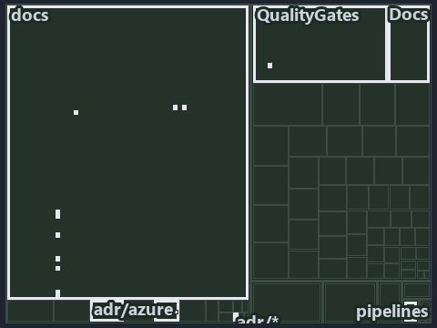

---
catzc:
  immutable:
    with_body_sha: "2a313b63dab3"
    repo_status: locked
    path: docs/explanation/design/.assets/what-keeps-the-platform-thin/tree.md
    source: docs/explanation/design/.assets/what-keeps-the-platform-thin/diagram.drawio.png
    role: asset-description
    language: markdown
    filetype: md
    track: docs
    tracktype: documentation
---

# Three gates guard the CLI and az, but nothing checks that cats stays thin: the tree minimap

```text
Which files cite ADR-AZ-CLI and ADR-DSGN-THINPLAT: every file of the world map is a tile, grouped by top-level folder.
19 files lit in 7 groups.
```



This is the tree minimap in the sidebar of the governance diagram of [Three gates guard the CLI and az, but nothing checks that cats stays
thin][20], which explains [ADR-AZ-CLI][1] and [ADR-DSGN-THINPLAT][2]. It lights every file that cites those codes, grouped by folder, so it
shows which files carry the decision. Each lit group has its reason below, naming the code that selects it.

## What the minimap shows

The tree draws every file of the world map as a tile, grouped by top-level folder (under `pwsh/` by module, under `docs/adr/` by ADR
domain), and lights 19 files in 7 groups, filled in ink. A lit ADR file has a white rim; a file lit only by passing mentions is a lighter
ink. Every other tile is idle, a grey box: a file the slide's ADR codes do not select.

- docs (docs/ outside docs/adr/): 10 lit files
- adr/azure (docs/adr/azure): 2 lit files
- adr/dsgn (docs/adr/design): 2 lit files
- QualityGates (pwsh/Catzc.Base.QualityGates): 2 lit files
- adr/* (the files directly in docs/adr/): 1 lit file
- pipelines: 1 lit file
- Docs (pwsh/Catzc.Base.Docs): 1 lit file

## Why each group is lit

### docs (docs/ outside docs/adr/, 10 lit files)

The group holds the files of docs/ outside docs/adr/; each sits in its world-map cell and is lit by:

- [docs/references/pwsh/.assets/az-cli-test-assert-share-one-state/diagram.drawio.md][3], in the cell docs × markdown: selected by
  [ADR-AZ-CLI][1]: the file cites it at line 101 (text).
- [docs/references/pwsh/.assets/az-cli-test-assert-share-one-state/diagram.drawio.verify.md][4], in the cell docs × markdown: selected by
  [ADR-AZ-CLI][1]: the file cites it at line 60 (text).
- [docs/references/pwsh/catzc-azure-cli/Assert-AzCliBicep.ps1.md][5], in the cell docs × markdown: selected by [ADR-AZ-CLI][1]: the file
  cites it at line 18 (text).
- [docs/references/pwsh/catzc-azure-cli/Assert-AzCliCanAccess.ps1.md][6], in the cell docs × markdown: selected by [ADR-AZ-CLI][1]: the file
  cites it at line 22 (text).
- [docs/references/pwsh/catzc-azure-cli/Assert-AzCliSubscriptionAccessible.ps1.md][7], in the cell docs × markdown: selected by
  [ADR-AZ-CLI][1]: the file cites it at line 21 (text).
- [docs/references/pwsh/catzc-azure-cli/Get-AzCliSubscriptionAccessState.ps1.md][8], in the cell docs × markdown: selected by
  [ADR-AZ-CLI][1]: the file cites it at line 26 (text).
- [docs/references/pwsh/catzc-azure-cli/Install-AzCliBicep.ps1.md][9], in the cell docs × markdown: selected by [ADR-AZ-CLI][1]: the file
  cites it at line 18 (text).
- [docs/references/pwsh/catzc-azure-cli/Test-AzCliBicep.ps1.md][10], in the cell docs × markdown: selected by [ADR-AZ-CLI][1]: the file
  cites it at line 23 (text).
- [docs/references/pwsh/catzc-azure-cli/Test-AzCliCanAccess.ps1.md][11], in the cell docs × markdown: selected by [ADR-AZ-CLI][1]: the file
  cites it at line 22 (text).
- [docs/references/pwsh/catzc-azure-cli/Test-AzCliSubscriptionAccessible.ps1.md][12], in the cell docs × markdown: selected by
  [ADR-AZ-CLI][1]: the file cites it at line 21 (text).

### adr/azure (docs/adr/azure, 2 lit files)

The group holds the files of docs/adr/azure; each sits in its world-map cell and is lit by:

- [docs/adr/azure/dora-explains.md][13], in the cell docs × markdown: selected by [ADR-AZ-CLI][1]: the file cites it at line 94 (text).
- [docs/adr/azure/prefer-az-cli.md][1], in the cell docs × markdown: selected by [ADR-AZ-CLI][1]: the ADR's own file.

### adr/dsgn (docs/adr/design, 2 lit files)

The group holds the files of docs/adr/design; each sits in its world-map cell and is lit by:

- [docs/adr/design/dora-explains.md][14], in the cell docs × markdown: selected by [ADR-DSGN-THINPLAT][2]: the file cites it at line 27
  (text).
- [docs/adr/design/thin-platforms.md][2], in the cell docs × markdown: selected by [ADR-DSGN-THINPLAT][2]: the ADR's own file.

### QualityGates (pwsh/Catzc.Base.QualityGates, 2 lit files)

The group holds the files of pwsh/Catzc.Base.QualityGates; each sits in its world-map cell and is lit by:

- [pwsh/Catzc.Base.QualityGates/configs/analyzer-adr-map.yml][15], in the cell pwsh × yaml: selected by [ADR-AZ-CLI][1]: the file cites it
  at line 7 (text).
- [pwsh/Catzc.Base.QualityGates/configs/terminology.yml][16], in the cell pwsh × yaml: selected by [ADR-AZ-CLI][1]: the file cites it at
  line 553 (text).

### adr/* (the files directly in docs/adr/, 1 lit file)

The group holds the files of the files directly in docs/adr/; each sits in its world-map cell and is lit by:

- [docs/adr/index.md][17], in the cell docs × markdown: selected by [ADR-AZ-CLI][1]: the file cites it at line 283 (text); selected by
  [ADR-DSGN-THINPLAT][2]: the file cites it at line 109 (text).

### pipelines (1 lit file)

The group holds the files of pipelines; each sits in its world-map cell and is lit by:

- [pipelines/ci-automation.yaml][18], in the cell pipelines × pipeline-yaml: selected by [ADR-AZ-CLI][1]: a pipeline that cites nothing
  itself carries its globset's citations, which cite it at `pwsh/Catzc.Base.Docs/configs/adrs.yml` line 258 (text),
  `pwsh/Catzc.Base.QualityGates/configs/analyzer-adr-map.yml` line 7 (text) and `pwsh/Catzc.Base.QualityGates/configs/terminology.yml` line
  553 (text); selected by [ADR-DSGN-THINPLAT][2]: a pipeline that cites nothing itself carries its globset's citations, which cite it at
  `pwsh/Catzc.Base.Docs/configs/adrs.yml` line 75 (text).

### Docs (pwsh/Catzc.Base.Docs, 1 lit file)

The group holds the files of pwsh/Catzc.Base.Docs; each sits in its world-map cell and is lit by:

- [pwsh/Catzc.Base.Docs/configs/adrs.yml][19], in the cell pwsh × yaml: selected by [ADR-AZ-CLI][1]: the file cites it at line 258 (text);
  selected by [ADR-DSGN-THINPLAT][2]: the file cites it at line 75 (text).

## Keywords

- [world map][21]
- [track][22]
- [file language][23]
- [cell][24]
- [lit cell][25]
- [docs][26]: a track
- [pipelines][26]: a track
- [pwsh][26]: a track
- [markdown][27]: a file language
- [pipeline-yaml][27]: a file language
- [yaml][27]: a file language

[1]: ../../../../adr/azure/prefer-az-cli.md
[2]: ../../../../adr/design/thin-platforms.md
[3]: ../../../../references/pwsh/.assets/az-cli-test-assert-share-one-state/diagram.drawio.md
[4]: ../../../../references/pwsh/.assets/az-cli-test-assert-share-one-state/diagram.drawio.verify.md
[5]: ../../../../references/pwsh/catzc-azure-cli/Assert-AzCliBicep.ps1.md
[6]: ../../../../references/pwsh/catzc-azure-cli/Assert-AzCliCanAccess.ps1.md
[7]: ../../../../references/pwsh/catzc-azure-cli/Assert-AzCliSubscriptionAccessible.ps1.md
[8]: ../../../../references/pwsh/catzc-azure-cli/Get-AzCliSubscriptionAccessState.ps1.md
[9]: ../../../../references/pwsh/catzc-azure-cli/Install-AzCliBicep.ps1.md
[10]: ../../../../references/pwsh/catzc-azure-cli/Test-AzCliBicep.ps1.md
[11]: ../../../../references/pwsh/catzc-azure-cli/Test-AzCliCanAccess.ps1.md
[12]: ../../../../references/pwsh/catzc-azure-cli/Test-AzCliSubscriptionAccessible.ps1.md
[13]: ../../../../adr/azure/dora-explains.md
[14]: ../../../../adr/design/dora-explains.md
[15]: ../../../../../pwsh/Catzc.Base.QualityGates/configs/analyzer-adr-map.yml
[16]: ../../../../../pwsh/Catzc.Base.QualityGates/configs/terminology.yml
[17]: ../../../../adr/index.md
[18]: ../../../../../pipelines/ci-automation.yaml
[19]: ../../../../../pwsh/Catzc.Base.Docs/configs/adrs.yml
[20]: ../../what-keeps-the-platform-thin.md
[21]: ../../../../adr/glossary.md#world-map
[22]: ../../../../adr/glossary.md#track
[23]: ../../../../adr/glossary.md#file-language
[24]: ../../../../adr/glossary.md#cell
[25]: ../../../../adr/glossary.md#lit-cell
[26]: ../../../../../pwsh/Catzc.Base.Variants/configs/variants.yml
[27]: ../../../../../pwsh/Catzc.Base.Languages/configs/languages.yml
