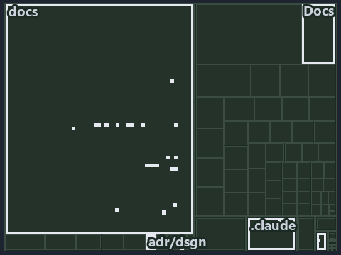

---
catzc:
  immutable:
    with_body_sha: "8fa6ff52c4bf"
    repo_status: locked
    path: docs/explanation/design/.assets/where-code-loads-from-decides-the-mode/tree.md
    source: docs/explanation/design/.assets/where-code-loads-from-decides-the-mode/diagram.drawio.png
    role: asset-description
    language: markdown
    filetype: md
    track: docs
    tracktype: documentation
---

# Where the code loads from decides the run mode: the tree minimap

```text
Which files cite ADR-DSGN-RUNMODE: every file of the world map is a tile, grouped by top-level folder.
27 files lit in 6 groups.
```



This is the tree minimap in the sidebar of the meta diagram of [Where the code loads from decides the run mode][28], which explains
[ADR-DSGN-RUNMODE][1]. It lights every file that cites those codes, grouped by folder, so it shows which files carry the decision. Each lit
group has its reason below, naming the code that selects it.

## What the minimap shows

The tree draws every file of the world map as a tile, grouped by top-level folder (under `pwsh/` by module, under `docs/adr/` by ADR
domain), and lights 27 files in 6 groups, filled in ink. A lit ADR file has a white rim; a file lit only by passing mentions is a lighter
ink. Every other tile is idle, a grey box: a file the slide's ADR codes do not select.

- docs (docs/ outside docs/adr/): 21 lit files
- adr/dsgn (docs/adr/design): 2 lit files
- .claude: 1 lit file
- adr/* (the files directly in docs/adr/): 1 lit file
- pipelines: 1 lit file
- Docs (pwsh/Catzc.Base.Docs): 1 lit file

## Why each group is lit

### docs (docs/ outside docs/adr/, 21 lit files)

The group holds the files of docs/ outside docs/adr/; each sits in its world-map cell and is lit by:

- [docs/references/.assets/automation/catzc-base-modulesystem/module-graph-declared-vs-observed.drawio.verify.md][2], in the cell docs ×
  markdown: selected by [ADR-DSGN-RUNMODE][1]: the file cites it at line 53 (text).
- [docs/references/pwsh/catzc-base-globs/Get-ModuleGlobSet.ps1.md][3], in the cell docs × markdown: selected by [ADR-DSGN-RUNMODE][1]: the
  file cites it at line 31 (text).
- [docs/references/pwsh/catzc-base-modulesystem/Copy-CatzcModule.ps1.md][4], in the cell docs × markdown: selected by [ADR-DSGN-RUNMODE][1]:
  the file cites it at line 38 (text).
- [docs/references/pwsh/catzc-base-modulesystem/Get-FunctionDependency.ps1.md][5], in the cell docs × markdown: selected by
  [ADR-DSGN-RUNMODE][1]: the file cites it at line 18 (text).
- [docs/references/pwsh/catzc-base-modulesystem/Get-InternalAssetDependency.ps1.md][6], in the cell docs × markdown: selected by
  [ADR-DSGN-RUNMODE][1]: the file cites it at line 36 (text).
- [docs/references/pwsh/catzc-base-modulesystem/Get-ModuleFunction.ps1.md][7], in the cell docs × markdown: selected by
  [ADR-DSGN-RUNMODE][1]: the file cites it at line 19 (text).
- [docs/references/pwsh/catzc-base-modulesystem/New-Importer.ps1.md][8], in the cell docs × markdown: selected by [ADR-DSGN-RUNMODE][1]: the
  file cites it at line 23 (text).
- [docs/references/pwsh/catzc-base-modulesystem/Sync-GeneratedFile.ps1.md][9], in the cell docs × markdown: selected by
  [ADR-DSGN-RUNMODE][1]: the file cites it at line 26 (text).
- [docs/references/pwsh/catzc-base-modulesystem/Test-FunctionDependency.ps1.md][10], in the cell docs × markdown: selected by
  [ADR-DSGN-RUNMODE][1]: the file cites it at line 26 (text).
- [docs/references/pwsh/catzc-base-modulesystem/module-graph-declared-vs-observed.drawio.md][11], in the cell docs × markdown: selected by
  [ADR-DSGN-RUNMODE][1]: the file cites it at line 105 (text).
- [docs/references/pwsh/catzc-base-repository/Assert-SourceTree.ps1.md][12], in the cell docs × markdown: selected by [ADR-DSGN-RUNMODE][1]:
  the file cites it at line 16 (text).
- [docs/references/pwsh/catzc-base-repository/Get-CatzcModuleRoot.ps1.md][13], in the cell docs × markdown: selected by
  [ADR-DSGN-RUNMODE][1]: the file cites it at line 16 (text).
- [docs/references/pwsh/catzc-base-rootconfig/Build-RootConfig.ps1.md][14], in the cell docs × markdown: selected by [ADR-DSGN-RUNMODE][1]:
  the file cites it at line 28 (text).
- [docs/references/pwsh/catzc-base-typessystem/Build-BashTimeoutHook.ps1.md][15], in the cell docs × markdown: selected by
  [ADR-DSGN-RUNMODE][1]: the file cites it at line 22 (text).
- [docs/references/pwsh/catzc-base-typessystem/Clear-ModuleTypeCache.ps1.md][16], in the cell docs × markdown: selected by
  [ADR-DSGN-RUNMODE][1]: the file cites it at line 34 (text).
- [docs/references/pwsh/catzc-base-typessystem/Get-CSharpTypeDependency.ps1.md][17], in the cell docs × markdown: selected by
  [ADR-DSGN-RUNMODE][1]: the file cites it at line 31 (text).
- [docs/references/pwsh/catzc-base-typessystem/Invoke-BuildForVSCode.ps1.md][18], in the cell docs × markdown: selected by
  [ADR-DSGN-RUNMODE][1]: the file cites it at line 27 (text).
- [docs/references/pwsh/catzc-base-vendor/Install-VendorModule.ps1.md][19], in the cell docs × markdown: selected by [ADR-DSGN-RUNMODE][1]:
  the file cites it at line 19 (text).
- [docs/references/pwsh/catzc-base-vendor/Remove-VendorModules.ps1.md][20], in the cell docs × markdown: selected by [ADR-DSGN-RUNMODE][1]:
  the file cites it at line 25 (text).
- [docs/references/pwsh/internal/Catzc.Internal.Builder.psm1.md][21], in the cell docs × markdown: selected by [ADR-DSGN-RUNMODE][1]: the
  file cites it at line 15 (text).
- [docs/references/pwsh/internal/assets/Import-Catzc.ps1.md][22], in the cell docs × markdown: selected by [ADR-DSGN-RUNMODE][1]: the file
  cites it at line 14 (text).

### adr/dsgn (docs/adr/design, 2 lit files)

The group holds the files of docs/adr/design; each sits in its world-map cell and is lit by:

- [docs/adr/design/dora-explains.md][23], in the cell docs × markdown: selected by [ADR-DSGN-RUNMODE][1]: the file cites it at line 123
  (text).
- [docs/adr/design/run-modes.md][1], in the cell docs × markdown: selected by [ADR-DSGN-RUNMODE][1]: the ADR's own file.

### .claude (1 lit file)

The group holds the files of .claude; each sits in its world-map cell and is lit by:

- [.claude/plans/plan-explanation-drift-gaps.md][24], in the cell .claude × markdown: selected by [ADR-DSGN-RUNMODE][1]: the file cites it
  at line 102 (text).

### adr/* (the files directly in docs/adr/, 1 lit file)

The group holds the files of the files directly in docs/adr/; each sits in its world-map cell and is lit by:

- [docs/adr/index.md][25], in the cell docs × markdown: selected by [ADR-DSGN-RUNMODE][1]: the file cites it at line 116 (text).

### pipelines (1 lit file)

The group holds the files of pipelines; each sits in its world-map cell and is lit by:

- [pipelines/ci-automation.yaml][26], in the cell pipelines × pipeline-yaml: selected by [ADR-DSGN-RUNMODE][1]: a pipeline that cites
  nothing itself carries its globset's citations, which cite it at `pwsh/Catzc.Base.Docs/configs/adrs.yml` line 80 (text).

### Docs (pwsh/Catzc.Base.Docs, 1 lit file)

The group holds the files of pwsh/Catzc.Base.Docs; each sits in its world-map cell and is lit by:

- [pwsh/Catzc.Base.Docs/configs/adrs.yml][27], in the cell pwsh × yaml: selected by [ADR-DSGN-RUNMODE][1]: the file cites it at line 80
  (text).

## Keywords

- [world map][29]
- [track][30]
- [file language][31]
- [cell][32]
- [lit cell][33]
- [.claude][34]: a track
- [docs][34]: a track
- [pipelines][34]: a track
- [pwsh][34]: a track
- [markdown][35]: a file language
- [pipeline-yaml][35]: a file language
- [yaml][35]: a file language

[1]: ../../../../adr/design/run-modes.md
[2]: ../../../../references/.assets/automation/catzc-base-modulesystem/module-graph-declared-vs-observed.drawio.verify.md
[3]: ../../../../references/pwsh/catzc-base-globs/Get-ModuleGlobSet.ps1.md
[4]: ../../../../references/pwsh/catzc-base-modulesystem/Copy-CatzcModule.ps1.md
[5]: ../../../../references/pwsh/catzc-base-modulesystem/Get-FunctionDependency.ps1.md
[6]: ../../../../references/pwsh/catzc-base-modulesystem/Get-InternalAssetDependency.ps1.md
[7]: ../../../../references/pwsh/catzc-base-modulesystem/Get-ModuleFunction.ps1.md
[8]: ../../../../references/pwsh/catzc-base-modulesystem/New-Importer.ps1.md
[9]: ../../../../references/pwsh/catzc-base-modulesystem/Sync-GeneratedFile.ps1.md
[10]: ../../../../references/pwsh/catzc-base-modulesystem/Test-FunctionDependency.ps1.md
[11]: ../../../../references/pwsh/catzc-base-modulesystem/module-graph-declared-vs-observed.drawio.md
[12]: ../../../../references/pwsh/catzc-base-repository/Assert-SourceTree.ps1.md
[13]: ../../../../references/pwsh/catzc-base-repository/Get-CatzcModuleRoot.ps1.md
[14]: ../../../../references/pwsh/catzc-base-rootconfig/Build-RootConfig.ps1.md
[15]: ../../../../references/pwsh/catzc-base-typessystem/Build-BashTimeoutHook.ps1.md
[16]: ../../../../references/pwsh/catzc-base-typessystem/Clear-ModuleTypeCache.ps1.md
[17]: ../../../../references/pwsh/catzc-base-typessystem/Get-CSharpTypeDependency.ps1.md
[18]: ../../../../references/pwsh/catzc-base-typessystem/Invoke-BuildForVSCode.ps1.md
[19]: ../../../../references/pwsh/catzc-base-vendor/Install-VendorModule.ps1.md
[20]: ../../../../references/pwsh/catzc-base-vendor/Remove-VendorModules.ps1.md
[21]: ../../../../references/pwsh/internal/Catzc.Internal.Builder.psm1.md
[22]: ../../../../references/pwsh/internal/assets/Import-Catzc.ps1.md
[23]: ../../../../adr/design/dora-explains.md
[24]: ../../../../../.claude/plans/plan-explanation-drift-gaps.md
[25]: ../../../../adr/index.md
[26]: ../../../../../pipelines/ci-automation.yaml
[27]: ../../../../../pwsh/Catzc.Base.Docs/configs/adrs.yml
[28]: ../../where-code-loads-from-decides-the-mode.md
[29]: ../../../../adr/glossary.md#world-map
[30]: ../../../../adr/glossary.md#track
[31]: ../../../../adr/glossary.md#file-language
[32]: ../../../../adr/glossary.md#cell
[33]: ../../../../adr/glossary.md#lit-cell
[34]: ../../../../../pwsh/Catzc.Base.Variants/configs/variants.yml
[35]: ../../../../../pwsh/Catzc.Base.Languages/configs/languages.yml
