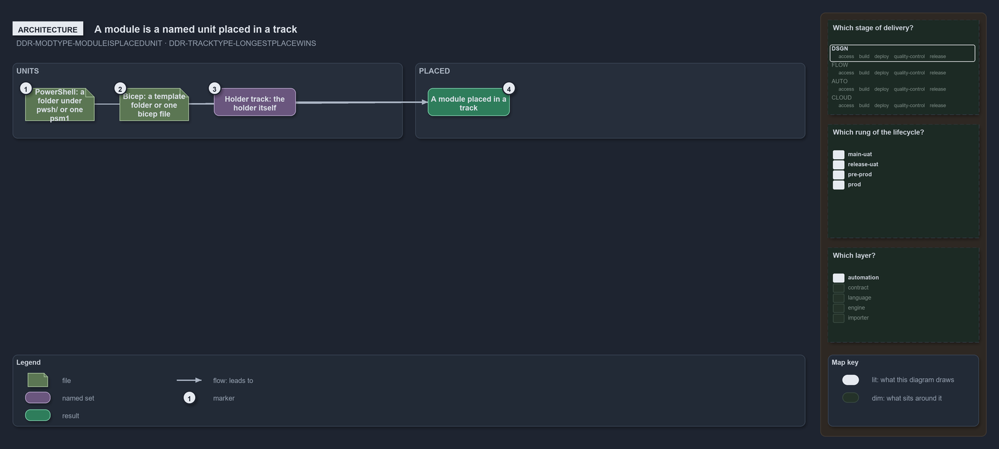

---
catzc:
  warning: "Experimental: this article merges two rules into one and holds nothing beyond what they say"
  edges:
    cites:
      - DDR-MODTYPE-MODULEISPLACEDUNIT
      - DDR-TRACKTYPE-LONGESTPLACEWINS
---

# A module is a named unit placed in a track and the longest place wins

This article is one rule: [DDR-MODTYPE-MODULEISPLACEDUNIT](../../drs/design/module-types.md#rule-ddr-modtype-moduleisplacedunit) and
[DDR-TRACKTYPE-LONGESTPLACEWINS](../../drs/design/track-types.md#rule-ddr-tracktype-longestplacewins) merged into one. It holds nothing
beyond what those two rules say.

A module is a named unit placed in a track: a PowerShell module is a folder under `pwsh/` or one `psm1` file, a Bicep module is a template
folder or one reusable `bicep` file, and a holder track's module is the holder itself. A file belongs to the track with the longest place
that contains it, so a narrower place wins over a wider one: a file under `.github/workflows` is in the GitHub `pipelines` track, and the
rest of `.github` is in the GitHub `vendor-settings` track.

