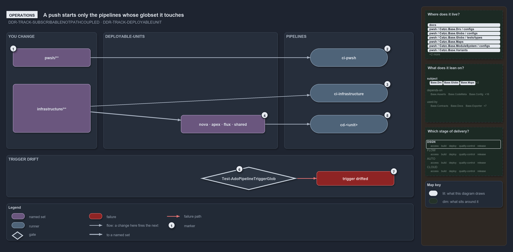

---
catzc:
  warning: "Header is generated by Format-FileMeta via Format-Code; do not change it"
  edges:
    cites:
      - DDR-TRACK-SUBSCRIBABLENOTPATHCOUPLED
      - DDR-TRACK-DEPLOYABLEUNIT
    drs_total: 2
---

# A push starts only the pipelines whose globset it touches

```text
A push starts only the pipelines whose globset holds a changed file.

1  pwsh/**                      a change here fires ci-pwsh on the PR and the merge
2  ci-pwsh                      runs Test-Automation -Level 2 -EnforceTimings
3  ci-infrastructure            fired by infrastructure/**; checks and builds three templates
4  A change re-keys the units   a foundation or modules edit reaches all four units
5  cd-<unit>                    the CD pipelines a change fires, deploying on main only
6  Test-AdoPipelineTriggerGlob  the drift gate comparing each trigger with its projection
7  trigger drifted              the failure a hand-edited trigger raises

Supports DDR-TRACK-SUBSCRIBABLENOTPATHCOUPLED and DDR-TRACK-DEPLOYABLEUNIT (operations lens).
```

Each pipeline in cats triggers on its globset projected to Azure DevOps path filters, so a change starts only the pipelines whose sets hold
a changed file. A pull request to main runs a pipeline as pre-commit validation, and the merge runs the same pipeline post-commit. An edit
to the shared foundation fires every CD pipeline; an edit to one unit's configuration fires only that unit's.

```yml drawio
description:
  "A changed file fires only the pipelines whose globset holds it: pwsh and infrastructure changes reach their pipelines, and a drift gate
  fails a trigger that no longer matches its globset's projection."
about:
  adrs: [DDR-TRACK-SUBSCRIBABLENOTPATHCOUPLED, DDR-TRACK-DEPLOYABLEUNIT]
  lens: operations
content:
  title: A push starts only the pipelines whose globset it touches
  kind: explanation
  flow: left-to-right
  relation: a change here fires the next
  theme: dark
  bands:
    - { id: band-change, label: YOU CHANGE }
    - { id: band-units, label: DEPLOYABLE-UNITS }
    - { id: band-pipelines, label: PIPELINES }
    - { id: band-drift, label: TRIGGER DRIFT }
  glyphs:
    - { id: s-powershell, kind: set, label: pwsh/**, in: band-change }
    - { id: s-infrastructure, kind: set, label: infrastructure/**, in: band-change }
    - { id: s-units, kind: set, label: nova · apex · flux · shared, in: band-units }
    - { id: r-automation, kind: runner, label: ci-pwsh, in: band-pipelines }
    - { id: r-infrastructure, kind: runner, label: ci-infrastructure, in: band-pipelines }
    - { id: r-unit, kind: runner, label: cd-<unit>, in: band-pipelines }
    - { id: g-drift, kind: gate, label: Test-AdoPipelineTriggerGlob, in: band-drift }
    - { id: f-drifted, kind: failure, label: trigger drifted, in: band-drift }
  edges:
    - { from: s-powershell, to: r-automation, kind: flow, label: "" }
    - { from: s-infrastructure, to: r-infrastructure, kind: flow, label: "" }
    - { from: s-infrastructure, to: s-units, kind: thick, label: "" }
    - { from: s-units, to: r-unit, kind: flow, label: "" }
    - { from: g-drift, to: f-drifted, kind: fail, label: "" }
  markers:
    - { at: s-powershell, number: 1 }
    - { at: r-automation, number: 2 }
    - { at: r-infrastructure, number: 3 }
    - { at: s-units, number: 4 }
    - { at: r-unit, number: 5 }
    - { at: g-drift, number: 6 }
    - { at: f-drifted, number: 7 }
  legend: auto
  minimaps: [code-locations, module-neighbourhood, axis]
layout:
  band-change: { x: 20, y: 84, w: 280, h: 360 }
  band-units: { x: 320, y: 84, w: 540, h: 360 }
  band-pipelines: { x: 880, y: 84, w: 400, h: 360 }
  band-drift: { x: 20, y: 464, w: 1260, h: 130 }
  s-powershell: { x: 40, y: 134, w: 240, h: 56 }
  s-infrastructure: { x: 40, y: 244, w: 240, h: 150 }
  s-units: { x: 560, y: 340, w: 260, h: 56 }
  r-automation: { x: 960, y: 134, w: 240, h: 56 }
  r-infrastructure: { x: 960, y: 244, w: 240, h: 56 }
  r-unit: { x: 960, y: 340, w: 240, h: 56 }
  g-drift: { x: 620, y: 500, w: 300, h: 72 }
  f-drifted: { x: 980, y: 514, w: 240, h: 44 }
```



## Walkthrough

1. **`pwsh/**`.** A change here fires `ci-pwsh`, on a pull request to main (`pr:`) and on the merge (`trigger:`). The GitHub workflow
   `ci-pwsh.yml` and the pipeline `ci-pwsh-expected-failures` carry the same path filter and start too.
2. **ci-pwsh.** Runs `Test-Automation -Level 2 -EnforceTimings`, among its other jobs.
3. **ci-infrastructure.** Any change under `infrastructure/**` fires it. It runs `Assert-BicepTemplate` and then `Build-Bicep` for each of
   the three templates, foundation, discovery and expedition, then `Test-Automation -Suite infrastructure`.
4. **A change re-keys the units.** Only a change inside a unit's set reaches it. An edit under `infrastructure/templates/foundation/**` or
   `infrastructure/modules/**` re-keys all four units, which compose the base unit. An edit under `configuration/<unit>/**` reaches only
   that unit; the configuration-root `.yml` files belong to `shared`.
5. **`cd-<unit>`.** A foundation or modules edit fires all four: `cd-nova`, `cd-apex`, `cd-flux` and `cd-shared`. The three customer
   pipelines run `Build-Bicep <template> -Customers <unit>` for three templates through `extends/cd-customer.yaml`; `cd-shared` runs
   `Build-Bicep <template> -Shared` for foundation and discovery. Each deploys on main only.
6. **Test-AdoPipelineTriggerGlob.** The gate against trigger drift reads every pipeline-bound globset and its pipeline file, and compares
   the file's `trigger:` and `pr:` path filters with the set's projection. It runs as an L2 integrity test inside `ci-pwsh`.
7. **trigger drifted.** A hand-edited trigger fails with
   `<set>: .ado/pipelines/<p>.yaml trigger drifted from the globset projection on <filters>`. The fix is to regenerate the trigger from
   `globs.yml` (`Get-GlobSetTrigger`); the report lands in `out/test-ado-pipeline-trigger-glob/`.

## Why it holds

- Consumers bind a track through its globset's projection, never by hand-matching its paths, so a change in one track never rebuilds
  customers of another (DDR-TRACK-SUBSCRIBABLENOTPATHCOUPLED).
- Each deployable-unit has its own pipeline, so an edit to one unit's configuration starts only that unit's (DDR-TRACK-DEPLOYABLEUNIT).

Azure DevOps path filters ignore order, so on `cd-shared` the root `configuration/*.yml` include and the `configuration/*/**` exclude sit at
the same depth and Azure DevOps may drop a root `.yml`. `Test-GlobSetTriggerCoverage` guarantees the include-only trigger never misses a
member. The scopes `markdown-scope` and `repository` bind no pipeline.

## Where the code and the decision record differ

`cd-shared.yaml` names "the in-pipeline Test-GlobSetAffected gate" as the exact backstop for a dropped root `.yml`, but no ado pipeline
under `.ado/pipelines/` runs `Test-GlobSetAffected`.

## See also

- [Tracks — the repository's root concerns](../../drs/design/tracks.md) — the decision this article explains.
- The other lenses on the same model: [meta](one-unit-one-pipeline.md), [architecture](units-not-tracks-own-the-pipelines.md),
  [implementation](globs-yml-pipeline-field-is-the-binding.md) and [governance](unit-to-pipeline-rule-is-review-only.md).
- [The design explanations](index.md) · [How to read the diagrams](../index.md#how-to-read-the-diagrams)
