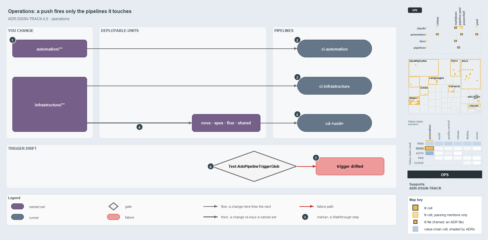

---
catzc:
  derived:
    path: docs/explanation/design/a-push-fires-only-touched-pipelines.md
    kind: explanation
    body_sha: bdee370f2672
    adrs:
      - ADR-DSGN-TRACK#4
      - ADR-DSGN-TRACK#5
    links:
      - docs/.assets/explanation/adr-dsgn-track--a-push-fires-only-touched-pipelines--operations.drawio.md
      - docs/.assets/explanation/adr-dsgn-track--a-push-fires-only-touched-pipelines--operations.drawio.png
      - docs/adr/design/tracks.md
      - docs/explanation/design/globs-yml-pipeline-field-is-the-binding.md
      - docs/explanation/design/index.md
      - docs/explanation/design/one-unit-one-pipeline.md
      - docs/explanation/design/unit-to-pipeline-rule-is-review-only.md
      - docs/explanation/design/units-not-tracks-own-the-pipelines.md
      - docs/explanation/index.md#how-to-read-the-diagrams
---

# A push starts only the pipelines whose globset it touches

```text
A push starts only the pipelines whose globset holds a changed file.

1  automation/**                a change here fires ci-automation on the PR and the merge
2  ci-automation                runs Test-Automation -Level 2 -EnforceTimings
3  ci-infrastructure            fired by infrastructure/**; checks and builds three templates
4  A change re-keys the units   a foundation or modules edit reaches all four units
5  cd-<unit>                    the CD pipelines a change fires, deploying on main only
6  Test-AdoPipelineTriggerGlob  the drift gate comparing each trigger with its projection
7  trigger drifted              the failure a hand-edited trigger raises

Supports ADR-DSGN-TRACK#4 and #5 (operations lens).
```

Each pipeline in cats triggers on its globset projected to Azure DevOps path filters, so a change starts only the pipelines whose sets hold
a changed file. A pull request to main runs a pipeline as pre-commit validation, and the merge runs the same pipeline post-commit. An edit
to the shared foundation fires every CD pipeline; an edit to one unit's configuration fires only that unit's.



The diagram is described element by element in
[its asset description](../../.assets/explanation/adr-dsgn-track--a-push-fires-only-touched-pipelines--operations.drawio.md).

## Walkthrough

1. **`automation/**`.** A change here fires `ci-automation`, on a pull request to main (`pr:`) and on the merge (`trigger:`). The GitHub
   workflow `ci-automation.yml` and the pipeline `ci-automation-expected-failures` carry the same path filter and start too.
2. **ci-automation.** Runs `Test-Automation -Level 2 -EnforceTimings`, among its other jobs.
3. **ci-infrastructure.** Any change under `infrastructure/**` fires it. It runs `Assert-BicepTemplate` and then `Build-Bicep` for each of
   the three templates, foundation, discovery and expedition, then `Test-Automation -Suite infrastructure`.
4. **A change re-keys the units.** Only a change inside a unit's set reaches it. An edit under `infrastructure/templates/foundation/**` or
   `infrastructure/modules/**` re-keys all four units, which compose the base unit. An edit under `configuration/<unit>/**` reaches only
   that unit; the configuration-root `.yml` files belong to `shared`.
5. **`cd-<unit>`.** A foundation or modules edit fires all four: `cd-nova`, `cd-apex`, `cd-flux` and `cd-shared`. The three customer
   pipelines run `Build-Bicep <template> -Customers <unit>` for three templates through `extends/cd-customer.yaml`; `cd-shared` runs
   `Build-Bicep <template> -Shared` for foundation and discovery. Each deploys on main only.
6. **Test-AdoPipelineTriggerGlob.** The gate against trigger drift reads every pipeline-bound globset and its pipeline file, and compares
   the file's `trigger:` and `pr:` path filters with the set's projection. It runs as an L2 integrity test inside `ci-automation`.
7. **trigger drifted.** A hand-edited trigger fails with
   `<set>: pipelines/<p>.yaml trigger drifted from the globset projection on <filters>`. The fix is to regenerate the trigger from
   `globs.yml` (`Get-GlobSetTrigger`); the report lands in `out/test-ado-pipeline-trigger-glob/`.

## Why it holds

- Consumers bind a track through its globset's projection, never by hand-matching its paths, so a change in one track never rebuilds
  customers of another (ADR-DSGN-TRACK#4).
- Each deployable-unit has its own pipeline, so an edit to one unit's configuration starts only that unit's (ADR-DSGN-TRACK#5).

Azure DevOps path filters ignore order, so on `cd-shared` the root `configuration/*.yml` include and the `configuration/*/**` exclude sit at
the same depth and Azure DevOps may drop a root `.yml`. `Test-GlobSetTriggerCoverage` guarantees the include-only trigger never misses a
member. The scopes `markdown-scope` and `repository` bind no pipeline.

## Where the code and the ADR differ

`cd-shared.yaml` names "the in-pipeline Test-GlobSetAffected gate" as the exact backstop for a dropped root `.yml`, but no pipeline under
`pipelines/` runs `Test-GlobSetAffected`.

## See also

- [Tracks — the repository's root concerns](../../adr/design/tracks.md) — the decision this article explains.
- The other lenses on the same model: [meta](one-unit-one-pipeline.md), [architecture](units-not-tracks-own-the-pipelines.md),
  [implementation](globs-yml-pipeline-field-is-the-binding.md) and [governance](unit-to-pipeline-rule-is-review-only.md).
- [The design explanations](index.md) · [How to read the diagrams](../index.md#how-to-read-the-diagrams)
