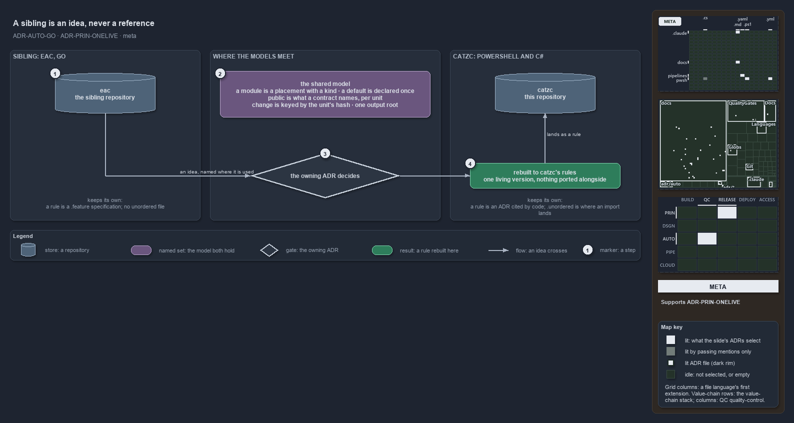

# A sibling is an idea, never a reference

```text
Two siblings of one family, catzc and eac, compared model by model: where they meet, where they part, and how an idea crosses.

1  the family      one thesis in two languages, PowerShell with C# and Go
2  the meeting     tracks and modules, contracts, defaults, materialization, output
3  the parting     rules as ADRs or as specifications; a place where imports land, or none
4  the crossing    an idea is named where it is used and rebuilt to this repository's rules

Supports ADR-PRIN-ONELIVE-ONEVERSION and ADR-PRIN-ONELIVE-HISTORYINGIT, ADR-AUTO-GO-MODULESBYLAYOUT, ADR-PRIN-CATS-CATZCISSOURCENAME and ADR-PRIN-CATS-CATSISPERSONNAME, and ADR-DSGN-TRACK-TRACKISPLACEDCLUSTER, ADR-DSGN-TRACK-ONETECHSTACK, ADR-DSGN-TRACK-DEPLOYABLEUNIT and ADR-DSGN-TRACK-UNORDEREDTRACK.
```

Cats has a sibling. The eac repository is the same project family built in Go: a repository automation CLI, an extension CLI for
containerised platform tools, a server of a hundred or more tools for an agent, and a documentation set that explains Everything as Code.
Catzc's own instructions let a session read it for inspiration on every aspect and forbid treating it as a reference implementation. This
article says what that means in practice: which parts of the two models now agree, which parts differ on purpose, and how an idea travels
from one to the other without becoming a copy. The diagram draws the crossing: two repositories, the model they share, and the gate an idea
passes before it lands here as a rule.



## Walkthrough

1. **The sibling.** The left store is eac, the repository of the same family built in Go. At the foot of its band, what it keeps as its own:
   a rule is a `.feature` specification, and no file sits unordered.
2. **The shared model.** The named set in the middle holds what both repositories agree on: a module is a placement with a kind, a default
   is declared once, public is what a contract names per unit, change is keyed by the unit's hash, and one output root holds everything
   unsorted.
3. **The gate.** An idea leaves eac named where it is used and reaches the owning ADR, which decides whether and how catzc takes it. An idea
   with no ADR to hold it opens a question for the user.
4. **The result.** What passes is rebuilt to catzc's rules, one living version with nothing ported alongside, and lands in catzc as a rule.
   At the foot of the right band, what catzc keeps as its own: a rule is an ADR cited by code, and `.unordered` is where an import lands.

The diagram's glyphs and edges are listed in [its description](.assets/a-sibling-is-an-idea-never-a-reference/diagram.drawio.md).

## The family

Both repositories hold one thesis: a rule is code, and a gate proves it. Catzc states its rules as ADRs, each rule with a code
(`ADR-DSGN-TRACK-ONETECHSTACK`), cited from file heads and tests and checked by the quality gates. Eac states its rules as executable
specifications, `.feature` files under `specs/`, one folder per rule (`one-module-per-file`, `module-isolation`, `no-scattered-scripts`),
run as tests. The two forms carry the same discipline in different grammars.

The engines differ by decision, not by accident. Catzc is PowerShell with the C# types it hosts
([ADR-DSGN-TRACK-ONETECHSTACK](../../adr/design/tracks.md#rule-adr-dsgn-track-onetechstack)), and Go in catzc is modules by layout and test
artifacts, never the engine ([ADR-AUTO-GO-MODULESBYLAYOUT](../../adr/automation/go/go-test-artifacts.md#rule-adr-auto-go-modulesbylayout)).
Eac is Go. A Go idea read in eac beyond that scope is a question for the user, never a precedent. The two names of this system, cats to a
person and catzc in code ([ADR-PRIN-CATS-CATZCISSOURCENAME](../../adr/principles/cats-and-catzc.md#rule-adr-prin-cats-catzcissourcename),
[ADR-PRIN-CATS-CATSISPERSONNAME](../../adr/principles/cats-and-catzc.md#rule-adr-prin-cats-catsispersonname)), have their counterpart in
eac's two names for its two CLIs, so a reader of either repository meets the same habit: one name per audience.

## Where the models meet

| Aspect           | Catzc                                                                                                                                                                                                                                                                                                                                                                                                                                          | Eac                                                                                                                                                                                                                                    | Meeting point                                                                                                                                           |
| ---------------- | ---------------------------------------------------------------------------------------------------------------------------------------------------------------------------------------------------------------------------------------------------------------------------------------------------------------------------------------------------------------------------------------------------------------------------------------------- | -------------------------------------------------------------------------------------------------------------------------------------------------------------------------------------------------------------------------------------- | ------------------------------------------------------------------------------------------------------------------------------------------------------- |
| Structure        | A [track](../../adr/design/tracks.md#rule-adr-dsgn-track-trackisplacedcluster) is a cluster of module contents with one tech-stack; a module is placed in a track and resolved through it ([ADR-AUTO-MODULE-DEPLOYABLETRACKMODULE](../../adr/automation/module-model.md#rule-adr-auto-module-deployabletrackmodule)); every track has one [track type](../../adr/design/track-types.md#rule-adr-dsgn-tracktype-closedsetoftypes) with one role | A module has a contract file with its metadata and dependencies, a component type that sets its build, test and deployment behaviour, and a module identifier; specifications keep the module hierarchy valid and the modules isolated | A module is a placement with a kind. Eac's component type is the nearest thing to a catzc track type. Catzc's track above the module is the newer idea. |
| Delivery         | A [deployable-unit](../../adr/design/tracks.md#rule-adr-dsgn-track-deployableunit) is what ships, one pipeline each; contracts freeze unit by unit, never repository-wide ([ADR-REPO-CONTRACT-LAYOUT](../../adr/repository/api-contracts.md#rule-adr-repo-contract-layout))                                                                                                                                                                    | One CI workflow and one release workflow per module; a module's changelog under `release/<module>/` drives its calendar version and its tag                                                                                            | Mono repository, not monolith, in both: each unit versions and releases on its own.                                                                     |
| Contracts        | A [contract](../../adr/repository/api-contracts.md#rule-adr-repo-contract-bindinginterface) is the only public API; a [command contract](../../adr/repository/command-contracts.md#rule-adr-repo-cmdcontract-commandcontract) states one command's call interface as data, and a check proves the command matches it                                                                                                                           | `contracts/<unit>/<version>/` holds versioned Go packages with their schemas; a specification validates every module contract and another proves every command is documented                                                           | Public is what a contract names, versioned with its unit. Catzc contracts the signature; eac contracts the documentation.                               |
| Configuration    | Every setting has one default declared on its config type ([ADR-PRIN-CONFIG-DEFAULTDECLAREDONCE](../../adr/principles/configure-not-program.md#rule-adr-prin-config-defaultdeclaredonce)) and resolves in one order ([ADR-AUTO-DEFAULT-ONERESOLUTIONORDER](../../adr/automation/sensible-defaults.md#rule-adr-auto-default-oneresolutionorder)); an analyzer rule forbids a literal default elsewhere                                          | A defaults package and a config-defaults specification                                                                                                                                                                                 | The same doctrine; catzc adds the analyzer that keeps it.                                                                                               |
| Change and cache | A generated tracked file carries the key of the inputs it was built from; a cache is a tool's copy inside a session, and a guard is a control whose verdict is never cached                                                                                                                                                                                                                                                                    | A change-detection package decides which modules a push touched and triggers only their workflows; a cache-invalidation specification; evidence kept as artifacts                                                                      | The same key, the scoped hash of a unit's files. Catzc names the axis, on demand or committed, as a rule; eac has the mechanics without the word.       |
| Output           | Every output path resolves under one root ([ADR-REPO-OUTDIR-OUTPUTROOTFUNCTION](../../adr/repository/dedicated-output-directory.md#rule-adr-repo-outdir-outputrootfunction)) and belongs to one format with an area that sets its retention ([ADR-REPO-OUTDIR-EVERYFILEHASFORMAT](../../adr/repository/dedicated-output-directory.md#rule-adr-repo-outdir-everyfilehasformat))                                                                 | Intermediate and planning files live under `out/` only; a specification forbids scattered scripts                                                                                                                                      | Nothing lands outside the output root unsorted. Catzc adds retention by area.                                                                           |
| Agents           | One agent contract every robot reads first; the user is the only actor who mutates git ([ADR-REPO-AI-NEVERMUTATEGIT](../../adr/repository/ai-agent-contract.md#rule-adr-repo-ai-nevermutategit)); robots and capabilities have line roofs and a named model                                                                                                                                                                                    | One agent file loaded at session start; git read-only by default; a handful of agents and skills                                                                                                                                       | Short contracts and read-only git in both.                                                                                                              |

## Where the models part, on purpose

Two differences are decisions, and each side keeps its own.

**Where a rule lives.** Catzc writes a rule once, in an ADR, and lets the gates cite it by code; a plan records a decision only until the
rule holds it ([ADR-REPO-PLANS-DECISIONSBECOMERULES](../../adr/repository/plans.md#rule-adr-repo-plans-decisionsbecomerules)), and a plan
with nothing open is deleted ([ADR-REPO-PLANS-DONEPLANDELETED](../../adr/repository/plans.md#rule-adr-repo-plans-doneplandeleted)). Eac
writes a rule as a specification and keeps its planning notes under `out/` with no gate over them. Catzc chose the ADR form because a rule
needs a stable code that heads, tests and prose can cite, and because a decision that never becomes a rule is the kind of parked text
[ADR-PRIN-ONELIVE-HISTORYINGIT](../../adr/principles/one-living-version.md#rule-adr-prin-onelive-historyingit) forbids.

**Unordered files.** Eac forbids them: a specification fails the build when a file sits where no module claims it. Catzc keeps one
[unordered track](../../adr/design/tracks.md#rule-adr-dsgn-track-unorderedtrack), `.unordered`, as the place where an import lands, whole
and with its history, before it is sorted into tracks. The two agree that nothing unsorted is part of the system; they differ on whether the
repository holds a place for it. Catzc needs the place because its track model is proven by importing a foreign repository into it.

## How an idea crosses

An idea from eac enters catzc in three steps, and the same three would carry a catzc idea the other way.

1. **It is named where it is used.** The plan that takes an idea from the sibling says so, so the provenance stays visible and the idea can
   be weighed against the domain rules instead of arriving as a fact.
2. **It is rebuilt, never ported.** Catzc carries exactly one living version of every behaviour
   ([ADR-PRIN-ONELIVE-ONEVERSION](../../adr/principles/one-living-version.md#rule-adr-prin-onelive-oneversion)), so an idea is written again
   to catzc's rules, in catzc's engine, with catzc's tests; nothing from the sibling's tree is copied alongside.
3. **The owning ADR decides.** Module and command design, contracts, testing, pipelines and tooling each have an ADR that rules on the idea,
   and an idea with no ADR to hold it opens a question for the user.

Three ideas came this way and are now catzc rules: the per-unit contract folder with a version segment, the top level named by stack, and
the output root as the only place for intermediate files. Ideas that are available the other way, each for eac's own sessions to weigh, are
the command contract as data proven by one check, the analyzer that forbids a literal default outside the defaults declaration, the named
axis of on-demand against committed resources, plans that hold the delta only, proven by a quality gate, a glossary generated from the rules
that define its terms, and retention by output area.

## What this article does not say

It does not rank the two. Each repository's rules fit its engine and its audience, and a difference listed above is a decision, not a
defect. It does not read eac as an authority: a sentence here about eac describes what its tree holds on the day of writing, and catzc's
ADRs decide catzc whatever eac does next.
