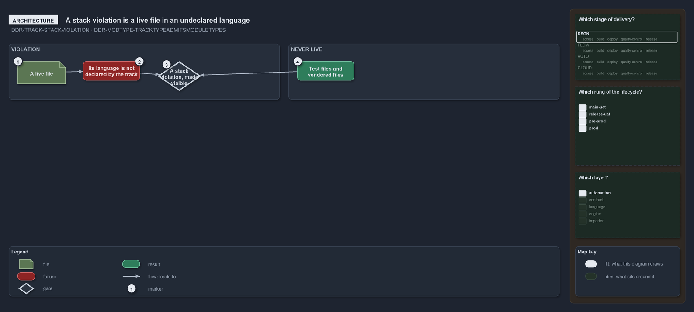

---
catzc:
  warning: "Experimental: this article merges two rules into one and holds nothing beyond what they say"
  edges:
    cites:
      - DDR-TRACK-STACKVIOLATION
      - DDR-MODTYPE-TRACKTYPEADMITSMODULETYPES
---

# A stack violation is live file in undeclared language and track type admits module types

This article is one rule: [DDR-TRACK-STACKVIOLATION](../../drs/design/tracks.md#rule-ddr-track-stackviolation) and
[DDR-MODTYPE-TRACKTYPEADMITSMODULETYPES](../../drs/design/module-types.md#rule-ddr-modtype-tracktypeadmitsmoduletypes) merged into one. It
holds nothing beyond what those two rules say.

A stack violation is a cell that holds a live file whose file language its track does not declare: the second tech-stack the one-tech-stack
rule forbids, made visible. Test files and vendored files are never live, so they never make one. Each track type also admits a set of
module types, and a module's type must be admitted by the type of the track that holds it.

