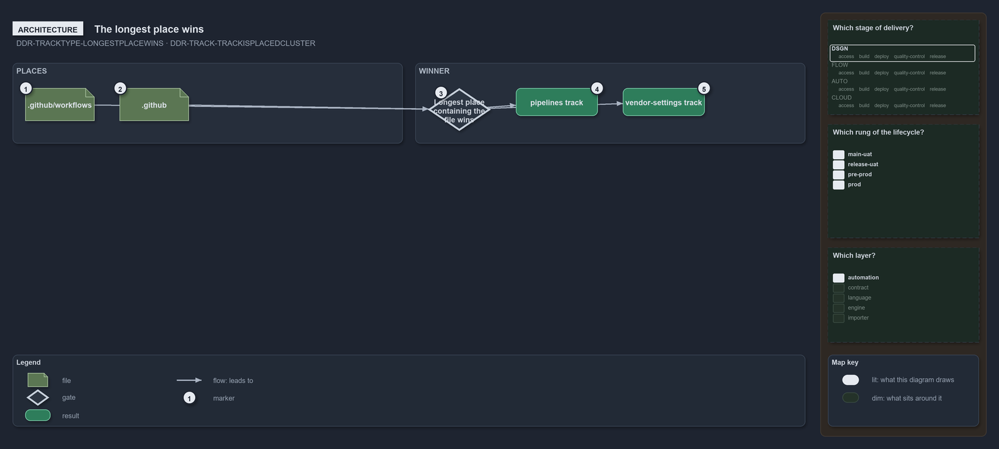

---
catzc:
  warning: "Experimental: this article merges two rules into one and holds nothing beyond what they say"
  edges:
    cites:
      - DDR-TRACKTYPE-LONGESTPLACEWINS
      - DDR-TRACK-TRACKISPLACEDCLUSTER
---

# A track is a placed cluster and the longest place wins

This article is one rule: [DDR-TRACKTYPE-LONGESTPLACEWINS](../../drs/design/track-types.md#rule-ddr-tracktype-longestplacewins) and
[DDR-TRACK-TRACKISPLACEDCLUSTER](../../drs/design/tracks.md#rule-ddr-track-trackisplacedcluster) merged into one. It holds nothing beyond
what those two rules say.

A track is a named, on-disk cluster of module contents: the tracked files of one concern, selected by the place or places the track
declares, a place being a root folder (`pwsh`) or a path inside one (`.github/workflows`, `pwsh/.vendor`). A file belongs to the track with
the longest place that contains it, so a narrower place wins over a wider one: a file under `.github/workflows` is in the GitHub `pipelines`
track, and the rest of `.github` is in the GitHub `vendor-settings` track.

