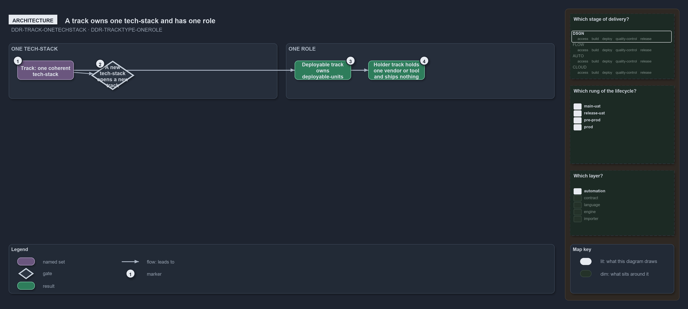

---
catzc:
  warning: "Experimental: this article merges two rules into one and holds nothing beyond what they say"
  edges:
    cites:
      - DDR-TRACK-ONETECHSTACK
      - DDR-TRACKTYPE-ONEROLE
---

# A track owns one tech stack and one role either deploying units or holding files

This article is one rule: [DDR-TRACK-ONETECHSTACK](../../drs/design/tracks.md#rule-ddr-track-onetechstack) and
[DDR-TRACKTYPE-ONEROLE](../../drs/design/track-types.md#rule-ddr-tracktype-onerole) merged into one. It holds nothing beyond what those two
rules say.

A track owns one coherent tech-stack, and a new tech-stack opens a new track, never a subfolder in an existing one: `pwsh` is PowerShell
with the C# types it hosts, `infrastructure` is Bicep plus PowerShell extension points. A track type has one role as well. A deployable
track owns deployable units the repository delivers through CI/CD; a holder track holds one vendor's or tool's files and ships nothing of
its own. The role is declared on the track type, never on the track.

