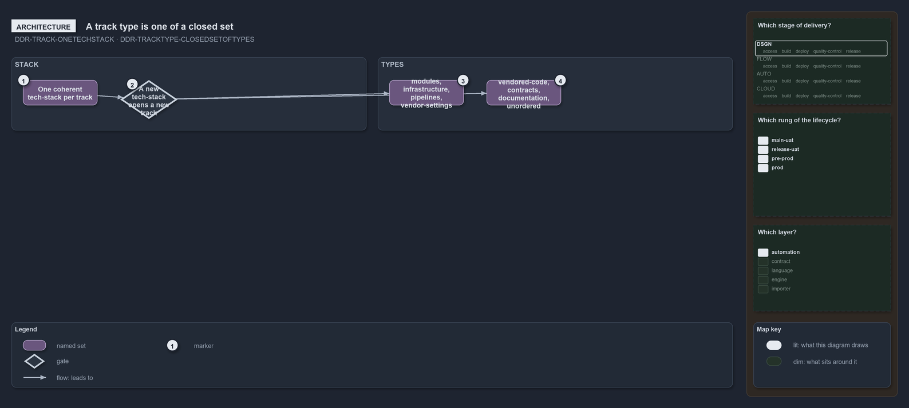

---
catzc:
  warning: "Experimental: this article merges two rules into one and holds nothing beyond what they say"
  edges:
    cites:
      - DDR-TRACK-ONETECHSTACK
      - DDR-TRACKTYPE-CLOSEDSETOFTYPES
---

# A track owns one tech stack and track types are a closed set

This article is one rule: [DDR-TRACK-ONETECHSTACK](../../drs/design/tracks.md#rule-ddr-track-onetechstack) and
[DDR-TRACKTYPE-CLOSEDSETOFTYPES](../../drs/design/track-types.md#rule-ddr-tracktype-closedsetoftypes) merged into one. It holds nothing
beyond what those two rules say.

A track owns one coherent tech-stack, and a new tech-stack opens a new track, never a subfolder inside an existing one. A track type is the
sort of cluster a track is, and it is one of a closed set: `modules`, `infrastructure`, `pipelines`, `vendor-settings`, `vendored-code`,
`contracts`, `documentation` and `unordered`.

