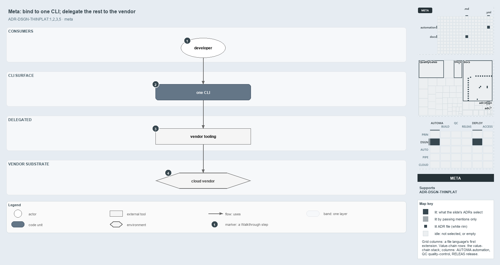

---
catzc:
  derived:
    path: docs/explanation/design/bind-to-one-cli-delegate-the-rest.md
    kind: explanation
    body_sha: "5ffe1a51b035"
    adrs:
      - ADR-DSGN-THINPLAT#{1-3,5}
    links:
      - docs/.assets/explanation/adr-dsgn-thinplat--bind-to-one-cli-delegate-the-rest--meta.drawio.md
      - docs/.assets/explanation/adr-dsgn-thinplat--bind-to-one-cli-delegate-the-rest--meta.drawio.png
      - docs/adr/design/thin-platforms.md
      - docs/explanation/design/deploy-bicep-delegates-to-az.md
      - docs/explanation/design/every-vendor-call-leaves-through-az.md
      - docs/explanation/design/index.md
      - docs/explanation/design/same-deploy-bicep-on-both-sides.md
      - docs/explanation/design/what-keeps-the-platform-thin.md
      - docs/explanation/index.md#how-to-read-the-diagrams
---

# Consumers bind to one CLI, and everything behind it is delegated to the vendor

```text
Consumers bind to one CLI; everything behind it is delegated to the vendor's own tools.

1  developer       the consumer; a CD pipeline runs the same commands
2  one CLI         the only surface anyone binds to: functions plus configuration
3  vendor tooling  a templating language and a control-plane CLI that do the work
4  cloud vendor    the substrate behind the CLI, swappable in principle; Azure today

Supports ADR-DSGN-THINPLAT#1, #2, #3 and #5 (meta lens).
```

Cats is a thin platform: a single CLI that standardizes how an organization uses a cloud vendor without reimplementing the vendor. Its idea
is a single chain. A consumer binds to the CLI and nothing else, the CLI hands the work to the vendor's own tools, and those tools talk to
the cloud. The invariant is delegation, not reimplementation, and the consequential choices stay in the consumer's configuration.



The diagram is described element by element in
[its asset description](../../.assets/explanation/adr-dsgn-thinplat--bind-to-one-cli-delegate-the-rest--meta.drawio.md).

## Walkthrough

1. **Developer.** The consumer who runs the platform. A CD pipeline runs the same commands, so what a developer types is exactly what the
   pipeline delivers.
2. **One CLI.** The only surface anyone binds to: the CLI plus its configuration is the platform's API. What the platform adds here is
   harmonization: one calling convention, one authentication path and one set of defaults, so a consumer never touches the vendor wiring.
3. **Vendor tooling.** A templating language and a control-plane CLI do the work. The platform calls them rather than rebuilding them.
4. **Cloud vendor.** The substrate sits behind the CLI and is swappable in principle, without reshaping the consumer's API. Today it is
   Azure only.

## Why it holds

- Cats is a thin platform, the smallest set of tooling that measurably speeds up the teams on it (ADR-DSGN-THINPLAT#1).
- Thin is achieved by delegation, not reimplementation: wrap to harmonize, never to hide or clone the vendor (ADR-DSGN-THINPLAT#2).
- The consumable surface is a CLI; consumers edit configuration and compose functions, and never touch the vendor wiring
  (ADR-DSGN-THINPLAT#3).
- The substrate is swappable behind the CLI, and cost, region, scale and blast radius stay in the consumer's configuration
  (ADR-DSGN-THINPLAT#5).

## Where the code and the ADR differ

The ADR's single authentication path, resolved for the consumer, is two logins in the code that meet at the az session: a pipeline signs in
through its service connection, and a developer runs `Connect-AzCli` and picks how to log in. Nothing chooses for them.

## See also

- [Thin platforms](../../adr/design/thin-platforms.md) — the decision this article explains.
- The other lenses on the same platform: [architecture](every-vendor-call-leaves-through-az.md),
  [implementation](deploy-bicep-delegates-to-az.md), [operations](same-deploy-bicep-on-both-sides.md) and
  [governance](what-keeps-the-platform-thin.md).
- [The design explanations](index.md) · [How to read the diagrams](../index.md#how-to-read-the-diagrams)
