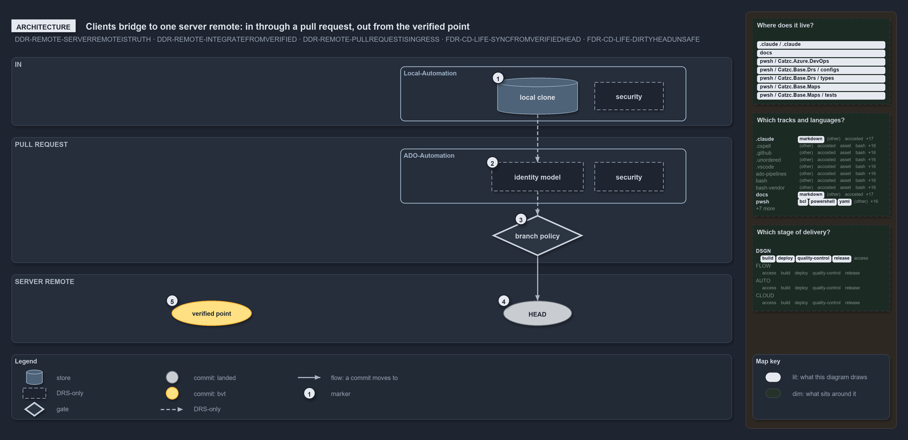

# Clients bridge to one server remote: in through a pull request, out from the verified point

```text
Clients bridge to one server remote: in through a pull request, out from the verified point.

1  local clone      a developer box's or CI agent's working copy; no authority
2  identity model   the server authenticates the author first; only the server runs it
3  branch policy    the merge gates on the protected main, then the merge
4  HEAD             the tip of the server's main; landed, not yet verified
5  verified point   the stable integration point, the BVT-verified server head

Supports DDR-REMOTE-SERVERREMOTEISTRUTH, DDR-REMOTE-INTEGRATEFROMVERIFIED and DDR-REMOTE-PULLREQUESTISINGRESS,
and FDR-LIFE-SYNCFROMVERIFIEDHEAD and FDR-LIFE-DIRTYHEADUNSAFE (architecture lens).
```

In cats the mainline is not a local artifact. It is the `main` / `master` branch that the server remote enforces, and that server is where
identity, branch protection and the audit history live. A client's change passes the server's identity model and branch policy before it
lands at HEAD, and the verified point is where consumers leave from, which the commit lifecycle owns. Knowing which side owns what tells a
reader where a guarantee is enforced and where it is only a discipline. The way out, and the way back in through a topic branch, is its own
drawing: [out from the verified point, back through its own topic](out-from-the-verified-point-back-through-a-topic.md).

```yml drawio
description:
  A client's change goes from its local clone through the server's identity model and branch policy to HEAD on the server remote, beside the
  verified point consumers leave from.
about:
  adrs:
    - DDR-REMOTE-SERVERREMOTEISTRUTH
    - DDR-REMOTE-INTEGRATEFROMVERIFIED
    - DDR-REMOTE-PULLREQUESTISINGRESS
    - FDR-LIFE-SYNCFROMVERIFIEDHEAD
    - FDR-LIFE-DIRTYHEADUNSAFE
  lens: architecture
content:
  title: "Clients bridge to one server remote: in through a pull request, out from the verified point"
  kind: explanation
  flow: top-to-bottom
  relation: a commit moves to
  states: true
  theme: dark
  bands:
    - { id: band-in, label: IN }
    - { id: band-request, label: PULL REQUEST }
    - { id: band-remote, label: SERVER REMOTE }
  groups:
    - { id: grp-local, label: Local-Automation, in: band-in }
    - { id: grp-ado, label: ADO-Automation, in: band-request }
  glyphs:
    - { id: s-clone, kind: store, label: local clone, in: grp-local }
    - { id: g-local-security, kind: drsonly, label: security, in: grp-local }
    - { id: g-identity, kind: drsonly, label: identity model, in: grp-ado }
    - { id: g-ado-security, kind: drsonly, label: security, in: grp-ado }
    - { id: g-policy, kind: gate, label: branch policy, in: band-request }
    - { id: c-head, kind: commit, label: HEAD, in: band-remote, state: landed }
    - { id: c-verified, kind: commit, label: verified point, in: band-remote }
  edges:
    - { from: s-clone, to: g-identity, kind: adr, label: "" }
    - { from: g-identity, to: g-policy, kind: adr, label: "" }
    - { from: g-policy, to: c-head, kind: flow, label: "" }
  markers:
    - { at: s-clone, number: 1 }
    - { at: g-identity, number: 2 }
    - { at: g-policy, number: 3 }
    - { at: c-head, number: 4 }
    - { at: c-verified, number: 5 }
  legend: auto
  minimaps: [code-locations, grid, axis]
layout:
  band-in: { x: 20, y: 84, w: 1260, h: 120 }
  band-request: { x: 20, y: 224, w: 1260, h: 220 }
  band-remote: { x: 20, y: 464, w: 1260, h: 120 }
  grp-local: { x: 700, y: 100, w: 500, h: 96 }
  s-clone: { x: 870, y: 120, w: 140, h: 64 }
  g-local-security: { x: 1040, y: 128, w: 120, h: 48 }
  grp-ado: { x: 700, y: 244, w: 500, h: 96 }
  g-identity: { x: 860, y: 268, w: 160, h: 50 }
  g-ado-security: { x: 1040, y: 268, w: 120, h: 50 }
  g-policy: { x: 860, y: 360, w: 160, h: 72 }
  c-head: { x: 880, y: 510, w: 120, h: 44 }
  c-verified: { x: 300, y: 510, w: 140, h: 44 }
```



## Walkthrough

1. **Local clone.** A developer box and a CI agent each hold a local clone that fetches from and pushes toward the server remote. It is a
   working copy with no authority. No code in cats pushes a change into a pull request, so the edge out of it is dashed.
2. **Identity model.** The pull request first authenticates the author against the server's identity model, so every commit on main is
   attributable to an authenticated principal. The server does this; no code in cats runs or checks it.
3. **Branch policy.** Next the pull request runs the mandatory merge gates that the branch policy on the protected `main` / `master`
   requires, and then performs the merge. In cats the policy is a set of blocking build validations on `main`, registered from code.
4. **HEAD.** The merged commit becomes the tip of the server's main. Landing is not verifying: HEAD may be a dirty HEAD, unverified or
   verified and then failed downstream, so it is not safe to sync from.
5. **Verified point.** The last commit the server proved verified is the stable integration point, the BVT-verified server head. It is also
   the commit `main-UAT` takes first, so once deployed it is the `main-UAT` occupant. It stays put while HEAD moves. Who leaves from it, and
   how a clone comes back in through its own topic branch, is the next drawing,
   [out from the verified point, back through its own topic](out-from-the-verified-point-back-through-a-topic.md).

## Why it holds

- The server remote is the single source of truth, and every local and CI clone is a bridge to it (DDR-REMOTE-SERVERREMOTEISTRUTH).
- Consumers integrate from the last remote-verified commit, never the current remote HEAD (DDR-REMOTE-INTEGRATEFROMVERIFIED).
- The pull request authenticates the author, runs the merge gates and performs the merge: it is the ingress engine, not merely a review
  (DDR-REMOTE-PULLREQUESTISINGRESS).
- The stable integration point is the BVT-verified server head, the same commit `main-UAT` takes first (FDR-LIFE-SYNCFROMVERIFIEDHEAD), and
  the dirty HEAD is never a source to sync from (FDR-LIFE-DIRTYHEADUNSAFE).

## Where the code and the decision record differ

- The DDR has every consumer integrate from the last verified commit, but no function or pipeline in cats resolves that commit, and the
  pipelines trigger on `main`.
- The DDR has the server branch policy admit merges only through a pull request, but cats registers only build-validation policies on Azure
  DevOps, sets no direct-push rule, and has nothing for GitHub.

## See also

- [The audited server git remote](../../drs/design/server-remote-integration.md) — the decision this article explains.
- [Commit lifecycle](../../drs/flow/commit-lifecycle.md) — the stable point and the dirty HEAD.
- The other lenses on the same decision: [meta](one-door-in-one-stable-point-out.md), [implementation](local-guard-and-server-policies.md),
  [operations](guard-and-policies-by-command.md) and [governance](ingress-gated-the-rest-by-review.md).
- [The design explanations](index.md) · [How to read the diagrams](../index.md#how-to-read-the-diagrams)
