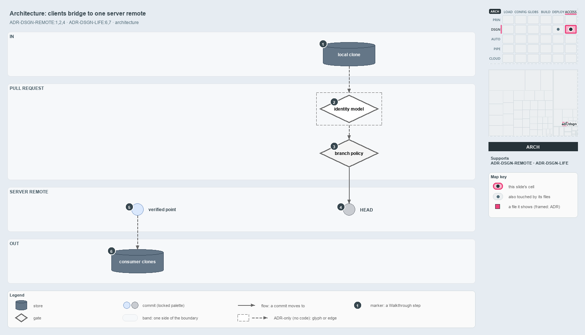

---
catzc:
  derived:
    path: docs/explanation/design/clients-bridge-to-one-server.md
    kind: explanation
    language: markdown
    filekind: md
    track: docs
    body_sha: "67c27c50bf4b"
    adrs:
      - ADR-DSGN-LIFE#{6,7}
      - ADR-DSGN-REMOTE#{1,2,4}
    links:
      - docs/.assets/explanation/adr-dsgn-remote--clients-bridge-to-one-server--architecture.drawio.md
      - docs/.assets/explanation/adr-dsgn-remote--clients-bridge-to-one-server--architecture.drawio.png
      - docs/adr/design/commit-lifecycle.md
      - docs/adr/design/server-remote-integration.md
      - docs/explanation/design/guard-and-policies-by-command.md
      - docs/explanation/design/index.md
      - docs/explanation/design/ingress-gated-the-rest-by-review.md
      - docs/explanation/design/local-guard-and-server-policies.md
      - docs/explanation/design/one-door-in-one-stable-point-out.md
      - docs/explanation/index.md#how-to-read-the-diagrams
---

# Clients bridge to one server remote: in through a pull request, out from the verified point

```text
Clients bridge to one server remote: in through a pull request, out from the verified point.

1  local clone      a developer box's or CI agent's working copy; no authority
2  identity model   the server authenticates the author first; only the server runs it
3  branch policy    the merge gates on the protected main, then the merge
4  HEAD             the tip of the server's main; landed, not yet verified
5  verified point   the stable integration point, the main-UAT occupant
6  consumer clones  developers, downstream units and upstream integrators build here

Supports ADR-DSGN-REMOTE#1, #2 and #4, and ADR-DSGN-LIFE#6 and #7 (architecture lens).
```

In cats the mainline is not a local artifact. It is the `main` / `master` branch that the server remote enforces, and that server is where
identity, branch protection and the audit history live. A client's change passes the server's identity model and branch policy before it
lands at HEAD, and consumers read out from the verified point, which the commit lifecycle owns. Knowing which side owns what tells a reader
where a guarantee is enforced and where it is only a discipline.



The diagram is described element by element in
[its asset description](../../.assets/explanation/adr-dsgn-remote--clients-bridge-to-one-server--architecture.drawio.md).

## Walkthrough

1. **Local clone.** A developer box and a CI agent each hold a local clone that fetches from and pushes toward the server remote. It is a
   working copy with no authority. No code in cats pushes a change into a pull request, so the edge out of it is dashed.
2. **Identity model.** The pull request first authenticates the author against the server's identity model, so every commit on main is
   attributable to an authenticated principal. The server does this; no code in cats runs or checks it.
3. **Branch policy.** Next the pull request runs the mandatory merge gates that the branch policy on the protected `main` / `master`
   requires, and then performs the merge. In cats the policy is a set of blocking build validations on `main`, registered from code.
4. **HEAD.** The merged commit becomes the tip of the server's main. Landing is not verifying: HEAD may be a dirty HEAD, unverified or
   verified and then failed downstream, so it is not safe to sync from.
5. **Verified point.** The last commit the server proved verified is the stable integration point, the `main-UAT` occupant. It stays put
   while HEAD moves.
6. **Consumer clones.** A developer branches from the verified point, a downstream deployable unit builds against it, and an upstream
   integrator syncs to it. No code resolves the verified point yet, so this edge is dashed.

## Why it holds

- The server remote is the single source of truth, and every local and CI clone is a bridge to it (ADR-DSGN-REMOTE#1).
- Consumers integrate from the last remote-verified commit, never the current remote HEAD (ADR-DSGN-REMOTE#2).
- The pull request authenticates the author, runs the merge gates and performs the merge: it is the ingress engine, not merely a review
  (ADR-DSGN-REMOTE#4).
- The stable integration point is the current `main-UAT` commit (ADR-DSGN-LIFE#6), and the dirty HEAD is never a source to sync from
  (ADR-DSGN-LIFE#7).

## Where the code and the ADR differ

- The ADR has every consumer integrate from the last verified commit, but no function or pipeline in cats resolves that commit, and the
  pipelines trigger on `main`.
- The ADR has the server branch policy admit merges only through a pull request, but cats registers only build-validation policies on Azure
  DevOps, sets no direct-push rule, and has nothing for GitHub.

## See also

- [The audited server git remote](../../adr/design/server-remote-integration.md) — the decision this article explains.
- [Commit lifecycle](../../adr/design/commit-lifecycle.md) — the stable point and the dirty HEAD.
- The other lenses on the same decision: [meta](one-door-in-one-stable-point-out.md), [implementation](local-guard-and-server-policies.md),
  [operations](guard-and-policies-by-command.md) and [governance](ingress-gated-the-rest-by-review.md).
- [The design explanations](index.md) · [How to read the diagrams](../index.md#how-to-read-the-diagrams)
