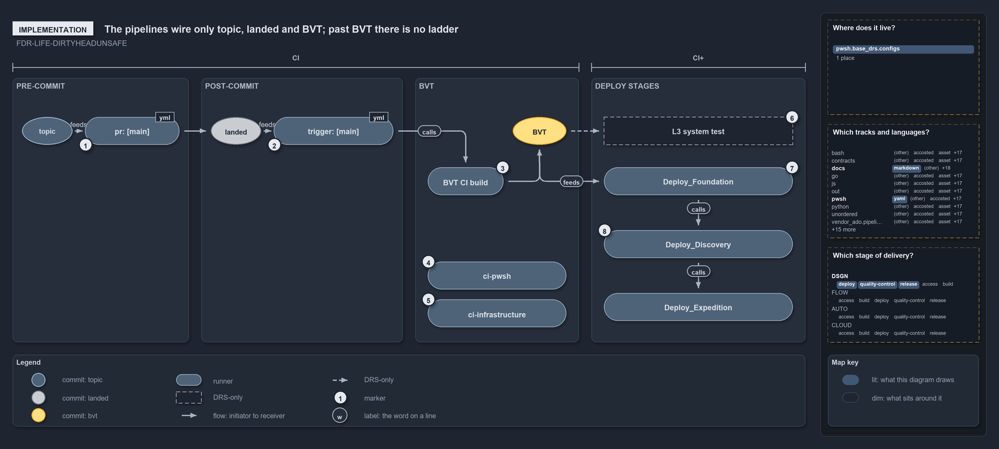

# The pipelines wire only topic, landed and BVT; past BVT there is no ladder

```text
The pipelines wire topic, landed and BVT; past BVT, stages follow the template, not the rung.

1  pr: [main]          pre-commit build validation of the topic commit
2  trigger: [main]     post-commit run of the same pipelines on the landed commit
3  BVT CI build        the CD pipeline's own CI engine: Build-Bicep, then publish
4  ci-pwsh             Test-Automation -Level 2 -EnforceTimings
5  ci-infrastructure   Assert-BicepTemplate, Build-Bicep, then the infrastructure suite
6  L3 system test     the CI+ test, run against the deploy stages; no pipeline step, nothing passes level 3
7  Deploy_Foundation   the first deploy stage; depends on CI, runs on main only
8  Deploy_Discovery    one stage that deploys its non-prod targets

Supports FDR-LIFE-FAILEDSTAYSUPSTREAM (implementation lens).
```

The commit lifecycle names eight rungs, from topic to production. The pipelines in cats wire the first three: a pull request to `main`, the
merge, and the CI engine that verifies the commit and publishes its artifact. After that, one CD run goes straight from its CI stage into
`Deploy_*` stages that are ordered by template, not by rung, and each stage deploys to all its targets at once.

```yml drawio
description:
  "The pipelines wire only the first three rungs of the commit lifecycle: a pull request, the merge, and the CD run's own CI engine; past
  the build validation commit the deploy stages follow the template, not a rung."
about:
  adrs: [FDR-LIFE-FAILEDSTAYSUPSTREAM]
  lens: implementation
content:
  title: The pipelines wire only topic, landed and BVT; past BVT there is no ladder
  kind: explanation
  flow: left-to-right
  theme: dark
  bands:
    - { id: band-pre, label: PRE-COMMIT }
    - { id: band-post, label: POST-COMMIT }
    - { id: band-validation, label: BVT }
    - { id: band-deploy, label: DEPLOY STAGES }
  spans:
    - id: span-integration
      label: CI
      over: [band-pre, band-post, band-validation]
    - id: span-delivery
      label: CI+
      over: [band-deploy]
  glyphs:
    - { id: c-topic, kind: commit, label: topic, in: band-pre, state: topic }
    - { id: r-pull-request, kind: runner, label: "pr: [main]", in: band-pre }
    - { id: c-landed, kind: commit, label: landed, in: band-post, state: landed }
    - { id: r-trigger, kind: runner, label: "trigger: [main]", in: band-post }
    - { id: r-stage, kind: runner, label: BVT CI build, in: band-validation }
    - { id: c-verified, kind: commit, label: BVT, in: band-validation }
    - { id: r-automation, kind: runner, label: ci-pwsh, in: band-validation }
    - { id: r-infrastructure, kind: runner, label: ci-infrastructure, in: band-validation }
    - { id: r-foundation, kind: runner, label: Deploy_Foundation, in: band-deploy }
    - { id: r-discovery, kind: runner, label: Deploy_Discovery, in: band-deploy }
    - { id: r-expedition, kind: runner, label: Deploy_Expedition, in: band-deploy }
    - { id: a-level-three, kind: drsonly, label: L3 system test, in: band-deploy }
  edges:
    - { from: c-topic, to: r-pull-request, kind: flow, label: feeds }
    - { from: r-pull-request, to: c-landed, kind: flow, label: "" }
    - { from: c-landed, to: r-trigger, kind: flow, label: feeds }
    - { from: r-trigger, to: r-stage, kind: flow, label: calls }
    - { from: r-stage, to: c-verified, kind: flow, label: "" }
    - { from: c-verified, to: r-foundation, kind: flow, label: feeds }
    - { from: c-verified, to: a-level-three, kind: adr, label: "" }
    - { from: r-foundation, to: r-discovery, kind: flow, label: calls }
    - { from: r-discovery, to: r-expedition, kind: flow, label: calls }
  markers:
    - { at: r-pull-request, number: 1 }
    - { at: r-trigger, number: 2 }
    - { at: r-stage, number: 3 }
    - { at: r-automation, number: 4 }
    - { at: r-infrastructure, number: 5 }
    - { at: a-level-three, number: 6 }
    - { at: r-foundation, number: 7 }
    - { at: r-discovery, number: 8 }
  legend: auto
  minimaps: [code-locations, grid, axis]
layout:
  band-pre: { x: 20, y: 108, w: 280, h: 420 }
  band-post: { x: 320, y: 108, w: 320, h: 420 }
  band-validation: { x: 660, y: 108, w: 260, h: 420 }
  band-deploy: { x: 940, y: 108, w: 340, h: 420 }
  c-topic: { x: 35, y: 170, w: 80, h: 44 }
  r-pull-request: { x: 135, y: 170, w: 150, h: 44 }
  c-landed: { x: 335, y: 170, w: 80, h: 44 }
  r-trigger: { x: 435, y: 170, w: 190, h: 44 }
  r-stage: { x: 680, y: 250, w: 120, h: 44 }
  c-verified: { x: 815, y: 170, w: 85, h: 44 }
  r-automation: { x: 680, y: 400, w: 220, h: 44 }
  r-infrastructure: { x: 680, y: 460, w: 220, h: 44 }
  a-level-three: { x: 960, y: 170, w: 300, h: 44 }
  r-foundation: { x: 960, y: 250, w: 300, h: 44 }
  r-discovery: { x: 960, y: 350, w: 300, h: 44 }
  r-expedition: { x: 960, y: 450, w: 300, h: 44 }
```



## Walkthrough

1. **pr: [main].** Pre-commit build validation of the brown topic commit. Every `ci-*.yaml` and `cd-*.yaml` pipeline runs on pull requests
   to `main`, and `build-validation.yml` binds six globsets as build validations on `main`.
2. **trigger: [main].** After the merge, the same pipelines run post-commit on the grey landed commit. The trigger starts all three
   pipelines in the BVT group at once, so they share one arrow into the group.
3. **BVT CI build.** The CD pipeline's own CI engine, its `CI` stage, inside the inner CI loop with the BVT:
   `Build-Bicep <template> -Customers <customer>` for a customer CD, or `-Shared` for `cd-shared`, each followed by `publish` of the
   artifact. The published artifact is the yellow commit's build, and every deploy stage takes it with `download: current`, so nothing is
   rebuilt.
4. **ci-pwsh.** Runs `Test-Automation -Level 2 -EnforceTimings`. The GitHub CI runs `Test-Automation -Level 2` on three operating systems,
   and `ci-pwsh-expected-failures` runs on the same triggers. On main, the `BuildArtifact` job also runs `Test-BuildArtifact`, the BVT's
   built-artifact check.
5. **ci-infrastructure.** Runs `Assert-BicepTemplate`, then `Build-Bicep`, for foundation, discovery and expedition, then
   `Test-Automation -Suite infrastructure`.
6. **L3 system test.** The inner CI loop is L0 to L2 and the BVT, and the yellow BVT commit is inside it. The L3 vertical system test is the
   CI+ test, the outer loop that starts after the BVT and runs in the CD pipeline's post-commit path against the deployed environment
   (FDR-CD-INNERANDOUTERLOOP, FDR-CD-CDSTAYSINNONPROD), so it sits under the CI+ span with the deploy stages. It is drawn dashed because no
   pipeline step exists: `Test-Automation` accepts level 3 (`-Level` is the alias of `-MaxLevel`, which defaults to 3), but no pipeline
   passes it.
7. **Deploy_Foundation.** The first deploy stage depends on `CI`, and each later stage depends on the one before: `Deploy_Foundation`,
   `Deploy_Discovery`, then `Deploy_Expedition` (one job per expedition entry; an entry with a slot passes `-Slot`). Each runs only when the
   previous stage succeeded and the source branch is `refs/heads/main`; `Deploy_Foundation` also needs the CI stage's `Test-GlobSetAffected`
   answer to be true, so an untouched unit skips every deploy. Every deploy calls `Deploy-Bicep` with `-SubscriptionIdAssertIs`.
8. **Deploy_Discovery.** Stages follow the template, not the rung: discovery deploys per subscription, to `nsub`. Counted as foundation, discovery and expedition jobs, apex has 1, 1 and 2 (expedition `dev`
   and `dev-blu`), `cd-shared` has 1, 1 and 2, nova has 1, 1 and 1, and flux has 1, 1 and none.

## Why it holds

A commit that fails a stage cannot go downstream (FDR-LIFE-FAILEDSTAYSUPSTREAM). In the code that rule is the `succeeded()` condition on
every `Deploy_*` stage: a failed CI stage skips every deploy, and a failed deploy stage skips the stages after it.

## Where the code and the decision record differ

- A CD stage deploys its non-prod targets together, where the FDR climbs `main-uat` → `release-uat` → `pre-prod` → `production` one rung at a
  time; the DEPLOY pipelines `deploy-apex.yaml` and `deploy-shared.yaml` carry the rungs past CD.
- No pipeline runs the L3 tier.
- No CD pipeline has a pre-prod target; the pre-prod target that stays inactive until it is activated is in `deploy-apex.yaml` only.

## See also

- [The commit lifecycle](../../drs/flow/commit-lifecycle.md) — the decision this article explains.
- The other lenses on the same lifecycle: [meta](one-way-climb-three-endings.md), [architecture](four-domains-promote-one-artifact.md),
  [operations](engineer-merges-pipelines-do-the-rest.md) and [governance](which-rung-gates-exist-in-code.md).
- [The design explanations](index.md) · [How to read the diagrams](../index.md#how-to-read-the-diagrams)
