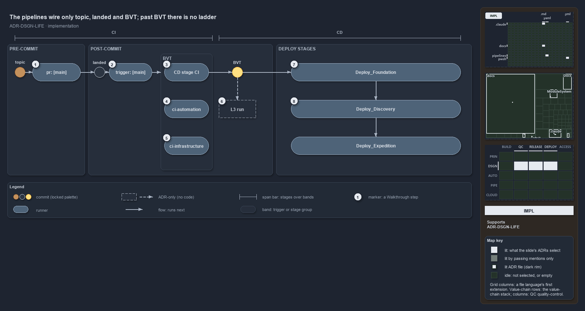

# The pipelines wire only topic, landed and BVT; past BVT there is no ladder

```text
The pipelines wire topic, landed and BVT; past BVT, stages follow the template, not the rung.

1  pr: [main]          pre-commit build validation of the topic commit
2  trigger: [main]     post-commit run of the same pipelines on the landed commit
3  CD stage CI         the CD pipeline's own CI engine: Build-Bicep, then publish
4  ci-automation       Test-Automation -Level 2 -EnforceTimings
5  ci-infrastructure   Assert-BicepTemplate, Build-Bicep, then the infrastructure suite
6  L3 run              no pipeline step; Test-Automation accepts level 3, nothing passes it
7  Deploy_Foundation   the first deploy stage; depends on CI, runs on main only
8  Deploy_Discovery    one stage that deploys nsub and psub side by side

Supports ADR-DSGN-LIFE-FAILEDSTAYSUPSTREAM (implementation lens).
```

The commit lifecycle names eight rungs, from topic to production. The pipelines in cats wire the first three: a pull request to `main`, the
merge, and the CI engine that verifies the commit and publishes its artifact. After that, one CD run goes straight from its CI stage into
`Deploy_*` stages that are ordered by template, not by rung, and each stage deploys to all its targets at once.



The diagram is described element by element in [its asset description](.assets/code-wires-only-the-first-rungs/diagram.drawio.md).

## Walkthrough

1. **pr: [main].** Pre-commit build validation of the brown topic commit. Every `ci-*.yaml` and `cd-*.yaml` pipeline runs on pull requests
   to `main`, and `build-validation.yml` binds six globsets as build validations on `main`.
2. **trigger: [main].** After the merge, the same pipelines run post-commit on the grey landed commit. The trigger starts all three
   pipelines in the BVT group at once, so they share one arrow into the group.
3. **CD stage CI.** The CD pipeline's own CI engine: `Build-Bicep <template> -Customers <customer>` for a customer CD, or `-Shared` for
   `cd-shared`, each followed by `publish` of the artifact. The published artifact is the yellow commit's build, and every deploy stage
   takes it with `download: current`, so nothing is rebuilt.
4. **ci-automation.** Runs `Test-Automation -Level 2 -EnforceTimings`. The GitHub CI runs `Test-Automation -Level 2` on three operating
   systems, and `ci-automation-expected-failures` runs on the same triggers. On main, the `BuildArtifact` job also runs
   `Test-BuildArtifact`, the BVT's built-artifact check.
5. **ci-infrastructure.** Runs `Assert-BicepTemplate`, then `Build-Bicep`, for foundation, discovery and expedition, then
   `Test-Automation -Suite infrastructure`.
6. **L3 run.** No pipeline step exists. `Test-Automation` accepts level 3 (`-Level` is the alias of `-MaxLevel`, which defaults to 3), but
   no pipeline passes it.
7. **Deploy_Foundation.** The first deploy stage depends on `CI`, and each later stage depends on the one before: `Deploy_Foundation`,
   `Deploy_Discovery`, then `Deploy_Expedition` (one job per expedition entry; an entry with a slot passes `-Slot`). Each runs only when the
   previous stage succeeded and the source branch is `refs/heads/main`; `Deploy_Foundation` also needs the CI stage's `Test-GlobSetAffected`
   answer to be true, so an untouched unit skips every deploy. Every deploy calls `Deploy-Bicep` with `-SubscriptionIdAssertIs`.
8. **Deploy_Discovery.** Stages follow the template, not the rung: discovery deploys per subscription, `nsub` and `psub` side by side as
   parallel jobs. Counted as foundation, discovery and expedition jobs, apex has 2, 2 and 3 (expedition `dev`, `dev-blu` and `prod`),
   `cd-shared` has 2, 2 and 2, nova has 1, 1 and 1, and flux has 1, 1 and none.

## Why it holds

A commit that fails a stage cannot go downstream (ADR-DSGN-LIFE-FAILEDSTAYSUPSTREAM). In the code that rule is the `succeeded()` condition
on every `Deploy_*` stage: a failed CI stage skips every deploy, and a failed deploy stage skips the stages after it.

## Where the code and the ADR differ

- Past BVT there is no promotion ladder: a stage deploys its non-prod and prod-tier targets together (`nsub` and `psub`, or apex's
  expedition `dev` and `prod`), where the ADR climbs `main-uat` → `release-uat` → `pre-prod` → `production` one rung at a time.
- No pipeline runs the L3 tier.
- No environment is named `main-uat` or `release-uat`, and no RC or RBC approval exists.
- No CD pipeline has a pre-prod target that stays inactive until it is activated.

## See also

- [The commit lifecycle](../../adr/design/commit-lifecycle.md) — the decision this article explains.
- The other lenses on the same lifecycle: [meta](one-way-climb-three-endings.md), [architecture](four-domains-promote-one-artifact.md),
  [operations](engineer-merges-pipelines-do-the-rest.md) and [governance](which-rung-gates-exist-in-code.md).
- [The design explanations](index.md) · [How to read the diagrams](../index.md#how-to-read-the-diagrams)
