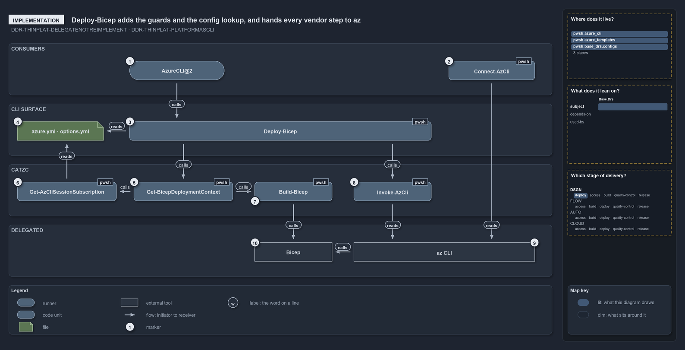

# Deploy-Bicep adds the guards and the config lookup, and hands every vendor step to az

```text
Deploy-Bicep adds the guards and the config lookup, and hands every vendor step to az.

1   AzureCLI@2                    how a pipeline signs az in, through its service connection
2   Connect-AzCli                 how a devbox signs az in: az login, four ways
3   Deploy-Bicep                  the CLI entry; runs the whole deploy in order
4   azure.yml, options.yml        the configuration: environments and template overrides
5   Get-BicepDeploymentContext    composes the one context every later step reads
6   Get-AzCliSessionSubscription  resolves the az session's subscription against azure.yml
7   Build-Bicep                   builds the template on a devbox with the bicep binary
8   Invoke-AzCli                  the az wrapper every control-plane step goes through
9   az CLI                        deploys, or previews with --what-if
10  Bicep                         the templating language, compiled by its own binary

Supports DDR-THINPLAT-DELEGATENOTREIMPLEMENT and DDR-THINPLAT-PLATFORMASCLI (implementation lens).
```

`Deploy-Bicep` is the one entry function that does a whole Bicep deploy. It resolves the az session's subscription against the
configuration, builds the template on a devbox, and passes every vendor step to az through `Invoke-AzCli`. Cats contributes the guards and
the lookup; az and Bicep do the work, which is what keeps the platform thin.

```yml drawio
description:
  Deploy-Bicep adds the guards and the configuration lookup and runs every vendor step through one wrapper that calls the az command-line
  interface, which compiles the Bicep template.
about:
  rules: [DDR-THINPLAT-DELEGATENOTREIMPLEMENT, DDR-THINPLAT-PLATFORMASCLI]
  lens: implementation
content:
  title: Deploy-Bicep adds the guards and the config lookup, and hands every vendor step to az
  kind: explanation
  flow: top-to-bottom
  theme: dark
  bands:
    - { id: band-consumers, label: CONSUMERS }
    - { id: band-surface, label: CLI SURFACE }
    - { id: band-platform, label: CATZC }
    - { id: band-delegated, label: DELEGATED }
  glyphs:
    - { id: r-pipeline-task, kind: runner, label: AzureCLI@2, in: band-consumers }
    - { id: c-connect, kind: code, label: Connect-AzCli, in: band-consumers }
    - { id: c-deploy, kind: code, label: Deploy-Bicep, in: band-surface }
    - { id: f-configuration, kind: file, label: azure.yml · options.yml, in: band-surface }
    - { id: c-session, kind: code, label: Get-AzCliSessionSubscription, in: band-platform }
    - { id: c-context, kind: code, label: Get-BicepDeploymentContext, in: band-platform }
    - { id: c-build, kind: code, label: Build-Bicep, in: band-platform }
    - { id: c-invoke, kind: code, label: Invoke-AzCli, in: band-platform }
    - { id: x-bicep, kind: external, label: Bicep, in: band-delegated }
    - { id: x-azure-command, kind: external, label: az CLI, in: band-delegated }
  edges:
    - { from: r-pipeline-task, to: c-deploy, kind: flow, label: calls }
    - { from: c-connect, to: x-azure-command, kind: flow, label: "" }
    - { from: c-deploy, to: f-configuration, kind: flow, label: "" }
    - { from: c-deploy, to: c-context, kind: flow, label: calls }
    - { from: c-deploy, to: c-invoke, kind: flow, label: calls }
    - { from: c-context, to: c-session, kind: flow, label: calls }
    - { from: c-context, to: c-build, kind: flow, label: calls }
    - { from: c-session, to: f-configuration, kind: flow, label: "" }
    - { from: c-build, to: x-bicep, kind: flow, label: calls }
    - { from: c-invoke, to: x-azure-command, kind: flow, label: "" }
    - { from: x-azure-command, to: x-bicep, kind: flow, label: calls }
  markers:
    - { at: r-pipeline-task, number: 1 }
    - { at: c-connect, number: 2 }
    - { at: c-deploy, number: 3 }
    - { at: f-configuration, number: 4 }
    - { at: c-context, number: 5 }
    - { at: c-session, number: 6 }
    - { at: c-build, number: 7 }
    - { at: c-invoke, number: 8 }
    - { at: x-azure-command, number: 9 }
    - { at: x-bicep, number: 10 }
  legend: auto
  minimaps: [code-locations, module-neighbourhood, axis]
layout:
  band-consumers: { x: 20, y: 84, w: 1260, h: 120 }
  band-surface: { x: 20, y: 224, w: 1260, h: 120 }
  band-platform: { x: 20, y: 364, w: 1260, h: 120 }
  band-delegated: { x: 20, y: 504, w: 1260, h: 120 }
  r-pipeline-task: { x: 300, y: 125, w: 220, h: 44 }
  c-connect: { x: 1040, y: 125, w: 200, h: 44 }
  c-deploy: { x: 300, y: 265, w: 700, h: 44 }
  f-configuration: { x: 40, y: 265, w: 200, h: 44 }
  c-session: { x: 40, y: 405, w: 230, h: 44 }
  c-context: { x: 310, y: 405, w: 230, h: 44 }
  c-build: { x: 590, y: 405, w: 180, h: 44 }
  c-invoke: { x: 820, y: 405, w: 180, h: 44 }
  x-bicep: { x: 590, y: 545, w: 180, h: 44 }
  x-azure-command: { x: 820, y: 545, w: 420, h: 44 }
```



## Walkthrough

1. **AzureCLI@2.** How a pipeline signs az in. A step built from `invoke-automation.yaml` with `Mode: azcli` runs on the AzureCLI@2 task,
   signed in through its `ServiceConnection`, and its `RunCommand` is the same `Deploy-Bicep` a developer types.
2. **Connect-AzCli.** How a devbox signs az in: `az login`, interactive by default, or with `-ServicePrincipal`, `-ManagedIdentity` or
   `-DeviceCode`. It asserts the `az_cli` pin and runs the login through `Invoke-Executable`.
3. **Deploy-Bicep.** The CLI entry:
   `-Environment -Template [-Slot] [-SubscriptionIdAssertIs] [-ArtifactsFolder] [-DoNotRebuild] [-OverrideDoNotRunAndRun] [-DryRun]`. In a
   pipeline it throws at once without `-SubscriptionIdAssertIs`. After the context, it runs a template's pre-deploy hook, checks and creates
   the resource group for a resource-group target, deploys, asserts that `provisioningState` is `Succeeded`, runs the post-deploy hook, and
   sets the tracking tags last.
4. **azure.yml and options.yml.** The configuration. `Deploy-Bicep` only accepts an environment that `azure.yml` declares, and a template's
   `options.yml` supplies its validated overrides.
5. **Get-BicepDeploymentContext.** Composes the one context every later step reads. In a pipeline it first throws on `-DoNotRebuild`,
   `-OverrideDoNotRunAndRun`, or a missing `-ArtifactsFolder`. A template marked DoNotRun returns nothing, and `Deploy-Bicep` prints that it
   skips the deployment.
6. **Get-AzCliSessionSubscription.** Reads the az session's subscription (through `Invoke-AzCli`) and resolves it against `azure.yml`,
   throwing when `azure.yml` does not declare it. The context then throws when `-SubscriptionIdAssertIs` names a different one.
7. **Build-Bicep.** Runs on a devbox only, unless `-DoNotRebuild` reuses the last build; a pipeline uses the downloaded artifacts. It first
   resolves the bicep binary at its `tools.yml` pin, then runs `bicep build` to `main.json`.
8. **Invoke-AzCli.** The az wrapper. It asserts `Assert-Tool 'az_cli'`, turns off az's dynamic extension install for the call, and runs az
   through `Invoke-Executable`.
9. **az CLI.** Runs `deployment group create` or `deployment sub create`, with `--what-if` under `-DryRun`.
10. **Bicep.** The templating language, compiled by the bicep binary at its `tools.yml` pin; cats never writes ARM by hand.

## Why it holds

- Thin comes from delegation: Bicep templates, compiled by the bicep binary, and az for every control-plane step
  (DDR-THINPLAT-DELEGATENOTREIMPLEMENT).
- `Deploy-Bicep` and its configuration are the API a consumer binds to; nothing behind it is called directly (DDR-THINPLAT-PLATFORMASCLI).

## Where the code and the decision record differ

- ADR-AZ-CLI-AZBYDEFAULT says to parse az output with `ConvertFrom-Json`, but `Deploy-Bicep` asks az for `--output yaml` and parses it with
  `ConvertFrom-Yaml`.
- DDR-THINPLAT describes a single authentication path that is resolved for you. The code has two logins that meet at the az session,
  AzureCLI@2 in a pipeline and `Connect-AzCli` on a devbox, and on the devbox the caller picks the parameter set.

## See also

- [Thin platforms](../../drs/design/thin-platforms.md) — the decision this article explains.
- [Prefer Az CLI over Az PowerShell modules](../../drs/azure/prefer-az-cli.md) — the az-first rules.
- The other lenses on the same platform: [meta](bind-to-one-cli-delegate-the-rest.md),
  [architecture](every-vendor-call-leaves-through-az.md), [operations](same-deploy-bicep-on-both-sides.md) and
  [governance](what-keeps-the-platform-thin.md).
- [The design explanations](index.md) · [How to read the diagrams](../index.md#how-to-read-the-diagrams)
