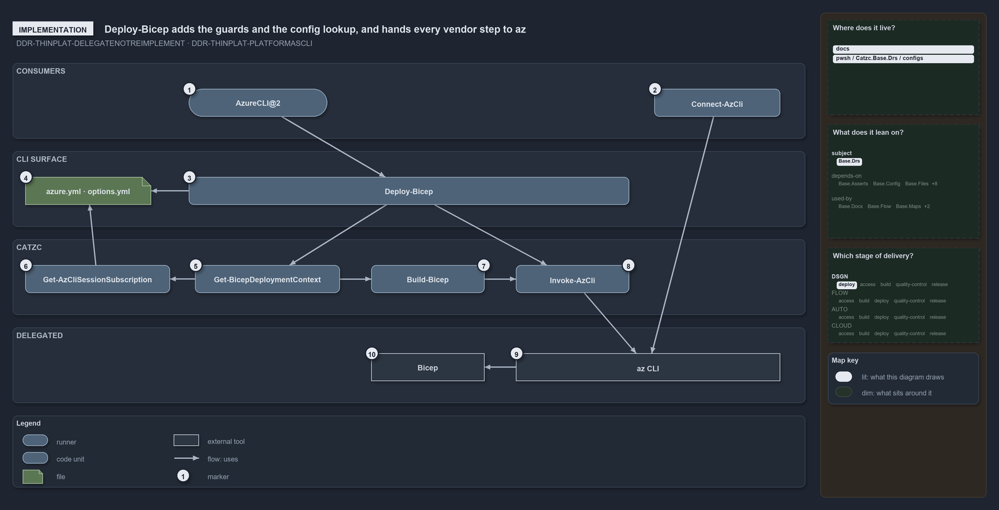

# Deploy-Bicep adds the guards and the config lookup, and hands every vendor step to az

```text
Deploy-Bicep adds the guards and the config lookup, and hands every vendor step to az.

1   AzureCLI@2                    how a pipeline signs az in, through its service connection
2   Connect-AzCli                 how a devbox signs az in: az login, four ways
3   Deploy-Bicep                  the CLI entry; runs the whole deploy in order
4   azure.yml, options.yml        the configuration: environments and template overrides
5   Get-BicepDeploymentContext    composes the one context every later step reads
6   Get-AzCliSessionSubscription  resolves the az session's subscription against azure.yml
7   Build-Bicep                   builds the template on a devbox
8   Invoke-AzCli                  the az wrapper every vendor step goes through
9   az CLI                        compiles, deploys, or previews with --what-if
10  Bicep                         the templating language az compiles

Supports ADR-DSGN-THINPLAT-DELEGATENOTREIMPLEMENT and ADR-DSGN-THINPLAT-PLATFORMASCLI (implementation lens).
```

`Deploy-Bicep` is the one entry function that does a whole Bicep deploy. It resolves the az session's subscription against the
configuration, builds the template on a devbox, and passes every vendor step to az through `Invoke-AzCli`. Cats contributes the guards and
the lookup; az and Bicep do the work, which is what keeps the platform thin.



The diagram is described element by element in [its asset description](.assets/deploy-bicep-delegates-to-az/diagram.drawio.md).

## Walkthrough

1. **AzureCLI@2.** How a pipeline signs az in. A step built from `invoke-automation.yaml` with `Mode: azcli` runs on the AzureCLI@2 task,
   signed in through its `ServiceConnection`, and its `RunCommand` is the same `Deploy-Bicep` a developer types.
2. **Connect-AzCli.** How a devbox signs az in: `az login`, interactive by default, or with `-ServicePrincipal`, `-ManagedIdentity` or
   `-DeviceCode`. It asserts the `az_cli` pin and runs the login through `Invoke-Executable`.
3. **Deploy-Bicep.** The CLI entry:
   `-Environment -Template [-Slot] [-SubscriptionIdAssertIs] [-ArtifactsFolder] [-DoNotRebuild] [-OverrideDoNotRunAndRun] [-DryRun]`. In a
   pipeline it throws at once without `-SubscriptionIdAssertIs`. After the context, it runs a template's pre-deploy hook, checks and creates
   the resource group for a resource-group target, deploys, asserts that `provisioningState` is `Succeeded`, runs the post-deploy hook, and
   sets the tracking tags last.
4. **azure.yml and options.yml.** The configuration. `Deploy-Bicep` only accepts an environment that `azure.yml` declares, and a template's
   `options.yml` supplies its validated overrides.
5. **Get-BicepDeploymentContext.** Composes the one context every later step reads. In a pipeline it first throws on `-DoNotRebuild`,
   `-OverrideDoNotRunAndRun`, or a missing `-ArtifactsFolder`. A template marked DoNotRun returns nothing, and `Deploy-Bicep` prints that it
   skips the deployment.
6. **Get-AzCliSessionSubscription.** Reads the az session's subscription (through `Invoke-AzCli`) and resolves it against `azure.yml`,
   throwing when `azure.yml` does not declare it. The context then throws when `-SubscriptionIdAssertIs` names a different one.
7. **Build-Bicep.** Runs on a devbox only, unless `-DoNotRebuild` reuses the last build; a pipeline uses the downloaded artifacts. It first
   asserts that the Bicep CLI meets `bicep_min_version`, then runs `az bicep build` to `main.json`.
8. **Invoke-AzCli.** The az wrapper. It asserts `Assert-Tool 'az_cli'`, turns off az's dynamic extension install for the call, and runs az
   through `Invoke-Executable`.
9. **az CLI.** Runs `bicep build`, then `deployment group create` or `deployment sub create`, with `--what-if` under `-DryRun`.
10. **Bicep.** The templating language az compiles; cats never writes ARM by hand.

## Why it holds

- Thin comes from delegation: Bicep templates, compiled by az, and az for every control-plane step
  (ADR-DSGN-THINPLAT-DELEGATENOTREIMPLEMENT).
- `Deploy-Bicep` and its configuration are the API a consumer binds to; nothing behind it is called directly
  (ADR-DSGN-THINPLAT-PLATFORMASCLI).

## Where the code and the ADR differ

- ADR-AZ-CLI-AZBYDEFAULT says to parse az output with `ConvertFrom-Json`, but `Deploy-Bicep` asks az for `--output yaml` and parses it with
  `ConvertFrom-Yaml`.
- ADR-DSGN-THINPLAT describes a single authentication path that is resolved for you. The code has two logins that meet at the az session,
  AzureCLI@2 in a pipeline and `Connect-AzCli` on a devbox, and on the devbox the caller picks the parameter set.

## See also

- [Thin platforms](../../adr/design/thin-platforms.md) — the decision this article explains.
- [Prefer Az CLI over Az PowerShell modules](../../adr/azure/prefer-az-cli.md) — the az-first rules.
- The other lenses on the same platform: [meta](bind-to-one-cli-delegate-the-rest.md),
  [architecture](every-vendor-call-leaves-through-az.md), [operations](same-deploy-bicep-on-both-sides.md) and
  [governance](what-keeps-the-platform-thin.md).
- [The design explanations](index.md) · [How to read the diagrams](../index.md#how-to-read-the-diagrams)
