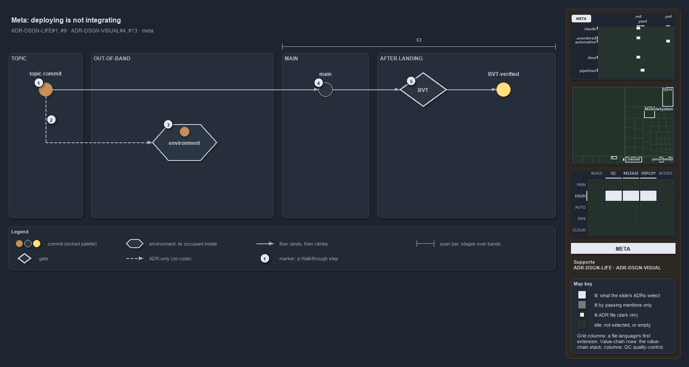

---
catzc:
  derived:
    path: docs/explanation/design/deploying-is-not-integrating.md
    folder: docs/explanation/design
    name: deploying-is-not-integrating
    filetype: md
    kind: explanation
    language: markdown
    track: docs
    body_sha: a9bdca79fa5e
    adrs:
      - ADR-DSGN-LIFE#{1,9}
      - ADR-DSGN-VISUAL#{4,13}
    links:
      - docs/.assets/explanation/adr-dsgn-life--deploying-is-not-integrating--meta.drawio.md
      - docs/.assets/explanation/adr-dsgn-life--deploying-is-not-integrating--meta.drawio.png
      - docs/adr/design/commit-lifecycle.md
      - docs/adr/design/visual-design.md
      - docs/explanation/design/deploy-and-integrate-share-only-the-topic.md
      - docs/explanation/design/every-deploy-stage-is-main-only.md
      - docs/explanation/design/index.md
      - docs/explanation/design/merging-to-main-is-what-deploys.md
      - docs/explanation/design/out-of-band-deploy-is-adr-only.md
      - docs/explanation/index.md#how-to-read-the-diagrams
---

# Deploying a topic commit is not integrating it

```text
A topic commit can reach an environment without reaching main; only landing on main puts it on the ladder.

1  topic commit         a commit on a topic branch, brown, off main
2  out-of-band deploy   a workflow deploys the topic commit; ADR-only, no code runs it
3  environment          a neutral container; its occupant stays brown
4  main                 landing on main is the integration; the commit turns grey
5  BVT                  turns the landed commit into a BVT-verified one, yellow

Supports ADR-DSGN-LIFE#1 and #9, and ADR-DSGN-VISUAL#4 and #13 (meta lens).
```

Deploying a commit and integrating it are separate events: a commit can reach an environment without reaching main. The commit lifecycle
treats that honestly: an out-of-band deploy puts a topic commit into an environment, but only landing on main puts it on the promotion
ladder. Keeping the two events apart is what lets a commit's colour stay a true statement about where it stands.



The diagram is described element by element in
[its asset description](../../.assets/explanation/adr-dsgn-life--deploying-is-not-integrating--meta.drawio.md).

## Walkthrough

1. **Topic commit.** A commit on a topic branch, off main. It is brown, the development colour, which is never an integrated mainline state.
   It has two ways forward.
2. **The out-of-band deploy.** A workflow or pipeline may deploy a topic commit directly, for a hotfix or an experiment. The deploy is
   explicitly not an integration and confers no promotion state, so no edge leads from it to main. The edge is ADR-only because nothing in
   the repository runs this deploy today.
3. **Environment.** The environment is a neutral container, and the commit inside it is its occupant, in that commit's own colour. After an
   out-of-band deploy the occupant stays brown: deployed, but not integrated.
4. **Main.** Landing on main is the integration, and the commit turns grey. The commit keeps its brown until it lands normally, and only
   then can it climb.
5. **BVT.** The BVT turns the landed commit into a BVT-verified one, yellow, with an immutable versioned artifact. A commit climbs one rung
   at a time and never moves backward.

## Why it holds

- A topic commit can be deployed out-of-band without integrating into main; the deploy confers no promotion state on the mainline
  (ADR-DSGN-LIFE#9).
- A commit advances one rung along the ladder at a time, or leaves it, and never moves backward (ADR-DSGN-LIFE#1).
- Brown is a development commit and never an integrated mainline state; grey is integrated onto main; yellow is past the BVT
  (ADR-DSGN-VISUAL#4).
- An environment box is neutral, and its occupant carries its own state colour (ADR-DSGN-VISUAL#13).

## Where the code and the ADR differ

ADR-DSGN-LIFE#9 allows the out-of-band deploy, but no pipeline or workflow in cats runs one: every `Deploy_*` stage runs only from main.

## See also

- [The commit lifecycle](../../adr/design/commit-lifecycle.md) — the decision this article explains.
- [Visual design](../../adr/design/visual-design.md) — the commit colours and the neutral environment.
- The other lenses on the same deploy: [architecture](deploy-and-integrate-share-only-the-topic.md),
  [implementation](every-deploy-stage-is-main-only.md), [operations](merging-to-main-is-what-deploys.md) and
  [governance](out-of-band-deploy-is-adr-only.md).
- [The design explanations](index.md) · [How to read the diagrams](../index.md#how-to-read-the-diagrams)
