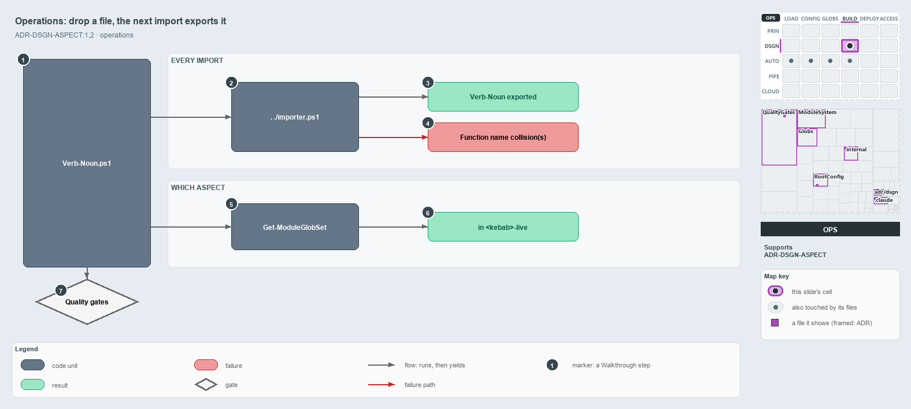

# docs/explanation/design/drop-a-file-the-import-exports-it.md

`Drop a file, and the next import exports it`

```text
Drop a file, and the next import exports it; no registration step exists.

1  Verb-Noun.ps1               the one file the author adds
2  . ./importer.ps1            the import: regenerates every manifest
3  Verb-Noun exported          a root function is exported
4  Function name collision(s)  a duplicate or shadowing name throws first
5  Get-ModuleGlobSet           returns the module's two aspect sets
6  In <kebab>-live             the new file is in the live set: it ships
7  Quality gates               report a non-conventional folder or file

Supports ADR-DSGN-ASPECT#1 and #2 (operations lens).
```

Adding a function to a cats module has no registration step. The author drops a `Verb-Noun.ps1` file into the module folder, the next import
exports it, and `Get-ModuleGlobSet` shows that the file belongs to the module's live aspect. The importer and the quality gates do the rest,
and each failure they raise names the file or function at fault.



The diagram is described element by element in
[its asset description](../../.assets/explanation/adr-dsgn-aspect--drop-a-file-the-import-exports-it--operations.drawio.md).

## Walkthrough

1. **Verb-Noun.ps1.** The author adds one file, `Verb-Noun.ps1` at the module root or `private/<Verb-Noun>.ps1`. Nothing else is edited: the
   folder is the registration.
2. **. ./importer.ps1.** The importer is dot-sourced and hands over to `Invoke-Importer`, whose `Import-AllModules` regenerates every
   module's manifest on every import.
3. **Verb-Noun exported.** A function at the module root is exported. A function in `private/` is loaded into the module but not exported.
4. **Function name collision(s).** A duplicate exported name, or one that shadows a vendored or built-in command, throws before any module
   loads, with the message "Function name collision(s) detected before import".
5. **Get-ModuleGlobSet.** Run with `-Name <Module>`, it returns both of the module's aspect sets, `<kebab>-live` and `<kebab>-tests`.
6. **In &lt;kebab&gt;-live.** A new root `*.ps1` or `private/` file is in the live set, so it ships. Files in `tests/` and `assets/`, and a
   stray root file that is not a `.ps1`, fall to `<kebab>-tests` and never ship.
7. **Quality gates.** `Test-FolderConventions` reports a subfolder that is "not a conventional module folder (private, tests, assets, types,
   configs)", and a `*.Tests.ps1` dropped at the module root: the loader skips such a file, but it matches the live pattern `*.ps1`, and
   tests belong in `tests/`. `Test-SourceConventions` reports a file that holds more or fewer than one top-level function.

## Why it holds

- A module's files partition into a `live` aspect and a `tests` aspect, with no file in both and none in neither (ADR-DSGN-ASPECT#1).
- The aspects come from folder conventions, never from a hand-written list; `live` is closed, so a file can enter it only by matching the
  convention (ADR-DSGN-ASPECT#2).

## Where the code and the ADR differ

ADR-REPO-FOLDERS#10 says unknown folders are ignored, not errors. The loader does skip them, but `Test-FolderConventions` reports every
non-conventional module subfolder as an issue.

## See also

- [Module aspects](../../adr/design/module-aspects.md) — the decision this article explains.
- The other lenses on the same layout: [meta](every-file-in-exactly-one-aspect.md), [architecture](one-folder-two-independent-readers.md),
  [implementation](manifest-and-aspects-from-one-folder.md) and [governance](partition-integrity-runs-only-in-unit-tests.md).
- [The design explanations](index.md) · [How to read the diagrams](../index.md#how-to-read-the-diagrams)
