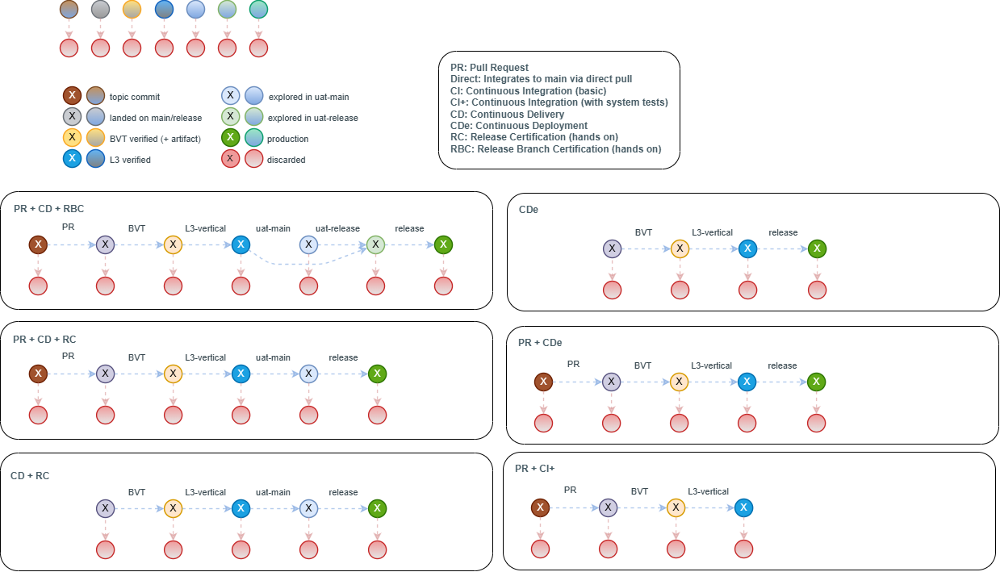

---
catzc:
  derived:
    path: docs/explanation/design/each-pipeline-shape-runs-a-stretch-of-the-ladder.md
    kind: explanation
    body_sha: cebebf5daac9
    adrs:
      - ADR-DSGN-LIFE#1
      - ADR-DSGN-LIFE#2
      - ADR-DSGN-LIFE#8
      - ADR-FLOW-CD#10
      - ADR-FLOW-CD#9
    links:
      - docs/.assets/commits-quality/state-changes.drawio.png
      - docs/adr/design/commit-lifecycle.md
      - docs/adr/design/commit-lifecycle.md#rule-adr-dsgn-life1
      - docs/adr/design/commit-lifecycle.md#rule-adr-dsgn-life2
      - docs/adr/design/commit-lifecycle.md#rule-adr-dsgn-life8
      - docs/adr/flow/cd-discipline-and-promotion-flow.md
      - docs/adr/flow/cd-discipline-and-promotion-flow.md#rule-adr-flow-cd10
      - docs/adr/flow/cd-discipline-and-promotion-flow.md#rule-adr-flow-cd9
      - docs/explanation/design/index.md
      - docs/explanation/design/ten-commits-trace-the-whole-lifecycle.md
      - docs/explanation/index.md#how-to-read-the-diagrams
---

# Each pipeline shape runs a stretch of the same ladder

```text
Six pipeline shapes each run a stretch of one promotion ladder, and a commit can leave it at any step.

1  the legend    seven commit states, each with a crossed discard
2  the terms     PR, Direct, CI, CI+, CD, CDe, RC and RBC, each in one line
3  the shapes    six panels, each a different stretch of the ladder
4  the exit      under every step a dashed arrow to discarded

Supports ADR-DSGN-LIFE#1, #2 and #8, and ADR-FLOW-CD#9 and #10.
```

There is one promotion ladder, and cats has more than one way to run it. A shape is the choice of how a commit gets onto the ladder and how
far it climbs. This diagram draws the six shapes side by side, each as a row of steps joined by arrows, so the difference between them is
which steps they include and where the row ends.



## Walkthrough

1. **The legend.** Seven states, each drawn as a crossed circle (the commit is in that state) and a plain circle (the state itself): topic
   commit, landed on main/release, BVT verified with its artifact, L3 verified, explored in main-UAT, explored in release-uat, and
   production. Discarded is the eighth, in red. Along the top, each state has a red discard circle under it with a dashed arrow, which is
   the exit every step has.
2. **The terms.** PR is a pull request, and Direct integrates to main by a direct pull. CI is basic continuous integration, and CI+ adds
   system tests. CD is continuous delivery, and CDe is continuous deployment. RC and RBC are the two hands-on certifications, of the release
   and of the release branch.
3. **PR + CD + RBC.** The longest shape: topic, landed, BVT-verified, L3-verified, explored in main-UAT, explored in release-uat, then
   production. The arrows are labelled PR, BVT, L3-vertical, main-UAT, release-uat and release. A curved arrow lets a commit go from
   L3-verified straight to release-uat without being explored in main-UAT.
4. **PR + CD + RC.** The same start, but with only main-UAT before release. There is no release-uat step, so the hands-on certification
   happens once.
5. **CD + RC.** There is no topic commit and no PR step: the commit starts as landed, then BVT, L3-vertical, main-UAT and release.
6. **CDe.** Landed, BVT, L3-vertical, then release. There is no hands-on step, so nothing waits for a human between L3 and production.
7. **PR + CDe.** CDe with a PR in front: topic, landed, BVT, L3-vertical and release.
8. **PR + CI+.** The shortest shape: topic, landed, BVT and L3-vertical, where it ends as L3-verified and never reaches an environment
   beyond that.

## Why it holds

- Every shape climbs the same ladder in the same order, so a colour means the same durable fact in every panel
  ([ADR-DSGN-LIFE#1](../../adr/design/commit-lifecycle.md#rule-adr-dsgn-life1)).
- Every step has an exit to discarded, and the discarded commit stays in history
  ([ADR-DSGN-LIFE#2](../../adr/design/commit-lifecycle.md#rule-adr-dsgn-life2)).
- A failed step stops the commit going further in every shape ([ADR-DSGN-LIFE#8](../../adr/design/commit-lifecycle.md#rule-adr-dsgn-life8)).
- RC and RBC are defined by the flow model, and the acceptance testing that clears them is separate from the environment it runs in
  ([ADR-FLOW-CD#9](../../adr/flow/cd-discipline-and-promotion-flow.md#rule-adr-flow-cd9),
  [ADR-FLOW-CD#10](../../adr/flow/cd-discipline-and-promotion-flow.md#rule-adr-flow-cd10)).

## See also

- [The commit lifecycle](../../adr/design/commit-lifecycle.md) — the decision this article explains.
- [Cd discipline and promotion flow](../../adr/flow/cd-discipline-and-promotion-flow.md) — the pipeline kinds and the RC and RBC gates.
- [Ten numbered commits trace the whole lifecycle](ten-commits-trace-the-whole-lifecycle.md) — the same ladder with ten real commits on it.
- [The design explanations](index.md) · [How to read the diagrams](../index.md#how-to-read-the-diagrams)
