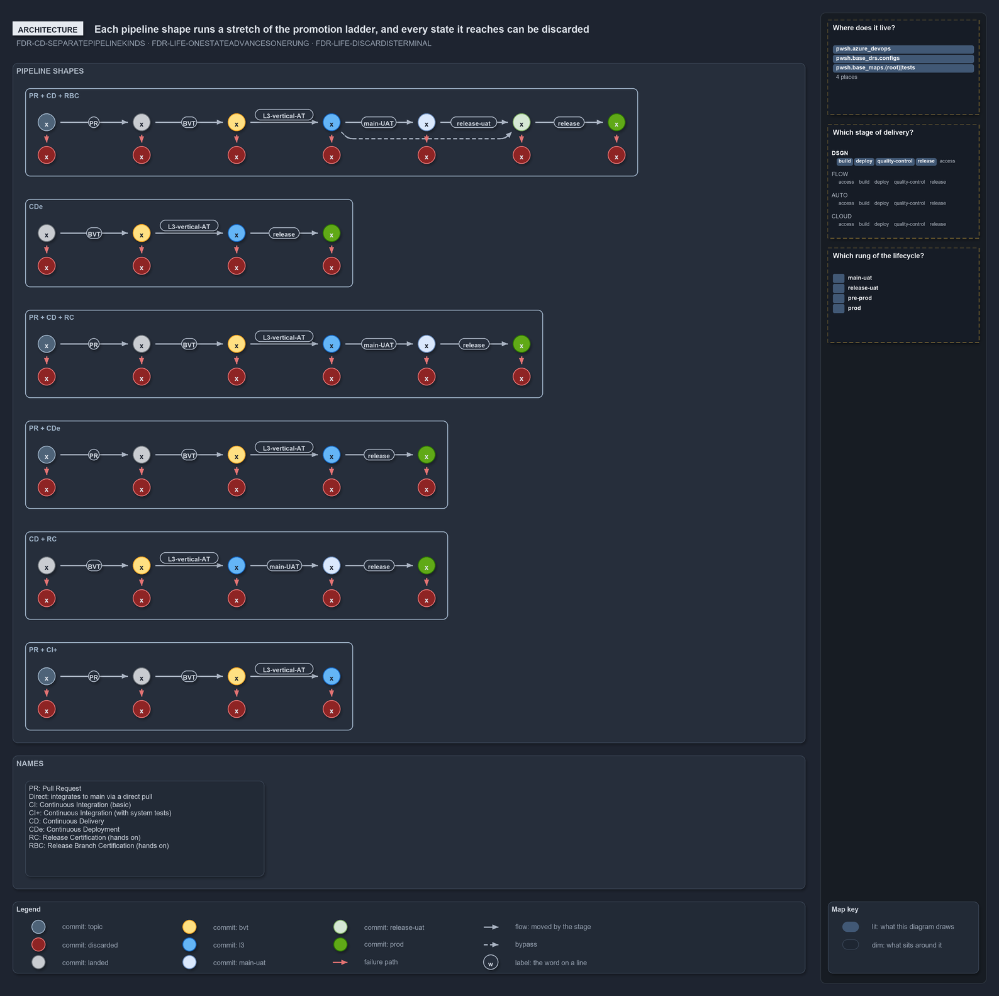

---
catzc:
  warning: "Header is generated by Format-FileMeta via Format-Code; do not change it"
  edges:
    cites:
      - FDR-CD-TWORELEASEGATES
      - FDR-CD-ACCEPTANCETESTINGISNOTUAT
      - FDR-CD-LIFE-ONESTATEADVANCESONERUNG
      - FDR-CD-LIFE-DISCARDISTERMINAL
      - FDR-CD-LIFE-FAILEDSTAYSUPSTREAM
    drs_total: 6
---

# Each pipeline shape runs a stretch of the same ladder

```text
Six pipeline shapes each run a stretch of one promotion ladder, and a commit can leave it at any step.

1  the legend    seven commit states, each with a crossed discard
2  the terms     PR, Direct, CI, CI+, CD, CDe, RC and RBC, each in one line
3  the shapes    six panels, each a different stretch of the ladder
4  the exit      under every step a dashed arrow to discarded

Supports FDR-CD-LIFE-ONESTATEADVANCESONERUNG, FDR-CD-LIFE-DISCARDISTERMINAL and FDR-CD-LIFE-FAILEDSTAYSUPSTREAM, and FDR-CD-TWORELEASEGATES and FDR-CD-ACCEPTANCETESTINGISNOTUAT.
```

There is one promotion ladder, and cats has more than one way to run it. A shape is the choice of how a commit gets onto the ladder and how
far it climbs. This diagram draws the six shapes side by side, each as a row of steps joined by arrows, so the difference between them is
which steps they include and where the row ends.

```yml drawio
description:
  "Six pipeline shapes, each a run of the promotion ladder from its first state: every step a commit takes is labelled with the stage that
  moves it, and every state it holds can be discarded."
about:
  adrs: [FDR-CD-SEPARATEPIPELINEKINDS, FDR-CD-LIFE-ONESTATEADVANCESONERUNG, FDR-CD-LIFE-DISCARDISTERMINAL]
  lens: architecture
content:
  title: Each pipeline shape runs a stretch of the promotion ladder, and every state it reaches can be discarded
  kind: explanation
  flow: top-to-bottom
  relation: moved by the stage
  theme: dark
  bands:
    - { id: band-shapes, label: PIPELINE SHAPES }
    - { id: band-key, label: NAMES }
  templates:
    pipeline-shape:
      states: { PR: landed, BVT: bvt, L3-vertical-AT: l3, main-UAT: main-uat, release-uat: release-uat, release: prod }
      drop: discarded
  rows:
    - id: pr-cd-rbc
      template: pipeline-shape
      label: PR + CD + RBC
      in: band-shapes
      start: topic
      steps: [PR, BVT, L3-vertical-AT, main-UAT, release-uat, release]
      skip: [main-UAT]
    - id: cde
      template: pipeline-shape
      label: CDe
      in: band-shapes
      start: landed
      steps: [BVT, L3-vertical-AT, release]
    - id: pr-cd-rc
      template: pipeline-shape
      label: PR + CD + RC
      in: band-shapes
      start: topic
      steps: [PR, BVT, L3-vertical-AT, main-UAT, release]
    - id: pr-cde
      template: pipeline-shape
      label: PR + CDe
      in: band-shapes
      start: topic
      steps: [PR, BVT, L3-vertical-AT, release]
    - id: cd-rc
      template: pipeline-shape
      label: CD + RC
      in: band-shapes
      start: landed
      steps: [BVT, L3-vertical-AT, main-UAT, release]
    - id: pr-ci-plus
      template: pipeline-shape
      label: PR + CI+
      in: band-shapes
      start: topic
      steps: [PR, BVT, L3-vertical-AT]
  notes:
    - id: note-names
      in: band-key
      text: "PR: Pull Request

        Direct: integrates to main via a direct pull

        CI: Continuous Integration (basic)

        CI+: Continuous Integration (with system tests)

        CD: Continuous Delivery

        CDe: Continuous Deployment

        RC: Release Certification (hands on)

        RBC: Release Branch Certification (hands on)"
  legend: auto
  minimaps: [axis, lifecycle-position, layer-stack]
```



## Walkthrough

1. **The legend.** Seven states, each drawn as a crossed circle (the commit is in that state) and a plain circle (the state itself): topic
   commit, landed on main/release, BVT verified with its artifact, L3 verified, explored in main-UAT, explored in release-uat, and
   production. Discarded is the eighth, in red. Along the top, each state has a red discard circle under it with a dashed arrow, which is
   the exit every step has.
2. **The terms.** PR is a pull request, and Direct integrates to main by a direct pull. CI is basic continuous integration, and CI+ adds
   system tests. CD is continuous delivery, and CDe is continuous deployment. RC and RBC are the two hands-on certifications, of the release
   and of the release branch.
3. **PR + CD + RBC.** The longest shape: topic, landed, BVT-verified, L3-verified, explored in main-UAT, explored in release-uat, then
   production. The arrows are labelled PR, BVT, L3-vertical, main-UAT, release-uat and release. A curved arrow lets a commit go from
   L3-verified straight to release-uat without being explored in main-UAT.
4. **PR + CD + RC.** The same start, but with only main-UAT before release. There is no release-uat step, so the hands-on certification
   happens once.
5. **CD + RC.** There is no topic commit and no PR step: the commit starts as landed, then BVT, L3-vertical, main-UAT and release.
6. **CDe.** Landed, BVT, L3-vertical, then release. There is no hands-on step, so nothing waits for a human between L3 and production.
7. **PR + CDe.** CDe with a PR in front: topic, landed, BVT, L3-vertical and release.
8. **PR + CI+.** The shortest shape: topic, landed, BVT and L3-vertical, where it ends as L3-verified and never reaches an environment
   beyond that.

## Why it holds

- Every shape climbs the same ladder in the same order, so a colour means the same durable fact in every panel
  ([FDR-CD-LIFE-ONESTATEADVANCESONERUNG](../../drs/flow/commit-lifecycle.md#rule-fdr-cd-life-onestateadvancesonerung)).
- Every step has an exit to discarded, and the discarded commit stays in history
  ([FDR-CD-LIFE-DISCARDISTERMINAL](../../drs/flow/commit-lifecycle.md#rule-fdr-cd-life-discardisterminal)).
- A failed step stops the commit going further in every shape
  ([FDR-CD-LIFE-FAILEDSTAYSUPSTREAM](../../drs/flow/commit-lifecycle.md#rule-fdr-cd-life-failedstaysupstream)).
- RC and RBC are defined by the flow model, and the acceptance testing that clears them is separate from the environment it runs in
  ([FDR-CD-TWORELEASEGATES](../../drs/flow/cd-discipline-and-promotion-flow.md#rule-fdr-cd-tworeleasegates),
  [FDR-CD-ACCEPTANCETESTINGISNOTUAT](../../drs/flow/cd-discipline-and-promotion-flow.md#rule-fdr-cd-acceptancetestingisnotuat)).

## See also

- [The commit lifecycle](../../drs/flow/commit-lifecycle.md) — the decision this article explains.
- [Cd discipline and promotion flow](../../drs/flow/cd-discipline-and-promotion-flow.md) — the pipeline kinds and the RC and RBC gates.
- [Ten numbered commits trace the whole lifecycle](ten-commits-trace-the-whole-lifecycle.md) — the same ladder with ten real commits on it.
- [The design explanations](index.md) · [How to read the diagrams](../index.md#how-to-read-the-diagrams)
