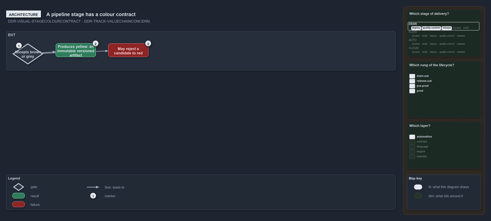

---
catzc:
  warning: "Experimental: this article merges two rules into one and holds nothing beyond what they say"
  edges:
    cites:
      - DDR-VISUAL-STAGECOLOURCONTRACT
      - DDR-TRACK-VALUECHAINCONCERN
---

# Each pipeline stage has a fixed colour contract and a concern says where record acts

This article is one rule: [DDR-VISUAL-STAGECOLOURCONTRACT](../../drs/design/visual-design.md#rule-ddr-visual-stagecolourcontract) and
[DDR-TRACK-VALUECHAINCONCERN](../../drs/design/tracks.md#rule-ddr-track-valuechainconcern) merged into one. It holds nothing beyond what
those two rules say.

Each pipeline stage has a fixed colour contract: the input colours it accepts, the output colour it produces, and that it may reject to red.
BVT accepts brown or grey and produces yellow, an immutable versioned artifact. A value-chain concern is one of the six columns that say
where along delivery a decision record acts, in value-chain order, starting from `automation` and `build`, then `quality-control`.

